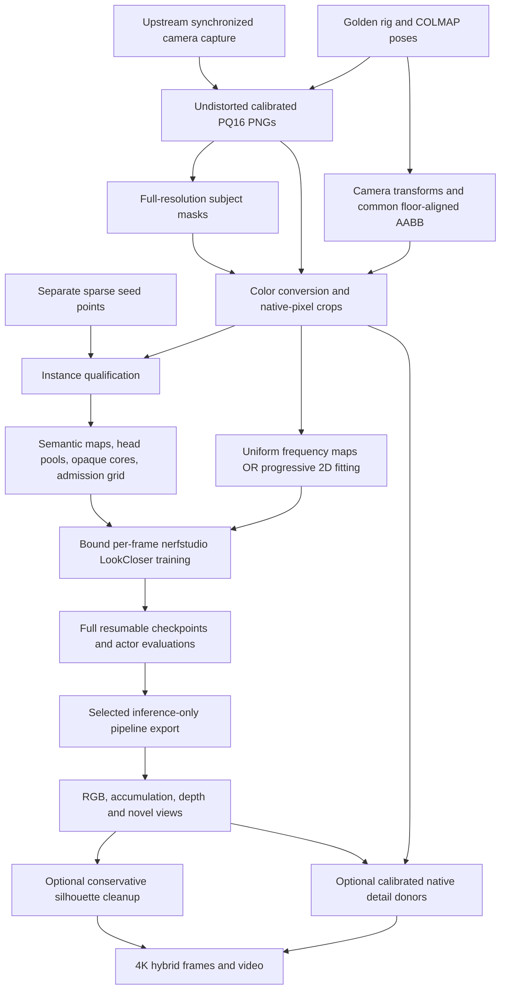

# LookCloser + nerfstudio: end-to-end engineering knowledge transfer

**Audience:** an engineer or LLM taking over the implementation, reproducing a solve, debugging artifacts, or moving the pipeline to another machine.

**Snapshot:** 2026-11-12. Repository: `snarb/nerfstudio`. Working branch: `scene/marshawn908-silver-handoff-20261111`. Source baseline inspected for this document: commit `5787b90f`. Paths below are relative to `LookCloser/` unless described as host paths. `../nerfstudio/` is the Python package in the parent repository, not another checkout.

**Scope:** the core LookCloser implementation, its generic nerfstudio integration, and the measured native-resolution Marshawn production pipeline. Historical Luster, Misha, Marshawn1660, and generic bounded Instant-NGP experiments are related references, not interchangeable recipes. This document describes existing code; it does not claim every optional configuration has been validated.

## Read this before operating anything

1. **LookCloser is a NeRF implementation.** It is not an image enhancement stage whose result is passed to a different NeRF. Its optional 2D image-frequency fitting is preprocessing; its frequency-aware 3D radiance field is the model trained by nerfstudio.
2. **The current Marshawn deliverable is 72 independent static models**, for source frames `908 + 5*i`, `i=0..71`: 908 through 1263. At 120 source fps this gives 24 fps coverage for a three-second output. There is no jointly trained temporal/4D field here.
3. **Training was explicitly stopped by the user.** Old queues and script defaults covering all 361 frames 908–1268 are obsolete. Do not restart a campaign, agent, or dense scheduler merely to inspect it.
4. **silver-sable's `/cache` has been lost.** Historical completion records prove that models existed, not that they remain recoverable. The latest audit found 20 of the 72 selected final checkpoints elsewhere; 52 selected checkpoints have no identified surviving copy. Source PNGs for all 72 time instants were present on WS07/WS08 at the audit. See [the recovery audit](experiments/marshawn_silver_cache_loss_recovery.md) and [machine-readable evidence](experiments/marshawn_silver_cache_loss_recovery.json).
5. The selected recipe uses **native-pixel crops, not resized training RGB**. “Full HD” was the normal output/review size. Later 4K hybrid output does not mean inputs were trained at 4K or that the earlier field was limited to Full HD.
6. The architecture has several spatial filters. The **AABB**, **semantic admission grid**, **learned occupancy grid**, **frequency grid**, and **output matte** have different jobs. Confusing them causes missing geometry and broken silhouettes.
7. Preserve the **exact checkpoint, code, configuration, calibration, data manifests, and dependencies** together. An exported tensor file alone is not a complete reproducibility package.

## Contents

- [1. Sources of truth and reading order](#1-sources-of-truth-and-reading-order)
- [2. System overview and artifact boundaries](#2-system-overview-and-artifact-boundaries)
- [3. NeRF fundamentals used by this code](#3-nerf-fundamentals-used-by-this-code)
- [4. Input acquisition, synchronization, and SfM](#4-input-acquisition-synchronization-and-sfm)
- [5. Coordinates, calibration, and the scene box](#5-coordinates-calibration-and-the-scene-box)
- [6. Color processing and native crops](#6-color-processing-and-native-crops)
- [7. Masks, instances, confidence, and admission](#7-masks-instances-confidence-and-admission)
- [8. Frequency preprocessing and 3D frequency updates](#8-frequency-preprocessing-and-3d-frequency-updates)
- [9. The field, feature reweighting, and ray marching](#9-the-field-feature-reweighting-and-ray-marching)
- [10. Training, objectives, and the measured recipe](#10-training-objectives-and-the-measured-recipe)
- [11. Evaluation and checkpoint selection](#11-evaluation-and-checkpoint-selection)
- [12. Per-frame execution, durability, and distribution](#12-per-frame-execution-durability-and-distribution)
- [13. Checkpoint contracts and inference](#13-checkpoint-contracts-and-inference)
- [14. Rendering, background removal, and hybrid detail transfer](#14-rendering-background-removal-and-hybrid-detail-transfer)
- [15. Environment and reproduction runbook](#15-environment-and-reproduction-runbook)
- [16. Storage, recovery, and migration](#16-storage-recovery-and-migration)
- [17. Debugging guide and engineering acceptance gates](#17-debugging-guide-and-engineering-acceptance-gates)
- [18. Glossary](#18-glossary)
- [Appendix A: exact selected configuration](#appendix-a-exact-selected-configuration)
- [Appendix B: sequence script and CLI reference](#appendix-b-sequence-script-and-cli-reference)
- [Appendix C: core implementation symbol map](#appendix-c-core-implementation-symbol-map)
- [Appendix D: core configuration defaults](#appendix-d-core-configuration-defaults)

## 1. Sources of truth and reading order

The local [Paper LookCloser.md](<Paper LookCloser.md>) contains the paper text, figures, and links. Use it before looking for an external copy. The paper motivates the design; measured results and the actual bound runtime determine what produced a particular checkpoint.

Read these in order:

| Source | What it establishes | Important limitation |
|---|---|---|
| This document | Mental model, interfaces, operational map | Snapshot, not a live machine inventory |
| [Local paper](<Paper LookCloser.md>) | Frequency-aware NeRF design | Paper defaults are not the final Marshawn recipe |
| [Architecture](architecture.md) | Implementation history and design notes | Contains multiple scenes and experiments |
| [Tuned recipe report](experiments/marshawn_908_1268_tuned_recipe.md) | Measured first-frame comparisons | Six-hour search does not prove a global optimum |
| [Selected recipe JSON](experiments/marshawn_908_1268_selected_recipe.json) | Original measured settings and selection evidence | Original admission rule preceded the thin-prop repair |
| [Three-vote recipe JSON](experiments/marshawn_908_1268_admission_votes3_recipe.json) | Versioned conservative admission repair | Read each frame's binding to know which version it used |
| [Selected models](experiments/marshawn_908_1268_sparse24_selected_models.json) | Intended selected model identity per frame | Existence must be checked separately |
| [Historical storage audit](experiments/marshawn_908_1268_sparse24_storage_audit.json) | Checkpoint hashes and historical placement | Predates cache loss |
| [Recovery audit](experiments/marshawn_silver_cache_loss_recovery.md) | Latest verified surviving copies | Does not establish infrastructure snapshots exist |
| [Hybrid report](experiments/marshawn_flying_native_hybrid_4k.md) | 4K rendering method and delivery | Rendered PNGs do not replace model checkpoints |

For conflicting instructions: explicit current user scope wins over stale campaign defaults. For conflicting parameter values: the specific run's immutable spec/binding and checkpoint metadata win over generic defaults. Do not combine convenient fragments from different experiments and call that an exact reproduction.

The generic repository evaluation rule selects highest all-eval PSNR with LPIPS as a tie-breaker within 0.07 dB. The Marshawn campaign explicitly prioritizes masked-person LPIPS; its production selection follows that specialized rule. Both policies exist, and they must not be silently interchanged.

## 2. System overview and artifact boundaries



The arrows are data dependencies, not a requirement to run every branch. The winning Marshawn configuration uses constant frequency maps, so the expensive progressive 2D fitting branch is unnecessary for a fresh production frame with that recipe. Hybrid rendering and matting are postprocessing; they do not alter the saved radiance field.

| Stage | Inputs | Outputs | Principal implementation |
|---|---|---|---|
| Acquisition | Already processed S3 assets and calibrated rig | Local PNGs, calibration, seed points | Upstream transfer scripts; dataset inventory |
| Native preparation | One time instant, 72 images/masks, box, split | Cropped RGB, transforms, semantics, provenance | `prepare.py` |
| Instance qualification | Native images, subject union, SAM3, seed points | Per-camera people/head masks and crew exclusions | `parts.py`, `qualify_parts.py` |
| Frequency preprocessing | Native RGB or uniform policy | Patch-grid float tensors and metadata | `frequency.py`, `assets.py` |
| Dataset assembly | Native artifacts, recipe | Sealed train/eval dataset variants | `assets.py`, `admission_vote_variant.py` |
| Training | Dataset, bound config/code, CUDA environment | Full pipeline and optimizer checkpoints | `runtime.py`, `worker.py`, `worker_background.py` |
| Selection/export | Scored checkpoints at selected inference cap | `model/inference.ckpt`, manifest, receipts | `production.py`, `archive.py` |
| Inference | Export, matching runtime and supporting dataset | RGB/alpha/depth images | `inference.py`, `render_fullhd.py` |
| Delivery | Render sequence, cameras, optional native donors | PNGs, MP4, validation receipts | Flight, matte, hybrid, and encoding scripts |

All short script names in the table are under [scripts/marshawn_sequence/](scripts/marshawn_sequence/). Appendix B lists every Python file there with its role, entry points, and declared CLI arguments.

## 3. NeRF fundamentals used by this code

### 3.1 What is learned

A neural radiance field is a function of spatial position and viewing direction:

```text
F_theta(x, d) -> density sigma(x), view-dependent color c(x, d)
```

`theta` includes learned multiresolution hash-grid features and small neural-network weights. Density describes how much light a ray absorbs per distance; it is not a segmentation class. Color can depend on direction to represent appearance changes across views. The model does not store one texture image per camera and is not a mesh.

Each training example is a calibrated camera ray and an observed RGB pixel. Camera intrinsics generate the ray direction; camera extrinsics place it in the common scene coordinates. The training process samples locations on that ray, queries the field, integrates them, and updates parameters to explain the observed pixel.

### 3.2 Volume rendering

For sample interval `i`, with density `sigma_i`, interval length `delta_i`, and color `c_i`:

```text
alpha_i = 1 - exp(-sigma_i * delta_i)
T_i     = product over j<i of (1 - alpha_j)
w_i     = T_i * alpha_i
RGB     = sum_i(w_i * c_i) + T_end * background_color
A       = sum_i(w_i)
```

`A` is accumulated opacity. A weighted depth can be formed from `sum(w_i * t_i)`, possibly divided by total opacity or replaced by a median/quantile statistic. **Depth definitions are not interchangeable.** Inspect the renderer and consumer: expected distance, conditional expected distance, camera-z, and q10/q50/q90 distance have different behavior around hair, empty space, and overlapping bodies.

A black RGB pixel does not prove empty space. It may be black clothing, a zero-filled unqueried canvas, a background-composited ray, or a postprocessing hole. Inspect raw RGB, accumulation, sample count, and depth together.

### 3.3 What nerfstudio contributes

nerfstudio supplies cameras/rays, data parsing, datamanagers, training lifecycle, optimizers, callbacks, checkpoint machinery, metrics, and rendering interfaces. The LookCloser extension supplies the field, frequency grid, frequency-guided pixel sampling and marching, and its specialized pipeline. The Marshawn wrapper adds native crops, semantic confidence/admission, actor metrics, immutable bindings, and distributed orchestration.

The training chain is:

```text
Trainer -> LookCloserPipeline -> datamanager/pixel sampler -> RayBundle
        -> LookCloserModel -> collider + occupancy/ARM sampler
        -> LookCloserField -> volume renderers -> objectives -> backward/optimizer
```

The production model additionally uses a frozen semantic-admission subclass. A plain `ns-train lookcloser` invocation is a useful generic entry point, but **does not recreate all campaign wrappers**.

## 4. Input acquisition, synchronization, and SfM

### 4.1 What was actually acquired

This campaign started from processed, synchronized, undistorted images. It did not decode R3D originals locally and did not rerun a new SfM solve. Original extraction software and exact upstream decoding commands are outside this checkout's verified pipeline. Do not invent a RED extraction command and present it as the historical process.

The source is `Marshawn_2_1`, 72 cameras, 120 source frames/second. WS07 originally held frames 908–1111; WS08 held 1112–1314. The complete range is 407 source instants. The production three-second subset is 72 instants spaced by five source frames.

The mirrored storage convention is:

```text
s3://aina-lustre-west-2/<key>/...
/fsx/oregon/<key>/...                 upstream shared filesystem convention
/raid/lookcloser/s3/<key>/...         workstation mirror
```

Main 66-camera key:

```text
gta_marshawn_2_1_prep_20261028/root/Marshawn_2_1/working/fullres_pq16/
  <frame:06d>/images/<CAM>_<frame:06d>.png
```

Extra cameras `AE BE KE LD LE ME` use:

```text
gta_marshawn_2_1_pq16_6cams_f0908-1314_20261107/root/Marshawn_2_1/working/fullres_pq16/
  <frame:06d>/images/<CAM>_<frame:06d>.png
```

The PNGs are 16-bit RGB, PQ/ST2084, AP1 primaries adapted to D65, with 4000-nit source peak. Undistortion produces camera-dependent canvases roughly 8458–8495 by 4362–4371. Use each camera's actual dimensions; do not replace them with 8192×4320 because that was the distorted sensor canvas.

Historical transfer/segmentation scripts include `/raid/lookcloser/png_half.sh`, `/raid/lookcloser/mask8k/golden_copy.sh`, `/raid/lookcloser/mask8k/mask8k_prod.py`, and `run_prod.sh`. These are host paths, not a promise that those exact versions are committed in this repository. Preserve them with their own hashes when migrating provenance.

### 4.2 What SfM normally does

For a new scene without calibration, a typical structure-from-motion workflow extracts image features, matches them across views, estimates camera poses, triangulates sparse 3D points, and jointly refines poses/intrinsics/points with bundle adjustment. Undistortion then produces images and a compatible pinhole camera model.

For moving performers, synchronized cameras at one instant are the relevant multiview observation set. Treating arbitrary times as a single static SfM scene can triangulate inconsistent actor geometry. A locked calibrated rig may provide camera poses across all times without resolving the rig for every frame.

This dataset already has the golden production rig, calibrated on this take at frame 1550. The 72-camera fingerprint begins `8bb4293e`; its scale is **1.0805 rig units/metre**. The 66-camera subset fingerprint begins `5739b71c`. Per-frame undistorted cameras are `PINHOLE`; the original rig uses `OPENCV` distortion on the original canvas. Those intrinsics are not substitutes for one another.

### 4.3 COLMAP file meanings

| File | Meaning | How this pipeline uses it |
|---|---|---|
| `cameras.txt` | Camera model, dimensions, intrinsics, distortion if applicable | Correct undistorted calibration |
| `images.txt` | Image IDs/names, world-to-camera quaternion and translation, observations | Pose conversion and image association |
| `points3D.txt` | XYZ, color, reprojection error, track observations | Sparse witnesses; generic frequency initialization when wired |
| Rig/config/fingerprint files | Rig identity and calibration provenance | Prevent mixing incompatible calibration packages |

The per-frame pose directories contain intentionally empty `points3D.txt` files. That is not a failed download. Separate seed point clouds are under:

```text
gta_marshawn_2_1_points3d_72cams_f0908-1314_20261107/
  root/Marshawn_2_1/golden/frames/<frame:06d>/sparse/text/points3D.txt
```

The 72-camera per-frame calibration is under the extra-camera key's:

```text
sparse72/root/Marshawn_2_1/working/fullres/<frame:06d>/sparse/text/
```

Seed points are not a dense surface or a trained model. In the sequence pipeline they qualify person instances against the common box. The core LookCloser grid also implements sparse initialization, but the sequence worker explicitly checks a cold zero frequency/occupancy state. **Do not claim the production field was initialized from a dense COLMAP reconstruction merely because seed files were present.**

## 5. Coordinates, calibration, and the scene box

### 5.1 Pose conversion

COLMAP stores a world-to-camera transform `x_cam = R*x_world + t`. Its camera convention is right/down/forward. nerfstudio camera-to-world convention uses right/up/backward. The conversion used by preparation is conceptually:

```text
R_c2w = R.T @ diag(1, -1, -1)
C     = -R.T @ t
```

Apply the accepted `world_to_box` rigid transform to camera centers/orientations and 3D points consistently. Then apply the selected isotropic model scale to positions and bounds. Do not scale a rotation matrix or focal lengths when changing world units.

### 5.2 Common floor-aligned box

The accepted physical box in its floor-aligned coordinate system is:

```text
minimum = [-0.41, -1.20, -0.15]
maximum = [ 3.41,  5.14,  1.77]
```

These are rig-coordinate units before the additional model scale. The full rotation/translation is reproduced in Appendix A from the canonical recipe. The box is axis aligned **after** `world_to_box`, so its bottom/top planes are parallel to the fitted floor. Testing raw COLMAP XYZ directly against these numbers is incorrect.

The common box was chosen to cover the fighting performers across the action, not crew and not just two people from the earlier temporal range. It is shared across the selected frames. A box visualized from one camera or one time is insufficient: validate projected coverage through time and from multiple views, especially extended props, feet, dreadlocks, and a falling hat.

Selected model scale is `0.2217203609534452`. Thus one metre corresponds to `1.0805 * 0.2217203609534452` model units. Sampling step lengths are expressed in model units. Changing this scale without changing the effective stepping/frequency behavior is a scientific change, not a harmless serialization edit.

### 5.3 Disable implicit parser normalization

The runtime asserts:

```text
orientation_method = none
center_method      = none
auto_scale_poses   = False
scale_factor       = 1
scene_scale        = 1
downscale_factor   = 1
eval_mode          = filename
```

It overrides the parsed scene box using the dataset's `box.json`. Automatic centering/orientation/scaling would invalidate the bound AABB, sparse witnesses, admission grid, and historical step sizes.

### 5.4 Cropping preserves rays

For native crop origin `(x0,y0)`:

```text
fx_crop = fx_source; fy_crop = fy_source
cx_crop = cx_source - x0; cy_crop = cy_source - y0
pose_crop = pose_source
```

The source pixel at `(x0+x,y0+y)` and crop pixel `(x,y)` must generate the same ray. This should be tested numerically, including pixel-center conventions. Resizing requires scaling focal lengths and principal point; cropping does not. The worker also verifies ray parity when rendering person ROIs for evaluation.

## 6. Color processing and native crops

### 6.1 Preparation sequence

[prepare.py](scripts/marshawn_sequence/prepare.py) merges camera membership, reads the corresponding native RGB and full-resolution subject mask, derives a subject bounding crop with margin, performs color conversion, shifts intrinsics, and writes per-camera records plus aggregate manifests.

The crop extent uses low-alpha subject support (`alpha >= 16`) with a 128-pixel margin. Actor membership elsewhere uses the stronger threshold (`alpha >= 128`). These thresholds serve different purposes: preserve fine extent when choosing the raster, use stable interior semantics for sampling/qualification. Do not replace both with one arbitrary threshold.

The source image is not downsampled. Different cameras can have different crop dimensions. This is why custom native raster gathering is needed rather than a naïve fixed-size image tensor stack.

### 6.2 Photometric transform

The prepared display-PNG path is conceptually:

```text
uint16 PQ code / 65535
  -> inverse ST2084 to luminance in nits
  -> AP1-D65 to linear Rec.709 RGB
  -> divide by 52.13360318135631 nits per scene-linear unit
  -> clamp negative RGB
  -> v = 1.6 * linear
  -> tone map v / (1 + v)
  -> sRGB transfer function
  -> 8-bit RGB PNG
```

The selected training path uses these display PNGs. “Native resolution” refers to spatial sampling, not retaining 16-bit linear photometry in the final training raster. Keep this distinction explicit when discussing detail quality.

The EXR variant stores the corresponding scene-linear crop in float32, changes the field's RGB parameterization to a positive linear output, and evaluates through the common display transform/reference. EXR is not additional sensor information; it preserves a different numeric/photometric representation of the same source capture. A matched experiment must hold cameras, crop, masks, model capacity, step budget, and evaluation display domain fixed.

The selected production recipe remains PNG. Do not adopt EXR solely because it is a higher-bit-depth format; require measured high-frequency/person-detail improvement. The trial code and report preserve the comparison path.

### 6.3 Typical prepared data tree

```text
frames/<frame>/
  native/
    images/<CAM>.png
    linear/...                     temporary linear masters, when retained
    masks/...                      parser masks; see semantic distinction below
    semantics/<CAM>.npz
    transforms.json
    box.json
    native_ready.json
    parts/<CAM>.json
    parts/<CAM>.npz
    points3D.txt                    separate seed source, when transferred
  data/                            assembled dataset
  data_confidence/                 historical confidence variant
  data_model/                      world/model-unit scale variant
  data_admission_votes3/           later conservative admission variant
  data_exr/                        optional, not selected PNG production path
```

Variants often share immutable files by symlink. A directory existing does not imply it is self-contained. Resolve symlinks and inspect manifests before copying or deleting a parent dataset.

## 7. Masks, instances, confidence, and admission

### 7.1 Full-resolution subject masks

Historical production SAM3 segmentation used coarse Bingo training masks to choose performers, then native-resolution 504-pixel tiles refined a ±64-pixel boundary band. The intended union includes the fighting performers and touching sticks, excluding studio crew. Output is an 8-bit soft-edge mask at source image resolution, stored under:

```text
/raid/lookcloser/masks8k/<frame:06d>/<CAM>_<frame:06d>.png
```

This upstream mask is evidence, not ground-truth physical opacity. Misclassified hair, thin props, overlapping clothing, and disconnected objects can affect every downstream stage. Inspect native patches before blaming the neural network.

### 7.2 Why parser masks are not the whole mask policy

The sequence creates all-white dataparser masks so rays remain available. Foreground selection is implemented by **semantic sampling weights, confidence, opaque-core priors, conservative background priors, and 3D admission**. Therefore “we used masks” is true, but “all RGB outside the mask was hard-cut to black before training” is an inaccurate description of this recipe.

Compatibility field names `black` and `grey` come from the earlier two-actor recipe. In this sequence, `black` stores the union of current performers and `grey` is an empty compatibility slot. Do not infer performer identities from these keys.

Semantic archives also contain validity, core/band information, soft alpha, and confidence-related data. `valid` describes eligible evidence, not necessarily foreground. Unknown people/crew must not become trusted clear-background evidence.

### 7.3 Instance/head proposals and crew qualification

`parts.py` runs current-image SAM3 person/head proposals, intersects accepted instances with the subject union, and writes camera-local IDs. Heads that are occluded can have empty proposals. A bounding-box “top of person” proxy is not substituted for a real head mask in the current sequence adapter.

`qualify_parts.py` rejects an apparent person as crew only with multiview sparse-point evidence:

- seed reprojection error below 2;
- track length at least 3;
- at least 8 projected witnesses for the instance;
- fewer than 20% of its witnesses inside the accepted common box.

Low-evidence instances remain unknown/reviewable instead of being confidently carved away. Instance IDs are local to one camera and one instant. They are not cross-view or temporal identity labels.

### 7.4 Confidence and sampling

The winning confidence profile is `historical_power`, native boundary width 64 and exponent `3.321928094887362`. Its purpose is to reduce the influence of uncertain foreground/background boundaries while keeping useful interior evidence. Preserve the implementation in `marshawn_actor_confidence.py`; replacing the curve with a linear ramp changes the objective.

The sampling adapter uses the inherited `body80` proposal and 0.15 head fraction, with exact rounded proposal expectation in its weighted Charbonnier normalization. It explicitly does **not** apply a generic inverse-probability `1/q` correction. The actor/head proposal, confidence curve, and normalization together define the objective. Changing one independently is not merely an optimization.

The frozen experimental adapter makes the mixture explicit. Let `phase = clamp((step-4096)/4096, 0, 1)`, `head = 0.15*phase`, `body = 2/3-head`, and `fas = 0.5*phase`. The five source probabilities are `[body*(1-fas), body*fas, 2/15, 1/5, head]`: core-uniform, person-FAS, protective band, whole valid image, and balanced head pools. Once fully ramped, these are approximately 25.833%, 25.833%, 13.333%, 20%, and 15%. Cameras are sampled uniformly. Integer batch quotas and the corresponding proposal expectation are computed together. Thus the historical name `body80` should not be read as a literal current 80% body / 20% everything-else partition. Empty eligible head pools fall back to core sampling; they do not fabricate a head label.

### 7.5 Opaque-core and clear-background priors

An actor core is eroded by 32 native pixels to avoid uncertain edges. The opaque-core prior, strength 0.01, discourages opacity deficits in that trusted interior. It cannot certify that every pixel near an edge should be opaque.

`worker_background.py` adds a separate weak empty-ray prior, selected strength 0.01. Trusted background must be valid, have exactly zero production soft alpha, be at least 64 native pixels from foreground in either axis, exclude unknown/crew people, and exclude a 64-pixel image border. The prior ramps from step 4096 to 12288 and penalizes squared accumulated opacity on those eligible rays.

This is not supervised alpha matting. The prior cannot automatically remove every background-colored halo at a silhouette, because silhouette-adjacent evidence is deliberately protected.

### 7.6 Semantic 3D admission: what the filter actually does

`assets.admission()` creates a 128³ boolean spatial support grid. It projects entire voxel-cell corners into training cameras and asks whether the cell is contradicted by trusted clear background. Outside a crop/FOV and uncertain/unknown observations are not negative evidence. A one-cell conservative padding preserves neighboring support.

The original rule excluded cells with two clear-background votes. The later versioned recipe raises the threshold to three, protecting thin props that erroneous masks could reject from two views. This repair is represented by `admission_background_votes: 3` and `admission_vote_variant.py`.

The grid is a conservative visual-hull-like **permission map**, not a learned mesh. It says where the field may be evaluated/occupied; it cannot add a missing object to RGB observations. If the filter removes a bat segment, additional optimization cannot learn density in the forbidden region. Rebuilding the admission data and retraining/rebinding is a different action from cleaning an output image.

The loading code verifies manifest hash, grid hash, semantic hashes, transforms, bounds, resolution, and training-camera membership. This prevents tuning heldouts from silently contributing training geometry. Final all-camera training intentionally uses all 72 cameras.

## 8. Frequency preprocessing and 3D frequency updates

### 8.1 Progressive 2D image fitting

The paper estimates local complexity by fitting an image with a small coordinate-based neural representation. More hash-grid levels expose higher spatial frequencies. For each image patch, record the earliest level at which reconstructed-patch SSIM crosses a threshold. The stored map is a spatial complexity estimate, not a foreground mask, depth map, or enhanced RGB image.

Core implementation: [lookcloser_preprocess.py](../nerfstudio/scripts/lookcloser_preprocess.py). Sequence wrapper: [frequency.py](scripts/marshawn_sequence/frequency.py).

The sequence experiment uses 16 levels, 2 features/level, resolutions 16–8192, 2D hash exponent 23, 1000 training steps per level, batch size 16384, learning rate 0.01, patch size/stride 8, SSIM window 7, and evaluation patch batch 1024. A single fitting trajectory collects first crossings at 0.95 and 0.90; it does not retrain two independent image regressors. Unresolved lower-threshold patches use maximum level 15.

Outputs are float `.pt` patch grids and JSON provenance with source-image hash, fitting-source hash, thresholds, resolution schedule, patch geometry, and map hash. The image-regression network is a preprocessing tool; it is not the 3D checkpoint shipped for novel-view rendering.

### 8.2 Uniform maps in the selected recipe

`uniform16` means **every patch contains scalar resolution 16**. It does not mean “frequency level 16,” “all 16 levels enabled,” or “a 16×16 output image.” With nonoverlapping 8-pixel patches, the map is approximately `(height//8, width//8)`, with metadata specifying patch size and stride.

The field still has 16 hash levels up to resolution 8192, and the uniform 2D map is still projected into 3D using camera/depth information. Constant image-space input does not imply that the final 3D frequency grid is constant.

The campaign compared learned 0.90/0.95 maps with uniform maps. The measured final recipe selected uniform16. That is a dataset-specific experimental outcome; it does not invalidate progressive frequency estimation for other scenes.

### 8.3 Frequency values versus levels

The grid resolution schedule is geometric:

```text
b   = (N_max / N_min) ** (1 / (L - 1))
N_l = N_min * b**l
l   = clamp(round(log(N / N_min) / log(b)), 0, L-1)
```

The 2D maps can contain scalar resolution `N`; the 3D voxel grid stores the corresponding level `l`. Sidecar metadata exists to prevent mixing these representations. The grid uses nearest-neighbor querying and `scatter_reduce(..., amax)` updates. Each voxel retains the maximum required level observed there.

### 8.4 Sparse initialization versus dense updates

The generic frequency manager can initialize from sparse points and their image observations: sample 2D frequency at each projection, convert to a 3D requirement using focal length/depth, take a median across views for a point, then update the destination voxel by maximum.

The sequence worker cold-start audit requires zero learned occupancy EMA and zero frequency entries at initialization. Its normal frequency propagation comes from periodic rendered-depth probes. Do not assume generic sparse initialization is active merely because the method exists.

Every 1024 training steps, the selected pipeline samples 2048 training patch-center rays, renders depth with the current field, backprojects positions, converts image frequency into a 3D requirement, and updates the grid. Poor early geometry can therefore affect frequency allocation; the warmup and periodic updates matter.

### 8.5 Projection units and legacy behavior

The conceptual projection is `f3D ~ f2D * focal / depth`. Its numeric meaning depends on whether image frequency is in pixels or normalized UV, depth is ray distance or camera-z, and spatial frequency is in world or normalized-AABB units.

The code supports `legacy`, `normalized_image`, and `normalized_jacobian` paths. The selected Marshawn recipe deliberately uses **legacy** behavior for reproducibility. The normalized-image helper uses `(fx/width + fy/height)/2 * aabb_span` and a camera-z conversion to preserve resize/similarity consistency. Do not silently switch a production checkpoint to that mode and expect identical behavior or quality; qualify it as a new experiment.

## 9. The field, feature reweighting, and ray marching

### 9.1 Learned representation

[lookcloser_field.py](../nerfstudio/fields/lookcloser_field.py) builds:

- a 3D tiny-cuda-nn multiresolution hash encoding;
- 16 levels with 2 features each, giving a 32-component encoded feature vector;
- a density/geometry MLP: one hidden layer of width 64, output density logit plus 15 geometry features;
- spherical-harmonics direction encoding, degree 4, giving 16 direction features;
- a color MLP with two hidden layers of width 64;
- sigmoid display-RGB output for the selected PNG recipe.

The selected hash-table exponent is 25, larger than the generic model default 23. `2^25` is a table-size cap, not a declaration that all 16 levels allocate that many unique spatial cells. This setting increases capacity and memory pressure. The density activation is `trunc_exp`, with density logits evaluated appropriately in FP32 to avoid half-precision exponential overflow. Correct SH direction mapping is enabled; the old default is not equivalent.

Optional separate density encodings, appearance embeddings, HDR outputs, surface/opacity variants, and JIT switches exist. They are not all active in this campaign. Never infer production settings from the presence of an experimental class.

### 9.2 Feature reweighting (FR)

At a point, the frequency grid supplies threshold level `l`. Hash features at levels `k <= l` keep weight 1. Higher levels receive a smooth damping factor. The implemented curve uses:

```text
range2 = (L-1)**2
D      = clamp((L-1-l+1)**2, 1, range2)
x      = sqrt(range2 / D)
w_high = sqrt(1 - exp(-4*x*x/pi))
w      = 1 for k<=l, otherwise w_high
w_final = 1 + strength * (w - 1)
```

The weight is repeated for each feature channel at that level. This is attenuation, not hard deletion of all high-frequency features. Strength 0 is identity. The selected schedule starts at strength 1 and switches to 0.3 at step 75941. The inference ARM frequency cap of 10 is a different control and does not mean FR strength 10 or ten hash levels.

### 9.3 Frequency-aware pixel sampling (FAS)

FAS biases which image locations become training rays. The generic paper mechanism gives higher-frequency areas more sampling probability rather than spending equal effort everywhere. The repository implements generic patch-based sampling plus native-crop adapters. The production actor/body/head proposal wraps and adapts this behavior to semantic evidence and variable raster sizes.

Sampling changes the observed optimization distribution. A performance patch must preserve camera IDs, pixel indices, confidence weights, and the proposal normalization if it claims numerical equivalence.

### 9.4 Occupancy and adaptive ray marching (ARM)

The AABB collider first determines the finite ray interval. The learned occupancy grid then skips regions with negligible density. Inside admitted occupied intervals, ARM uses the local frequency level to choose finer or coarser subdivisions. The conceptual Nyquist motivation is that higher spatial frequency needs smaller distance steps; the exact implementation includes bounds and a finite sample budget.

The selected coarse traversal step is 0.000390625 model units; min/max adaptive step sizes are 0.0001 and 0.1, with at most 1024 samples per ray. Warmup lasts 4096 steps. The corrected allocator ensures minimum-one allocation where applicable, caps the budget using a largest-remainder policy, and merges intervals deterministically when necessary. Naïve proportional rounding can starve thin occupied intervals.

Read [lookcloser_samplers.py](../nerfstudio/model_components/lookcloser_samplers.py) for interval construction and allocator details. Monitor saturation and zero-sample-ray rate. “Maximum 1024” is a ceiling, not a promise that all rays receive 1024 useful samples.

### 9.5 Three grids that must remain distinct

| Structure | Learned? | Stores | Update/use |
|---|---|---|---|
| Frequency grid | Derived from image-frequency/depth evidence | Required frequency levels | Maximum updates; FR/ARM queries |
| Occupancy grid | Updated from current density | EMA occupancy and binary active cells | Update every 16 steps; skip empty space |
| Semantic admission grid | Precomputed from mask evidence | Boolean permitted spatial cells | Conservative geometric restriction |

Selected occupancy parameters: resolution 128, one bounded grid level, EMA decay 0.95, threshold 0.01, update interval 16, binary warmup 4096, learned occupancy dilation radius 0. The semantic grid's conservative padding is separate from occupancy dilation. Changing one is not equivalent to changing the other.

## 10. Training, objectives, and the measured recipe

### 10.1 One training iteration

1. Load/sample a batch of calibrated native crop pixels.
2. Gather RGB and semantic/proposal metadata for those exact indices.
3. Generate rays in the frozen model coordinate system.
4. Intersect AABB, semantic support, and learned occupancy.
5. Sample along rays using warmup or ARM.
6. Query hash encoding, frequency-reweighted density/color networks.
7. Integrate RGB, opacity, depth, and auxiliary statistics.
8. Compute weighted RGB reconstruction and enabled regularizers.
9. Backpropagate and update field parameters with Adam.
10. Run scheduled callbacks for occupancy, frequency updates, and live parameter switches.
11. At durable boundaries, save state, render evaluation, and commit metric/checkpoint bindings.

### 10.2 Objectives

The RGB objective uses Charbonnier residuals, conceptually `sqrt((prediction-target)^2 + 1e-4)`, with native semantic/proposal weighting. This is more robust than plain squared error. The sequence adapter's exact normalization matters.

Distortion regularization discourages ray weights spread across many separated depths. The standard interval formulation contains pairwise weighted midpoint separation plus an intra-interval term proportional to `w_i^2 * delta_i / 3`. Consult the implemented loss rather than transcribing a potentially ambiguous equation from the local paper text. The selected weight ramps from 0.01 to 0.1 between steps 4096 and 12288.

The generic model supports early sparse-depth supervision, nominal weight 0.001 and 5000-step window. Such a configured term only contributes when compatible depth supervision exists in the batch. The presence of seed points used for instance qualification does not establish that a sparse-depth objective was exercised during production.

Additional production objectives are the trusted opaque-core prior and conservative clear-background opacity prior described above. LPIPS is primarily an evaluation/selection metric here, not a declaration that the field optimizes a full-resolution perceptual loss on every training iteration.

### 10.3 Most important selected values

| Parameter | Selected value | Consequence |
|---|---:|---|
| Input | Native display PNG crops | Retain spatial samples; no resize |
| Cameras | 69 tuning / 72 final | Tuning has true heldouts; final checks are in-sample |
| Rays per batch | 8192 | Fixed ray batch, not paper's target point batch |
| Hash levels/features | 16 / 2 | 32 encoded channels |
| Hash exponent | 25 | Larger capacity/memory than generic default |
| Maximum resolution | 8192 | Encoding schedule endpoint |
| Frequency source | uniform16 | Scalar resolution 16 per patch |
| Frequency updates | 1024 steps / 2048 probes | Current-depth-driven grid updates |
| Adam | LR 0.01, betas 0.9/0.99 | Initial optimizer settings |
| LR endpoint/horizon | 0.0001 / 200000 | Schedule horizon differs from run ceiling |
| Hard attempt ceiling | 150000 | Includes reserved replay budget |
| FR schedule | 1.0 -> 0.3 at 75941 | Explicit live switch |
| ARM coarse step | 0.000390625 | Model-unit traversal resolution |
| ARM max samples | 1024 | Budget per ray |
| Inference cap | 10 | Adaptive interval sizing cap |
| Confidence | historical_power, width 64 | Native boundary evidence weighting |
| Opaque-core erosion/prior | 32 pixels / 0.01 | Protect actor interior |
| Background prior | 0.01 | Conservative empty-ray preference |
| Later admission threshold | 3 background votes | More conservative thin-prop protection |
| Seed | 42 | Reproducibility input, not cross-hardware identity guarantee |

Appendix A contains the machine-readable effective settings and exact geometry. Appendix D lists core defaults separately. Defaults are not a substitute for the sequence runtime's overrides.

### 10.4 What the tuning results do and do not prove

The six-hour first-frame campaign explored frequency maps, marching settings, confidence, background priors, EXR representation, and GPU caching. The selected validation checkpoint was step 79999 (80000 completed updates), with actor LPIPS about 0.13952, PSNR about 29.5425 dB, and SSIM about 0.69078. See the recipe JSON/report for full comparison provenance and domains.

Plateau was **not confirmed** by the search deadline. The 150000-attempt production ceiling is not evidence that a measured optimum occurred exactly at 150000. Each final frame selects its best scored checkpoint at the frozen inference cap. “Every camera is in training” does not imply the last checkpoint is always visually or metrically best.

GPU caching was tested: the recorded matched speedup was approximately 2.43%, below the 5% adoption threshold, so the selected recipe has `gpu_cache: false`. The code contains a packed GPU gather path. This result does not mean images are reread from disk per ray; normal dataset/RAM caching already avoids that simplistic bottleneck. Also, later `sampling_memmap` host accommodations can enable datamanager GPU residency separately from the named `gpu_cache` ablation. Inspect effective runtime settings before making memory/performance claims.

Specifically, `campaign.make_spec()` sets `gpu_cache=True` when a host supplies `sampling_memmap_root`, and `runtime.config()` enables `images_on_gpu`/`masks_on_gpu` for the resulting sampling-memmap spec. The selected scientific recipe and the later host-specific execution accommodation must both be recorded; a recipe-level `false` alone does not establish that every production worker used CPU image storage.

## 11. Evaluation and checkpoint selection

Tuning heldouts are `CB`, `GC`, and `NB`, selected with angular spread and avoidance of extreme camera elevations. Training uses the other 69. Final models train on all 72, including those three; reports must label subsequent measurements **in-sample**.

`worker.score()` renders native person ROIs, not resized full-frame previews. It checks that changing the render camera's crop origin preserves rays. Each saved raw person image is actual field RGB. The overview canvas outside rendered ROIs is zero-filled and must not be interpreted as a full-image background render.

Metrics are person-masked PSNR, SSIM, and AlexNet LPIPS. The LPIPS domain uses a fixed ground-truth actor crop with identical neutral RGB 0.5 exterior in prediction/reference, no raster resize, and enough padding for the network's minimum size. SSIM includes contour-window behavior; it is not equivalent to evaluating a disconnected list of foreground RGB values. Aggregation is equal-person within a view and equal-view across cameras, preventing a large nearby body from dominating all small performers.

Head/hair/face patches are separately saved for high-frequency inspection. Metrics cannot fully diagnose a missing bat segment, temporal matte flicker, or a sleeve seam. Required visual gates include native crops and playback across time.

At evaluation, the worker tests uncapped ARM and cap 10, binds metrics to the saved checkpoint SHA, and preserves pending-evaluation journals across crashes. Production filters evaluations to the frozen selected cap and chooses minimum LPIPS, with PSNR as a tie-breaker. Do not select a metric from one cap and render another without labeling that change.

## 12. Per-frame execution, durability, and distribution

### 12.1 Production state machine

`production.py` owns a per-frame file lock and executes:

```text
bind immutable recipe
 -> ensure native data (local prepare or verified transfer)
 -> SAM parts/head proposals
 -> sparse-witness qualification
 -> optional learned frequency fitting
 -> assemble all-camera dataset
 -> build admission
 -> confidence/model-unit/format/admission variants
 -> make immutable training spec
 -> launch/rejoin own worker
 -> select scored checkpoint at frozen cap
 -> exact inference export
 -> optional verified relocation
 -> durable frame completion receipt
```

Existing `frame_complete.json`, `archive_receipt.json`, or `export_complete.json` can short-circuit already completed stages. A surviving worker is rejoined through its lock; a restarted parent must not launch a duplicate optimizer process.

### 12.2 Run bindings

A spec binds the data, code, frozen helpers, parameters, semantic manifests, and qualified CUDA extension. The worker records cold initialization evidence and rejects resume from an unowned or hash-mismatched checkpoint. The scientific extension files are included in binding hashes; changing a wrapper after a run began should produce a new binding, not an undocumented continuation.

The runtime adapts frozen source with explicit checked replacements. It requires the expected source strings to exist and records executed-source hashes. This is deliberately conservative but brittle: editing the frozen helper layout can break the adapter. Read both the frozen file and the adapter, not just whichever module Python imports first.

### 12.3 Checkpoint cadence and attempt accounting

The worker saves periodically (including 2000-update boundaries), at evaluation gates, at completion, and on handled termination. Evaluation gates include 8000, 16000, 32000, 75941, and subsequent 16000-step intervals. Step filenames are zero-based; completed iterations are `step + 1`.

It reserves optimizer attempts in blocks of 128 in `attempt_budget.json`. A crash can consume a reserved block without producing a checkpoint. This conservative ledger prevents retries from exceeding the authorized 150000-attempt ceiling, but means successful completed updates can be below 150000 after failures. Do not equate the ledger's reserved attempts with the checkpoint's completed updates.

The checkpoint save uses a temporary file, fsync, atomic replacement, and SHA receipt. The worker retains the latest state, switch-related state, and scored best states instead of every historical checkpoint. Evaluation is journaled so a crash during rendering can resume pending evaluation without pretending the score was committed.

### 12.4 Distribution

`campaign.py` creates experiments/specs and coordinates the original tuning/production allocation. `agent.py` executes GPU jobs and tracks process identity/retries. `priority_scheduler.py` implements shared 24-fps priority and reassignment; an idle host should help unfinished selected frames before doing denser frames. `dense_scheduler.py` is historical and must not be started for the current user scope.

`producer.py`, `native_transfer.py`, `preparation_prefetch.py`, `replicate.py`, and `retiring_host.py` stage data and move work between source-owning and receiving machines. A source owner is determined by which workstation has the native images, not by which machine is fastest at training. Avoid duplicate GPU work by inspecting receipts and locks before rescheduling.

Useful status artifacts include `campaign_state.json`, per-agent state/supervision logs, `progress.json`, `attempt_budget.json`, `pending_evaluation.json`, `metrics.json`, `latest.json`, and per-frame completion/export/archive receipts. A PID alone is insufficient: verify host, process identity, advancing checkpoint/progress, and GPU/OOM evidence.

For any newly authorized training campaign, follow repository supervision requirements: checks at least hourly, but not more frequently than every 15 minutes for manual status polling unless a concrete failure needs attention. Detached services provide durability; they do not replace required supervision. This document itself launches no training.

## 13. Checkpoint contracts and inference

### 13.1 Full training checkpoint

The sequence worker stores:

```text
step
pipeline                  all registered pipeline/model state
optimizers                Adam state per optimizer
schedulers                learning-rate schedule states
scalers                   mixed-precision scaler state
rng_state                 Python/NumPy/Torch RNG state as captured
sampling_state            custom sampling adapter state
binding                   immutable run identity
```

This is the resumable state, subject to matching code/data/runtime and worker ownership checks. Model weights without optimizer moments or sampling/RNG state cannot produce exact continuation.

### 13.2 Inference export

`archive.export()` writes:

```text
step
pipeline
inference_only = True
source_training_checkpoint_sha256
```

It reloads the output and checks every pipeline tensor's key, dtype, shape, and exact equality before accepting the export. The associated model manifest records hash, step, cap, selection metrics, source checkpoint identity, and optimizer removal.

The exported file **is a checkpoint of the trained model**. The distinction is packaging: it retains the field/pipeline needed for inference and omits training-only state. It is not a mesh, a different solve, or an additional stage of learning. You can initialize a new fine-tuning run from compatible model weights with a new optimizer, but that is not an exact resume.

### 13.3 Necessary inference bundle

Preserve at minimum:

- `model/inference.ckpt` and its SHA/selection manifest;
- exact recipe and run spec/binding;
- camera transforms, AABB/model-unit metadata;
- semantic admission grid and bound manifests;
- supporting frequency/semantic/head/core/parts metadata expected during pipeline construction;
- source checkout and frozen helpers at recorded revisions/hashes;
- compatible Python/Torch/tiny-cuda-nn/nerfacc environment;
- native source crops if hybrid rendering or re-evaluation is required.

The custom loader constructs the matching pipeline before loading tensor state. Its setup may require supporting dataset files even though inference does not need a training-image cache. Archive enough metadata to satisfy the actual loader, then test on a clean receiving machine.

`inference.resolve_data()` handles relocated data variants and supports an explicit data override. `load_pipeline()` rebinds host-specific paths and semantic-manifest location, creates the pipeline in inference mode, loads checkpoint state at its recorded step, and switches to evaluation. Do not edit scientific values simply to bypass a loader assertion.

## 14. Rendering, background removal, and hybrid detail transfer

### 14.1 Raw rendering

The trained field accepts a target camera and produces RGB, accumulation, depth, and optional uncertainty/quantile diagnostics. `render_fullhd.py` reconstructs the original calibrated FOV at 1920×1080, undoing crop-origin offsets and checking ray parity. A new output resolution changes camera pixel sampling, not the trained input images.

A flying camera path interpolates poses/intrinsics between train-camera neighborhoods. Bigger camera motion increases disocclusion and extrapolation risk. A path through sparse or poorly constrained viewpoints can reveal artifacts absent from heldout stills. The accepted modest path and rejected wider path should be treated as different deliverables, not a pure camera-speed parameter change.

### 14.2 Why depth helps but is not a perfect cutout

Distant reconstructed material can sometimes be removed using depth/spatial support. However, a ray can contain hair, skin, clothing, a crossing prop, and background contributions at multiple depths. A single expected depth can lie between surfaces. A field trained with masks/admission is not guaranteed to contain a clean separately recoverable foreground layer.

The depth cleanup experiments used opaque support, spatial distance, and depth tolerances. They improved background suppression but could erase thin props, overlapping sleeves, and portions of bodies. Increasing segmentation strength without protecting actor interiors made this worse.

The important debugging split is:

```text
missing in raw field RGB -> investigate data, AABB, admission, occupancy, training
present in raw field but missing after cleanup -> fix compositing/matte logic
```

### 14.3 Accepted conservative cleanup direction

MatAnyone2 was useful for hair boundaries but unrestricted application could cut holes inside overlapping actors and props. Subsequent scripts restrict corrections near external silhouettes and restore protected union interiors.

`restore_union_interior.py` forms support from strong strict-alpha or matte evidence, does not globally fill every hole, and restores original raw RGB increasingly inside the supported union: unchanged cleanup at distance <=2 pixels, transition over the next 3 pixels, full raw restoration at >=5 pixels. This preserves true gaps while preventing matte/depth stages from inventing black interior holes.

Other body/sleeve/lying-person fixes are scene-specific history. Do not assume every script should be chained. Read the accepted delivery report/receipts to identify the actual stage order. A torso band or coordinate-specific sleeve-opening rule is not a general segmentation algorithm for another scene.

### 14.4 Ground-truth camera tail

The accepted flight uses 70 neural frames for source instants 908..1253 at stride 5, followed by 14 source-camera frames 1254..1267. At 24 output fps this is 84 frames / 3.5 seconds, preserving the action while slowing the final native-camera section by roughly five times. It is not a three-second file after that edit.

The tail is a calibrated source-camera crop/shift treatment, not neural synthesis. Crop origins, output scale, masks, and timing must remain explicit. A variable-size crop displayed at fixed video dimensions necessarily involves resampling somewhere; the engineering meaning is retaining native source detail until the output transform, not claiming mathematically resize-free zoom at fixed resolution.

### 14.5 Hybrid rendering: transfer native image detail using NeRF geometry

Hybrid rendering uses the trained field for geometry/visibility and a high-resolution calibrated camera image for fine appearance detail:

1. Render target-view RGB and depth/quantile geometry at actual 4K.
2. Select nearby same-time training cameras.
3. Render/use source-view geometry and opacity.
4. Project a target surface point into a source camera.
5. Reject inconsistent depth, opacity, round-trip projection, uncertainty, angle, or photometry.
6. Choose a reliable donor per pixel rather than averaging incompatible camera textures.
7. Transfer high-frequency detail while retaining stable neural low-frequency appearance.
8. Keep accepted silhouette cleanup and the final ground-truth tail unchanged in content.

The current 4K implementation is in `flying_native_hybrid.py`, `flying_hybrid_batch.py`, and `validate_flying_hybrid.py`. It reuses historical Luster/Misha hybrid helpers; some helper paths in runtime settings are external campaign copies rather than imports wholly contained in this directory. Audit those dependencies before migration.

The measured implementation uses up to 16 nearest source cameras; source geometry is lower resolution while donor RGB remains native crop resolution. Source RGB is prepared display PNG, not a fresh linear-PQ16 transfer. Acceptance checks include high source/target opacity, depth consistency, round-trip pixel agreement, view angle, footprint/native-resolution ratio, and local photometric agreement. High-pass transfer uses donor detail over neural low-frequency color; invalid pixels fall back to raw neural rendering.

The 4K cleanup preserves the accepted HD contour by lifting its per-channel correction gain onto actual 4K neural RGB. This is different from merely upscaling the entire HD neural image. The final ground-truth tail, by contrast, uses the previously accepted finished HD master enlarged for the 4K delivery, so it should not be described as newly recovered 4K tail detail.

Historical delivered outputs:

- [70 hybrid PNG frames on Google Drive](https://drive.google.com/drive/folders/1Llq-e5LSWYdzOg2qHW7lsKT6-yB0lpXH)
- [4K hybrid video](https://drive.google.com/file/d/1jl0Ly2OOVd7a1cRu-QbSpU-xIHOsH64Z/view)
- [Accepted earlier HD video](https://drive.google.com/file/d/1-CJU3tdGPJMCCSHDY4WUVb8BfvlytwoJ/view)

These are delivery references, not a fresh availability audit. Rendered images cannot reconstruct the exact lost neural checkpoints or allow arbitrary new camera paths.

## 15. Environment and reproduction runbook

### 15.1 Dependencies and portability

Core requirements include Python, PyTorch/CUDA, tiny-cuda-nn, nerfacc, nerfstudio, image libraries, and LPIPS dependencies. Segmentation uses a separately qualified SAM3 environment/checkpoint. EXR and video paths add their own image-codec/FFmpeg requirements. GB300 workstations are ARM64; other GPU hosts can be x86_64. A `.so` built for one architecture/PyTorch/CUDA ABI is not portable by copying alone.

The generic `AGENTS.md` Conda path `/home/ubuntu/anaconda3/envs/nerfstudio` belongs to a historical environment. Use the receiving campaign's `settings.json` to locate the actual qualified interpreter, source checkout, frozen helpers, SAM interpreter/checkpoint, dependency paths, and nerfacc extension/hash.

`runtime.bootstrap()` prepends frozen helpers and repo paths and can load a prebuilt nerfacc extension explicitly to avoid unqualified JIT compilation. A source checkout being current does not prove that Python imported it. Record `module.__file__` and extension path/hash when qualifying a host.

Method registration lives in [method_configs.py](../nerfstudio/configs/method_configs.py). The sequence runtime deep-copies its `lookcloser` configuration and then applies its own model/parser/optimizer overrides. Frozen-helper provenance is recorded in [MANIFEST.json](scripts/marshawn_native63_frozen/MANIFEST.json) and [BASE_SOURCE_SEAL.json](scripts/marshawn_native63_frozen/BASE_SOURCE_SEAL.json). These are source identities, not installed-environment lockfiles.

### 15.2 Read-only inspection first

From the parent repository:

```bash
git status --short
git branch --show-current
git rev-parse HEAD
```

From `LookCloser/`, inspect selected values without dumping every metric row:

```bash
python3 - <<'PY'
import json
from pathlib import Path
p = Path('experiments/marshawn_908_1268_admission_votes3_recipe.json')
r = json.loads(p.read_text())
for key in ('parameters', 'steps', 'selected_inference_cap', 'canonical_geometry'):
    print(key, json.dumps(r.get(key), indent=2))
PY
```

Do not use old `campaign.py --root ...` as a status command; it can schedule work. Inspect JSON receipts and process state instead.

### 15.3 Preparation example for newly authorized work

The following is a command template, not something this document ran. Preparation assumes the historical raw-data locations or a deliberately adapted source resolver, a qualified environment, the correct box, and a split file.

```bash
python scripts/marshawn_sequence/prepare.py \
  --frame 908 \
  --output /persistent/campaign/frames/000908/native \
  --box /persistent/campaign/box.json \
  --split /persistent/campaign/split.json \
  --workers 3
```

Use `production.py` on a fully configured campaign root for the complete per-frame pipeline, rather than manually forgetting qualification, admission, or recipe binding:

```bash
# Starts preparation/training: only for a newly authorized campaign.
python scripts/marshawn_sequence/production.py \
  --root /persistent/campaign --frame 908 \
  > /persistent/campaign/frame908.log 2>&1
```

This is not a one-command environment installer. `settings.json`, the selected recipe, seeds, source ownership/transfer configuration, and hardware qualification must already exist. Appendix B documents the actual arguments rather than inventing generic flags.

### 15.4 Inference example

On a qualified host with a complete frame bundle:

```bash
python scripts/marshawn_sequence/inference.py \
  --root /persistent/campaign \
  --spec /persistent/campaign/frames/000908/train/spec.json \
  --data /persistent/campaign/frames/000908/data_admission_votes3 \
  --checkpoint /persistent/campaign/frames/000908/model/inference.ckpt \
  --output /persistent/campaign/frames/000908/reloaded_eval \
  --caps 10 \
  > /persistent/campaign/frame908_eval.log 2>&1
```

Choose the data variant from that frame's spec. Earlier frames can legitimately reference a different variant. A fabricated `data_admission_votes3` directory does not repair a checkpoint trained against different support.

### 15.5 Porting to a new dataset

First establish synchronized image/camera association, photometry, coordinate units, and trusted foreground evidence. Build a small native-crop dataset and prove ray parity. Validate AABB across representative times and views. Separate heldout cameras before using mask-derived geometric evidence. Run a short cold-start training and inspect raw RGB/alpha/depth/native patches. Only then tune frequency maps, capacity, marching, confidence, and duration.

Do not copy this scene's AABB matrix, crop-based sleeve rules, camera names, frame rate, or color transform into an unrelated dataset. Preserve algorithms but replace scene-specific data and remeasure the recipe.

## 16. Storage, recovery, and migration

### 16.1 Current verified model locations

As of the recovery audit, 20 selected final models matched the historical selected SHA256 values:

| Location | Selected models | Root |
|---|---:|---|
| Workstation07 | 8 | `/home/pavlo/marshawn_campaign_20261109/frames/` |
| Workstation08 | 7 | `/home/nvuser/lookcloser/campaigns/marshawn908_20261109/frames/` |
| olive-lark / FSx | 5 | `/fsx/tmp/marshawn908_20261109/olive/frames/` |

Each selected export is conventionally `<root>/<frame:06d>/model/inference.ckpt`. Use the recovery JSON for the actual per-frame host/path/hash mapping. An additional older frame-988 export on WS07 did not match the preferred repaired selection and is not counted among these 20.

Surviving selected frame IDs:

```text
908, 913, 953, 993, 998, 1053, 1073, 1078, 1083, 1098,
1108, 1123, 1148, 1158, 1163, 1183, 1188, 1203, 1228, 1243
```

They are **not a continuous 20-frame clip** on the requested 24-fps grid. They are scattered through the three-second interval. Do not infer continuity from count alone.

The audit found all 72-camera source PNG sets for the selected time grid: 41 instants 908..1108 on WS07 and 31 instants 1113..1263 on WS08. That check established file presence, not a new decode/hash audit of every multi-terabyte source. Original S3 availability and infrastructure snapshots were not freshly established by that local audit.

### 16.2 What was lost and why receipts were insufficient

The central campaign root was historically:

```text
/cache/ubuntu/lookcloser/campaigns/marshawn908_20261109
```

`archive.relocate()` verified a destination export, wrote receipts, and then removed substantial source-side model/training/data directories. This is relocation with integrity checking, not redundant backup. The workstation emergency copies were also placed on the same lost Silver cache, so they did not provide an independent failure domain.

A successful SHA check proves the bytes matched at copy time. It does not guarantee persistence after host deletion. A committed manifest cannot recreate tensor contents. Existing video/PNG deliveries do not substitute for the neural model.

### 16.3 Required archive design for the next campaign

Before deleting any sole source copy:

1. Keep the selected inference export and reproducibility metadata on durable shared/object storage.
2. Keep an independent second copy in another failure domain.
3. Preserve at least one full resumable checkpoint for frames that may need exact continuation; an inference export is sufficient only for the narrower inference requirement.
4. Resolve and archive symlink targets, external legacy helpers, calibration, and semantic/frequency manifests.
5. Verify hashes at destination and perform a real clean-host load/render test.
6. Record explicit retention/deletion policy and a manifest of what is intentionally omitted.
7. Only then release staging space, and keep raw data under its independent retention policy.

This is a recommended correction to the archival process, not a claim that `archive.py` already implements redundant storage. Its existing deletion behavior must be reviewed before reuse.

## 17. Debugging guide and engineering acceptance gates

| Symptom | First evidence to inspect | Likely classes of cause | Avoid |
|---|---|---|---|
| Bat disappears in raw render | Native RGB/mask, admission cell projections, occupancy/sample stats | Wrong mask votes, forbidden support, sampling starvation | Training longer without checking support |
| Bat present raw but black halo after cleanup | Raw/strict/matte/accepted patch comparison | Matte multiplication, occlusion-depth rejection, premultiplication | Blaming hash capacity first |
| Missing shoulder near 3 seconds | Exact source time and render index, union support, raw RGB | Interior cutout from segmentation/depth stage | Global hole filling that erases real gaps |
| Hair cut at a flat plane | Box-space coordinates, AABB intersection | Box too tight or transform mismatch | Tuning alpha threshold to fix geometric clipping |
| Halo outside bodies | Raw alpha/depth and native mask edge | Weakly constrained radiance, uncertain masks, compositing | Assuming depth uniquely separates every layer |
| Flicker between frames | Same patch across raw and matte sequences | Independent models, inconsistent masks, temporal propagation | Judging only one attractive still |
| Blurry detail everywhere | Actual crop size, focal lengths, field max resolution, ARM samples | Accidental resize, calibration error, insufficient representation/sampling | Calling Full HD output the input resolution |
| Changed appearance after migration | Imported module paths, code/hash bindings, cap, color transform | Wrong runtime, defaults, checkpoint variant | Silencing manifest assertions |
| GPU memory exhaustion | RGB residency, hash allocation, sampler buffers, duplicate caches | Packed/native copies, architecture differences | Assuming a faster GPU has more usable memory |
| Checkpoint exists but cannot load | Config/helper/data manifests and extension ABI | Incomplete inference bundle | Treating `.ckpt` as a standalone executable |
| Progress count stalls | Worker/controller identity, logs, OOM, attempt ledger, pending eval | Dead worker, evaluation in progress, exhausted reserved attempts | Declaring training failed from a shell-wrapper error |

Minimum gates for a new production recipe:

- Camera/image count and names match; no accidental cross-time images.
- Calibration is the correct undistorted model and dimensions.
- Native crop ray parity passes; no hidden resize or parser normalization.
- Color conversion has known input/output domains and a reference patch comparison.
- Common AABB covers required actors/props across time.
- Masks and geometric admission preserve thin props and uncertain silhouettes.
- Heldout membership is frozen before training-derived selection.
- Cold-start state, immutable bindings, and own-checkpoint resume are verified.
- Raw native patches and novel views pass visual review alongside PSNR/SSIM/LPIPS.
- Export round-trip tensor equality passes.
- A clean receiving host loads and renders the archived bundle.
- Independent durable copies exist before source deletion.

The same tests should separate numerical equivalence from quality equivalence. Two renderers can share tensors and still differ because of cap, camera, background, or depth policy. Two training runs can share a seed and still differ across GPU kernels/hardware.

## 18. Glossary

| Term | Meaning here |
|---|---|
| NeRF | Neural function for density and view-dependent radiance, rendered by ray integration |
| nerfstudio | Framework hosting cameras, data, trainer, pipeline, metrics, and tooling |
| LookCloser / FA-NeRF | Frequency-aware NeRF design and this repository's implementation |
| SfM / COLMAP | Camera/point reconstruction process and its calibration/point-file representation |
| Native crop | Integer-window extraction without reducing source pixel sampling |
| FAS | Frequency-aware selection of image pixels/rays |
| FR | Frequency-dependent attenuation of hash feature levels |
| ARM | Frequency-guided subdivision along a ray |
| AABB | Finite axis-aligned box in the chosen box/model coordinates |
| Admission | Conservative precomputed spatial permission from multiview semantic evidence |
| Occupancy | Density-derived acceleration mask for skipping empty space |
| Accumulation | Sum of volume-render weights; approximate ray opacity |
| Inference cap | Limit on frequency level used for adaptive interval sizing |
| Seed points | Sparse geometric witnesses, not a dense actor model |
| Full checkpoint | Model/pipeline plus optimizer, scheduler, RNG, and sampling continuation state |
| Inference export | Exact pipeline tensor checkpoint without training continuation state |
| Hybrid render | Neural geometry/base appearance plus qualified native-camera detail transfer |
| Matte | Output foreground opacity/support treatment; separate from training masks |
| Heldout | Camera excluded from training for generalization measurement |
| In-sample | Evaluated camera also used in training |
| Receipt | Recorded successful operation with identity/hash, not durable storage itself |


## Appendix A: exact selected configuration

This is a deliberately limited extract of the versioned three-vote recipe. The full JSON also contains selection evidence and candidate results; use each frame’s run binding to determine whether this repair version was applied.

```json
{
  "parameters": {
    "frequency_source_policy": "uniform16",
    "coarse_step": 0.000390625,
    "confidence_profile": "historical_power",
    "background_opacity_prior": 0.01,
    "model_units_scale": 0.2217203609534452,
    "gpu_cache": false,
    "admission_background_votes": 3
  },
  "steps": 150000,
  "selected_inference_cap": 10,
  "effective_hyperparameters": {
    "hash_levels": 16,
    "hash_features_per_level": 2,
    "log2_hashmap_size": 25,
    "max_res": 8192,
    "sh_degree": 4,
    "correct_sh_directions": true,
    "density_activation": "trunc_exp",
    "train_rays_per_batch": 8192,
    "sampling": "body80 with exact rounded proposal expectation, no 1/q correction",
    "head_fraction": 0.15,
    "confidence_width_native": 64,
    "opaque_core_erosion_native_pixels": 32,
    "opaque_core_prior": 0.01,
    "adam_betas": [
      0.9,
      0.99
    ],
    "learning_rate": 0.01,
    "learning_rate_final": 0.0001,
    "learning_rate_horizon": 200000,
    "warmup_steps": 4096,
    "distortion_weight_start": 0.01,
    "distortion_weight_final": 0.1,
    "distortion_ramp": [
      4096,
      12288
    ],
    "fr_initial": 1.0,
    "fr_switch_step": 75941,
    "fr_after_switch": 0.3,
    "coarse_step": 0.000390625,
    "minimum_step": 0.0001,
    "maximum_step": 0.1,
    "max_samples_per_ray": 1024,
    "corrected_arm_allocator": true,
    "interval_level_mode": "midpoint",
    "occupancy_resolution": 128,
    "occupancy_ema": 0.95,
    "occupancy_threshold": 0.01,
    "occupancy_update_interval": 16,
    "occupancy_dilation_radius": 0,
    "frequency_grid_update_interval": 1024,
    "frequency_projection": "legacy",
    "frequency_probe_train_rays": 2048,
    "frequency_source_policy": "uniform16",
    "native_rgb_resize": false,
    "seed": 42,
    "background_opacity_prior": 0.01,
    "confidence_profile": "historical_power",
    "confidence_exponent": 3.321928094887362,
    "semantic_background_votes": 3
  },
  "canonical_geometry": {
    "aabb": [
      [
        -0.41,
        -1.2,
        -0.15
      ],
      [
        3.41,
        5.14,
        1.77
      ]
    ],
    "world_to_box": [
      [
        0.6478439998448969,
        -0.31083015727912405,
        0.6954730513763996,
        0.0
      ],
      [
        -0.7600046002119942,
        -0.201556873214209,
        0.6178736396033724,
        0.0
      ],
      [
        -0.05187638693636899,
        -0.9288484484489095,
        -0.36680976035607593,
        1.8163470591461168
      ],
      [
        0.0,
        0.0,
        0.0,
        1.0
      ]
    ],
    "box_to_world": [
      [
        0.6478439998448972,
        -0.760004600211994,
        -0.051876386936369014,
        0.0942255228509999
      ],
      [
        -0.31083015727912416,
        -0.20155687321420906,
        -0.9288484484489095,
        1.6871111477326102
      ],
      [
        0.6954730513763997,
        0.6178736396033724,
        -0.36680976035607593,
        0.6662538294888504
      ],
      [
        0.0,
        0.0,
        0.0,
        1.0
      ]
    ]
  }
}
```

## Appendix B: sequence script and CLI reference

This catalog covers every Python module currently in `scripts/marshawn_sequence/`, including experimental render variants and tests. It does **not** imply all modules belong in one execution chain. Descriptions are taken from source docstrings; flags are statically extracted from `add_argument` calls and may be conditional or associated with subcommands. Read the parser for mutually dependent options. Absence of declared flags means a library/import entry point or a different parser pattern, not permission to guess flags.

### `admission_vote_variant.py`

[Source](scripts/marshawn_sequence/admission_vote_variant.py). Isolated conservative vote-threshold variant; never mutate source datasets.

Top-level entry points: `build` (line 11), `ensure` (line 62).

| Argument | Declared behavior |
|---|---|
| `--source` | `required=True` |
| `--output` | `required=True` |
| `--votes` | `type=int; required=True` |

### `agent.py`

[Source](scripts/marshawn_sequence/agent.py). One durable local GPU executor. Queue state survives controller/SSH termination.

Top-level entry points: `identity` (line 12), `completed` (line 20), `start_allowed` (line 28), `run` (line 33).

| Argument | Declared behavior |
|---|---|
| `--root` | `required=True` |

### `alpha_review.py`

[Source](scripts/marshawn_sequence/alpha_review.py). Auxiliary opacity leakage on fixed, conservatively labelled rendered rays.

Top-level entry points: `review` (line 10).

| Argument | Declared behavior |
|---|---|
| `--data` | `required=True` |
| `--render` | `required=True` |

### `archive.py`

[Source](scripts/marshawn_sequence/archive.py). Export exact selected field tensors; optionally relocate a completed frame.

Top-level entry points: `export` (line 11), `relocate` (line 35).

### `assemble_body_cleanup.py`

[Source](scripts/marshawn_sequence/assemble_body_cleanup.py). Combine independently reviewed body/lying mattes on the previous camera path.

Top-level entry points: `sha` (line 8), `build` (line 10).

| Argument | Declared behavior |
|---|---|
| `--root` | `required=True` |

### `assemble_depth_cleanup.py`

[Source](scripts/marshawn_sequence/assemble_depth_cleanup.py). Assemble and verify the72-frame cleanup videos and before/after review sheets.

Top-level entry points: `digest` (line 10), `main` (line 14).

| Argument | Declared behavior |
|---|---|
| `--output` | `required=True` |
| `--suffix` | `default=''` |

### `assets.py`

[Source](scripts/marshawn_sequence/assets.py). Build auditable native semantic assets and TRAIN-only whole-cell admission.

Top-level entry points: `assemble` (line 13), `admission` (line 71), `exr_variant` (line 99), `map_variant` (line 122), `scale_variant` (line 142), `confidence_variant` (line 174), `historical_confidence_variant` (line 182), `_confidence_variant_unlocked` (line 223), `resolution_variant` (line 263).

| Argument | Declared behavior |
|---|---|
| `--source` | `required=True` |
| `--output` | `required=True` |
| `--policy` | `default='uniform16'` |
| `--all-train` | `action='store_true'` |

### `audit_exports.py`

[Source](scripts/marshawn_sequence/audit_exports.py). Read-only export audit; pending frames never count as verified completion. Run on each artifact host. For relocated exports pass --frames-dir pointing at the archive and --queue pointing at the original queue copied to that host. This checks persisted evidence, not visual quality or independent tensor parity.

Top-level entry points: `read` (line 16), `sha` (line 20), `iteration_budget_valid` (line 28), `approved_recipes` (line 34), `audit` (line 53), `summarize` (line 153), `combine` (line 166).

| Argument | Declared behavior |
|---|---|
| `--root` | `parser default behavior` |
| `--combine` | `nargs='+'` |
| `--queue` | `parser default behavior` |
| `--frames-dir` | `parser default behavior` |
| `--output` | `required=True` |
| `--require-complete` | `action='store_true'` |

### `body_matte_hybrid.py`

[Source](scripts/marshawn_sequence/body_matte_hybrid.py). Conservative lower-body MatAnyone2 cleanup; explicit protected upper bodies/props.

### `body_matte_neural.py`

[Source](scripts/marshawn_sequence/body_matte_neural.py). Isolated MatAnyone2 pilot on existing previous-flight neural renders.

| Argument | Declared behavior |
|---|---|
| `--root` | `type=Path; required=True` |
| `--out` | `type=Path; required=True` |
| `--checkpoint` | `required=True` |
| `--first` | `type=int; default=0` |
| `--last` | `type=int; default=69` |

### `body_matte_upper.py`

[Source](scripts/marshawn_sequence/body_matte_upper.py). Conservative Mat2 strict-only body boundary cleanup with explicit hair/prop guards.

### `campaign.py`

[Source](scripts/marshawn_sequence/campaign.py). Persistent six-hour two-station experiment controller and final-frame dispatcher. Remote access uses an SSH key; credentials are never stored in campaign JSON.

Top-level entry points: `runtime_settings` (line 51), `make_spec` (line 59), `Host` (line 88), `metrics` (line 139), `matched_finalist_candidates` (line 142), `allocate_frames` (line 153), `run` (line 176).

| Argument | Declared behavior |
|---|---|
| `--root` | `required=True` |

### `common.py`

[Source](scripts/marshawn_sequence/common.py). Small durable I/O helpers; no CUDA initialization on import.

Top-level entry points: `read` (line 8), `atomic` (line 12), `sha` (line 24).

### `dense_scheduler.py`

[Source](scripts/marshawn_sequence/dense_scheduler.py). Continue durable work stealing after the sparse24 barrier is complete.

Top-level entry points: `plan` (line 17), `observe` (line 48), `tick` (line 66), `run` (line 97).

| Argument | Declared behavior |
|---|---|
| `--root` | `required=True` |
| `--once` | `action='store_true'` |

### `depth_cleanup_batch.py`

[Source](scripts/marshawn_sequence/depth_cleanup_batch.py). Detached, restartable eight-GPU inference queue; never starts training.

Top-level entry points: `main` (line 12).

| Argument | Declared behavior |
|---|---|
| `--root` | `required=True` |
| `--output` | `required=True` |
| `--stage` | `choices=['raw', 'clean']; required=True` |
| `--name` | `default='depth_clean'` |
| `--gpus` | `type=int; default=8` |
| `--wait-variants` | `action='store_true'` |
| `--temporal` | `action='store_true'` |
| `--support-name` | `default='temporal_support'` |
| `--band` | `type=float; default=0.15` |
| `--fade` | `type=float; default=0.1` |
| `--radius` | `type=float; default=8` |
| `--feather` | `type=float; default=6` |

### `enroll.py`

[Source](scripts/marshawn_sequence/enroll.py). Enroll verified replica hosts without resetting the six-hour campaign clock.

Top-level entry points: `run` (line 10).

| Argument | Declared behavior |
|---|---|
| `--root` | `required=True` |

### `exterior_only_matte.py`

[Source](scripts/marshawn_sequence/exterior_only_matte.py). MatAnyone reductions only at external silhouette boundaries, never interiors.

Top-level entry points: `exterior_gate` (line 8), `run` (line 20).

| Argument | Declared behavior |
|---|---|
| `--root` | `required=True` |

### `fix_gt_sleeve_seam.py`

[Source](scripts/marshawn_sequence/fix_gt_sleeve_seam.py). Restore confident body interior missing from the Mat2 native photographic tail.

Top-level entry points: `sha` (line 6), `run` (line 8).

| Argument | Declared behavior |
|---|---|
| `--root` | `required=True` |

### `flying_delivery.py`

[Source](scripts/marshawn_sequence/flying_delivery.py). Durable inference-only flying delivery, eight GPUs, validated cache and assembly.

Top-level entry points: `sha` (line 14), `assemble` (line 18), `run` (line 60).

| Argument | Declared behavior |
|---|---|
| `--root` | `required=True` |
| `--output` | `required=True` |
| `--reuse-gt` | `action='store_true'` |
| `--gpus` | `default='0,1,2,3,4,5,6,7'` |
| `--assemble-only` | `action='store_true'` |

### `flying_encode.py`

[Source](scripts/marshawn_sequence/flying_encode.py). Encode the reviewed PNG sequence as H.264, with decode and timing verification.

Top-level entry points: `encode` (line 8).

| Argument | Declared behavior |
|---|---|
| `--output` | `required=True` |

### `flying_extract_gt.py`

[Source](scripts/marshawn_sequence/flying_extract_gt.py). Export native BC source crops and original alpha; no RGB resize.

Top-level entry points: `one` (line 10).

### `flying_gt.py`

[Source](scripts/marshawn_sequence/flying_gt.py). Original120fps BC photographs: animated native crop and temporal soft alpha. No low-resolution source surrogate and no RGB frame interpolation. A variable crop is sampled once into the fixed FullHD video; the last window is exactly1:1.

Top-level entry points: `make` (line 13).

| Argument | Declared behavior |
|---|---|
| `--output` | `required=True` |

### `flying_hybrid_batch.py`

[Source](scripts/marshawn_sequence/flying_hybrid_batch.py). Restartable eight-GPU inference controller; no training or model mutations.

Top-level entry points: `sha` (line 14), `run` (line 21).

| Argument | Declared behavior |
|---|---|
| `--root` | `required=True` |

### `flying_native_hybrid.py`

[Source](scripts/marshawn_sequence/flying_native_hybrid.py). Adapt the qualified native single-donor detail renderer to the 908 flight. Uses original-size PNG training crops as RGB donors, same-instant frozen NeRF quantiles for visibility, and the accepted union-interior composite as fallback. The 14 photographic tail frames are linked unchanged.

Top-level entry points: `native_png_sample` (line 22), `Sources` (line 42), `run` (line 73).

| Argument | Declared behavior |
|---|---|
| `--root` | `required=True` |
| `--index` | `required=True; type=int` |

### `flying_path.py`

[Source](scripts/marshawn_sequence/flying_path.py). Exact calibrated hemisphere spline ending in a native BC photographic crop.

Top-level entry points: `smooth` (line 10), `full_intrinsics` (line 14), `points` (line 19), `crop_at` (line 29), `build` (line 36).

| Argument | Declared behavior |
|---|---|
| `--root` | `required=True` |
| `--output` | `required=True` |

### `flying_path_wide.py`

[Source](scripts/marshawn_sequence/flying_path_wide.py). Exact calibrated hemisphere spline ending in a native BC photographic crop.

Top-level entry points: `smooth` (line 10), `full_intrinsics` (line 14), `points` (line 19), `crop_at` (line 29), `build` (line 36).

| Argument | Declared behavior |
|---|---|
| `--root` | `required=True` |
| `--output` | `required=True` |

### `flying_render.py`

[Source](scripts/marshawn_sequence/flying_render.py). Render an exact-K flying-camera sample; frozen models and no training.

Top-level entry points: `supported_components` (line 9), `render` (line 43).

| Argument | Declared behavior |
|---|---|
| `--root` | `required=True` |
| `--output` | `required=True` |
| `--index` | `type=int; required=True` |

### `frequency.py`

[Source](scripts/marshawn_sequence/frequency.py). Frozen progressive fitter, collecting two first-crossing thresholds in one fit.

Top-level entry points: `fit` (line 12).

| Argument | Declared behavior |
|---|---|
| `--data` | `required=True` |
| `--source-code` | `required=True` |
| `--only` | `nargs='+'` |

### `inference.py`

[Source](scripts/marshawn_sequence/inference.py). Reload exported tensors without training-image caches or optimizer allocation.

Top-level entry points: `resolve_data` (line 12), `load_pipeline` (line 23), `run` (line 45).

| Argument | Declared behavior |
|---|---|
| `--root` | `required=True` |
| `--spec` | `required=True` |
| `--checkpoint` | `required=True` |
| `--output` | `required=True` |
| `--data` | `parser default behavior` |
| `--caps` | `default='9,10,11,12'` |

### `lying_matte_cleanup.py`

[Source](scripts/marshawn_sequence/lying_matte_cleanup.py). Local lying-actor matte intersection; never adds raw-render background.

Top-level entry points: `run` (line 7).

| Argument | Declared behavior |
|---|---|
| `--root` | `required=True` |

### `lying_multiview_probe.py`

[Source](scripts/marshawn_sequence/lying_multiview_probe.py). Conservative multi-view silhouette diagnostic for low-height render artifacts.

Top-level entry points: `probe` (line 8).

| Argument | Declared behavior |
|---|---|
| `--root` | `required=True` |
| `--output` | `required=True` |
| `--index` | `type=int; required=True` |

### `matanyone2_hair_test.py`

[Source](scripts/marshawn_sequence/matanyone2_hair_test.py). Isolated native-BC MatAnyone2 test; never modifies source frames or training.

Top-level entry points: `panel` (line 19), `main` (line 28).

| Argument | Declared behavior |
|---|---|
| `--source` | `type=Path; required=True` |
| `--out` | `type=Path; required=True` |
| `--checkpoint` | `type=Path; required=True` |
| `--first` | `type=int; default=1251` |
| `--last` | `type=int; default=1267` |
| `--warmup` | `type=int; default=10` |
| `--prompt` | `choices=['official_close10', 'soft', 'corrected_close10']; default='official_close10'` |

### `native_transfer.py`

[Source](scripts/marshawn_sequence/native_transfer.py). Verified native transfer, shared by foreground preparation and CPU prefetch.

Top-level entry points: `verify` (line 11), `ensure_native` (line 18).

| Argument | Declared behavior |
|---|---|
| `--root` | `required=True` |
| `--frame` | `required=True; type=int` |
| `--nonblocking` | `action='store_true'` |

### `parts.py`

[Source](scripts/marshawn_sequence/parts.py). Current-image SAM3 people/head proposals, always intersected with subject masks. Camera-local person IDs are evaluation domains, not cross-view identity claims. Occluded heads have empty proposals; they never become bounding-box proxies.

Top-level entry points: `run` (line 15).

| Argument | Declared behavior |
|---|---|
| `--data` | `required=True` |
| `--checkpoint` | `default='/home/nvuser/sam3env/weights/sam3.pt'` |
| `--only` | `nargs='+'` |

### `preparation_prefetch.py`

[Source](scripts/marshawn_sequence/preparation_prefetch.py). One CPU preparation/verified native transfer ahead of each remote GPU queue. Native pixels and training parameters are unchanged. Source producers own their existing frame lease; the receiving native-transfer lease serializes extraction.

Top-level entry points: `next_frame` (line 11), `prefetch` (line 20).

### `prepare.py`

[Source](scripts/marshawn_sequence/prepare.py). Native PQ16 crops. No training RGB resize; no model or checkpoint is read.

Top-level entry points: `decode_rgb` (line 13), `display` (line 26), `cameras` (line 33), `split` (line 57), `prepare` (line 74).

| Argument | Declared behavior |
|---|---|
| `--frame` | `type=int; required=True` |
| `--output` | `required=True` |
| `--box` | `required=True` |
| `--split` | `required=True` |
| `--workers` | `type=int; default=3` |

### `prepare_depth_temporal.py`

[Source](scripts/marshawn_sequence/prepare_depth_temporal.py). Motion-align field-derived support across three frames without blending RGB.

Top-level entry points: `main` (line 13).

| Argument | Declared behavior |
|---|---|
| `--output` | `required=True` |
| `--name` | `default='temporal_support'` |
| `--minimum-component` | `type=int; default=2000` |
| `--preserve-lower-border` | `action='store_true'` |
| `--minimum-height` | `type=int; default=0` |

### `priority_scheduler.py`

[Source](scripts/marshawn_sequence/priority_scheduler.py). Global sparse24 barrier and durable work stealing; never changes neural settings.

Top-level entry points: `frame` (line 13), `pending` (line 15), `can_receive` (line 18), `relocate` (line 21), `plan` (line 29), `recover` (line 57), `pending_quality_receipts` (line 71), `tick` (line 87), `run` (line 129).

| Argument | Declared behavior |
|---|---|
| `--root` | `required=True` |
| `--once` | `action='store_true'` |

### `producer.py`

[Source](scripts/marshawn_sequence/producer.py). CPU-only, locked per-frame source preparation on its NVIDIA data owner.

Top-level entry points: `produce` (line 9), `release` (line 26).

| Argument | Declared behavior |
|---|---|
| `--root` | `required=True` |
| `--frame` | `type=int; required=True` |
| `--linear` | `action='store_true'` |
| `--nonblocking` | `action='store_true'` |
| `--release` | `action='store_true'` |
| `--expected-ready-sha` | `parser default behavior` |

### `production.py`

[Source](scripts/marshawn_sequence/production.py). One independent final frame, including native preparation and durable training.

Top-level entry points: `wait_for_existing_worker` (line 11), `run` (line 18).

| Argument | Declared behavior |
|---|---|
| `--root` | `required=True` |
| `--frame` | `type=int; required=True` |

### `qualify_parts.py`

[Source](scripts/marshawn_sequence/qualify_parts.py). Reject source-mask crew contamination only with multiview 3D witness evidence.

Top-level entry points: `qualify` (line 10).

| Argument | Declared behavior |
|---|---|
| `--data` | `required=True` |
| `--seeds` | `required=True` |

### `recipe_binding.py`

[Source](scripts/marshawn_sequence/recipe_binding.py). Bind each cold frame to one registered recipe, preserving legacy recovery.

Top-level entry points: `bind_recipe` (line 7).

### `render_depth_cleanup.py`

[Source](scripts/marshawn_sequence/render_depth_cleanup.py). Inference-only depth cleanup experiments for the frozen sparse24 models. Never modifies weights, source masks, admission grids, or training services.

Top-level entry points: `camera_for` (line 17), `save_rgb` (line 31), `depth_support` (line 39), `install_depth_gate` (line 70), `run` (line 111).

| Argument | Declared behavior |
|---|---|
| `--root` | `required=True` |
| `--frame` | `type=int; required=True` |
| `--output` | `required=True` |
| `--camera` | `default='GC'` |
| `--stage` | `choices=['raw', 'clean']; default='raw'` |
| `--name` | `default='depth_clean'` |
| `--temporal` | `action='store_true'` |
| `--support-name` | `default='temporal_support'` |
| `--band` | `type=float; default=0.15` |
| `--fade` | `type=float; default=0.1` |
| `--radius` | `type=float; default=8` |
| `--feather` | `type=float; default=6` |

### `render_fullhd.py`

[Source](scripts/marshawn_sequence/render_fullhd.py). Original calibrated FOV, raw field/opacity, Full HD canvas; no GT masking.

Top-level entry points: `run` (line 13).

| Argument | Declared behavior |
|---|---|
| `--root` | `required=True` |
| `--spec` | `required=True` |
| `--checkpoint` | `required=True` |
| `--sizes` | `required=True` |
| `--output` | `required=True` |
| `--views` | `default='CB,GC,NB'` |
| `--cap` | `type=float; default=10` |
| `--novel-fraction` | `type=float; default=0.0` |

### `repair_frame.py`

[Source](scripts/marshawn_sequence/repair_frame.py). Independent corrected frame plus automatic export audit and six-view renders.

Top-level entry points: `repair` (line 11).

| Argument | Declared behavior |
|---|---|
| `--root` | `required=True` |
| `--frame` | `required=True; type=int` |

### `replicate.py`

[Source](scripts/marshawn_sequence/replicate.py). Copy the first-frame experiment bundle from Silver to an authorized SSH host.

Top-level entry points: `replicate` (line 10).

| Argument | Declared behavior |
|---|---|
| `--source` | `required=True` |
| `--definition` | `required=True` |

### `restore_union_interior.py`

[Source](scripts/marshawn_sequence/restore_union_interior.py). Preserve raw ray integration inside the union of foreground silhouettes. Depth-gated RGB is not a valid foreground source at occlusions: a single depth window can remove the rear person around a bat/hat. MatAnyone is positive-only here: it may identify additional interior, but cannot delete strict foreground. Real holes in the union are retained (no blanket hole filling or closing).

Top-level entry points: `restore` (line 18), `run` (line 30).

| Argument | Declared behavior |
|---|---|
| `--root` | `required=True` |

### `retiring_host.py`

[Source](scripts/marshawn_sequence/retiring_host.py). Keep the scheduling ledger available after an evacuated workstation disappears.

Top-level entry points: `RetiringHost` (line 11).

### `run_depth_cleanup_delivery.py`

[Source](scripts/marshawn_sequence/run_depth_cleanup_delivery.py). Resume the inference-only GC cleanup delivery without touching training units.

Top-level entry points: `main` (line 9).

| Argument | Declared behavior |
|---|---|
| `--root` | `required=True` |
| `--output` | `required=True` |

### `runtime.py`

[Source](scripts/marshawn_sequence/runtime.py). Explicit GB300/native72 port of the frozen recipe; original helpers stay immutable.

Top-level entry points: `bootstrap` (line 13), `load_support` (line 25), `config` (line 41), `install_sampling` (line 92), `display_rgb` (line 158), `GPUCacheGather` (line 163), `install_core` (line 197).

### `setup_host.py`

[Source](scripts/marshawn_sequence/setup_host.py). Install one isolated campaign root and its durable local GPU executors.

Top-level entry points: `setup` (line 10).

| Argument | Declared behavior |
|---|---|
| `--root` | `required=True` |
| `--python` | `required=True` |
| `--dependencies` | `default=''` |
| `--extension` | `parser default behavior` |
| `--sam-root` | `parser default behavior` |
| `--memmap` | `parser default behavior` |
| `--owners` | `parser default behavior` |
| `--service-user` | `parser default behavior` |
| `--gpus` | `type=int; nargs='+'; default=[0]` |
| `--install-services` | `action='store_true'` |

### `test_contracts.py`

[Source](scripts/marshawn_sequence/test_contracts.py). Meaningful cache-index and executor-crash checks; never touches campaign jobs.

Top-level entry points: `ExecutorTests` (line 14), `CacheTests` (line 53), `ExportRecoveryTests` (line 71), `SequenceAllocationTests` (line 88), `TrustedBackgroundTests` (line 100), `HistoricalConfidenceTests` (line 115), `ProductionRecoveryTests` (line 132), `ComparisonTests` (line 152), `SourceCacheTests` (line 178).

### `test_dense_scheduler.py`

[Source](scripts/marshawn_sequence/test_dense_scheduler.py). No module-level description; see the named functions and source.

Top-level entry points: `DenseSchedulingTests` (line 8).

### `test_depth_cleanup.py`

[Source](scripts/marshawn_sequence/test_depth_cleanup.py). Verify the actual sample-density hook's calibrated projection and removal.

Top-level entry points: `Field` (line 10), `DepthCleanupTests` (line 16).

### `test_exterior_only_matte.py`

[Source](scripts/marshawn_sequence/test_exterior_only_matte.py). No module-level description; see the named functions and source.

Top-level entry points: `ExteriorTests` (line 5).

### `test_flying_native_hybrid.py`

[Source](scripts/marshawn_sequence/test_flying_native_hybrid.py). No module-level description; see the named functions and source.

Top-level entry points: `NativeSamplingTests` (line 5).

### `test_native_transfer.py`

[Source](scripts/marshawn_sequence/test_native_transfer.py). Real tar/lease/crash canaries using temporary data, never campaign inputs.

Top-level entry points: `LocalHost` (line 15), `fixture` (line 42), `NativeTransferTests` (line 59).

### `test_priority_scheduler.py`

[Source](scripts/marshawn_sequence/test_priority_scheduler.py). No module-level description; see the named functions and source.

Top-level entry points: `job` (line 10), `SchedulingTests` (line 13).

### `test_recipe_binding.py`

[Source](scripts/marshawn_sequence/test_recipe_binding.py). Recipe promotion must not silently rebind existing frame recovery.

Top-level entry points: `RecipeBindingTests` (line 13).

### `test_restore_union_interior.py`

[Source](scripts/marshawn_sequence/test_restore_union_interior.py). No module-level description; see the named functions and source.

Top-level entry points: `RestoreTests` (line 5).

### `test_retiring_host.py`

[Source](scripts/marshawn_sequence/test_retiring_host.py). No module-level description; see the named functions and source.

Top-level entry points: `RetirementTests` (line 10).

### `validate_flying_delivery.py`

[Source](scripts/marshawn_sequence/validate_flying_delivery.py). Validate the actual delivered timeline, calibrated crop rays and saved weights.

Top-level entry points: `validate` (line 10).

| Argument | Declared behavior |
|---|---|
| `--root` | `required=True` |
| `--output` | `required=True` |
| `--verified-weights` | `parser default behavior` |

### `validate_flying_hybrid.py`

[Source](scripts/marshawn_sequence/validate_flying_hybrid.py). Validate a finished native hybrid delivery and produce a compact audit.

Top-level entry points: `sha` (line 11), `run` (line 18).

| Argument | Declared behavior |
|---|---|
| `--root` | `required=True` |

### `worker.py`

[Source](scripts/marshawn_sequence/worker.py). Native-crop cold training, own-state recovery and checkpoint-bound actor metrics.

Top-level entry points: `seed` (line 18), `score` (line 22), `plateau` (line 95), `train` (line 102).

| Argument | Declared behavior |
|---|---|
| `--spec` | `required=True` |
| `--technical-steps` | `type=int` |

### `worker_background.py`

[Source](scripts/marshawn_sequence/worker_background.py). Declared fresh ablation: weak empty-ray prior on conservative TRAIN background. The sealed worker/runtime and every RGB/foreground/head label stay unchanged. This additional source file is explicitly included in the immutable run binding.

Top-level entry points: `trusted_background` (line 15), `install` (line 23).

| Argument | Declared behavior |
|---|---|
| `--spec` | `required=True` |
| `--technical-steps` | `type=int` |

### `worker_prop_guard.py`

[Source](scripts/marshawn_sequence/worker_prop_guard.py). Isolated prop-carving ablation; original production modules stay immutable. Exclude conservative projected prop capsules from the empty-background prior. This does not synthesize RGB/alpha or force any ray to be opaque.

Top-level entry points: `exclude_capsule` (line 13), `train` (line 33).

| Argument | Declared behavior |
|---|---|
| `--spec` | `required=True` |

### `worker_prop_rgb_exclusion.py`

[Source](scripts/marshawn_sequence/worker_prop_rgb_exclusion.py). Causal ablation: omit conflicting prop RGB in explicitly named cameras.

Top-level entry points: `inside_capsule` (line 9), `train` (line 16).

| Argument | Declared behavior |
|---|---|
| `--spec` | `required=True` |


## Appendix C: core implementation symbol map

The following map is generated from Python syntax without importing CUDA modules or starting jobs. Line numbers refer to this source snapshot and may change. The frozen-helper directory is part of the production implementation, not merely an old report. Standard framework files are included to show the handoff into parsing, data management, and training.

### `../nerfstudio/models/lookcloser.py`

[Source](../nerfstudio/models/lookcloser.py). LookCloser (FA-NeRF) Model Implementation. Integrates Frequency-Aware Neural Radiance Fields with Adaptive Ray Marching.

- `validate_density_checkpoint_controls` — line 37. Refuse archived experimental math that this branch does not implement.
- `LookCloserModelConfig` — line 49. Configuration for LookCloser Model.
- `LookCloserModel` — line 335. LookCloser: Frequency-Aware NeRF with Adaptive Ray Marching. This model maintains a 3D frequency grid that guides both the feature encoding capacity (via the Field) and the rendering step size (via Adaptive Ray Marching).
  Methods: `_render_packed_black`:347, `populate_modules`:372, `_resolved_ray_sampling_mode`:599, `get_training_callbacks`:604, `_stable_update_occupancy_grid`:660, `_postprocess_occupancy_grid`:694, `_dilate_occ_binaries`:758, `_geometry_support_binary_mask`:767, `_selective_dilated_binaries`:806, `_ensure_eval_occupancy_dilation`:845, `update_geometry_support`:862, `probe_surface_fixed`:888, `train`:931, `_fallback_ray_samples`:939, `_concat_packed_ray_samples`:998, `_append_fallback_samples`:1045, `get_param_groups`:1077, `_packed_distortion_loss`:1084, `_dense_distortion_loss`:1132, `_admit_depth_occupancy`:1153, `_refine_adaptive_samples`:1157, `adaptive_ray_marching`:1161, `occupancy_ray_marching`:1280, `adaptive_ray_marching_python`:1417, `fixed_ray_marching`:1584, `get_outputs`:1665, `get_outputs_for_camera_ray_bundle`:1678, `get_metrics_dict`:1699, `get_loss_dict`:1754, `get_image_metrics_and_images`:1893.

### `../nerfstudio/fields/lookcloser_field.py`

[Source](../nerfstudio/fields/lookcloser_field.py). Frequency-Aware Field for LookCloser (FA-NeRF). Implements the modified hash encoding with frequency-dependent feature re-weighting.

- `LookCloserField` — line 25. LookCloser Field that adapts feature weights based on a frequency grid. 
  Methods: `__init__`:39, `_density_logits`:182, `_activate_rgb`:195, `_tcnn_networks_for_scope`:212, `set_tcnn_network_jit`:225, `get_tcnn_network_jit`:237, `_normalize_positions`:245, `_encode_with_optional_reweighting`:259, `_get_discrete_feature_weights`:279, `query_points`:296, `activate_density`:332, `encode_directions`:342, `get_weights`:347, `get_density`:399, `get_outputs`:429.
- `np_exp` — line 472. 
- `np_log` — line 477. 

### `../nerfstudio/pipelines/lookcloser_pipeline.py`

[Source](../nerfstudio/pipelines/lookcloser_pipeline.py). LookCloser (FA-NeRF) Pipeline. Extends VanillaPipeline to handle periodic "Side-Channel" updates of the frequency grid.

- `LookCloserPipelineConfig` — line 29. Configuration for LookCloser Pipeline.
- `LookCloserPipeline` — line 140. LookCloser Pipeline. In addition to the standard training loop, this pipeline performs a periodic "maintenance" step where it samples random patches from the training set, renders their depth using the current model state, and updates the 3D frequency grid (Part 2 of the LookCloser method).
  Methods: `__init__`:153, `_validate_independent_rng_config`:272, `_read_frequency_metadata`:282, `_validate_dynamic_batch_config`:295, `_clamp_dynamic_rays`:319, `_target_num_samples_for_step`:322, `_set_train_rays_per_batch`:329, `_update_dynamic_rays`:335, `load_pipeline`:364, `_sync_tcnn_network_jit_to_step`:404, `_validate_tcnn_network_jit_switch_config`:421, `_tcnn_network_names_for_scope`:445, `_expected_tcnn_network_jit_states`:452, `_assert_tcnn_network_jit_states`:470, `_apply_live_tcnn_jit_switch`:479, `get_training_callbacks`:509, `_validate_frequency_schedule`:524, `_expected_map_shape`:541, `_load_frequency_maps`:550, `_load_geometry_support_maps`:635, `_update_geometry_support_grid`:665, `get_train_loss_dict`:731, `_update_frequency_grid`:850.

### `../nerfstudio/model_components/lookcloser_grid.py`

[Source](../nerfstudio/model_components/lookcloser_grid.py). 

- `normalized_frequency_focal` — line 15. Convert pixel focal lengths to normalized-image / normalized-AABB units. The 2D regressor's hash resolution is per unit UV, whereas camera focal lengths are in pixels and the 3D hash resolution is per unit AABB. Dividing this effective focal by camera-z therefore preserves image-resize and scene-similarity invariance of the proj
- `FrequencyGridManager` — line 26. Manages the frequency voxel grid for LookCloser (FA-NeRF). This grid stores the maximum required frequency level (0 to L-1) for regions in 3D space. It is initialized from sparse SfM points and updated during training using dense depth estimates. Ref: https://arxiv.org/abs/2503.18513
  Methods: `__init__`:36, `world_to_grid`:80, `grid_to_indices`:91, `freq_to_level`:98, `level_to_freq`:110, `query`:114, `update_max`:135, `initialize_from_sparse`:159, `update_step`:291.

### `../nerfstudio/model_components/lookcloser_samplers.py`

[Source](../nerfstudio/model_components/lookcloser_samplers.py). Packed frequency-aware samplers for LookCloser.

- `FrequencyAwareSamplerStats` — line 17. Small profiling bundle for adaptive interval adjustment.
- `FrequencyAwareVolumetricSampler` — line 27. Nerfacc occupancy traversal followed by vectorized frequency-aware subdivision.
  Methods: `__init__`:30, `get_sigma_fn`:41, `_normalized_ray_speed`:53, `_pack_info_from_sorted_indices`:58, `_merge_intervals_to_cap`:65, `_allocate_interval_counts`:154, `_subdivide_intervals`:202, `_empty_samples`:230, `forward`:257.

### `../nerfstudio/model_components/lookcloser_occupancy.py`

[Source](../nerfstudio/model_components/lookcloser_occupancy.py). Correctness helpers for LookCloser occupancy-grid updates.

- `admit_occupancy_points_` — line 15. Conservatively add point-containing cells; retain all existing occupancy.
- `load_occupancy_prior` — line 28. Load a hash-qualified train-only spatial admission grid; no density veto.
- `stable_ema_max_update_` — line 49. Apply one max-with-decay update per touched cell, independent of duplicate order.

### `../nerfstudio/model_components/lookcloser_colliders.py`

[Source](../nerfstudio/model_components/lookcloser_colliders.py). LookCloser ray bounds with an optional consistent evaluation near plane.

- `LookCloserAABBBoxCollider` — line 7. 
  Methods: `__init__`:8, `_intersect_with_aabb`:12.

### `../nerfstudio/lookcloser_pixel_sampler.py`

[Source](../nerfstudio/lookcloser_pixel_sampler.py). 

- `LookCloserFASPrefetchSnapshot` — line 19. Immutable CPU inputs and scalar policy for private-generator FAS.
  Methods: `_active_fas_strength`:42, `sample`:64.
- `LookCloserPixelSamplerConfig` — line 165. Configuration for the LookCloser Frequency-Averaged Pixel Sampler.
- `LookCloserPixelSampler` — line 231. Frequency-Averaged Sampler (FAS) for LookCloser. This sampler buckets all pixels in the training dataset based on their pre-computed 2D frequency complexity and samples a batch ensuring a specific ratio (default 1:3) between low-frequency and high-frequency regions.
  Methods: `__init__`:242, `_image_shapes_for_indices`:264, `_read_frequency_metadata`:295, `_expected_map_shape`:309, `_initialize_buckets`:318, `_active_fas_strength`:542, `_sample_levels_consolidated_h2d`:563, `_expand_patch_anchors`:678, `_sample_spatial_patches`:692, `sample_method`:781, `_sample_variable_resolution`:941, `sample`:1030, `_prefetch_config_signature`:1061, `_prefetch_image_order`:1082, `_prefetch_tensor_identity`:1089, `prefetch_live_signature`:1102, `build_prefetch_snapshot`:1117.

### `../nerfstudio/utils/lookcloser_frequency.py`

[Source](../nerfstudio/utils/lookcloser_frequency.py). Automatic frequency-map selection from progressive HDR reconstruction curves.

- `FrequencyMapQuality` — line 14. 
  Methods: `objectives`:25, `as_dict`:42.
- `monotonic_recovery` — line 46. Return a non-decreasing envelope along the first (frequency-level) axis.
- `first_crossing_levels` — line 54. Assign the first level crossing a data-derived absolute threshold.
- `relative_ensemble_levels` — line 65. Aggregate three relative recovery crossings without an absolute SSIM threshold.
- `knee_levels` — line 93. Select a threshold-free saturation knee using distance above the diagonal.
- `levels_to_resolutions` — line 107. 
- `guided_median_levels` — line 114. Suppress isolated bin noise while preserving the strongest structural patches.
- `_rank` — line 126. 
- `map_quality` — line 133. Score how well a map represents structure while avoiding distribution collapse.
- `balanced_topsis` — line 187. Robust-normalized, equal-weight TOPSIS closeness for candidate rows.
- `bootstrap_select` — line 206. Select a scene-level candidate by bootstrap image resampling and TOPSIS.

### `../nerfstudio/utils/lookcloser_projection.py`

[Source](../nerfstudio/utils/lookcloser_projection.py). Pull normalized image-grid resolution back to a bounded 3D encoding domain.

- `normalized_frequency_resolution` — line 7. Return local required grid resolution and valid front-facing points. The 2D regressor encodes (pixel_x / W, pixel_y / H), while the 3D field encodes (world - box_min) / box_extent. Pulling back normalized image frequencies therefore uses d(image_uv)/d(encoding_xyz), not pixel focal length divided by ray distance. Its largest sin

### `../nerfstudio/utils/lookcloser_rng.py`

[Source](../nerfstudio/utils/lookcloser_rng.py). Independent deterministic RNG streams for static LookCloser training.

- `stream_seed` — line 14. Return a stable seed without depending on Python's randomized hash().
- `fork_seeded_rng` — line 24. Fork CPU/CUDA RNG state and seed one repeatable module-local step stream.

### `../nerfstudio/scripts/lookcloser_preprocess.py`

[Source](../nerfstudio/scripts/lookcloser_preprocess.py). 

- `_ssim_fallback` — line 48. SSIM fallback for tensors in [0, 1]. 
- `compute_ssim` — line 86. SSIM wrapper. Uses pytorch-msssim if available.
- `InstantNGP2D` — line 110. 
  Methods: `__init__`:111, `get_resolution_at_level`:158, `forward`:162, `render_masked`:165.
- `load_image_as_tensor` — line 189. Returns image as (H, W, 3), float32. EXR remains scene-linear and unbounded. Integer formats are normalized to [0, 1]; RGBA integer images are composited on white for compatibility.
- `random_crop_image` — line 216. 
- `crop_image_with_coords` — line 235. Returns crop and (x0, y0, width, height) in the source image.
- `to_uint8_np` — line 261. 
- `save_tensor_image_hwc` — line 265. 
- `make_full_uv_grid` — line 270. 
- `render_full_image` — line 278. 
- `psnr_from_mse` — line 297. 
- `get_scene_size_from_scene_box` — line 303. Returns the longest AABB side for LookCloser's max_res=2048*scene_size baseline.
- `compute_patch_starts` — line 320. Important: no tail patches by default. Reason: Downstream maps patch cell (iy, ix) to top-left (iy * stride, ix * stride). Adding tail patches would require storing true starts as metadata.
- `make_patch_uv` — line 333. 
- `extract_gt_patches` — line 361. Returns: patches: (B, 3, P, P)
- `parse_debug_levels` — line 383. 
- `colorize_freq_map` — line 397. Simple blue-red heatmap without matplotlib dependency.
- `colorize_level_map` — line 413. Blue-to-red heatmap normalized by discrete assigned frequency level.
- `colorize_normalized_levels` — line 421. Colorize normalized level values in [0, 1].
- `colorize_level_map_quantile` — line 444. Diagnostic heatmap with robust per-image contrast stretching. This does not change assigned levels or frequency-map semantics; it only makes local variation visible when the absolute level range is narrow.
- `make_level_legend` — line 463. 
- `upsample_heatmap_to_image` — line 480. 
- `save_freq_overlay` — line 488. 
- `save_freq_histogram` — line 545. 
- `save_patch_mosaic` — line 574. Mosaic layout: row 0: GT patches row 1..N: predictions at selected levels
- `render_patches_nchw` — line 630. 
- `make_patch_audit_mosaic` — line 647. 
- `save_uv_audit_mosaic` — line 696. 
- `save_stats_json` — line 734. 
- `DebugBundle` — line 808. 
- `per_level_learning_rates` — line 814. Rates for one progressive level; Adam state is retained across levels.
- `train_progressive_and_estimate_frequency_map` — line 825. Trains 2D NGP progressively and assigns each patch the first level where SSIM crosses threshold. Returns: model freq_map: float map of actual resolutions level_map: integer level map debug bundle
- `save_frequency_metadata` — line 1045. 
- `_positions_from_flat_indices` — line 1077. 
- `_pick_level_positions` — line 1090. 
- `save_patch_audit_artifacts` — line 1118. 
- `save_uv_audit_artifacts` — line 1193. 
- `save_debug_artifacts` — line 1224. 
- `LookCloserPreprocessConfig` — line 1374. LookCloser 2D frequency preprocessing + debug visualization.
  Methods: `__post_init__`:1500, `_validate`:1503, `_legacy_steps_per_level`:1550, `_total_training_steps`:1555, `_effective_max_res`:1560, `_get_data_dir`:1566, `_process_single_image`:1574, `_load_direct_image_crop`:1661, `_run_direct_image`:1675, `_run_sweep`:1697, `_run_one_sweep_case`:1767, `_sweep_score`:1813, `main`:1820.
- `entrypoint` — line 1913. 

### `../nerfstudio/data/datamanagers/base_datamanager.py`

[Source](../nerfstudio/data/datamanagers/base_datamanager.py). Datamanager.

- `DataManagerConfig` — line 72. Configuration for data manager instantiation; DataManager is in charge of keeping the train/eval dataparsers; After instantiation, data manager holds both train/eval datasets and is in charge of returning unpacked train/eval data at each iteration
- `DataManager` — line 88. Generic data manager's abstract class This version of the data manager is designed be a monolithic way to load data and latents, especially since this may contain learnable parameters which need to be shared across the train and test data managers. The idea is that we have setup methods for train and eval separately and this can
  Methods: `__init__`:143, `forward`:159, `iter_train`:166, `iter_eval`:173, `get_train_iterable`:180, `get_eval_iterable`:192, `setup_train`:205, `setup_eval`:211, `next_train`:215, `next_eval`:227, `next_eval_image`:239, `get_train_rays_per_batch`:251, `get_eval_rays_per_batch`:256, `get_datapath`:261, `get_training_callbacks`:264, `get_param_groups`:271.
- `VanillaDataManagerConfig` — line 281. A basic data manager for a ray-based model
  Methods: `__post_init__`:328.
- `VanillaDataManager` — line 342. Basic stored data manager implementation. This is pretty much a port over from our old dataloading utilities, and is a little jank under the hood. We may clean this up a little bit under the hood with more standard dataloading components that can be strung together, but it can be just used as a black box for now since only the c
  Methods: `__init__`:362, `dataset_type`:409, `create_train_dataset`:433, `create_eval_dataset`:440, `_get_pixel_sampler`:447, `setup_train`:468, `_copy_batch_to_cpu`:498, `_prepare_cpu_fas_prefetch`:511, `_ensure_train_batch_prefetch`:537, `_restore_prefetched_batch_devices`:563, `train_batch_prefetch_barrier`:578, `close_train_batch_prefetch`:584, `setup_eval`:592, `next_train`:621, `next_train_seeded_prefetch`:636, `next_eval`:658, `next_eval_image`:669, `get_train_rays_per_batch`:675, `get_eval_rays_per_batch`:680, `get_datapath`:685, `get_param_groups`:688.

### `../nerfstudio/data/dataparsers/nerfstudio_dataparser.py`

[Source](../nerfstudio/data/dataparsers/nerfstudio_dataparser.py). Data parser for nerfstudio datasets.

- `NerfstudioDataParserConfig` — line 44. Nerfstudio dataset config
- `Nerfstudio` — line 84. Nerfstudio DatasetParser
  Methods: `_generate_dataparser_outputs`:90, `_load_3D_points`:434, `_get_fname`:473.

### `../nerfstudio/engine/trainer.py`

[Source](../nerfstudio/engine/trainer.py). Code to train model.

- `_capture_rng_state` — line 59. Capture every process-global RNG stream used by the training path.
- `_restore_rng_state` — line 70. Restore a checkpointed RNG snapshot after setup/load has consumed randomness.
- `_validate_grad_scaler_checkpoint_config` — line 80. Fail closed when a resumed checkpoint would silently replace the requested scaler policy.
- `_normalize_pipeline_parameter_name` — line 95. Normalize the two wrappers used by Nerfstudio DDP checkpoints.
- `_model_parameter_only_state` — line 105. Validate and return the exact checkpoint tensors for optimizer group ``fields``. State-dict buffers are deliberately not returned. In particular this excludes LPIPS, AABBs, occupancy/frequency grids, sampler counters, and pipeline telemetry.
- `_load_model_parameters_only` — line 175. Copy only validated trainable field parameters into a fresh pipeline.
- `_tensor_sha256` — line 191. Hash a tensor in bounded host chunks without changing its dtype or values.
- `_fresh_model_only_state_assertions` — line 202. Inspect LookCloser fresh-state invariants without imposing them on other models.
- `_reset_lookcloser_occupancy_for_resume` — line 230. Reset only LookCloser occupancy state while preserving all other resumed state.
- `_reset_lookcloser_frequency_state_for_resume` — line 255. Reset target-frame frequency/sampling state while preserving model and Adam state.
- `TrainerConfig` — line 302. Configuration for training regimen
- `Trainer` — line 366. Trainer class 
  Methods: `__init__`:389, `setup`:442, `setup_optimizers`:517, `train`:527, `_apply_live_optimizer_switch`:636, `shutdown`:647, `_after_train`:658, `_check_viewer_warnings`:686, `_init_viewer_state`:702, `_update_viewer_state`:712, `_train_complete_viewer`:728, `_close_train_batch_prefetch`:741, `_train_batch_prefetch_barrier`:746, `_update_viewer_rays_per_sec`:754, `_load_checkpoint`:770, `save_checkpoint`:917, `train_iteration`:951, `eval_iteration`:998, `_replay_eval_trajectory`:1044.

### `scripts/marshawn_actor_confidence.py`

[Source](scripts/marshawn_actor_confidence.py). Finite semantic RGB-loss confidence; NEVER alpha labels or RGB compositing.

- `outside_profile` — line 7. 
- `native_confidence` — line 13. Core1; continuous outsidefalloff .1athalfwidth,0atwidth; veto overridesALL. `source_ineligible` means other-person/ambiguous-occluder/invalid source, NOT hair merely missed by the nominal segmentation. Unknown hair belongs in the finite soft band, without a forced alpha=0 or background RGB target. 
- `weighted_rgb_mse` — line 35. Unbiased under uniform eligible-pixel proposal (no confidence-based sampling). Fixed mean confidence =sumeligiblew/Neligible for this train dataset/proposal. Batch self-normalization sum(batchw) is intentionally avoided. No target edit. 

### `scripts/marshawn_tuning_metrics.py`

[Source](scripts/marshawn_tuning_metrics.py). Frozen-mask Full-HD metrics and restartable two-signal saturation policy. The approved metric composites both inputs onto RGB .5 outside each GT actor mask. It is not the historical complete-receptive-field or whole-image LPIPS. Imports are lightweight so the controller can restore plateau state without CUDA.

- `masked_actor_metrics` — line 20. Score one actor on original-size NCHW RGB, with a sealed GT-only crop. PSNR/Charbonnier use all actor pixels; SSIM averages centers in the actor mask after neutral compositing (therefore boundary windows include neutral padding). LPIPS averages the entire fixed crop, including its identical exterior. Crop and mask MUST be identi
- `aggregate_actor_metrics` — line 72. Equal actors within each view, then equal views; reject incomplete gates.
- `PlateauTracker` — line 97. Mandatory full ancestry followed by 4 misses of BOTH independent signals. Significant-record thresholds allow subthreshold gains to accumulate. The first post-ancestry anchor is exactly106316. Only complete 5000-step gates may advance counters; duplicate replay is idempotent only for identical data.
  Methods: `__post_init__`:118, `observe`:140, `to_dict`:174, `from_dict`:178, `save`:184, `load`:195.
- `actor_regression_guard` — line 199. Report, never silently filter, >3% actor degradation versus explicit control. Accepts a completed-task result (selection.by_actor), an evaluation result (by_actor), or None. Missing references remain unassessed, never a pass.

### `scripts/marshawn_tuning_sampling.py`

[Source](scripts/marshawn_tuning_sampling.py). Runtime-only actor weighting/body80 adapter for the actual LookCloser pipeline. No RGB or alpha targets are edited. The objective is E_q[w*Charbonnier]/E_q[w], where q is the declared sampling proposal; changing q intentionally changes emphasis. Its normalizer is analytic and never estimated from the drawn batch.

- `quotas` — line 14. 
- `body80_quotas` — line 24. 
- `weighted_charbonnier` — line 29. 
- `gather_rasters` — line 42. Gather every per-pixel auxiliary tensor with the SAME absolute indices.
- `SamplingAdapter` — line 70. 
  Methods: `__init__`:71, `_body_cells`:156, `set_step`:175, `_validate_batch`:180, `_initialize_baseline_means`:197, `_baseline_normalizer`:229, `_pool`:238, `_body_draw`:244, `sample`:276, `state_dict`:301, `load_state_dict`:305, `audit_state`:311.
- `install_sampling` — line 319. 

### `scripts/marshawn_native63_frozen/heldout_quality.py`

[Source](scripts/marshawn_native63_frozen/heldout_quality.py). Frozen-region supplemental metrics. No rendering, training or source editing. Use original float RGB/alpha in worker.evaluate, before saving quantized PNGs. Call after the unchanged primary equal-actor/equal-view evaluator. This module never supplies masks/ROIs to prediction or training.

- `sha` — line 11. 
- `load_regions` — line 12. 
- `supplemental_metrics` — line 19. HWC floatRGB/HW[1] alpha; exact per-region actor&valid intersection.
- `regression_flags` — line 53. Review flags only; never selects/rejects a scientific result silently.

### `scripts/marshawn_native63_frozen/native63_data.py`

[Source](scripts/marshawn_native63_frozen/native63_data.py). Strict63 training inventory. Heldout masks are evaluation-only; heldout maps forbidden.

- `sha` — line 6. 
- `read` — line 11. 
- `write` — line 12. 
- `membership` — line 14. 
- `verify_data` — line 19. 
- `build` — line 47. 

### `scripts/marshawn_native63_frozen/native63_eval_durability.py`

[Source](scripts/marshawn_native63_frozen/native63_eval_durability.py). One owned pre-eval checkpoint + SHA-bound metric journal; no optimizer/RNG work.

- `sha` — line 5. 
- `read` — line 6. 
- `_binding` — line 7. 
- `pending_evaluation` — line 8. Merge a validated completed journal, otherwise recover pending evalbeforetraining.
- `evaluate_and_commit` — line 32. Never overwrite the canonical checkpoint after evaluation: commit metrics separately.

### `scripts/marshawn_native63_frozen/native63_geometry.py`

[Source](scripts/marshawn_native63_frozen/native63_geometry.py). Fresh63 TRAIN-only image-mask admission. No prior grid, heldout mask/map or neural state read. Fixed floor AABB/calibration retained with disclosed legacy provenance.

- `sha` — line 14. 
- `read` — line 19. 
- `write` — line 20. 
- `link` — line 21. 
- `replay` — line 22. 
- `build` — line 43. 
- `load_support` — line 60. 

### `scripts/marshawn_native63_frozen/native63_sampling_experiment.py`

[Source](scripts/marshawn_native63_frozen/native63_sampling_experiment.py). Optional TRAIN63 proposal axes; defaults delegate byte-for-byte to frozen body80. Head is a per-actor bbox-top30 spatial proxy, never a heldout/face annotation. 20% whole-valid and 2/15 protective-band floors remain. Analytic E_q[W64] uses actual rounded source counts, per-camera means, equal camera probability, FAS level/cell probabilities and balanced nonempty actor head pools.

- `sha` — line 15. 
- `probabilities` — line 16. 
- `nondefault` — line 19. 
- `validate` — line 20. 
- `ExperimentalSampling` — line 38. 
  Methods: `__init__`:39, `_body_draw`:69, `state_dict`:87, `load_state_dict`:88, `audit_state`:91.
- `install_sampling` — line 95. 

### `scripts/marshawn_native63_frozen/native63_semantic_admission.py`

[Source](scripts/marshawn_native63_frozen/native63_semantic_admission.py). Fixed TRAIN semantic admission for density and traversal, separate from learned EMA. This opt-in module adds no learned parameters, loss, RNG draw or density activation. The registered model subclass also installs the gate on inference-only reload.

- `sha` — line 15. 
- `rng_signature` — line 22. Canonical RNG-state digest independent of Tensor storage identities.
- `load_support` — line 38. 
- `AdmissionLookup` — line 43. Floor-frame XYZ lookup in the already conservatively covered LC cells.
  Methods: `__init__`:45, `forward`:53.
- `install_density_admission` — line 64. Gate the shared native selector used by get_density and query_points. Native density_fn delegates to get_density. Fixed warmup, ARM and inference therefore use the same exact density support; encoding/activation/RGB and admitted-point derivatives remain unchanged.
- `__getattr__` — line 83. 

### `scripts/marshawn_native63_frozen/native_crop_opaque_core_prior.py`

[Source](scripts/marshawn_native63_frozen/native_crop_opaque_core_prior.py). Optional deficit-only adaptation of green opacity recipe, not measured alpha GT. A soft opaque-material assumption on32-native-pixel eroded actor interiors. No profile term, field query, random draw, model parameter or registered buffer.

- `sha` — line 11. 
- `read` — line 16. 
- `ramp` — line 17. 
- `eroded_core` — line 18. 
- `verify_manifest` — line 28. 
- `core_loss` — line 46. Mean only over selected interior rays; exterior has exactly zero gradient.
- `OpaqueCorePrior` — line 58. 
  Methods: `__init__`:59, `_pack_rows`:70, `set_step`:75, `flags`:76.
- `install_opaque_core_prior` — line 85. 

### `scripts/marshawn_native63_frozen/native_crop_sampling.py`

[Source](scripts/marshawn_native63_frozen/native_crop_sampling.py). Variable native-crop collation for the unchanged Marshawn body80 proposal. Install instead of marshawn_tuning_sampling.install_sampling. Equal-size tensor batches use the original implementation, including its exact random draws.

- `gather_rasters` — line 12. Gather aligned RGB/auxiliary rasters by absolute dataset camera ID.
- `NativeCropSamplingAdapter` — line 60. Retain body80 pool/FAS/normalizer math while accepting jagged rasters.
  Methods: `_validate_batch`:63, `_body_draw`:85.
- `install_sampling` — line 122. Drop-in replacement for the archived install_sampling entrypoint.

### `scripts/marshawn_native63_frozen/native_crop_sampling_v2.py`

[Source](scripts/marshawn_native63_frozen/native_crop_sampling_v2.py). Isolated CPU packed-raster gather candidate; original body80 proposal unchanged. Source caches are immutable GT. Tensor replacements, cache reorders and tracked PyTorch in-place mutations invalidate packing. Writes through external NumPy or raw-storage aliases must call ``invalidate()`` explicitly: PyTorch does not expose those writes through Tensor._version. Image/auxiliary rasters remain on CPU; small camera-ID and ray-index metadata may reside on a GPU and is copied to CPU exactly as in the original gather.

- `PackedRaggedGather` — line 18. Own one packed copy of each CPU raster target and its camera layout.
  Methods: `__init__`:20, `invalidate`:26, `_tensor_signature`:30, `_signature`:36, `_build`:49, `cache_info`:88, `__call__`:95.
- `NativeCropSamplingAdapterV2` — line 121. Original proposal/RNG math; replace only the final list raster gather.
  Methods: `__init__`:123, `_body_draw`:127.
- `install_sampling` — line 163. 

### `scripts/marshawn_native63_frozen/train_native_crop.py`

[Source](scripts/marshawn_native63_frozen/train_native_crop.py). Isolated native actor crop tuning worker with external review stages. Run --spec SPEC.json; --smoke-steps N is an explicitly labelled technical run. No training happens on import. The production loop has a140000-attempt hard ceiling and preserves the native train_iteration and before/after callbacks.

- `_path_under_source` — line 36. Path.is_relative_to semantics using the Python 3.8-compatible API.
- `_source_import` — line 45. 
- `_public_sampling_import` — line 59. 
- `__getattr__` — line 94. 
- `read_stage_plan` — line 126. 
- `validate_spec` — line 134. 
- `build_config` — line 226. 
- `exposure_phase` — line 307. Return body80 phase and distortion ramp in4096-ray-equivalent steps. Trainer/model/optimizer/checkpoint step counters remain actual updates. This pure mapping consumes no RNG; LR and FR use explicit spec schedules.
- `is_eval_iteration` — line 318. Evaluation cadence uses actual completed updates, including extra late gates.
- `choose_checkpoint` — line 323. 
- `protected_checkpoints` — line 327. Keep the moving LPIPS-tie Pareto frontier, plus resume and FR boundary. Keeping only today's tie winner can discard tomorrow's: as minimum LPIPS decreases, the high-PSNR winner can leave the .001 window. Candidates outside today's window can never reenter as the minimum only decreases.
- `finish` — line 355. Idempotent finalization, including a crash after terminal checkpoint commit.
- `inventory_and_prune` — line 377. Commit hash/size ledger and prune only dominated files owned by this run.
- `validate_data` — line 405. 
- `evaluate` — line 442. 
- `bind_cold_output` — line 508. Permit cold initialization only in a fresh, source-bound owned output.
- `train` — line 523. 


## Appendix D: core configuration defaults

These values are extracted from annotated class fields in the core model/pipeline configurations. They are **defaults in source**, not a second production recipe. Runtime overrides in Appendix A and `runtime.py` take precedence for Marshawn. Optional controls here include experimental modes that were not used or not qualified for the selected campaign. `field(...)` expressions identify factories rather than serializable literal values.

### `LookCloserModelConfig`

[Source](../nerfstudio/models/lookcloser.py).

| Field | Default expression | Source description |
|---|---|---|
| `_target` | `field(default_factory=lambda: LookCloserModel)` |  |
| `training_seed` | `42` | Recorded campaign seed used to derive the occupancy RNG stream. |
| `independent_rng_streams` | `False` | Isolate occupancy candidate sampling from pixel/FAS and frequency-grid RNG. |
| `enable_frequency_grid` | `True` | Whether to use the 3D frequency grid; disabled runs use fallback_frequency_level. |
| `grid_resolution` | `128` | Resolution of the frequency voxel grid. |
| `occupancy_grid_levels` | `1` | Number of nerfacc occupancy-grid AABB cascade levels. |
| `occupancy_prior_grid_path` | `None` | Optional train-depth spatial admission manifest; never excludes unknown cells. |
| `occupancy_prior_transforms_sha256` | `None` | Expected calibration digest required when a spatial admission prior is enabled. |
| `num_frequency_levels` | `16` | Number of discrete frequency levels. |
| `min_res` | `16.0` | Minimum resolution (N_min). |
| `max_res` | `8192.0` | Maximum resolution (N_max). If unset, uses max_res_base * scene_size. 8192 matches the HD frequency maps generated for this scene. |
| `max_res_base` | `2048.0` | Per-scene-size maximum hash-grid resolution multiplier. |
| `fallback_frequency_level` | `0.0` | Frequency level returned when the frequency grid is disabled. |
| `enable_feature_reweighting` | `True` | Whether to apply LookCloser Eq. 6 frequency-aware feature re-weighting. |
| `feature_reweighting_strength` | `1.0` | Blend strength for feature re-weighting; 1.0 preserves Eq. 6, 0.0 is identity. |
| `separate_density_encoding` | `False` | Experimental independent density hash/MLP; default preserves shared fields. |
| `geo_feat_dim` | `15` | Geometry feature dimension emitted by the density MLP. |
| `hash_features_per_level` | `2` | Feature channels per hash-grid level. |
| `log2_hashmap_size` | `23` | Hash table size exponent for the 3D field hash grid. |
| `field_hidden_dim` | `64` | Hidden width for LookCloser field MLPs. |
| `geo_num_layers` | `1` | Hidden layer count for the density/geometry MLP. |
| `color_num_layers` | `2` | Hidden layer count for the color MLP. |
| `appearance_embedding_dim` | `0` | Optional per-training-image appearance embedding dimension. |
| `sh_degree` | `4` | Spherical harmonics degree passed to tinycudann for view direction encoding. |
| `tcnn_network_jit` | `False` | Opt in to tiny-cuda-nn runtime JIT fusion for the network(s) selected by the JIT scope. |
| `tcnn_network_jit_scope` | `'both'` | TCNN field network(s) affected by initial and live JIT enablement. |
| `density_activation` | `'softplus'` | Exponential evaluates logits in FP32 to prevent TCNN FP16 overflow. |
| `correct_sh_directions` | `False` | Map unit directions to the [0, 1] domain expected by TCNN SH encoding. |
| `eval_use_training_near_plane` | `False` | Keep the configured near plane during evaluation; False preserves archived rendering. |
| `distortion_loss_mult` | `0.01` | Multiplier for Mip-NeRF 360 distortion loss. |
| `depth_loss_mult` | `0.001` | Multiplier for sparse depth supervision. |
| `depth_loss_steps` | `5000` | Number of steps to apply depth loss. |
| `ray_sampling_mode` | `'adaptive'` | Ray sampling mode; auto preserves enable_adaptive_ray_marching backward compatibility. |
| `enable_adaptive_ray_marching` | `True` | Whether to use frequency-guided adaptive step sizes. |
| `max_steps_per_ray` | `1024` | Maximum number of steps per ray for adaptive marching. |
| `adaptive_min_step_size` | `0.0001` | Minimum adaptive ray marching step size. |
| `adaptive_max_step_size` | `0.1` | Maximum adaptive ray marching step size. |
| `adaptive_coarse_step_size` | `0.00625` | Coarse nerfacc traversal step for adaptive marching; unset uses adaptive_max_step_size. |
| `adaptive_min_frequency_level` | `0.0` | Minimum frequency-grid level used only for adaptive interval sizing. |
| `adaptive_max_frequency_level` | `None` | Maximum frequency-grid level used only for adaptive interval sizing. |
| `adaptive_warmup_steps` | `4096` | Use the leader's fixed 256-sample warmup before adaptive marching. |
| `adaptive_fixed_fallback_samples_per_ray` | `0` | Uniform fallback samples per ray appended to adaptive ARM samples; 0 preserves pure ARM. |
| `adaptive_interval_level_mode` | `'midpoint'` | Frequency level query mode for ARM interval subdivision. |
| `corrected_arm_allocator` | `False` | Use minimum-one/largest-remainder capping with deterministic interval merging. |
| `transmittance_threshold` | `0.0` | Ray termination threshold for remaining transmittance. |
| `render_step_size` | `None` | Step size used when updating the nerfacc occupancy grid. |
| `render_step_size_mult` | `1.0` | Multiplier for the default scene-diagonal/1000 coarse traversal step size. |
| `occupancy_occ_thre` | `0.01` | Nerfacc occupancy binarization threshold cap. |
| `occupancy_ema_decay` | `0.95` | Nerfacc max-with-decay occupancy update factor. |
| `occupancy_warmup_steps` | `4096` | Nerfacc dense all-cells occupancy update warmup steps. |
| `occupancy_update_interval` | `16` | Run nerfacc occupancy updates every N training steps. |
| `occupancy_update_step_size` | `None` | Scale density values for occupancy updates; unset uses render_step_size. |
| `occupancy_thre_clamp_mult` | `1.0` | Multiplier on mean(occs) in custom threshold clamp; 1.0 preserves nerfacc default. |
| `occupancy_dilation_radius` | `0` | Voxel dilation radius applied to binary occupancy after every grid update. |
| `occupancy_eval_dilation_radius` | `0` | Temporary binary-occupancy dilation used only while evaluating frozen weights. |
| `occupancy_eval_dilation_min_frequency_level` | `0.0` | If positive, admit eval-dilated cells only in frequency-grid regions at or above this level. |
| `occupancy_eval_dilation_frequency_quantile` | `None` | Scene-adaptive quantile of nonzero frequency levels used instead of a fixed level threshold. |
| `occupancy_eval_dilation_frequency_halo` | `0` | Voxel halo around the high-frequency eligibility mask used by selective eval dilation. |
| `geometry_support_enabled` | `False` | Keep independently probed structural surface voxels available to occupancy traversal. |
| `geometry_support_threshold` | `0.2` | Minimum decayed geometry confidence admitted to the traversal mask. |
| `geometry_support_dilation_radius` | `1` | Safety radius around geometry-supported surface voxels. |
| `geometry_support_dilation_shape` | `'cube'` | Neighborhood shape: full Chebyshev cube or a conservative axis-aligned cross. |
| `occupancy_binary_warmup_steps` | `4096` | Keep occupancy binaries fully occupied for this many initial steps to avoid cold-start empty grids. |
| `occupancy_fixed_fallback_samples_per_ray` | `0` | Uniform safety samples per ray appended to occupancy traversal; 0 preserves pure occupancy traversal. |
| `stable_occupancy_reduction` | `True` | Reduce duplicate occupancy candidates by max; disable only for legacy forensic controls. |
| `occupancy_diagnostics` | `True` | Collect occupancy-grid reduction metrics after updates; disable to remove their hot-path overhead. |
| `near_plane` | `0.01` | Near plane passed to nerfacc adaptive traversal. |
| `far_plane` | `1000.0` | Far plane passed to nerfacc adaptive traversal. |
| `alpha_thre` | `0.0` | Opacity threshold for nerfacc adaptive traversal visibility pruning. |
| `cone_angle` | `0.0` | Cone angle for nerfacc adaptive traversal. |
| `use_gradient_scaling` | `False` | Whether to scale field-output gradients by squared distance. |
| `fixed_num_samples_per_ray` | `256` | Number of uniform samples per ray when adaptive ray marching is disabled. |
| `background_color` | `'black'` | Background color strategy. |
| `reconstruction_loss_type` | `'charbonnier'` | RGB reconstruction loss for LookCloser training. |
| `huber_delta` | `0.1` | Delta used by Huber RGB reconstruction loss. |
| `rgb_output_parameterization` | `'sigmoid'` | Color-head representation; HDR campaigns use an explicitly selected non-sigmoid mode. |
| `hdr_linear_scale` | `None` | Scene-linear normalization scale; unset reads deterministic train-split calibration metadata. |
| `hdr_initial_radiance` | `None` | Initial scene-linear radiance represented by zero color logits. |
| `hdr_softplus_beta` | `1.0` | Softplus beta for unbounded non-negative scene-linear radiance. |
| `pq_nits_per_scene_unit` | `None` | Dataset-wide scene-linear to display-nits scale; unset uses train-split calibration. |
| `pq_black_nits` | `0.005` | Black floor used inside PQ transforms. |
| `pq_peak_nits` | `10000.0` | Peak represented by the PQ-code head. |
| `pq_code_temperature` | `1.0` | Sigmoid temperature for the PQ-code output ablation. |
| `rawnerf_epsilon` | `0.001` | Stop-gradient denominator floor in normalized scene-linear units. |
| `rawnerf_grad_clip` | `0.1` | Recorded gradient clipping value for RawNeRF campaign runners. |
| `pq_linear_anchor_weight` | `0.0` | Optional normalized linear-L1 anchor added to PQ reconstruction losses. |
| `eag_dssim_weight` | `0.2` | DSSIM weight for the EAG-PT-inspired patch loss. |
| `eag_patch_size` | `11` | Contiguous patch width required by EAG-PT-inspired DSSIM. |
| `eag_edge_weight` | `0.0` | PQ finite-difference edge consistency added to the EAG patch loss. |
| `eag_lpips_weight` | `0.0` | Additive PQ-domain LPIPS weight for contiguous perceptual training patches. |

### `LookCloserPipelineConfig`

[Source](../nerfstudio/pipelines/lookcloser_pipeline.py).

| Field | Default expression | Source description |
|---|---|---|
| `_target` | `field(default_factory=lambda: LookCloserPipeline)` |  |
| `training_seed` | `42` | Recorded campaign seed used to derive independent per-step RNG streams. |
| `independent_rng_streams` | `False` | Isolate pixel/FAS and frequency-grid RNG from other stochastic subsystems. |
| `frequency_map_dir` | `'lookcloser_frequencies'` | Name of the directory inside the data folder containing pre-computed frequency maps. |
| `enable_frequency_grid` | `True` | Whether to load 2D maps and run periodic 3D frequency-grid updates. |
| `frequency_projection_mode` | `'legacy'` | Opt-in unit-consistent UV frequency projection; legacy preserves archived experiments. |
| `grid_update_interval` | `1024` | Step interval for updating the 3D frequency grid using dense depth rendering. |
| `grid_update_batch_size` | `2048` | Number of rays to sample for the grid update step. |
| `frequency_patch_size` | `8` | Fallback patch size for legacy frequency maps without sidecar metadata. |
| `frequency_stride` | `8` | Fallback frequency-map stride for legacy maps without sidecar metadata. |
| `geometry_support_map_dir` | `None` | Optional dataset-relative directory of structural maps used for occupancy geometry probes. |
| `geometry_support_map_suffix` | `'.pt'` | Filename suffix appended to each training image stem in the structural-map directory. |
| `geometry_support_quantile` | `0.8` | Per-view structural-score quantile eligible for geometry probing. |
| `geometry_support_update_interval` | `1024` | Training-step interval for occupancy-independent structural surface probes. |
| `geometry_support_batch_size` | `8192` | Number of structural rays in each geometry-support update. |
| `geometry_support_probe_samples` | `1024` | Fixed uniform samples per structural ray; this path never consults occupancy. |
| `geometry_support_min_accumulation` | `0.1` | Reject fixed probes with less accumulated opacity than this value. |
| `geometry_support_min_peak_weight` | `0.002` | Reject fixed probes without a sufficiently strong surface-density peak. |
| `geometry_support_decay` | `0.95` | Multiplicative confidence decay applied at every geometry update. |
| `geometry_support_patch_size` | `8` | Pixel footprint represented by one structural-map cell. |
| `geometry_support_stride` | `8` | Pixel stride between structural-map cells. |
| `train_rays_switch_step` | `None` | Optional trainer step at which to change the live pixel-sampler ray batch. |
| `train_rays_after_switch` | `None` | Ray batch used at and after ``train_rays_switch_step`` without restarting RNG streams. |
| `feature_reweighting_switch_step` | `None` | Optional trainer step for an in-process feature-reweighting strength change. |
| `feature_reweighting_after_switch` | `None` | Feature-reweighting strength used at and after the live switch. |
| `tcnn_network_jit_switch_step` | `None` | Optional trainer step that enables the model-selected TCNN JIT scope in-process. |
| `tcnn_network_jit_second_switch_step` | `None` | Optional later trainer step that enables an additional TCNN JIT scope in-process. |
| `tcnn_network_jit_second_switch_scope` | `None` | TCNN network scope enabled by the optional second live JIT switch. |
| `target_num_samples_per_batch` | `0` | Target field points per update; non-positive preserves the historical fixed ray batch. |
| `target_num_samples_switch_step` | `None` | Optional trainer step whose completed update starts a new dynamic point target. |
| `target_num_samples_after_switch` | `None` | Dynamic field-point target used to choose the ray batch after the switch update. |
| `dynamic_rays_start_step` | `0` | First trainer step allowed to change rays; zero preserves the original controller behavior. |
| `dynamic_rays_ema` | `0.9` | EMA decay for observed samples per ray under point-budget control. |
| `dynamic_rays_min` | `256` | Minimum live ray batch under point-budget control. |
| `dynamic_rays_max` | `32768` | Maximum live ray batch under point-budget control. |
| `dynamic_rays_change_limit` | `1.25` | Maximum multiplicative ray-batch change after one optimizer update. |


## Document maintenance

When changing an algorithm, update the narrative and the relevant source-derived appendix. When changing a production recipe, create a versioned recipe and preserve old checkpoint bindings. When storage changes, update the recovery audit separately from historical completion records. Never rewrite historical existence as present availability. This document was prepared by reading the local paper, source, selected recipe, experiment reports, and recovery audit; no new training, rendering, or model recovery was performed to create it.
