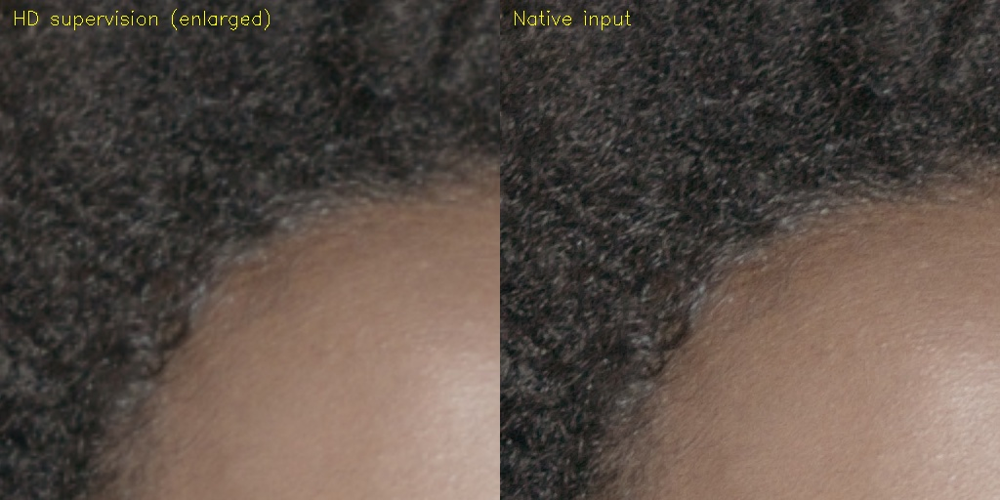
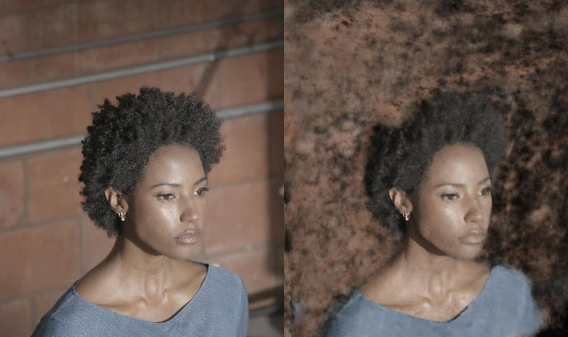

# DEC5 001055: native head RGB supervision

## What was tested

Separate single-frame experiment within the existing 16 GPU-hour campaign;
001083 results and its locked test are not mixed with this frame. All 65 native
6144×3072 JPEG headers at `calib/matching8/*/001055.jpg` are readable. Native
001083 files remain unavailable. JPEG sources are 8-bit tonemap-frozen images,
not recovered HDR.

The existing split supplies **59 train / 3 validation**, with the other three
camera identifiers reserved and physically absent from the prepared datasets.
A train-derived 3D head center determines all crop locations; held-out RGB does
not select crops. Native crops are 3584×3072; the HD control uses the identical
FOV resized to 1260×1080. A separate reference has true UHD 3840×2160 samples
from the native JPEG center crop. The intended artifact is a **4K head ROI**,
not a claim of reconstructed whole-frame geometry outside that ROI.

HD training runs on dev3 (L40S); native training runs on clever-shadow
(RTX PRO 6000). These are single seeded trials on different CUDA hardware,
not replicated device-controlled causal estimates.

Both arms use full LookCloser FR/FAS/ARM, .6 hair / .3 other-person quotas, a
2^18 point budget and a 20k initial ceiling. Frequency maps and Sapiens evidence
are generated from HD train images and shared in native pixel coordinates;
this isolates native RGB supervision rather than claiming native-resolution
frequency estimation. Boundary radii are scaled to the same physical image
region. Fresh fixed-pose train59 SfM supplies 5,902 points / 41,463 observations;
no inherited scene points or held-out images enter this reconstruction.

New native work is capped at 4.5 additional GPU-device hours, with the parent
16-hour limit taking precedence. A substantial common-renderer gain is required
before extending training. HD native-RGB validation uses stride 1; the larger
crop uses stride 3, keeping validation ray counts similar. Their native scores
are for within-arm selection, not a cross-resolution quality comparison. Both
fixed 20k geometry gates are evaluated against the same UHD reference. Native
cropped RGB checkpoints are selected by
`eval_all_psnr`, with LPIPS tie-break within .07 dB; external geometry controls
must remain explicitly labeled.

## Results

Both 20k training jobs and common UHD transfer completed without OOM. The
**equal-step native-input control is rejected**: hair LPIPS worsens 2.05%, holes
increase 13.6%, and silhouette recall drops .40 percentage points. The separate
RGB-selected native 10k checkpoint check is still running.

| Common UHD head ROI, same native source RGB/fallback | Hair PSNR / SSIM / LPIPS | Face LPIPS | Holes | Halo | Recall |
| --- | --- | ---: | ---: | ---: | ---: |
| HD 20k | 21.16599 / .38875 / .197080 | .282010 | .010975 | .001541 | .920120 |
| Native 20k | 21.02913 / .38400 / .201118 | .282583 | .012468 | .001630 | .916106 |

These frame-1055 UHD values must not be compared numerically with frame-1083 HD
values. Both raw selected RGB fields also retain conspicuous background-colored
clouds. [All three raw RGB-best reviews](assets/dec5_001055_native_head/raw_best_all3_review.jpg).
A different foreground/background representation is tested in its
[own report](dec5_001055_background_separation.md). The first clever frequency launch failed during
import because its environment omitted the private `pyquaternion` dependency;
it was restarted with the known working private dependency path. This is an
environment setup failure, not a negative model result. The first assembly
expected 158 map columns, but all 59 valid maps have 157 because the reference
regressor uses complete 8-pixel patches. The assembly guard stopped before any
training; physical-coordinate remapping now clamps the final four HD border
pixels to the last measured patch. This reuses measured maps rather than
inventing a new regression result. Native metadata retains the inherited
frequency schedule and specifies its native raster.

Initial visual inspection confirms additional native curl and hairline detail.
This is a train-camera input comparison, not a rendered-model improvement.

The initial 5k HD field has visible volumetric floaters around the crown. This
is an intermediate training image, not an accepted geometry or RGB-transfer
result. It must be rechecked at the fixed final geometry gate.

The separate native-RGB selection policy is locked before common UHD scores:
HD selects step 19,999; native selects step 9,999. A second native-best geometry
export is queued alongside the equal-step 20k comparison; it is not a post-score
checkpoint search.

| Own-raster RGB validation, not cross-resolution comparable | Step | PSNR | SSIM | LPIPS |
| --- | ---: | ---: | ---: | ---: |
| HD selected | 19,999 | 20.41724 | .77858 | .48140 |
| Native fixed geometry gate | 19,999 | 20.18764 | .72920 | .54442 |
| Native RGB-selected | 9,999 | 20.45316 | .73053 | .55067 |

### Occupancy and checkpoint portability diagnostics

On 1,024 **train-SfM fitting** hair witnesses, enabling every occupancy cell
changes median depth by over 1% of witness depth for only 3 rays. Relative median
witness discrepancy .0006775 → .0006470 costs 185.8 → 775.8 samples/ray. This
small fitting-proxy benefit does not justify a full occupancy-policy sweep and
does not rule out effects on wisps absent from SfM. The original mask and full
model fingerprint are restored. [Metrics](assets/dec5_001055_native_head/occupancy_probe_metrics.json).

The same frozen checkpoint and 3,076 witnesses were queried on both hosts.
Native median-depth cross-device relative difference is median 2.04e-7,
p99 3.83e-6, maximum 2.09e-5. This supports portability of the frozen geometry;
it does not make independently trained trials device-controlled replicates.
[Portability check](assets/dec5_001055_native_head/portability.json).

An optional vectorized conditional-quantile evaluator passes six numerical tests
and exactly matches all 6,152 real probe rays, including FP64 output. Its measured
CPU timing is .174 → .151 s, only a small benefit; the active UHD export retains
the established scalar evaluator. No training or field weights are changed.
[Actual-ray parity](assets/dec5_001055_native_head/fast_quantile_parity.json).

### Continuous source-visibility screen (closed)

A separate one-camera screen, fixed D004_A005_12103C before common UHD scores,
keeps native 20k target geometry and source order unchanged. Only rejected raster
source rays within semantic hair (probability >.5) are queried at their exact
projected floating coordinates in the same frozen field. The existing visibility
tolerance is unchanged; this is not another threshold sweep. The first screen is
capped at two million source-ray queries and .25 controller hours. Confident
parent skin and the exterior must preserve exact RGB; a no-op callback, rejected
plane recovery and protected-domain behavior pass with the five prior CUDA tests.

Acceptance needs a meaningful gain on **that same camera** against the stronger
baseline, not against a weaker aggregate: >=5% hair LPIPS or >=20% holes, <=1%
face LPIPS and <=1pp recall regressions, plus halo and visual review. One camera
cannot certify the full camera path. No held-out RGB drives the visibility query.

It completes with 351,966 exact source-ray queries and unchanged frozen field /
protected RGB. On D004_A alone, hair LPIPS changes **.219763 → .219302 (0.21%)**,
holes **.036222 → .035838 (1.06%)**. HD on this same camera is stronger
(.213704 LPIPS / .032098 holes). This fails the material-gain gate; no additional
camera or query/threshold sweep is launched.
[One-camera metrics](assets/dec5_001055_native_head/native_direct_D_metrics.json).

The reference-copy helper initially invoked absent `python` on dev3 (exit 127).
It was replaced by system `python3` for its stdlib-only copy step; all training
and sealed UHD predictions were already complete and remained valid.

## Insights

This tests a different information and sampling regime instead of more local
opacity thresholds. Final evaluation must use the same native source RGB,
held-out UHD reference, fixed head domain, source order and fallback for both
arms. Reports must distinguish native geometry quality from RGB transfer and
must not compare numerical scores across frames 001055 and 001083. UHD
boundary/interior bands use a five-pixel radius; the historical HD scorer default
remains three pixels. The full-frame score includes the explicitly neutral
exterior and is not a whole-frame reconstruction claim.

Frozen-export memory control uses a uint8 CPU image cache because source training
RGB is unused by the frozen ray query. A real checkpoint comparison preserves
native median depth exactly; expected depth differs by at most 7.2e-6 calibration
units, opacity 1.2e-6 and RGB 7.2e-7. Repeating the original float32 path itself
gives expected-depth variation 9.1e-6. Thus this is a numerical-roundoff check,
not an all-channel bit-exact claim. [Receipt](assets/dec5_001055_native_head/cache_parity.json).
