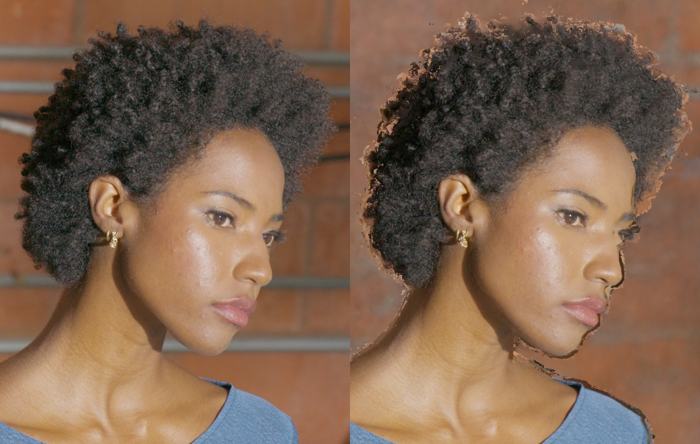
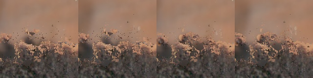
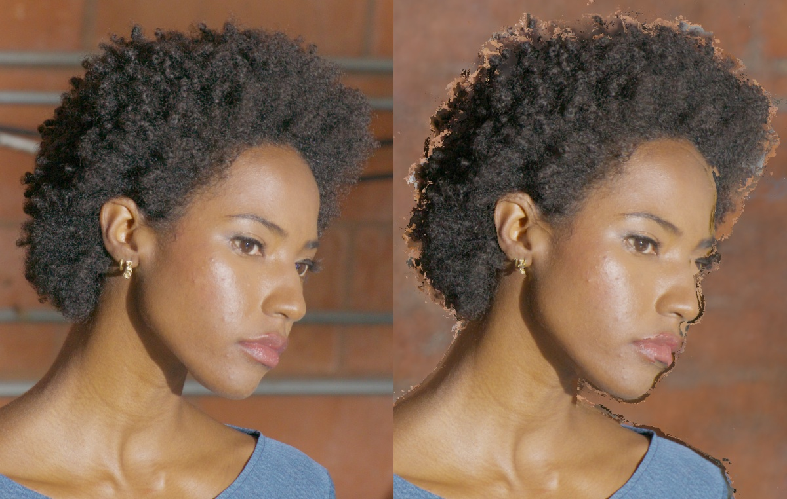

# DEC5 001083: global geometry and correspondence screens

## What was tested

2026-10-27 continuation of [the depth campaign](dec5_001083_hair_depth_stability.md).
Same native HD frame, frozen train59 / validation3 / test3 exclusion, source
EXRs, original-MVS visibility policy, nearest eight RGB sources, display and
NeRF fallback. These screens use validation only; test images were already
opened by the preceding campaign and are not a new blind evaluation.

Global alternatives were screened instead of further tuning local hair gates:

1. A multiview person silhouette envelope, at alpha .05 and .5, from the 59
   BiRefNet crops. The third smallest signed silhouette distance tolerates two
   bad views; outside-FOV/crop samples are unknown, with at least 12 known views.
   Person mattes are fallible evidence, not hair alpha or depth ground truth.
   The 384-resolution box contains 43,665,408 voxels. Only the .05 envelope was
   rendered as replacement geometry; the .5 mesh was extracted, not evaluated.
2. Global carving of the original B0 mesh: all three vertices AND centroid of
   a triangle must lie over two native pixels outside the .05 person silhouette
   in at least three known cameras. Removed 13,034 / 88,459 triangles (14.73%).
   Fresh raycasts expose surfaces behind removals. This is not depth smoothing.
3. Static-background SIFT calibration audit, and independent pretrained RoMa
   correspondences across train F004_C005 / G004_C005 / E004_C005.

Global render changes are restricted to the projected head domain and existing
ROI with skin protection. Unchanged pixels retain the exact B0 arrays. CPU
bilinear RGB interpolation is tested against the frozen Torch sampler, including
border samples. Depth remains camera-z in calibration units, not certified mm.

## Results

| Geometry | Hair PSNR ↑ | Hair SSIM ↑ | Hair LPIPS ↓ | Hair holes ↓ | Halo ↓ | Face LPIPS ↓ |
| --- | ---: | ---: | ---: | ---: | ---: | ---: |
| Corrected B0 | 21.001 | .34152 | .19753 | .06081 | .00769 | .07838 |
| Global carve | 21.119 | .34165 | .19605 | .06101 | .00594 | .07873 |
| Full soft envelope | 19.706 | .24320 | .22215 | .07955 | .00679 | .07884 |

Carving improves hair LPIPS only **0.75%**, despite a **22.7%** reduction in halo.
On the frozen 16-view central path, visibility toggles fall only **4.48%**
(.024200 → .023115), while exposure/depth dropouts increase
(.003716 → .004050) and present coverage decreases (.79088 → .78569).
The full envelope increases multiview roundtrip error from 3.214 to 10.282 px.
Neither method meets the adoption gate. **Stop these geometry families.**

Static-background SIFT produced 10,787 features over 59 views, but insufficient
three-view cycles for a reliable calibration verdict. This audit is inconclusive;
no calibration refinement was based on those background matches.

RoMa v1 official revision `77f8d68803526dcddfd9b7a46bc76125bdc25f15`, outdoor
weights, upright native head crops, 864 upsampling, no custom correlation build:
three pairs took 5.2 seconds total after model loading; smoke peak allocation
4.26 GiB. All matching images are training cameras. Independent forward/backward
and three-view cycles qualify matches before consulting calibrated poses.

| Independent correspondence check | Hair samples | Known-pose epipolar median | Maximum three-view reprojection median |
| --- | ---: | ---: | ---: |
| RoMa cycles | 8,698 | 3.288 px | 4.326 px |
| SIFT feature-ID cycles | 12 | 3.473 px | 3.497 px |

A fundamental matrix fitted only to face RoMa matches predicts hair matches at
0.131 px median epipolar error. This is **not** a calibrated 3D accuracy claim:
the face is close to planar and an unconstrained fundamental matrix has more
freedom than the calibrated rig. A calibrated essential fit and a tiny local
rotation-only probe do not reproduce that precision. Do not replace calibration
with the unconstrained F or claim the hair is reconstructed.

The source `calib/rig/rig_5a3.json` was checked directly: crop-adjusted intrinsics
are identical, and its F matrix agrees with the current F to 6e-17 after common
normalization. No pose-export or HD-crop calibration bug was found. Historical
subpixel BA errors came from filtered fitting tracks; they do not certify the
new correspondences. Rig uncertainty, lens/model error, synchronization and
correspondence bias remain possible explanations.

## Insights

The global envelope loses strand structure; conservative carving reduces halos
without solving popping. Neither is promoted. Dense independent matching
reveals a potentially larger geometry/calibration limitation. A bounded,
train-only pose-SfM screen completed on dev3, with fixed intrinsics and no
inherited points. After similarity alignment of the 59 camera centers, source
order and the target hair ROI were frozen to B0; held-out poses were unchanged.
New PatchMatch and TSDF were reconstructed with the same parameters.

Independent RoMa hair epipolar median improved 3.288 → 1.638 px, maximum
three-view reprojection median 4.326 → 2.255 px, and accepted triangulated hair
points increased 133 → 3,281 at unchanged gates. This did **not** predict better
held-out RGB:

| Recalibrated MVS, fixed B0 hair ROI | PSNR | SSIM | LPIPS |
| --- | ---: | ---: | ---: |
| Hair | 19.171 | .21871 | .21405 |
| Face/neck | 29.358 | .84579 | .08053 |

Holes decreased .06081 → .03729 (38.7%), but hair LPIPS worsened 8.4%, halo
increased .00769 → .01142 and face LPIPS worsened 2.75%. **Rejected before path
evaluation.** Fewer missing pixels can mean more incorrectly filled pixels.

A focal-free BA variant reduced the independent hair epipolar median further
to 1.098 px, but focal drift reached −36.9%; it was rejected as unreliable and
never used for reconstruction. A same-camera/same-time JPEG→working-EXR ingest
check at 001055 found 5,342 homography inliers with median identity discrepancy
.152 px, versus .148 after homography; no large processing warp was found.
The archive contains readable native 6144×3072 calibration JPEGs for seven
neighboring instants, although not 001083. This does not recover unavailable
native HDR files or establish a new 4K result.

The MVS supervisor reached its conservative 4 GiB local-disk reserve, stopped
only its own worker, then resumed under a 2 GiB reserve after cache validation.
All 236 final depth/normal arrays were validated; MVS, fusion, RGB and scoring
finished without GPU OOM. The next user-requested track is full LookCloser with
subject/hair ray quotas, separately budgeted at 16 hours. Further PatchMatch
experiments are stopped.

Durable root on clever-shadow:
`/mnt/footage2/lookcloser_hair_001083_20261027_1330`.
Evidence subdirectories: `global_hull384`, `global_carve`,
`global_{carve,envelope}_{render,complete}`, `global_{carve,envelope}_metrics.json`,
`global_carve_pilot_review`, `calibration_audit`, `roma_triplet`.
The first hull controller stopped after saving the field because private
scikit-image was missing; CPU extraction resumed successfully. No GPU OOM in
these root screens. HairGS has separate supervision and a separate report.
