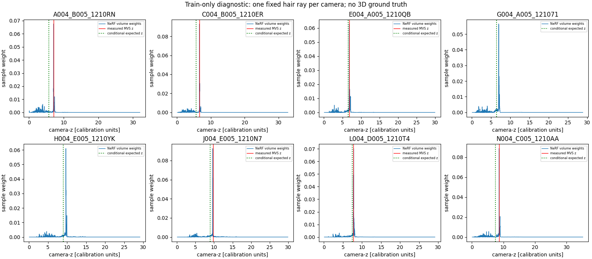
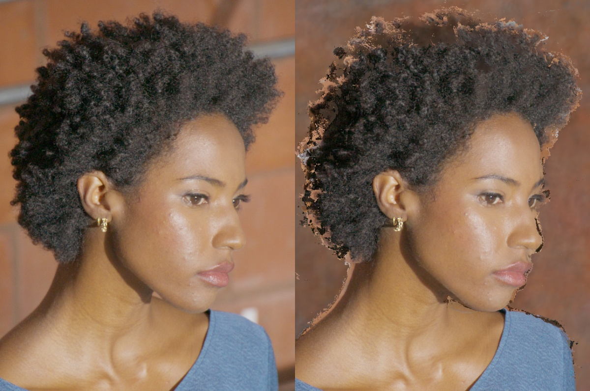
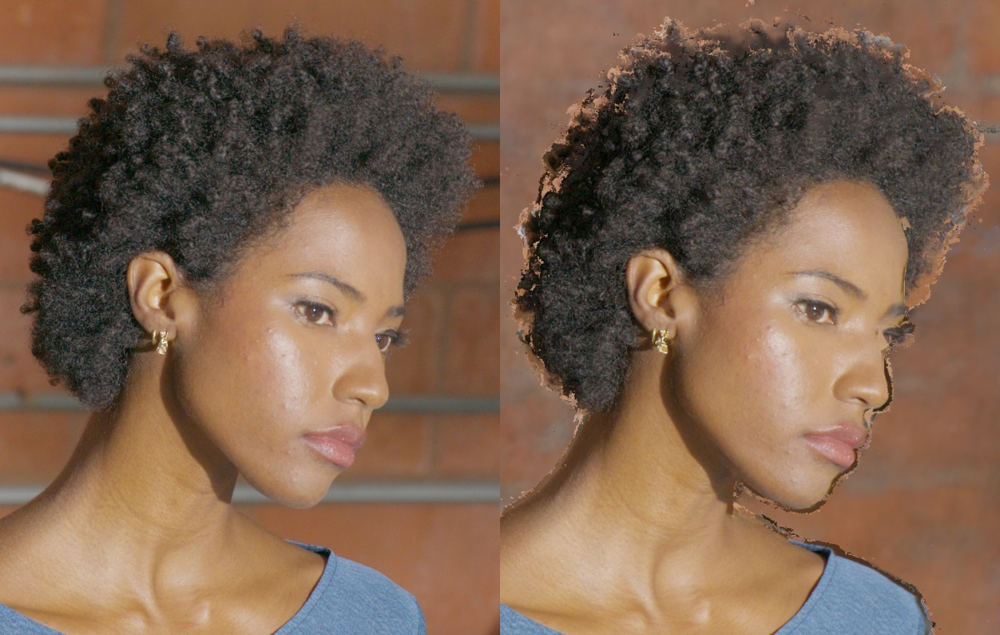
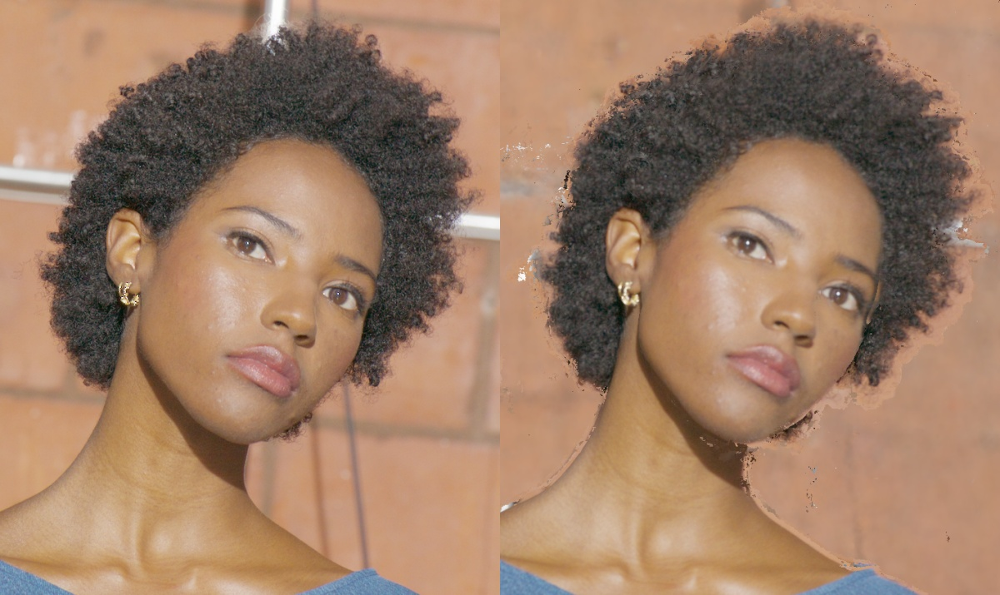
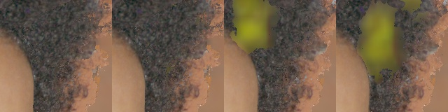

# DEC5 001083: глубина волос и стабильность камеры

## What was tested

2026-10-27, один реальный момент `001083`, **native HD 1920×1080**. Кампания
ограничена 24 GPU-часами суммарно на clever-shadow и dev3. Основной reference —
локальный `Paper LookCloser.md`; результаты ниже относятся к диагностическому
LookCloser-core без frequency grid/FAS/feature reweighting, а не к полной
репликации всех вариантов статьи.

**Итог: исправленный B0 сохранён. Ни один новый hair-метод не принят.**
Strongest-peak улучшил static hair LPIPS до 7,54%, но на соседних novel views
примерно удвоил переключения видимости и внёс яркие пятна внутрь волос.
MVS-gate убрал большую часть регрессии, однако не достиг порога улучшения.
Это выполненная диагностическая кампания, **не исправление исчезновения волос**.

Данные: `/fsx/tmp/dec5_5a3_nerfstudio_exr_1920x1080/001083`. Исключено объединение
filename-eval и исторического HELD3: **59 train / 3 validation / 3 test**.
Validation: D004_A005_12103C, E004_B005_1210I7, I004_D005_1210Q7.
Test: F004_B005_1210O9, J004_D005_1210TA, L004_B005_12106A. Унаследованные sparse
points, профили цвета и старые checkpoint не использовались. Test RGB не входит
в fitting, источники переноса или выбор checkpoint; исходный thumbnail одного
тестового ракурса просматривался для идентификации сцены до экспериментов,
поэтому полной слепоты человеческого знакомства с субъектом не заявляем.

Фиксированный display для EXR: gain `10.570320292648677`, Reinhard, sRGB.
Глубина — OpenCV camera-z в единицах калибровки; метрический масштаб независимо
не подтверждён. TIFF/fullres PQ PNG существуют в каталогах FSx, но выборочные
чтения возвращают `ENODATA`. Поэтому **4K не проверено**; увеличенные HD crops
на входе matting не являются исходными 4K данными.

Все итоговые артефакты находятся на clever-shadow:

```text
/mnt/footage2/lookcloser_hair_001083_20261027_1330
```

Временная рабочая копия dev3: `/tmp/lookcloser_hair_001083_20261027_1330`.
Исходная ревизия: `ddd7675a300411b2b90c02ddc6e60cfd6d2d1e3d` плюс сохранённые
campaign scripts, request JSON и SHA256 входов/результатов. Исторический поиск
данных и старых весов описан [отдельно](dec5_lipstick_recovery_inventory.md).

### Исправления до финального сравнения

1. Для уже undistorted изображений с нулевой дисторсией нужен PINHOLE workspace
   **без `image_undistorter`**. OPENCV экспорт дал raster 1919×1079 при камере
   1920×1080; PINHOLE через undistorter сохранил размер, но обнулил часть краёв.
   Финальный workspace копирует PNG байт-в-байт и сохраняет intrinsics.
2. Для вложенных image names явно создаются подкаталоги depth/normal/consistency.
   COLMAP может сообщить `Check failed: file.is_open` и вернуть нулевой код:
   теперь проверяются fatal log и фактические 59 карт после каждой стадии.
3. В новом training control согласованы независимые RNG streams pipeline/model,
   включены корректные SH directions, выключена унаследованная sparse-depth
   supervision. Source и target depth приводятся к общей camera-z системе через
   проверенное similarity преобразование нормализованных камер.
4. Для Open3D RGBD intrinsics используются `cx-.5, cy-.5`, чтобы его integer
   pixel centers совпадали с half-pixel центрами COLMAP/Nerfstudio. Это проверено
   сравнением с реальными Open3D points, а не только взаимно обратными своими
   функциями. [COLMAP convention](https://colmap.github.io/tutorial),
   [Open3D projection](https://www.open3d.org/docs/release/python_api/open3d.geometry.PointCloud.html).
   Предыдущие `native_tsdf_*` не являются итоговым исправленным TSDF.
5. N2 меняет только **действительно изменённые** depth hypotheses в frozen hair
   ROI и требует ≥3 подтверждений исходными измеренными картами. Это исключает
   подмену всей TSDF-области raw-MVS геометрией под видом локального refinement.

**Финальный MVS: `pm1920_native_v2`, 59 photometric + 59 geometric maps.**
Предварительные `pm960`, `pm1920`, `pm1920_pinhole` и первый `pm1920_native`
не используются для выводов о качестве: у них были ошибки preprocessing/setup.
CUDA COLMAP 3.13.0.dev0 (`5509fffe`) и его библиотеки изолированы от сервисного
окружения clever-shadow; системный CPU-only COLMAP не использовался для MVS.

### Общий renderer и измерение

Один неизменный GT-transfer: 8 ближайших train camera centers, первый depth-valid
источник, без усреднения RGB. Visibility и независимые witnesses всегда используют
**исходные** MVS maps, даже при изменении candidate depth. RGB берётся из линейных
HD EXR. Для отсутствующего source RGB используется один frozen NeRF fallback;
`source_id=-1`, holes и missing-depth evidence сохраняются и входят в метрики.

Hair/face reference ROI получены Sapiens2 на GT ракурсах после сохранения
предсказаний. Это **ошибочная в принципе semantic reference**, не human alpha или
3D ground truth. Hair interior и boundary не пересекаются: erosion/dilation 3 px
на HD; это не заявленный 5 px benchmark на 4K. PSNR/SSIM считаются по фиксированным
маскам; LPIPS — AlexNet, фиксированный crop, внешний фон нейтральный 0.5.
Агрегация — среднее по трём камерам. Missing pixels не исключаются.

Геометрические прокси: доля unsupported hair pixels, доля пикселей с <3 original
witnesses, обратная репроекция source measured depth в target. При отсутствии
witness ошибка равна 20 px, остальные ошибки ограничены сверху 20 px. Эти числа
не являются точностью глубины в миллиметрах.

Порог принятия: hair LPIPS лучше ≥5% **или** holes/popping меньше ≥20%, плюс
независимый geometry proxy лучше ≥1%, face LPIPS не хуже >1%, silhouette recall
не ниже >1 п.п. Визуальная проверка обязательна. Popping оценивается отдельно
на frozen static-camera path, без физической временной динамики волос.

## Results

### Исправленный validation baseline и абляции

B0 — TSDF voxel 0.005, truncation 0.04, 88,459 triangles, без component pruning.
Fine control — voxel 0.0025, truncation 0.02, 367,602 triangles; изменения только
в frozen train-derived hair ROI. Размеры в единицах калибровки.

| Вариант | Hair PSNR ↑ | Hair SSIM ↑ | Hair LPIPS ↓ | Holes % ↓ | Roundtrip px ↓ | Face LPIPS ↓ |
|---|---:|---:|---:|---:|---:|---:|
| B0 TSDF | 21.0010 | 0.34152 | 0.19753 | 6.081 | 3.214 | 0.07838 |
| Fine TSDF control | 21.1235 | 0.34391 | 0.19645 | 6.030 | 2.944 | 0.07863 |
| Raw per-view MVS | 20.4428 | 0.31032 | 0.21249 | 7.878 | 5.760 | 0.13499 |
| Binary alpha | 20.9988 | 0.34120 | 0.19722 | 6.081 | 3.214 | 0.07838 |
| Soft alpha | 21.0016 | 0.34119 | 0.19713 | 6.081 | 3.214 | 0.07838 |
| Alpha + F/B | 21.0019 | 0.34135 | 0.19725 | 6.081 | 3.214 | 0.07838 |
| Alpha + F/B + two depths | 20.9982 | 0.34097 | 0.19743 | 6.080 | 3.216 | 0.07843 |
| N2 без orientation | 20.9424 | 0.33956 | 0.19815 | 5.992 | 3.573 | 0.07849 |
| N2 STITCH-lite | 20.9380 | 0.33917 | 0.19924 | 5.988 | 3.594 | 0.07854 |
| N2 + NGP front | 20.9380 | 0.33917 | 0.19924 | 5.988 | 3.594 | 0.07854 |
| N2 + NGP peak1 | 20.9375 | 0.33924 | 0.19929 | 5.982 | 3.609 | 0.07854 |
| N2 + NGP peak2 | 20.9373 | 0.33924 | 0.19939 | 5.986 | 3.601 | 0.07854 |
| NGP expected target | 21.6311 | 0.34296 | 0.41588 | 96.852 | 19.713 | 0.07895 |
| NGP front target | 21.9577 | 0.36484 | 0.43302 | 99.663 | 19.951 | 0.07853 |
| NGP strongest peak | 21.4560 | 0.31448 | 0.18406 | 4.934 | 4.974 | 0.07861 |
| NGP subpixel strongest peak | 21.4727 | 0.31630 | 0.18263 | 4.943 | 4.896 | 0.07870 |
| NGP subpixel + MVS gate | 21.1269 | 0.34345 | 0.19429 | 5.267 | 2.877 | 0.07839 |

После исправления центров пикселей используются `center_tsdf_*`, `c_render_*`
и `c_metrics_*.json`. Старые `native_tsdf_*` и соответствующие метрики являются
предварительными.

Полные показатели, включая full-frame, boundary, interior, silhouette и каждую
камеру: [CSV](assets/dec5_001083_hair/validation.csv) и `c_metrics_*.json` / `p_metrics_*.json`
[в каталоге свидетельств](assets/dec5_001083_hair/).

N1: BiRefNet_HR-matting даёт **person alpha** на train head crops, а Sapiens2
ограничивает hair ROI; общая person alpha не считается hair alpha. PyMatting
оценивает foreground на bounded linear RGB с обратимым scale. Прототип ограничен soft band `0.001 < alpha < 0.995`; он не является полной
перестройкой всей hair silhouette. Для layers нужны
правильный depth order и ≥2 original witnesses для обоих слоёв. RGB композитится
один раз из premultiplied foreground. Эффект слишком мал для принятия.

N2: multiscale structure tensors, orientation modulo π, 8 pose-diverse witnesses,
7 depth hypotheses, robust photo/residual/prior score, conditioned minimum
eigenvalue tangent tensor, ≥3 witnesses и минимум 10% score improvement.
Неуверенные hypotheses оставляют base depth. Orientation term не дал выигрыша;
это STITCH-inspired MVP, **не воспроизведение full STITCH**. Его расширение и
strand growing не запускались после отрицательного gate.

N3: source profiles 4096 samples на half-HD hair ROI, expected/front/top-2 peaks;
8 train cameras ×64 полных weight traces сохранены отдельно. Checkpoint hash
до/после одинаков. Front и второй пик не дали полезного multiview support.
Среднюю глубину смещает ранняя слабая плотность; самый сильный пик на части
train-лучей близок к MVS. Его static RGB оказался лучше, поэтому проверены две
доработки без переобучения: log-parabolic субпиксельная локализация и confidence
gate. Gate принимает depth только при ≥3 original witnesses, hair probability
≥0.5, protected skin <0.7 и measured roundtrip лучше B0 минимум на 1%.
Остальные RGB/depth/source IDs точно сохраняют baseline. У gate hair LPIPS лучше
лишь на 1,64%, holes меньше на 13,38%, roundtrip лучше на 10,49%; material gate
не пройден. Эти результаты не опровергают все layered/orientation методы —
отрицателен именно описанный MVP.



При этом более высокий PSNR размытого NeRF fallback **не** означает правильную
hair geometry: LPIPS и measured-depth support здесь значительно хуже.

### Визуальная проверка validation

Слева GT, справа B0. Проверены все три ракурса: сохраняются фоновые обрывки и
ореолы у внешнего контура, часть локонов теряет детали. Проблема не решена.





Дополнительные проверенные сравнения:
[STITCH-lite](assets/dec5_001083_hair/orientation.jpg),
[two-layer](assets/dec5_001083_hair/two_depth.jpg),
[expected-depth blur failure](assets/dec5_001083_hair/ngp_expected.jpg).

### Плавный обход камеры: 96 poses и отсев на pilot

Frozen path: 96 разных poses, 24 fps, 4 s, дуга 11.465°, **один статичный момент**.
Full RGB и native head crops реально закодированы и декодированы по всем 96
кадрам. Head video — crop 832×638 без увеличения, вычисленный по train semantics;
эта рамка меняет только просмотр, не metric ROI. Проверены все contact sheets
и три worst native patch pairs. Непрерывный человеческий просмотр не заявляется.
Фон fallback в path использует один 384×216 NeRF preview; GT-transfer волос
остаётся native HD. Это не 4K video и не проверка физической динамики.

Visibility toggles считаются после общего B0 warp и frozen B0 occlusion veto.
Candidate missing pixels не исключаются. Depth dropout дополнительно переносит
предыдущую candidate depth, чтобы постоянное отличие от B0 не считать flicker.
Это прокси согласованности, не GT отслеживание отдельных волос.

| Full path, 95 пар | Visibility toggles % ↓ | Source switches % ↓ | Depth dropouts % ↓ |
|---|---:|---:|---:|
| B0 | 2.4382 | 5.7110 | 0.6620 |
| Fine TSDF | 2.6482 | 5.8918 | 0.8740 |

Fine ухудшает основной stability proxy на 8.61%, поэтому не заменяет B0.
[Baseline head video](assets/dec5_001083_hair/path96/baseline/head.mp4),
[fine control](assets/dec5_001083_hair/path96/candidate/head.mp4),
[полные 95 pair metrics](assets/dec5_001083_hair/path96/metrics.json).

Для peak-кандидатов до их рендера зафиксирован **central consecutive pilot
40..55** исходного path, 16 poses / 15 пар. Меньший pilot может отклонить
кандидата; код запрещает использовать его вместо финального 96-pose gate для
принятия. По отрицательному pilot полный peak-path не запускался.

| Pilot, общий domain 3,093,936 anchors | Visibility toggles % ↓ | Depth dropouts % ↓ |
|---|---:|---:|
| B0 | 2.4200 | 0.3716 |
| Strongest peak | 5.1676 | 6.1815 |
| Subpixel peak | 4.9130 | 2.5975 |
| Subpixel + MVS gate | 2.4521 | 2.3323 |

Обычный peak даёт 2.14× toggles, subpixel — 2.03×. На сохранённых native patches
видны новые яркие жёлтые пятна внутри причёски и переключения больших фрагментов.
Gate устраняет крупную регрессию, но toggles всё ещё хуже B0 на 1.33%, а material
RGB/holes gate не пройден. Все три прототипа отклонены **до чтения test RGB**.

[Peak pilot video](assets/dec5_001083_hair/pilot/pilot_final_head_peak1/candidate/head.mp4),
[subpixel](assets/dec5_001083_hair/pilot/pilot_final_head_subpixel/candidate/head.mp4),
[gated](assets/dec5_001083_hair/pilot/pilot_final_head_gate/candidate/head.mp4).



### Независимый test: выбран только B0

[Immutable selection](assets/dec5_001083_hair/final_selection.json) фиксирует B0
и причины отклонения численно eligible peak-кандидатов. Все три test prediction
сохранены до [unlock](assets/dec5_001083_hair/test/unlock_receipt.json). Затем
прочитаны test RGB, получены только reference semantic masks и посчитаны метрики.
После test не было fitting, tuning или перевыбора метода.

| B0, 3 test cameras | PSNR ↑ | SSIM ↑ | LPIPS ↓ |
|---|---:|---:|---:|
| Hair | 23.0495 | 0.50258 | 0.17660 |
| Face + neck | 31.5684 | 0.90350 | 0.07371 |
| Full frame | 24.0758 | 0.82388 | 0.35628 |

Test hair holes: 4.785%; witness deficit: 15.812%; roundtrip: 2.651 px;
silhouette recall proxy: 93.601%. Это readout сохранённого baseline, **не выигрыш
нового метода** и не сравнение validation/test как одинаковых ракурсов.
[Полные test metrics](assets/dec5_001083_hair/test/metrics.json).
Просмотрены все три пары GT/B0:
[F](assets/dec5_001083_hair/test/F004_B005_1210O9.jpg),
[J](assets/dec5_001083_hair/test/J004_D005_1210TA.jpg),
[L](assets/dec5_001083_hair/test/L004_B005_12106A.jpg).
Ореолы, фоновые обрывки по краю и размытие части волос остаются.

### Training controls и checkpoint

Оба control используют 1024 rays/batch, fixed sampling, log2 hash size 19,
max resolution 8192, black background, одинаковый split/seed. Frequency features
выключены для отдельной диагностики geometry. Бюджет второго control выровнен
по числу queried points: 18k×2048 против 9k×4096.

| Control | Selected step | Eval-all PSNR ↑ | SSIM ↑ | LPIPS ↓ | Native samples/ray |
|---|---:|---:|---:|---:|---:|
| `nerf_v2/best.pt` | 13999 | 22.34095 | 0.72391 | 0.54623 | 2048 |
| `nerf4096/best.pt` | 8999 | 22.25267 | 0.72931 | 0.53420 | 4096 |

Checkpoint publisher дополнительно исправлен для случая, когда сдвиг PSNR tie-band
выбирает старый gate, ранее не бывший best; regression test воспроизводит этот
случай. В обоих завершённых run содержимое `best.pt` отдельно проверено: step
13999 и 8999 совпадают с selection, поэтому их результаты не меняются.

Checkpoint selector: максимальный `eval_all_psnr`, LPIPS tie-break в полосе
0.07 dB. Таблица training evaluation использует stride 2; итоговые RGB renders
сохранены full HD. При общем inference 4096 samples hair LPIPS у 4096-training
0.43847 против 0.45279 у 2048-training: улучшение ~3.16%, ниже 5% gate.
Для всех GT-transfer controls fallback остаётся **одним и тем же** 2048-control,
чтобы изменение fallback не подменило geometry experiment. Полные checkpoint,
конфиги, gate snapshots и selected renders сохранены на clever-shadow.

### HairGS feasibility

Подготовлен `native_hairgs_input`: 59 images, hair masks, orientation/confidence,
COLMAP model и 215,779 измеренных train-only MVS initializer points. Официальный
код pinned: `16588656b1f6f048bc3bc83f3cb98c2da8596754`.
[Preflight](assets/dec5_001083_hair/hairgs_preflight.json): `ready_for_training=false`.
Нет калиброванных `head_verts/scalp_verts`; hair TSDF нельзя выдавать за scalp.
Также не установлены изолированные pytorch3d/pyvista. Обучение HairGS не запускалось,
его качество не измерено; strand GT не объявляется необходимым для inference.
Полный upstream включает 3DGS research/non-commercial ограничения; это не
одобренная для коммерческого релиза интеграция. В треке N GS не использовался.

### Реализованные интерфейсы и сохранённые артефакты

В корне campaign на clever-shadow:

```text
nerf_v2/best.pt                 # selected step 13999
nerf4096/best.pt                # selected step 8999
pm1920_native_v2/               # 59 split-clean native-HD MVS maps
center_tsdf_base/mesh.ply       # corrected B0
final_selection.json           # immutable choice, before test RGB
checkpoint_inventory.json      # both weights loaded; SHA/step/export match
code/                          # source snapshot and current experiment code
dev3_controls/                 # archived controller/worker/resource logs
delivery_hd/{validation,test}/ # 3 cameras in each partition
```

У каждого delivery camera есть `base_depth.exr`, `hair_front_depth.exr`,
`hair_confidence.exr`, `source_id.exr`, `edit_roi.exr`, semantic probability,
independent reprojection, linear RGB EXR, display PNG и `metadata.json` с SHA.
EXR прочитан обратно **точно**, без численных изменений. Confidence — original
support/8, а не calibrated probability. Semantic probability не выдаётся за alpha;
для выбранного B0 `alpha_available=false`. Background candidate не объявляется
достоверной второй поверхностью. Source-ID mapping и missing=-1 сохранены.

[Checkpoint inventory](assets/dec5_001083_hair/checkpoint_inventory.json) подтверждает
по 81,114,238 bytes на каждый `best.pt`, совпадение selected step и SHA с frozen
render/export receipts. Конфиг при переносе загружается только с hash-matched
набором камер, data path переопределяется на текущий campaign root. Это не
заменяет совместимую среду PyTorch/tinycudann для GPU inference.

В репозитории добавлены campaign prepare/supervisor, native MVS workspace,
training selector, semantics/matting, offline geometry/reranking/volume probes,
fixed-ROI scorer, path reviewer, immutable selector и EXR packager. Основной
`render_mesh_image_blend.py` принимает **опциональный** `--hair-override-manifest`;
архив связывается с конкретной камерой/base depth/mesh manifest и depth units.
Layers допускаются только в согласованном linear EXR pipeline. Без флага
существующее поведение сохраняется. Ни один новый hair-метод не включён по
умолчанию; [architecture](../architecture.md) обновлена.

### Тесты и эксплуатация

[24 tests passed](assets/dec5_001083_hair/tests.log), включая реальный CLI renderer,
две пересекающиеся полупрозрачные пряди, однократное alpha compositing,
byte-exact RGB вне ROI, hash binding и rejection ложного улучшения от стирания
волос. [CUDA smoke test](assets/dec5_001083_hair/cuda_smoke.log) записал реальные
PatchMatch maps для вложенных PINHOLE images. Python compile и diff whitespace
check выполнены. Низкоуровневые тесты не заменяют визуальную приёмку качества.

Supervisors записывают controller/worker, GPU, disk и progress каждые 30 секунд.
Лимит дополнительной VRAM — 24 GiB; резерв clever-shadow 16 GiB, dev3 8 GiB.
Existing calibration service PID 3718826 не останавливался. Зависимости установлены
в campaign-local targets, без изменения его Conda environment. Выводы на FSx
не записывались.

[Финальный audit](assets/dec5_001083_hair/audit.json): **2.489 GPU allocation-hours
из 24**, включая setup/IO ожидание контроллеров, суммарно по двум хостам.
Незавершённых controller receipts нет, OOM evidence нет. Повтор B0 дал точное
совпадение RGB, depth, source IDs, support, ROI и reprojection для всех трёх
validation cameras. GPU-проверка после завершения видит только исходный сервис
3718826 с 7,806 MiB; новых training/export workers не осталось. Ранние setup
ошибки сохранены в логах и не используются как quality measurements.

## Insights

Static RGB gain оказался недостаточным критерием. Dominant volume peak может
переключаться между неоднозначными слоями: при численно почти одинаковых лучах
99% common-ROI depth differences меньше 1.5e-6 единиц, но редкие argmax switches
дают скачки до 5.59 единиц. На pilot это сопровождается появлением/исчезновением
ярких пятен внутри причёски и более частыми visibility toggles. Повышение PSNR
или LPIPS в трёх статичных ракурсах не доказывает правильную геометрию волос.

Measured MVS gate полезен как ограничитель регрессии, но не дал нужного выигрыша
в основной задаче. После отрицательного camera gate не запускались full STITCH,
обучение HairGuard/αDepth с нуля, HairGS без scalp, полный 96-view peak campaign
или динамическая реконструкция тысяч кадров. Наиболее важное оставшееся
ограничение — неоднозначная геометрия/видимость перекрывающихся волос, а не
только alpha внешнего силуэта. Native 4K и физическая временная стабильность
остаются непроверенными; для 4K нужны реально читаемые исходные файлы.
