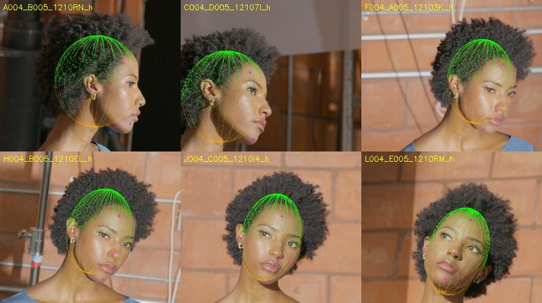
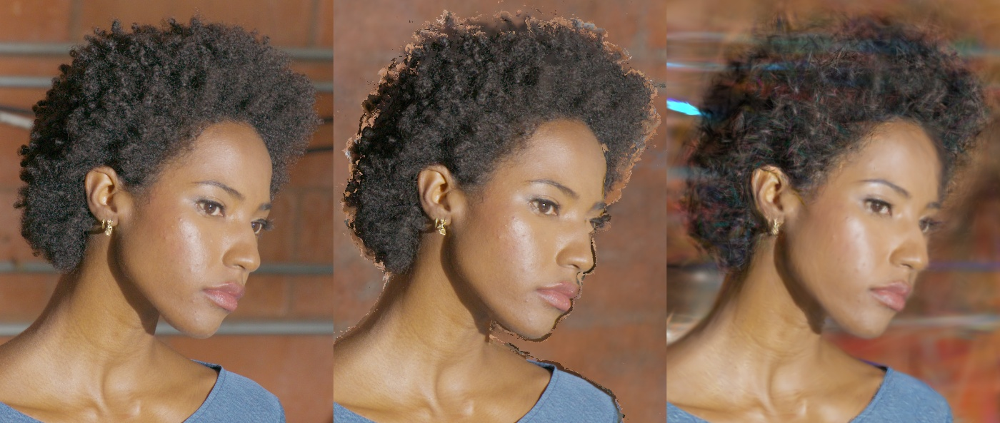
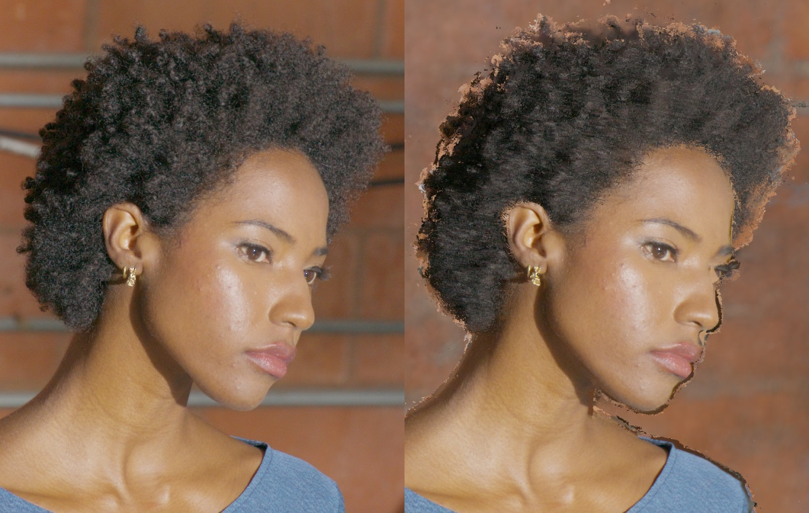

# DEC5 001083 — ограниченная попытка официального HairGS

## What was tested

**Итог: HairGS технически запущен, качественный результат не принят. B0 сохранён.**
Старт **2026-10-27 17:16:06 UTC**, deadline **21:16:06 UTC**. Завершены две
трёхэтапные траектории и оценка всех **22 сохранённых strand-checkpoint**.
Большие артефакты находятся на `ubuntu@clever-shadow`:

```text
/mnt/footage2/lookcloser_hair_001083_20261027_1330/hairgs_trial_20261027_171606/
```

[Официальный upstream](https://github.com/yimin-pan/hair-gs/tree/16588656b1f6f048bc3bc83f3cb98c2da8596754)
зафиксирован на `16588656b1f6f048bc3bc83f3cb98c2da8596754`.
Fitting: только **59 train**, контроль — 3 validation; test RGB не открывался.
Все входы и выходы — native HD **1920×1080**, один момент времени.
COLMAP initializer содержит measured train-MVS points без SfM tracks.
Сравнение использует [исправленный B0](dec5_001083_hair_depth_stability.md).

| Вариант | Инициализация | Orientation weight | Stage I | Merge | Stage III |
|---|---|---:|---:|---:|---:|
| Default | 215 779 hair-MVS points | 100 | 30 000 | 8 | 5 000 |
| Corrected | 215 564 hair + 142 939 nonhair MVS points | 1 | 30 000 | 7 | 5 000 |

В Corrected удалены 215 далёких hair outliers и добавлены train-only measured
nonhair points: исходный hair-only initializer не покрывал full-frame RGB objective.
Новые точки требуют согласия geometric/photometric depth в пределах 1% + 0.002
calibration units. RGB, камеры и head/scalp proxy сохраняются. Это **input/config
bundle**, не чистая λ-абляция. Stage III — короткий pilot: LR schedule 5 000,
densification до 4 500; полная 30k strand-оптимизация не заявляется.

FLAME assets в проверенных каталогах не найдены. Построен **приближённый
анатомический эллипсоид**, по train-MVS в вручную выбранных face/ear cues и явным
априорным размерам; 16 000 head и 7 531 scalp vertices. Волосная TSDF не использована
как scalp. Proxy не сертифицирует скрытую анатомию или истинные корни волос.
На train59 person projection fraction: медиана 100%, минимум 98.51%; доля scalp
впереди measured hair более чем на 0.02 units: медиана 0%, максимум 1.53%.
Шесть train overlays просмотрены. Ручные поверхностные cues не идеально гомологичны;
их residuals сохранены, поэтому это gross alignment check, не точный landmark fit.



Dependencies и CUDA extensions собраны в собственной `deps/`, базовое окружение
сервиса не менялось: Python gs2, torch 2.9.1+cu128, nvcc 12.6.85, compute90+PTX
на Blackwell. Исправлены `np.bool`, финальный GT guard, principal-point offset,
merge CLI parsing и соглашение orientation: `theta_new=(pi/2-theta_old) mod pi`.
RGB/SH audit: initializer RGB [0, 0.8667], RGB↔SH error <1e-16; пересчёт 3 804
points первой train camera совпал по XYZ <2.5e-7 и RGB точно. Ошибка экспозиции
или 0–255 нормировки не обнаружена. Numeric camera projection error около
0.0002 px подтверждает согласованность реализации с исходными камерами;
физическая точность multiview-калибровки этим не устанавливается.

## Results

**Собственный RGB HairGS.** По mean full-frame PSNR трёх validation и LPIPS
в пределах 0.07 dB выбран Corrected **iteration 30 507**, 500 strand-шагов.
Максимальный native eval_all_psnr: 20.53439; выбранный:
**20.47453 dB**, SSIM
**0.74415**, LPIPS
**0.54610**.
Hair ROI: PSNR **19.3767**, SSIM
**0.28991**, LPIPS **0.33899**.
Это native renderer с собственными fitted RGB. Для изолированной проверки геометрии
ниже используется общий B0 hard-source transfer. Просмотрены все три выбранных
native-рендера: сохраняются blur, длинные фрагменты и яркий фон внутри волос.



**Общий renderer.** Frozen B0 hair ROI, ≥3 original MVS witnesses, source hair
probability ≥0.5, skin <0.7; вне квалифицированного домена RGB точно равен B0.
Gaussian expected-z требует foreground opacity >0.5. Polyline core-z — nearest
rasterized zero-width segment core, perspective-correct camera-z; coverage —
геометрический hit, не alpha. Обе глубины являются proxy, не сертифицированной
front strand surface. Метрики — среднее по трём фиксированным reference ROI;
missing pixels остаются в знаменателе, LPIPS использует прежний AlexNet protocol.
Roundtrip — measured-source reprojection proxy в пикселях, не абсолютная точность.

| Hair ROI, validation3 | PSNR ↑ | SSIM ↑ | LPIPS ↓ | Roundtrip px ↓ |
|---|---:|---:|---:|---:|
| B0 | 21.0010 | 0.34152 | 0.19753 | 3.214 |
| Default, final expected-z | 20.8909 | 0.31779 | 0.20341 | 4.424 |
| Corrected, final expected-z | 20.8591 | 0.30807 | 0.20147 | 4.885 |
| Selected native, expected-z | 20.8292 | 0.30570 | 0.20272 | 4.892 |
| Best receiver, opacity reset | 21.0005 | 0.34149 | 0.19760 | 3.221 |
| Default, polyline core-z | 20.3470 | 0.26141 | 0.25249 | 7.001 |
| Selected native, polyline core-z | 19.9574 | 0.23104 | 0.26954 | 9.373 |

Лучший receiver выбран отдельно по тому же full-frame PSNR/LPIPS правилу:
Corrected **33 007**, сразу после opacity reset. Он меняет всего **389 pixels**
на трёх HD кадрах; близость к B0 отражает почти бездействующий gate/fallback.
Это не geometry boost. Direct core-z выбранного native checkpoint ухудшает hair
LPIPS на **36.5%**,
roundtrip до **9.373 px**,
face LPIPS на **3.6%**.
Все три core-transfer изображения также просмотрены.



Порог принятия сохранён: ≥5% hair LPIPS gain либо ≥20% holes/popping gain,
≥1% независимый geometry-proxy gain, face LPIPS regression ≤1%, silhouette recall
drop ≤1 п.п., обязательная visual review. Ни один вариант gate не прошёл.
96-pose path и новый test не запускались; temporal/4K стабильность не заявляется.

**Граф выбранного native checkpoint:** 67,338 foreground
segments в 60,569 компонентах; median/p95 числа узлов =
**2/3**. Длина компоненты median **0.03103** units.
Условный root distance до proxy scalp: median **0.06207**,
p95 **10.427** units; лишь
**7.04%** корней ближе 0.01. Граф структурно
валиден, но состоит преимущественно из фрагментов, а не полной укоренённой причёски.

Strands NPZ/edge-PLY, coverage и HD camera-z EXR экспортированы. Все **9 EXR**
трёх наборов прошли exact float32 roundtrip. Ноль — unknown core hit, не доказанное
пустое пространство. Единицы — исходные calibration camera-z; metric scale не
сертифицирован, normalized ray distance не используется. Raw core projections
не учитывают head occlusion; wireframe на лице сам по себе не доказывает пересечение.

Один Stage III запуск остановился на собственном **24 GiB cap**, при ещё
64.98 GiB device-free. Повтор с cap 32 GiB и expandable allocator завершился.
Пик PyTorch — **29.10 GiB**, минимальный observed GPU-free
reserve — **58.64 GiB**. Calibration
service **PID 3718826 жив**, мои GPU workers завершены. GPU-stage process wall
**1.324 h** включает CPU/IO и ≤60 s legacy
polling slack; сумма CUDA forward/backward event intervals —
**0.799 h**. Wall-clock **17:16:06–19:26:40 UTC**, **2.176 h**, включая подготовку и отчёт.
Точные интервалы сохранены в `resource_accounting.json`; бюджет 4 h не исчерпан.

Основные артефакты относительно trial root:

```text
model_corrected/point_cloud/iteration_30507/point_cloud.ply
native_corrected_s00500/                 # selected native RGB, 3 validation
geometry_selected_native/               # strands.npz, strands_edges.ply, audits
cores_selected_native/                  # HD camera-z EXR, coverage, scope
calibration_delivery.json               # exact train59/validation3 CV cameras
best_native_hairgs_candidate.json        # checkpoint SHA 00da2606...def84e988
checkpoint_selection_complete.json      # all 22 receiver scores
native_checkpoint_selection_progress.json
final_selection.json                    # B0 unchanged, test locked
acceptance_audit.json                   # all 22 expected-z + 2 core-z gates
resource_accounting.json                # timings, VRAM, processes
patches.diff / *_cfg_args.txt / *_supervision.jsonl
```

[Machine-readable summary](assets/dec5_001083_hairgs_trial/trial_summary.json),
[repro scripts, configs, proxy and metadata](assets/dec5_001083_hairgs_trial/repro_bundle.tar.gz).
Большие checkpoints/renders/dependencies сохранены на clever-shadow.

## Insights

Рабочая isolated HairGS цепочка и camera-aligned anatomical proxy получены.
Исправления подготовки и weak orientation заметно улучшили собственный RGB
относительно первого варианта; достаточного выигрыша геометрии/финального RGB
перед B0 нет. После двух заявленных траекторий новых обучений и подбора порогов
не проводилось.
Negative result относится к данным, исходной калибровке, approximate orientation/scalp
и короткому strand pilot; это не заключение о HairGS при других входах.

Combined upstream содержит Gaussian-Splatting research/non-commercial components
([license](https://github.com/yimin-pan/hair-gs/blob/16588656b1f6f048bc3bc83f3cb98c2da8596754/LICENSE-GAUSSIAN-SPLATTING.md)).
FLAME assets не использовались; proxy построен самостоятельно. Интеграция в default
LookCloser не принята, `architecture.md`, исходный B0 и пользовательские изменения
не изменялись этой попыткой.
