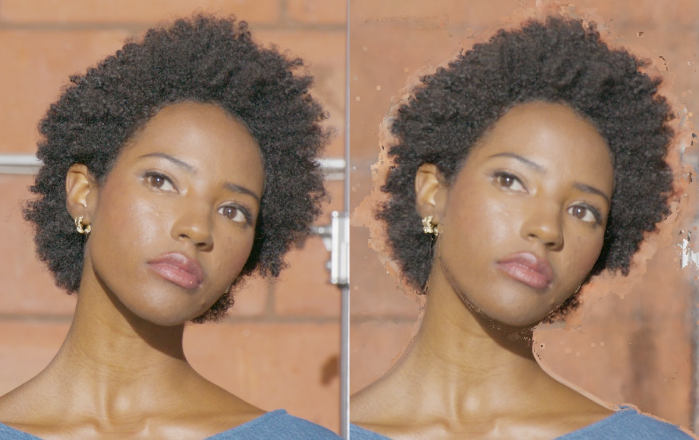
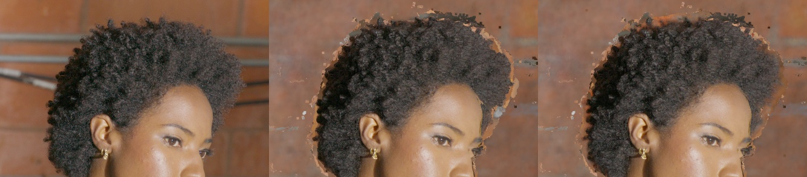

# DEC5 001083: LookCloser depth, subject sampling and camera stability

## What was tested

User-requested independent LookCloser track, started **2026-10-27 18:57:38 UTC**.
Maximum **16 aggregate GPU-device hours and 16 wall hours**, conservative deadline
2026-10-28 10:57:38 UTC. Preprocessing and evaluation count toward this budget.
No further PatchMatch experiments. The separately requested HairGS trial has its
[own report](dec5_001083_hairgs_four_hour_trial.md).

This is distinct from the earlier LookCloser-core control, which disabled the
frequency grid, feature reweighting, FAS and ARM. That control did not constitute
a full test of the local `Paper LookCloser.md` design. Its strongest density peak
improved static RGB but failed the camera-path stability gate; no hair fix was
accepted. [Earlier results](dec5_001083_hair_depth_stability.md).

The new track enables genuine progressive 2D frequency regression, sparse
frequency-grid initialization, feature reweighting, FAS and frequency-dependent
ray marching. All arms share original calibration, fixed display, seed, sparse
support and source images: 59 train / 3 validation / 3 excluded test cameras.
The corrected Instant-NGP density activation uses FP32 truncated exponential;
the historical softplus control remains separately identified.

| Arm | Explicit hair-region quota | Other subject quota | Native FAS context |
| --- | ---: | ---: | ---: |
| Paper FAS control | 0 | 0 | 100% |
| Subject90 | 60% | 30% | 10% |
| Hair95 | 80% | 15% | 5% |

Quotas begin after 1,000 steps and ramp over 2,000 steps. Thirty percent of the
hair-region allocation samples a ±5-pixel silhouette band, including adjacent
background; the rest samples semantic hair interior. Classes are fallible
training-only Sapiens localizers, not alpha or depth GT. Actual class proportions
and cached-camera IDs are audited, not inferred from requested quotas.

Paper starting points: 16 hash levels, two features/level, bounded-scene hash
size 2^19, maximum resolution 8192, 128³ frequency grid, grid
update interval 1024, Charbonnier RGB epsilon 1e-4, distortion coefficient .01,
early sparse-depth coefficient .001, Adam beta=(.9,.99), epsilon 1e-15. The ray
controller targets 2^18 field samples/update with 128–8192 rays and an ARM cap
of 2048 samples/ray. Sparse support adds 64 rays/update during the first 5,000
steps; these queries are counted. Sampling ratios are the first experiment;
capacity and opacity constraints remain later alternatives. All full arms use
the same train-only SfM scene bounds: scene_scale .0903317, AABB span .1806634.
The old camera-sized span 4 put almost every sparse point at maximum frequency
and made the finest cell project to 6.49 px; it was unsuitable for this scene.
The corrected span makes that cell approximately .29 px. Coarse/min/max marcher
steps scale with bounds (.00028229 / .000005513 / .0056457 normalized units).

True 2D maps use the existing progressive regressor: 1000 steps/level,
8-pixel patches, SSIM .97, max resolution 8192, 2D hash size 2^23. Only the 59
training images enter regression. Both GPUs use pytorch-msssim 1.0.0; private
tiny-cuda-nn on clever-shadow uses compute90 PTX on Blackwell and passed a real
forward/backward check. It does not change the calibration service environment.

## Results

**Completed frame-1083 result:** joint scoped LookCloser geometry with source
premultiplied RGBA reduces 96-pose toggles **61.5%** and validation hair LPIPS
**10.3%** against corrected B0. Selection was locked before the reserved-camera
readout. That readout improves hair LPIPS **8.2%**, but loses **2.06 percentage
points of silhouette recall**, failing the one-point guard. Residual gray/orange
crown fragments remain visible. This is useful progress, not a solved-hair,
production-validation or 4K claim. A separate native-resolution frame-1055
control is documented [here](dec5_001055_native_head_resolution.md).

| Validation candidate | Hair PSNR / SSIM / LPIPS | Face LPIPS | Holes | Halo | 96-pose toggle fraction |
| --- | --- | ---: | ---: | ---: | ---: |
| Corrected B0 | 21.00097 / .34152 / .197531 | .078379 | .060811 | .007685 | .0243825 |
| RGB-selected dense-guided LC | 21.62145 / .33220 / .180117 | .077592 | .008641 | .003575 | .0112592 |
| Scoped LC geometry + source RGBA, skin protected | 21.57718 / .33673 / .179720 | .077856 | .005502 | .002713 | .0107696 |
| Joint scoped LC + source RGBA, locked candidate | 21.63109 / .34137 / .177151 | .077794 | .004413 | .002074 | .0093918 |

[Selected 96-view video](assets/dec5_001083_lookcloser16/joint_head_rgba_full96_candidate.mp4).
The source-switch fraction drops .0571102 → .0042255, but exposure events remain
worse: .0066197 → .0755134. These are camera-path stability measurements, not
proof of temporal consistency on independently reconstructed video frames.
Hair SSIM does not materially improve.

| Reserved-camera readout | Hair PSNR / SSIM / LPIPS | Face LPIPS | Holes | Halo | Silhouette recall |
| --- | --- | ---: | ---: | ---: | ---: |
| Corrected B0 | 23.04947 / .50258 / .176601 | .073709 | .047848 | .002921 | .936010 |
| Locked joint LC + RGBA | 23.33613 / .49204 / .162193 | .072965 | .002249 | .000156 | .915422 |

The recall proxy uses fallible Sapiens semantic evidence and transferred coverage,
not true alpha GT. Nevertheless, the guard fails and visual inspection confirms
remaining crown artifacts; no post-test tuning or reselection is performed.

Full-frame test LPIPS also worsens .356281 → .363224; do not imply an overall-frame
win. Test RGB had been viewed during earlier campaigns, so this is a locked
readout within this campaign rather than a historically pristine blind test.

Independent well-observed RoMa witnesses still favor raw PatchMatch: median/p90
relative discrepancy .000183/.000494 versus the final native head median
.000356/.001451. Improved completion and stability must not be presented as
certified geometric accuracy everywhere. Native RGB checkpoint selection retains
the 74,999-step parent; the joint 84,999-step field is an explicitly labeled
auxiliary geometry diagnostic, not the native-RGB winner.

Completed implementation checks:

- Subject-biased samples retain exact RGB/coordinate binding under a cached
  camera subset with noncontiguous IDs. Requested quotas are camera-balanced.
- Opt-in frequency projection converts the 2D regressor's normalized-UV grid
  resolution using `mean(fx/W,fy/H) * AABB span / camera-z`. The legacy path
  multiplies UV resolution by a pixel-valued focal length and can saturate the
  3D grid. Image-resize and scene-similarity invariance tests pass for the new
  mode; legacy remains the default for archived experiments.
- The actual periodic update is tested with off-axis perspective rays: correct
  camera-z, half-pixel centers and the existing no-autograd contract.
- The clever-shadow CUDA runtime passed actual fixed and adaptive marcher
  forward/backward checks with finite gradients. This synthetic runtime test is
  not a reconstruction-quality result.
- A new train-only fixed-pose SfM initializer supplies **17,709 points / 126,322
  observations**, median reprojection .363 px, p95 .990 px. Pose difference from
  the original cameras is below 5.4e-15. These are reconstructed training points,
  not independent depth ground truth or inherited all-camera sparse points.
- Adaptive-trained fields require an explicit common dense probe for density
  profiles. Adaptive sample locations must never be interpreted as uniformly
  spaced depths. The probe preserves learned frequency-grid and FR weights.

Initial measured map example, A004_B005: 61.5% of background patches versus
39.0% of hair patches were assigned maximum 2D frequency. FAS alone therefore
does not guarantee priority for the subject. Other views differ; the comparison
will use actual accumulated ray counts for all 59 cameras.

The old core field was additionally tested on 133 qualified RoMa points / 399
source-view witnesses. Common 4096-sample probe median absolute relative
camera-z discrepancy: expected depth **5.868%**, first significant surface
**33.671%**, strongest peak **.067%**, subpixel strongest peak **.060%**.
Median volume-weight mass before / within ±1% / behind the triangulated witness
was **23.0% / 64.0% / 13.0%**. These are well-observed training-view locations,
not a claim about the whole hairstyle or independent 3D ground truth. They show
why both density concentration and depth extraction must be measured.

Native marcher export is kept separate from the common dense probe, so the
algorithm's saved occupancy/adaptive state can be assessed directly. An eight-
pixel original-checkpoint roundtrip differed from the archived baseline by at
most .000153 calibration units; it preserves the frozen field fingerprint.
The original 8192-level hash cell projects to about **6.49 pixels** at these
hair witnesses. Higher field capacity / tighter subject bounds are therefore
the reason scene bounds were corrected before all three full LookCloser arms.

### Initial full LookCloser depth check

Same 133 qualified RoMa points / 399 source-view observations; these reconstructed
training-RGB witnesses do not provide independent 3D ground truth. All camera
poses remain fixed. Common profiles use 4096 uniform samples, while native depth
uses each checkpoint's own occupancy and adaptive marcher.

| Field | Step | Native expected discrepancy | Dense expected discrepancy | Strongest peak discrepancy | Weight within ±1% of witness |
| --- | ---: | ---: | ---: | ---: | ---: |
| Earlier core B0 | 13,999 | 5.868% | 5.868% | .0671% | 64.0% |
| Full paper FAS, PSNR-selected | 4,999 | .6045% | 1.6047% | .0941% | 56.3% |
| Full paper FAS, diagnostic latest gate | 19,999 | .1749% | .1482% | .0299% | 93.6% |

[Selected proxy](assets/dec5_001083_lookcloser16/paper_selected_depth_proxy.json),
[20k proxy](assets/dec5_001083_lookcloser16/paper_step19999_depth_proxy.json),
[old field reference](assets/dec5_001083_lookcloser16/b0_depth_reference_final.json).
The 20k gate is explicitly a depth diagnostic, not silently substituted for the
native-RGB PSNR-selected checkpoint. Its native RGB PSNR/SSIM/LPIPS are
21.9815 / .71375 / .50957, versus 22.2372 / .70440 / .54956 at selected 5k.
This gives a concrete reason to continue convergence and test depth through the
same frozen GT transfer, rather than stop at the early whole-image PSNR peak.

The first 20k native-depth receiver with **unchanged original PatchMatch source
visibility** fails: hair PSNR/SSIM/LPIPS 20.8270 / .27585 / .21423 versus
21.0010 / .34152 / .19753 for B0. Holes increase .06081 → .13774; halo falls
.007685 → .000555, but silhouette recall drops .91969 → .84075.
Face LPIPS .079707 is 1.70% worse. No pilot or acceptance path is justified yet.
[Metrics](assets/dec5_001083_lookcloser16/paper20k_metrics.json),
[GT left / receiver right](assets/dec5_001083_lookcloser16/paper20k_receiver_E_B.jpg).
Visual review shows altered internal curl texture and missing strands despite
a cleaner outer silhouette. A distinct visibility ablation now exports source
head-depth maps from the **same frozen field**, retaining source order and RGB;
missing neural hits remain unknown rather than being marked visible.

At the initial control audit, approximately 66% of RGB rays and 60% of field
queries were background; only 7–9% were hair. Subject90 reached 30k and continues from its full native state. Hair95 is
running with the same 200k ceiling as the extended paper control. Full LookCloser stopping now separately tracks measurable PSNR, SSIM or
LPIPS progress; checkpoint selection still follows the required PSNR band.
Native continuation restores optimizer, scheduler, scaler and pipeline buffers.
A custom-loop RNG-restore omission was caught immediately, its owned trial was
stopped and recorded, and the continuation was restarted from the same parent
with restoration immediately before the first iteration. No other job was stopped.

## Insights

Select checkpoints by highest eval_all_psnr, with LPIPS as tie-breaker inside
.07 dB. Save PSNR/SSIM/LPIPS, rendered head crops, common-probe expected/front/
separated-peak depths, opacity and confidence. The decisive comparison uses the
same corrected B0 GT-pixel transfer, source order, hair ROI and frozen fallback.
No held-out RGB enters frequency fitting, sparse support or RGB source blending.

First reject poor candidates on three validation views and the fixed 16-view
pilot. Only a material RGB/coverage or popping gain, with face/silhouette guards
and an independent geometry proxy, advances to the 96-view acceptance path.
Improved neural RGB alone cannot establish better depth or reduced flicker.
Do not continue minor tuning when an arm has no substantial gain or clear
prospect. Full convergence or higher-capacity/head-focused alternatives must
remain inside the total 16-hour budget.

Durable network root on dev3:
`/fsx/tmp/lookcloser_hair_001083_20261027_1330/lookcloser16`.
Its campaign manifest pins the budget and split; owned controllers log resource,
process, checkpoint and OOM checks every 30 seconds. Root supervision remains
active while training runs. Clever-shadow helper root:
`/mnt/footage2/lookcloser_hair_001083_20261027_1330/lc16_frequency_shard20`.

### Foreground-volume alternative

A separate full LookCloser arm on dev3 tests foreground geometry directly:
train-only BiRefNet/PyMatting head-crop targets supervise premultiplied RGB and
optical thickness `sum(sigma * delta)` against `-log(1-alpha)`. This is person
matting, not hair depth ground truth. Unknown pixels outside known crops do not
supply RGB/opacity targets. Native adaptive sample intervals are integrated
without assuming uniform spacing; uniform-density partition invariance and
nonzero density gradients pass a deterministic check. The original pipeline's
FAS, dynamic ray count, frequency updates and early sparse prior remain enabled.
Its .6/.3 sampling and other full LookCloser controls match Subject90, while
held-out RGB completion uses the same frozen original neural background.
No quality result is claimed before actual CUDA training and held-out review.

Targeted checks: five checkpoint-selection/sampling/projection tests and three
foreground-coordinate/optical-thickness tests pass in a private test environment.
Network backup contains both selected 5k and diagnostic 20k control checkpoints
with byte-identical SHA-256, plus all 59 frequency maps. The foreground targets,
fallback and new outputs use the real FSx mount on dev3.

[Shared-scale depth review](assets/dec5_001083_lookcloser16/paper20k_depth_review.jpg)
shows more internal depth structure but a far-depth band at the hair boundary.
The display is a qualitative comparison, not a depth ground-truth image; blue
is nearer and red farther on one common scale. Foreground-volume training has
passed actual fixed warmup and adaptive CUDA updates on dev3 with finite
optimization; held-out quality is still pending.

The first Subject90 20k receiver also fails with original source visibility:
hair PSNR/SSIM/LPIPS 20.9528 / .27707 / .20967, holes .13283, face LPIPS .08001.
This is only a 2.1% perceptual improvement over the full LookCloser 20k control,
and still 6.1% worse than B0. Native witness discrepancy .1715%, mass within ±1%
94.4%; the local proxy alone remains insufficient. Actual resumed Subject90
queries are approximately 59.2% hair, 32.9% other person, 6.0% background,
compared with 13.2% / 36.7% / 49.6% for resumed paper FAS. These are measured
field queries, not nominal sampler quotas. At 50k, raw neural RGB control versus
Subject90 is PSNR 21.8336 / 22.1817, SSIM .7165 / .7284, LPIPS .4835 / .4462.
Final transfer/visibility tests remain necessary.

The first foreground-volume screen is **rejected and stopped** after visual
inspection at 5k: unconstrained density outside known crops produces large
floating volumes (PSNR/SSIM/LPIPS 13.6314 / .53392 / .66761). No OOM occurred.
[Rejected raw render, GT left](assets/dec5_001083_lookcloser16/foreground5k_E_B.jpg).
The next distinct **head-only volume** arm treats pixels outside padded head
crops as empty head volume. A train-only audit confirms all 9,813,973 semantic
hair pixels across 59 cameras lie inside those crops. This is a fallible crop
coverage check, not proof that all fine wisps are annotated. It uses the same
foreground targets and records the immutable coverage receipt; the rest of the
scene comes from the frozen baseline. The original outside-crop-unknown variant
remains archived separately.

### First material static candidate: native conditional median

An adaptive-volume depth statistic is exported without changing the learned
field. Native packed weights are ordered per ray; the conditional 50% weight
crossing is located inside its true interval using constant-density exponential
interpolation. It never assumes uniform spacing. Two deterministic tests show
invariance under nonuniform subdivision and proper separation of packed rays.
At Subject90 50k witnesses, native expected / median discrepancies are
.1387% / .0427%; median p90 .3178%. This remains a noisy training-view proxy.

| Receiver, original source visibility | Hair PSNR | Hair SSIM | Hair LPIPS | Face LPIPS | Holes |
| --- | ---: | ---: | ---: | ---: | ---: |
| B0 | 21.0010 | .34152 | .19753 | .07838 | .06081 |
| Subject90 50k expected | 20.9552 | .27997 | .21170 | .08019 | .13782 |
| Subject90 50k native median | **21.5852** | .31656 | **.18226** | **.07797** | .08830 |

The median candidate gains **7.73% hair LPIPS and .584 dB hair PSNR**, with no
face regression; holes remain 45.2% worse than B0 and SSIM is lower. It advances
to the fixed 16-view camera pilot, not directly to acceptance. Whole-frame
receiver PSNR/SSIM/LPIPS are 23.3388 / .78060 / .42522.
[Metrics](assets/dec5_001083_lookcloser16/subject50k_median_metrics.json),
[proxy](assets/dec5_001083_lookcloser16/subject50k_median_proxy.json),
[GT left / receiver right](assets/dec5_001083_lookcloser16/subject50k_median_E_B.jpg).
The 50k gate is a frozen depth candidate; native-RGB checkpoint selection still
chooses the recorded PSNR-band best. That selected 20k Subject90 field is also
being tested with median depth. Final receiver selection must explicitly name
its own full validation RGB PSNR/LPIPS criterion and retained checkpoint.

The 80% hair screen stops after its completed 30k gate: at 20k it gives hair
LPIPS .20944, effectively tied with .20967 at 60%, with no material receiver
benefit. The full 60% and FAS controls continue toward query-matched convergence.

A separate mean-depth **same-field source visibility** test at control 20k
reduces holes to .04785 (21.3% below B0), but hair LPIPS degrades to .21996.
It is rejected for texture fidelity. Same-field source **median** depth is now
exported for the promising 50k field, separately from the unchanged-visibility
pilot; these are distinct ablations.

Foreground head-only SmoothL1-thickness training stops at 10k without validation
progress. A component audit separates frozen fallback, predicted alpha, raw RGB
and composite: the new field's alpha contains broad floating density even where
raw RGB correctly approaches black. Thus the ghosts are not solely inherited
fallback artifacts. A distinct Bernoulli-opacity likelihood tests a physically
matched objective: alpha=1-exp(-tau), empty-ray negative log likelihood=tau,
and soft-alpha targets have their optimum at -log(1-alpha). Unlike SmoothL1
around zero thickness, the empty-space gradient does not vanish. Four foreground
coordinate/integration/likelihood checks pass; actual reconstruction remains
unaccepted until held-out review.
[Component audit](assets/dec5_001083_lookcloser16/head5k_composite_audit.jpg).

### Current strongest prototype: median target + same-field source visibility

At 50k, replacing the source visibility maps as well as target depth gives
hair PSNR/SSIM/LPIPS **21.4250 / .31871 / .18481**, face LPIPS **.07748**, holes
**.008396** and recall **.94257**. Relative to B0: hair LPIPS improves **6.44%**,
holes decrease **86.2%**, and face LPIPS improves **1.14%**.
[Static metrics](assets/dec5_001083_lookcloser16/subject50k_median_neuralvis_metrics.json).
F/B decontamination layered on this configuration changes hair LPIPS only
.184806 → .184746: no material benefit, so that variant is closed.

| Fixed 16-view pilot | B0 | LC50 same-field median | LC50 + path-local source priority |
| --- | ---: | ---: | ---: |
| Visibility toggles | .024200 | **.012528** | **.012528** |
| Present fraction | .790877 | **.887253** | **.887253** |
| Source switches | .104211 | .117654 | **.006143** |
| Mixed-coordinate depth-exposure proxy | .003716 | .095984 | .095984 |

Coverage toggles decrease **48.2%** and present coverage increases **12.2%**.
Source priority is a separate renderer control: same 8 train cameras ordered
against the path midpoint, with no RGB averaging. Fixed-source counterfactuals
assert exact geometry and ROI, and midpoint RGB/source IDs match exactly. A
repeated skin gate initially narrowed the BCE counterfactual ROI; the invariant
check caught it, the explicit frozen-ROI path was corrected, and BCE was rerun
as `sourcefixed_v3`. Original artifacts remain separate.

On exactly identical geometry, source freezing reduces estimated-motion display
RGB MAE by **23.7% for B0**, **22.9% for BCE**, and **45.6% for LC50 with matching
source median maps**. These are paired continuity measurements, not unseen-view
RGB GT or proof that real specular changes should be suppressed. All paired
coverage denominators remain fixed. Source priority does not itself reduce
semantic coverage toggles.
[Coverage pilot](assets/dec5_001083_lookcloser16/joint50k_pilot_metrics.json),
[fixed-priority pilot](assets/dec5_001083_lookcloser16/joint50k_sourcefixed_pilot_metrics.json),
[B0 RGB continuity](assets/dec5_001083_lookcloser16/sourcefixed_b0_rgb_continuity.json),
[BCE RGB continuity](assets/dec5_001083_lookcloser16/sourcefixed_bce_v3_rgb_continuity.json).

### Geometry caveat and further controlled tests

The unfavorable depth-exposure result is not explained away by coordinate
transport. A separate audit projects candidate points to their own next-view
coordinates, retaining the common B0 anchor domain. LC50 exposure is .09760
versus .09598 under mixed coordinates; median/p95 flow disagreement is only
.0445 / .5960 px. The identity control reproduces all baseline counts exactly.
Thus the field-derived single-depth receiver is not yet a proven rigid surface.
[Motion audit](assets/dec5_001083_lookcloser16/joint50k_depth_motion_audit.json).

The same 133 RoMa points also clarify what improved: native raw PatchMatch has
median/p90 relative discrepancy **.0183% / .0494%**, B0 fused mesh **.0421% /
.1064%**, and LC50 native median **.0427% / .3178%**. The raw stereo maps are
more precise at these well-observed locations. The LookCloser gain is currently
coverage and transfer stability, not uniformly better pointwise depth. These
training-RGB witnesses are noisy reconstructed proxies, not independent 3D GT.
[Reference comparison](assets/dec5_001083_lookcloser16/patchmatch_mesh_witness_reference.json).

A single shared surface fused solely from 59 frozen LookCloser median maps,
known opaque train mattes and no PatchMatch geometry produced 5,678,823 triangles
at .001 calibration-unit voxels. Its held-out hair LPIPS .19863, face .08014,
and halo .01056 fail the baseline guards. This surface variant is rejected;
smaller voxel tuning is not pursued.
[Shared-surface metrics](assets/dec5_001083_lookcloser16/subject50k_shared_surface_metrics.json).

A new hybrid screen uses **267,336** hair depth anchors spanning all 59 train
cameras: opaque matte/semantic interior, photo/geometric agreement, >=3 other
pose-diverse views, source roundtrip <=1.5 px, and modulo-pi 3D orientation
consistency. No RoMa locations or held-out RGB select anchors. About 5% of anchors
are withheld. A short native continuation of the selected 75k field supervises
pre-surface optical thickness and opacity in a two-pixel depth band; RGB decoder
weights are frozen while shared geometry features can learn. Extra queries are
counted. The online geometry monitor initially uses the first 512 withheld
anchors and is source-order skewed; global posthoc validation is required before
claiming global depth gains. Initial RGB PSNR/SSIM/LPIPS remain essentially at
the parent level. A Python 3.8 `str.removeprefix` checkpoint-loader incompatibility
was fixed with equivalent prefix slicing; old checkpoints remain intact.

Both full LookCloser arms reached **174,999** and stopped after two validation
checks without sufficient progress, below their 200k ceiling. Subject90's
native PSNR-band best is **74,999**, PSNR/SSIM/LPIPS **22.4122 / .73106 / .43987**;
FAS control selects 4,999, **22.2372 / .70440 / .54956**. At equal 100k steps,
Subject90 improves raw neural RGB by .60 dB and 8.8% LPIPS over FAS control.
The three median-extraction quota screens at 20k give hair LPIPS .18850 (FAS),
.18381 (60/30), .18231 (80/15); 80/15's incremental gain over 60/30 is small.
The selected 75k Subject90 field is now validated through the same source-depth
pipeline and a 96-pose export.

All image-quality results here are **1920×1080**, not validated 4K. Static
validation uses the frozen full-resolution neural fallback; the camera-path
baseline and candidates use the same downscale-5 low-frequency fallback. This
fallback is only used where original GT transfer is unsupported. The pilot's
midpoint depth/RGB/source-ID/ROI arrays match the full baseline path exactly.
No physical-time hair-motion reconstruction has yet been tested.

### 75k native-selected field and dense geometric continuation

The PSNR-band-selected 75k field, using its own conditional-median source maps,
now gives validation hair PSNR/SSIM/LPIPS **21.5156 / .32291 / .18296**, face
LPIPS **.07772**, holes **.009156**, silhouette recall **.94439**. Hair LPIPS
improves **7.38%** and holes decrease **84.94%** versus B0. On the fixed 16-view
pilot, visibility toggles decrease **49.37%**, present fraction rises from
.79088 to **.88549**, and midpoint-fixed source priority reduces source switches
to **.005915**. Depth-exposure remains unfavorable (**.09333**); this is a
coverage/appearance improvement, not a claim that the geometry is solved.
The complete 96-view native depth export has finished; final RGB and video
validation are in progress.

A frozen marcher convergence audit at the 133 independent-detector train-RGB
witnesses found all witnesses inside occupied cells, no 2048-sample saturation,
and essentially unchanged median-depth discrepancy when increasing the cap,
dilating occupied cells, or using 4096/16384 uniform samples. The existing
interior depth error is not explained by an obvious ray-step/culling bug.

Posthoc evaluation of **all 13,379 withheld depth anchors spanning 59 cameras**
confirms the short geometric continuation improves more than its initially
source-skewed 512-anchor online monitor suggested:

| Step | Median relative depth discrepancy | P90 discrepancy |
| --- | ---: | ---: |
| 74,999 parent | .08934% | .33984% |
| 75,499 native RGB-selected | .06723% | .29368% |
| 76,499 | .05991% | .27826% |
| 77,999 | .05313% | .26609% |
| 79,999 diagnostic latest | **.05053%** | **.26238%** |

All anchors remain valid; model state is unchanged during evaluation. The
latest step reduces median/P90 discrepancy **43.4% / 22.8%**. These withheld
labels come from training RGB, not unseen cameras or independent 3D ground
truth. The native RGB-selected checkpoint remains **75,499**, PSNR/SSIM/LPIPS
**22.4078 / .73205 / .43770**. The latest gate is a separately labeled geometry
diagnostic, not silently substituted for the required RGB selection.
[All-camera anchor evaluation](assets/dec5_001083_lookcloser16/dense_guidance_global_validation.json).
Both gates are being compared through the unchanged validation GT-transfer path
before deciding whether this hybrid deserves a new camera-path test.

### Full 96-camera gate for the 75k field

The frozen 96-camera path completes with the selected 75k model, same-field
median source visibility and a single midpoint reference for the original eight
source cameras. Both videos encode/decode to **96 frames, 24 fps, 4 seconds**.

| Fixed common-domain proxy | B0 | LC75 + same-field visibility + fixed priority |
| --- | ---: | ---: |
| Visibility toggles | .0243825 | **.0118046** |
| Present fraction | .805083 | **.889733** |
| Source switches | .0571102 | **.00716284** |
| Depth-exposure dropouts | .00661968 | .101084 |

Coverage toggles decrease **51.6%**, source switches **87.5%**, and present
coverage increases **10.5% relative**. These are camera-path proxies, not a
physical-time motion test. Missing candidate pixels remain in the denominator.
Decoded contact sheets and problem crops were visually inspected: the overall
head survives the path more consistently, while contour halos and isolated
background fragments remain visible. This is an improved prototype with a
retained geometry limitation, not an artifact-free reconstruction.
[Full path metrics](assets/dec5_001083_lookcloser16/subject75k_full96_metrics.json).

Full-HD native neural renders from the required PSNR-band-selected 75k checkpoint
are also saved on FSx under `lookcloser16/subject75_selected_native_hd`, including
RGB/depth/accumulation archives and GT comparison panels. At stride 1, native
PSNR/SSIM/LPIPS are **22.4086 / .77671 / .49013**. Stride-1 LPIPS/SSIM must not
be compared numerically with the training selector's stride-2 metrics.
[Native HD metrics](assets/dec5_001083_lookcloser16/subject75_selected_native_hd_metrics.json).

### Additional structural screens

A density/appearance separation screen explicitly clones the parent 75k
encoding and geometry MLP, including Adam moments, to an independent density
branch. The original RGB encoding/geometry/color weights and frequency grid
are frozen; all other training data, quotas and dense anchors are unchanged.
Before training, density/RGB at 2,048 points match exactly; 384 rendered rays
match within 1.3e-6 RGB and 4.8e-6 normalized depth (the initial overly strict
1e-6 ray tolerance rejected the conversion before training; the exact point
function parity passed). Original checkpoints are retained. A post-training
byte audit is required before interpreting this branch.

Two cheap renderer alternatives are measured and closed:

- Semantic-consensus source selection changes only the chosen RGB source.
  Runtime assertions prove exact geometry, semantic probabilities, support,
  reprojection diagnostics and holes. Hair LPIPS worsens **.18296 → .18412**;
  there is no reason to develop this selector further.
- Using matching neural source medians for the separate head-only BCE-5k field
  gives hair LPIPS **.18218**, holes **.006426**, recall **.98219**, but halo
  **.01270**, versus **.003352** for the full-subject 75k field. This is not a
  material fidelity gain and worsens hair/background separation; it is not
  promoted merely for its higher semantic coverage.

At unchanged original MVS source visibility, dense geometric continuation gives
hair LPIPS **.17722** (native RGB-selected 75,499) and **.17571** (diagnostic
79,999), versus **.18046** for the parent. Face metrics remain within guards.
Holes remain about .086 until matching neural source visibility is evaluated.
This modest incremental RGB gain is distinct from the much larger all-camera
anchor-depth improvement; both are reported rather than conflated.

The independent-density trial completed **10,000 updates**, ending at 84,999.
A byte audit confirms all original appearance encoding/geometry/color weights
and frequency-grid copies remain unchanged. All-camera held-out anchor median
error falls to **.05095%**, P90 **.28025%**; native RGB PSNR/SSIM/LPIPS remain
**22.4090 / 0.73192 / .43914** at the latest diagnostic gate. Its native-selected gate remains 75,499. GT-transfer hair LPIPS is
**.17736** selected and **.17738** latest: separation protects the appearance
function but provides no material transfer boost over the shared-feature dense
trial. This is not promoted on parameter separation alone.

A direct isodensity extraction is distinct from the earlier failed view-depth
TSDF: one scalar-field threshold is the median native density at fitting anchors
only (**387.97**), not tuned with validation RGB. A 355×277×384 grid produces
10,711,544 triangles at .001513 calibration-unit spacing. Hair LPIPS **.18723**,
holes **.05314**, halo **.01042** lose to LC75's median receiver. A final short
motion control also fails: toggles **.02936** versus B0 **.02420** (+21.3%),
present fraction **.79480** versus .79088. Thus an explicit common surface alone
does not resolve correspondence/visibility problems. No threshold sweep follows.

A separately logged density-only continuation now adds a physical opaque
first-hit median constraint: optical thickness from the ray origin to its
qualified anchor should be ln(2), using exact pre-band native integration plus
midpoint quadrature over the band front half. This supplements free-space and
band-opacity terms; fitting anchors remain disjoint from the 13,379 monitored
labels. Five targeted guidance/checkpoint tests pass, including the known
constant-density median, independence from density behind the anchor, and
correct finite gradient directions. Original appearance and grid are again
frozen, with a required byte audit after training. This is a new experiment;
no gain is assumed before its results.

### Layer compositor coverage audit and independent background sources

The earlier same-eight-camera F/B ablation affected only **464 pixels** across
three validation views despite ~149k soft-alpha ROI pixels. Its layer eligibility
was limited mostly by unavailable/occluded background sources, so its near-zero
metric change is not a general test of layered compositing.

A separate standalone compositor now keeps the original eight foreground sources
but searches all **59 train cameras** for visible background, with original
stereo visibility rather than the neural head surface. A deterministic CUDA
occluded-plane test demonstrates that two cameras outside the nearest eight
recover the correct background while head-only visibility rejects it. Actual
runtime assertions retain parent depth, ROI, and exact RGB outside the layer
gate. The new gate covers **9,280 pixels**, background support expands to about
51–55k ROI pixels per view, and no target RGB selects sources. Nevertheless,
hair LPIPS **.18405** loses to parent **.18296**, face **.07771**, halo **.003354**
is essentially unchanged. This corrected layer experiment is not promoted.

The centered-CDF trial finishes 84,999 with original appearance/grid byte parity.
Its all-camera anchor median/P90 discrepancy is **.04820% / .26676%**; native
PSNR/SSIM/LPIPS **22.3981 / .73179 / .43929**. This modest depth-proxy improvement
also gives no material downstream advantage: MVS-visibility hair LPIPS **.17720**
latest, versus **.17738** for independent density without centering and **.17571**
for the coupled 80k diagnostic. No further coefficient or band-width sweep is
justified by these results.

The later 30k head-only BCE gate also fails to improve its 5k screen materially:
MVS-visibility hair LPIPS **.18779**, face **.07803**, holes **.05124**, halo
**.006331**. Its lower halo than the early head-only joint screen does not
outperform the full-subject LookCloser track.

A fresh controlled **feature-reweighting-off** ablation retains train59 sparse
initialization, corrected bounds, frequency grid, FAS, ARM, .6/.3 subject quotas,
and the same point budget. The existing configured early stop remains active.
Its 50k ceiling and one-hour worker cap are within the shared campaign budget;
The native-selected 20k gate reaches validation PSNR/SSIM/LPIPS
22.65439 / .71758 / .48181 at stride 2. Its downstream hair LPIPS .18241
(50k diagnostic .18177) provides no material advantage over full LookCloser.
Higher whole-image PSNR does not establish better hair geometry; this screen is closed.

### Full-path dense-guided LookCloser result

The RGB-selected dense-guided gate (75,499; checkpoint SHA256
`bd025e49cb5483461589d22e398772c2ea7c89d2e73dfaa0d2c704cc0d830427`)
with matching source medians gives validation hair PSNR/SSIM/LPIPS
**21.62145 / .33220 / .180117**, versus B0 **21.00097 / .34152 / .197531**.
Face LPIPS .077592 improves on B0 .078379. Holes .008641 and halo .003575
improve on B0 .060811 and .007685. SSIM does not improve.

The identical 96-pose, 24-fps path completes successfully without OOM.
Warp-compensated strand toggles fall **.0243825 → .0112592 (53.8%)**,
source switches **.0571102 → .00652952 (88.6%)**, and hair presence rises
.805083 → .889078. Exposure disagreement **.084942** remains substantially
worse than B0 .006620, though below the unrefined LC75 value .101084.
Visual inspection still shows gray/orange background fragments around the
crown. This is a useful prototype, not a declaration that hair separation is solved.
These are novel-camera results for one HD time instant, not physical temporal
stability or validated 4K results.

### Independent pretrained stereo screen

The [official FoundationStereo implementation](https://github.com/NVlabs/FoundationStereo)
and published ViT-large checkpoint were tested on three calibrated train-camera
pairs. Rectification retains principal-point offsets in Q; world reprojection
is checked without fitting a depth scale. All 133 withheld correspondence
witnesses remain valid. Full-resolution crop median relative depth discrepancies
are .000287 / .000475 / .000218, versus raw PatchMatch .000162 / .000211 / .000162.
The coarser screen also loses. This does not justify exporting all 59 cameras.
Correspondences are train-image proxies, not independent 3D ground truth.

One initial full-crop attempt exceeded its deliberately imposed 14-GiB allocator
cap when cuDNN requested a 47.63-GiB workspace. It did not exhaust physical GPU
memory or stop unrelated work. After all LookCloser controllers finished, an
isolated retry with a 60-GiB task cap and 16-GiB reserve succeeded, peaking near
50 GiB. Main LookCloser training controllers report no OOM.

### Scoped head-density and opacity experiment

A diagnostic on hair-biased validation samples finds that the global volume
median lies outside the train-anchor head compartment for 9.7–14.6% of sampled
rays. Train-camera empty-matte samples still have mean visible head mass
.314–.423. This motivates a distinct head/background representation rather
than another depth coefficient sweep.

An opt-in independent density branch is restricted to an oriented head box
derived from training anchors. Original appearance weights, frequency grid,
and density outside the box remain byte/function identical after 10k updates;
2,560-point audits and initial forward-parity checks are saved. No anatomical
scalp is used. Soft person alpha is supervised only in qualified head crops of
the 59 train views, with 5% of labels reserved by a fixed pixel hash.
Reserved-label MAE falls **.242810 → .044636 (81.6%)**; this measures agreement
with fallible matting labels, not ground-truth hair alpha. Withheld anchor median
relative discrepancy reaches .0005323.

The latest gate is an **auxiliary geometry/opacity diagnostic**: native RGB
PSNR/LPIPS 21.8688/.45907 worsen, so the native RGB selection remains its
75k parent. A separate renderer now tests conditional head depth/coverage,
decontaminated GT foreground, and conditional non-head neural background.
It preserves full-ray transmittance, checks matching frozen source/target
fields, and retains the exact parent outside its gate. Exporting layers and
improving alpha-label agreement are not yet evidence of a better final render.

Downstream causal controls now distinguish the effects:

| Scoped-head use | Hair PSNR | Hair SSIM | Hair LPIPS | Face LPIPS | Holes | Halo |
| --- | ---: | ---: | ---: | ---: | ---: | ---: |
| Dense-selected parent | 21.62145 | .33220 | .180117 | .077592 | .008641 | .003575 |
| Head layers + decontaminated foreground/background | 20.84720 | .33394 | .194040 | .077542 | .005413 | .002378 |
| Conditional head geometry + raw GT RGB | 21.96510 | .34509 | .169464 | .077527 | .002723 | .009103 |
| Geometry only, target/source opacity ≥ .95 | 21.60462 | .33015 | .178896 | .077581 | .008641 | .003575 |

Conditional geometry improves hair LPIPS **5.92%** relative to the current
parent, but increases halo. The complete layer compositor loses interior detail
despite lower halo. Its comparison below is GT / parent / layered candidate.
The physically opaque confidence gate preserves parent halo but keeps only a
.68% perceptual gain. No opacity-threshold sweep follows. On the fixed 16-pose
path, raw conditional geometry reduces toggles .024200 → .006024 (75.1%),
but visibly expands the crown and has unacceptable contour artifacts. The
opaque-only control gives .011694, essentially the existing parent .011667.

A separate visibility-only nearest-depth control preserves bilinear RGB and all
geometry. It improves hair LPIPS only **.180117 → .179799**, halo .003508;
this does not warrant promoting a new renderer policy. A deterministic CUDA
discontinuity test confirms the mechanism: bilinear depth invents a depth-2
surface between depth-1 and depth-3 pixels, whereas nearest depth rejects it.
Both visibility tests pass. The earlier 11 quantile/opacity/selection/sampling
tests also pass; unrelated jobs remain untouched.

An appearance-only continuation tests whether changed density invalidates the
frozen color head's conditional background. After 10k color-only updates,
native PSNR/SSIM/LPIPS are **21.97637 / .72463 / .44648**. The 27-tensor audit
confirms exact frozen density, frequency and occupancy state. This is insufficient
recovery against the parent's 22.41222/.73106/.43987; the native-selected best
remains the original parent. A separate matched 10k **joint RGB + scoped opacity**
trial reaches **22.25139 / .73124 / .44410**, with withheld depth discrepancy
.0004537 and alpha-label MAE .04234. Its downstream geometry/RGBA screen is running.
The first joint setup was rejected by a frozen-appearance-only guard before
optimization; `head_joint_v2` explicitly enables the joint mode. No checkpoint
or dataset was invalidated by this setup error.

### Correct source-alpha transfer

The earlier compositor treated visible neural head weight as coverage and
interpolated unpremultiplied foreground RGB. The separate source-RGBA path now
premultiplies decontaminated source RGB **before** bilinear warping and transfers
the matching source alpha. A CUDA transparent-neighbor test rejects the familiar
color-bleeding case; all three visibility/compositing tests pass. Source-voted
confident skin pixels preserve exact parent RGB, with runtime assertions.

This yields validation hair PSNR/SSIM/LPIPS **21.57718 / .33673 / .179720**,
face LPIPS **.077856**, holes **.005502**, halo **.002713**. Against the dense
parent, perceptual quality is similar, holes decrease **36.3%** and halo **24.1%**.
The first 16-pose screen gives toggles **.009945** versus parent .011667;
the final skin-protected version is being rechecked and all 96 poses are running.
Unsupported pixels retain the exact parent, including some of its crown artifacts.

A density-component probe on three train cameras rules out a proposed correction:
opaque-hair visible and intrinsic head alpha differ by at most .00025 in their
means. Removing front attenuation is not supported by this sample. Neither
quantity is independent hair-alpha ground truth.

### Target-ray multiview depth re-ranking

The separate STITCH-inspired target-ray screen uses the selected LC depth as a
prior, nine bounded hypotheses, 3×3 source ZNCC patches and 3D orientation-plane
agreement from eight train views. It never reads target RGB. Acceptance requires
four nonflat witnesses, unchanged support, no worse orientation, 10% photometric
gain and a separated minimum. The known-plane reconstruction and ambiguity/
orientation fallback tests pass. This is not full STITCH strand tracing.

It changes **172,826 / 503,311** source-voted hair-domain pixels, but downstream
hair LPIPS worsens **.180117 → .185047 (2.7%)**, roundtrip error 2.977 → 3.184 px.
This screen is closed without a coefficient or threshold sweep.

### View-independent appearance control (closed)

An independent full-LookCloser continuation tests whether suppressing angular
color freedom improves geometry for subsequent GT transfer. It keeps subject
quotas/FAS/ARM and replaces color directions with one constant unit vector;
this is an ablation, not a paper default. Actual GPU checks confirm strict legacy
checkpoint loading, exact density invariance, exact default-mode roundtrip,
and direction-independent point RGB. Since the initial forward function changes,
its parent is re-evaluated and old incompatible metrics are excluded from native
checkpoint selection. No improvement is assumed before downstream validation.

The matched view-independent source/target geometry test completes with hair
LPIPS .181787, holes .024801 and roundtrip error 3.3746 px, all worse than the
locked candidate. Native RGB also worsens. This family is closed.

### Fixed-density RGB fallback diagnosis (closed)

Replacing unsupported hair with same-field neural RGB blurs fine structure;
validation hair LPIPS worsens to .21181. A boundary-only variant preserves
geometry and nearly ties static LPIPS (.177197 versus .177151), but its actual
fixed-domain warped boundary RGB change rises .010144 → .010692, a 5.4%
regression. No further fallback mask/threshold sweep is justified.

All owned frame-1083 training, full-path and locked-test controllers have finished.
No NeRF training OOM occurred. One external FoundationStereo attempt with a 14-GiB
allocator cap failed on a cuDNN workspace; a separately capped 60-GiB attempt
completed, but failed the geometry comparison. Unrelated processes were untouched.
