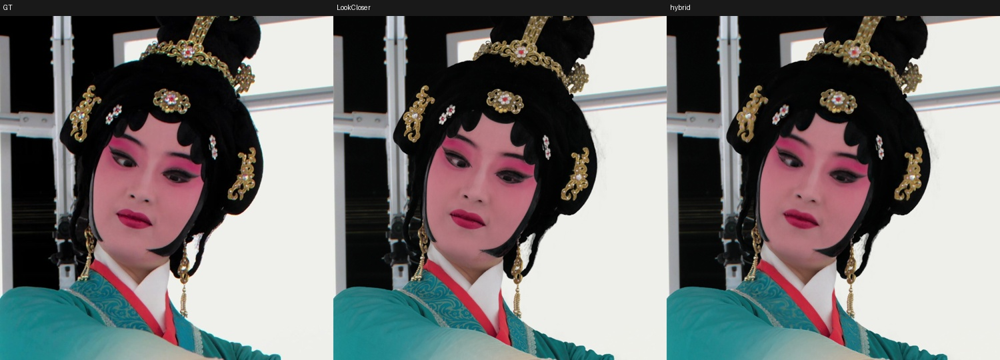
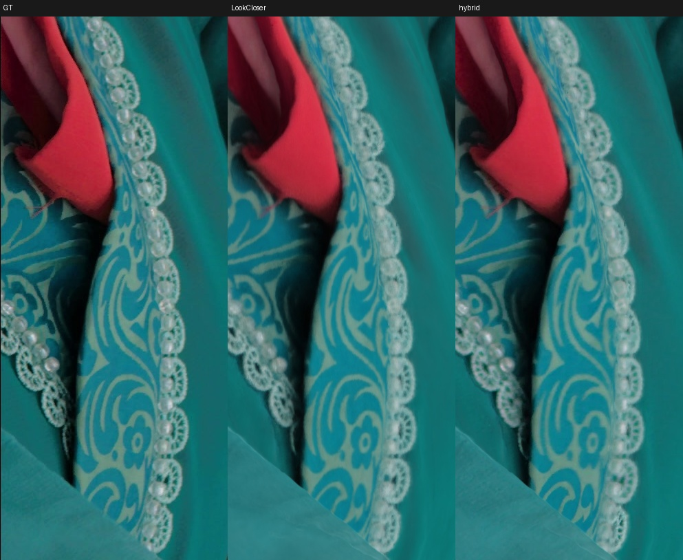
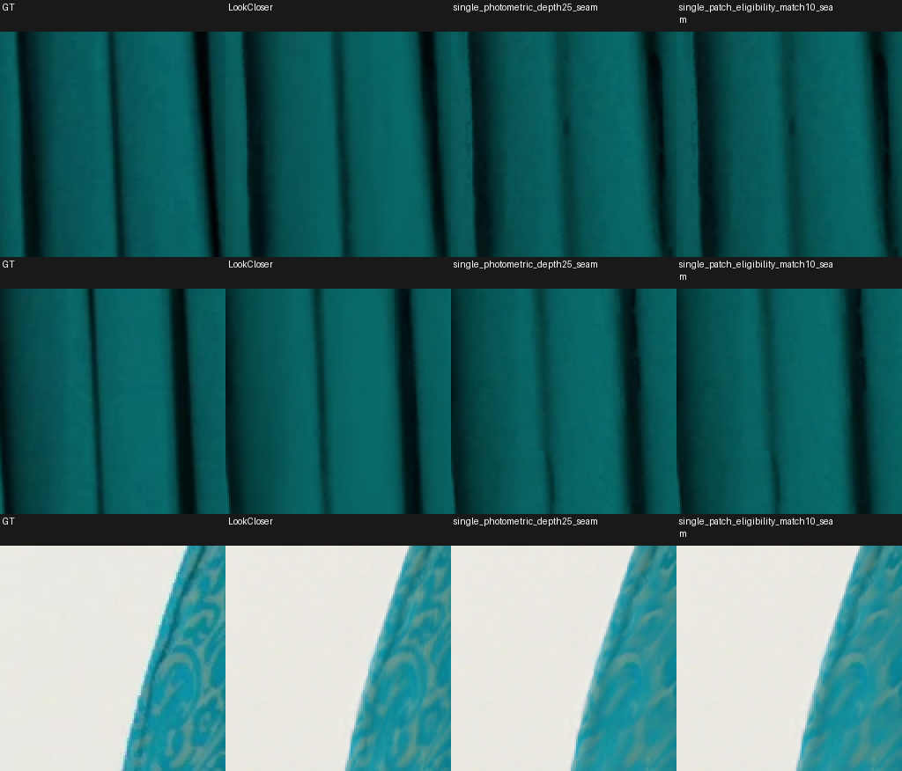

# Accepted post-training recipe: LookCloser + native photo detail, Luster 000540

## Status and scope

**Accepted by the user on 2026-10-18 as the working baseline for further improvement:**
`single_patch_eligibility_match10_seam`, the recipe used for the shown cam007 render.
Native validation person LPIPS improves **30.8034%**, from **0.1350403850** to
**0.0934433863**. This is a postprocessing step after selecting and freezing the
trained NeRF. It does not retrain the field or replace its geometry.

The [acceptance record](luster_000540_hybrid_v1/acceptance.json) records the user's
decision separately from the earlier strict local visual rejection. That review
remains valid evidence of remaining defects; acceptance does not mean every patch
improved or that the earlier 40% research goal was reached. The demonstrated scope
is one frame and four static views, not temporal consistency or universal dataset defaults.

Use this recipe after the [main training recipe's Luster adaptation](static_leader_reproduction_recipe.md#luster-dataset-adaptation-and-reusable-findings-2026-10-17).
The [full experiment log](luster_000540_native_hybrid.md) retains all controls,
including historical ineligible approaches. Only the recipe below is promoted.

## What is transferred and how

The rule is **geometry from frozen LookCloser; texture from one automatically
chosen native TRAIN photograph at each pixel**. All source selection, eligibility,
patch scoring and fallback are computed by code. No manually assigned nail/face
patches, optical flow, lookup shifts or target-GT-based choices are used.

1. Render the exact checkpoint at native target/source resolution. Save RGB,
   alpha and conditional termination depth quantiles. Use **camera-z q50** to
   unproject the target surface and project into each source. Q10/Q90 only inform
   uncertainty/ranking; they never change the texture coordinates. Pixel centers
   use +0.5 for unprojection and -0.5 for projection. Do not substitute ray distance.
2. Select a coverage-weighted pool of **16 TRAIN cameras per target** using frozen
   geometry, viewing angle and projected resolution. The candidate pool is automatic;
   the per-pixel winner is selected later. Cam012/095/150 are excluded from both
   texture and witnesses; cam007 cannot use itself. Source-native witnesses also
   exclude cam007. Read the original 3000×4096 / 4096×3000 JPEGs directly.
3. Check source alpha, depth agreement, round trip, uncertainty, projected scale and
   bounds. Check the entire eventual **16-tap cubic footprint before source ranking**.
   Use support-normalized local filters so invalid/background samples cannot enter
   patch statistics. A failed source cannot win simply because its color looks plausible.
4. Rank eligible sources by geometry, patch appearance, structural agreement and
   scalar TRAIN witness evidence. Broad-color patch error may be at most **0.10**;
   its ranking denominator remains **0.06**. This distinction is the final winning
   change. Setting both to 0.10 is a different experiment. Add contradiction-only
   source-native witness cost and directional photo sensitivity to depth uncertainty.
   Smooth scalar costs at sigma3, take one hard winner, then remove source islands
   once with a 3×3 majority check. Removal falls back to LookCloser; it does not
   invent a new source assignment.
5. Sample the selected photograph with clamped Keys cubic interpolation, parameter
   **-0.75**, at the same calibrated q50 coordinates. Do not repeat island removal.
   Filter the selected source over its valid geometric support, not just over the
   selected-label island. Replace the high-frequency residual at **sigma6, gain1**:

   `hybrid = clip(B + w * ((T - G6(T)) - (B - G6(B))), 0, 1)`

   Here B is the frozen target render, T is one projected native photograph, and G6
   is a Gaussian normalized by that source's geometric support. This preserves
   LookCloser's broad appearance while replacing detail; it is not raw full-RGB replacement.
6. Fade incompatible source boundaries over **3 native pixels**. Full strength
   across an internal boundary requires all touching source corrections to agree
   within **0.02 max RGB**, with a 3×3 disagreement guard. Other photos provide
   confidence only; their RGB is never averaged into the selected texture.
   With no valid transfer, preserve the original float LookCloser RGB exactly.

The stored source map identifies the selected photograph, while the transfer map
identifies the actual applied weight. A label alone does not prove that the output
changed. Use the float RGB comparison for the exact preserved fraction.

### Frozen configuration and implementation

The complete selector settings are committed in
[`selection_config.json`](luster_000540_hybrid_v1/selection_config.json).
Do not use the ranker's historical CLI defaults; they are not this recipe.

| Component | Accepted value |
|---|---|
| Source count / alpha | 16 / ≥ .99 |
| Relative source camera-z error / round trip / uncertainty | ≤ .005 / ≤ 1 native target pixel / ≤ 2 |
| Geometric source score / projected resolution ratio | ≤ 1 / ≥ .5 |
| Matching sigma / patch sigma / support mass | 2 / 3 / .6 |
| Color admission / color cost denominator / cost weight | .10 / .06 / .25 |
| Scale compatibility / round-trip / uncertainty / depth weights | .3 / 2 / .2 / .2 |
| Source-phase / view-phase weights | .5 / .5 |
| Contradiction penalty | 4 × max(source confidence cost − .5, 0) |
| Photo-depth penalty | .25 × log1p(RGB gradient sensitivity / .01) |
| Cost smoothing / source-island removal | sigma3 / one pass |
| Texture filter / residual / gain | clamped cubic −.75 / sigma6 / 1 |
| Merge support / seam fade / adaptive tolerance | geometry / 3 px / .02 |

Source confidence uses up to four geometry-selected TRAIN witnesses; two valid
observations are required and missing evidence is neutral. This is a heuristic
cost, not a calibrated probability. Do not interpret neutral or flat agreement as
proof that an unseen detail is correct.

The promoted path is
[`patch_eligibility_rank_luster_hybrid.py`](../scripts/patch_eligibility_rank_luster_hybrid.py)
→ [`cubic75_once_luster_hybrid.py`](../scripts/cubic75_once_luster_hybrid.py)
→ [`fixed_sampling_seam_luster_hybrid.py`](../scripts/fixed_sampling_seam_luster_hybrid.py).
The renderer, geometry/warp helpers, phase and witness confidence modules, tests
and audit/export tools are committed alongside it. Other campaign scripts remain
explicit ablations, not stages to run in production.

## Measured results

Both columns below use the same native images, person masks, neutral exterior,
spatial AlexNet LPIPS and CUDA evaluation. Validation012/095/150 were used to select
the recipe; they are not an untouched final test. Cam007 is a TRAIN demonstration
view evaluated with its own photograph excluded. HD numbers from training are a
different protocol and must not be compared directly to this table.

| View | LookCloser LPIPS | Hybrid LPIPS | Hybrid PSNR | Hybrid SSIM | Exact LookCloser preserved in person |
|---|---:|---:|---:|---:|---:|
| 007 | .06944436 | .06734035 | 31.222746 | .91339040 | 11.50% |
| 012 | .12492531 | .09799714 | 27.916029 | .87624147 | 13.79% |
| 095 | .12697524 | .07754952 | 29.199814 | .90819825 | 6.26% |
| 150 | .15322061 | .10478351 | 27.929138 | .91570885 | 8.23% |
| Validation mean | **.13504039** | **.09344339** | **28.348327** | **.90004952** | — |

Baseline validation PSNR/SSIM: **28.241791 / .89937888**. All predefined measured
ROI LPIPS means improve, but PSNR/SSIM do not improve in every view or region:
cam007 SSIM falls from .92124642 to .91339040. Small local fold/geometry errors
remain visible despite favorable aggregate LPIPS. The unachieved 40% target would
require validation LPIPS ≤ .0810242310.

Full region measurements are committed with the recipe:
[hybrid metrics](luster_000540_hybrid_v1/hybrid_metrics.json),
[baseline metrics](luster_000540_hybrid_v1/baseline_metrics.json), and
[source/output hashes](luster_000540_hybrid_v1/evidence.json).

Representative saved comparisons below are previews, not substitutes for native
images. Columns are GT / frozen LookCloser / accepted hybrid.





The following fixed native detail panels also preserve remaining fold-edge defects.
Their four columns are GT / LookCloser / previous depth25 candidate / accepted v1.



## Reproduction on olive-lark

Promotion verification on 2026-10-18: **115 focused tests passed**. Fresh selector,
cubic and seam stages using the committed config and original caches reproduced
all four views' float RGB, source labels, transfer weights and PNGs **exactly**.
The accepted candidate also passed the deep dependency/input audit, frozen-state
checks, source/witness exclusions and independent single-source merge reconstruction.
See [verification.json](luster_000540_hybrid_v1/verification.json) for hashes, paths
and test commands. This replay did not rerender the field or retrain the model.

The exact existing inputs and caches are retained at:

```text
C = /fsx/tmp/luster_000540_hybrid_20261017T104440Z
R = /fsx/tmp/luster_000540_body_opt_20261016
checkpoint = R/runs/cold_body80_fas50_threshold095_zero/G106316/field/lookcloser/run/nerfstudio_models/step-000106316.ckpt
checkpoint SHA256 = f07369d46d29852d9816a9681ac5758e9ecf22fad087ac3aece78e443ae8413b
native photos = /fsx/tmp/luster/root_8s/working/fullres/000540/images/
```

Use `C/runtime`, the copied compatible runtime from `R/code`, for model loading.
Do not assume current main can load this checkpoint identically. Preserve AABB,
weights, occupancy and frequency grids. The checkpoint already includes the
one-cell occupancy halo: do not dilate again or disable occupancy.

Rebuild the accepted transfer from verified caches with fresh candidate names:

```bash
C=/fsx/tmp/luster_000540_hybrid_20261017T104440Z
PY=/home/pavlo/.conda/envs/nerfstudio/bin/python
S="$C/code/LookCloser/scripts"
CFG=/fsx/tmp/luster_face_findings_main/LookCloser/experiments/luster_000540_hybrid_v1/selection_config.json
NAME=accepted_hybrid_v1_replay  # choose an unused name for every reproduction
export OMP_NUM_THREADS=4 OPENBLAS_NUM_THREADS=4 PYTHONDONTWRITEBYTECODE=1
export CUDA_HOME=/home/pavlo/.conda/envs/nerfstudio
export PATH=/home/pavlo/.conda/envs/nerfstudio/bin:$PATH
"$PY" "$S/patch_eligibility_rank_luster_hybrid.py" --root "$C" --name "$NAME" --config "$CFG"
"$PY" "$S/cubic75_once_luster_hybrid.py" --root "$C" --parent "$NAME" --name "${NAME}_cubic75"
"$PY" "$S/fixed_sampling_seam_luster_hybrid.py" --root "$C" --parent "${NAME}_cubic75" --name "${NAME}_seam" --filter-support geometry --seam-fade 3 --adaptive-seam --seam-tolerance .02
"$PY" "$S/evaluate_luster_hybrid.py" --root "$C" --candidate "${NAME}_seam" --device cuda
"$PY" "$S/review_single_luster_hybrid.py" --root "$C" --name "${NAME}_seam"
"$PY" "$S/freeze_luster_hybrid_candidate.py" --root "$C" --name "${NAME}_seam" --warp-root "$C/variants/cubic75" --deep --require-single-source
```

Run GPU rendering/evaluation sequentially and redirect long command output to
logs. The first three stages are CPU-only. Existing campaign `run_*` sweep
controllers contain historical deadlines and multiple variants: use the explicit
commands above instead of restarting the campaign to reproduce the leader.

This is **cache-backed reproduction**, not a portable from-scratch installer.
Required inputs are `preflight/manifest.json`, `preflight/sources.json`,
`geometry/`, bilinear `warps/`, `variants/cubic75/`, `source_model_warps/`, `source_phase_quality/`,
`source_surface_confidence/`, `source_surface_projected/`, and
`photometric_depth_risk/`, plus the evaluation protocol for scoring. Receipts bind
source photos, geometry state and code. Keep these snapshots immutable; do not
recompute witness selection against a different available-camera pool and call
it the same experiment. Some receipts also bind absolute script paths, so the
commands use the original `C/code` checkout containing the code now committed
to main. Running the same script bytes from another path can correctly reject
those old caches; do not edit receipts to bypass that check.
For a new frame, create a new root, render frozen target
and source geometry, select sources, build both warp footprints and confidence
caches, then evaluate against a separately frozen protocol. Pixel scales and
thresholds require new validation. No claim of cross-scene reproduction is made.

Native outputs are `C/candidates/single_patch_eligibility_match10_seam/camNNN.png`;
baseline images are `C/baseline/camNNN.png`. Crops are under
`C/evaluation/single_patch_eligibility_match10_seam/`, and fixed local regression
comparisons under `C/evaluation/bracket_patch_reference_tiles/single_patch_eligibility_match10_seam/`.
Metrics and coverage: `C/evaluation/single_patch_eligibility_match10_seam_metrics.json`.

```bash
scp olive-lark:/fsx/tmp/luster_000540_hybrid_20261017T104440Z/candidates/single_patch_eligibility_match10_seam/cam007.png .
```

## What worked, what did not, and what to preserve

These are measured findings for this frame. Rows compare different controls;
their gains cannot be added. See the full log and `C/evaluation/*_screen.json`
for exact candidate names, canonical scores and visual reviews.

| Tested approach | Observed outcome | Practical lesson |
|---|---|---|
| One visible native photo, fixed q50, strict footprint checks, sigma6 residual | Stronger fine texture with frozen broad appearance; foundation of the retained recipe | Preserve this path as the control |
| Cubic footprint eligibility before argmin, clamped cubic −.75, compatible seams | Reference reached 29.5715% lower LPIPS | Check the sampling support before choosing a source |
| Negative-only TRAIN corroboration and one cleanup pass | 29.6760% reduction | Reject contradictory evidence; avoid a second label cleanup |
| Directional photo-depth risk weight .25 | 29.8247% reduction | Scalar uncertainty helps ranking without moving the surface |
| Color admission .10 with score denominator .06 | **30.8034% reduction, selected baseline** | Admission and ranking scale must be separate |
| Native TRAIN witness LPIPS weight .5 | 30.1933%, no named ROI LPIPS regressions; local artifacts remain | Potential further ranking signal, not a reliable defect certificate; not part of v1 |
| Full texture on current labels | Full replacement only 5.1733%, nine ROI regressions; quarter blend 29.4027% | Broader photo appearance introduces mismatch; retain fine residual |
| Local additive / affine color fitting at sigma32 | 26.0020% / 26.7615%, two ROI regressions each | Broad color fitting did not solve warped edges |
| Detail gain 1.1 / 1.3 / 1.6 | 29.6808% / 24.7862% / 7.2862%, increasing regressions | Contrast amplification is not added measured detail; retain gain1 |
| Stronger native source-coherence graph | 29.3636% / 29.0088%, one / three ROI regressions | Larger coherent patches can still select the wrong texture |
| Analytical TRAIN-witness transfer gain | Roughly 12–24% depending on variant | Confidence-based gain suppressed useful detail; no promotion |
| Alternative depth readouts and denser integration | Did not remove fine geometric errors | Texture cannot repair filled lace holes, eye shape or wrong pendant geometry |
| More sources / wider angles / Lanczos / Poisson controls | No sustained improvement over the retained path | Do not repeat broad sweeps without a new failure-specific hypothesis |
| Curvature, edge density, phase and normalized-witness diagnostics as universal vetoes | No consistent incremental benefit across views | A correlation on one view is insufficient for a local rejection rule |
| GT-selected per-pixel/tile minima | Evaluation-only incompatible neighborhoods | Not an achievable image, deployable selector or proof of 40% performance |

Nails can transfer correctly only when the surface is correct and the selected
photo contains a sharp visible nail. Inspected selected native crops were sometimes
soft or showed finger/palm sides. This does not establish that all 165 photos lack
sharper nail detail. Do not compensate with guessed texture or manual patch selection.

Next improvements should retain v1 and change one measurable choice at a time:
test whether native witness LPIPS adds value on top of the .10 admission rule,
then develop automatic rejection of wrong projected patches with matched controls.
Neither improvement is included in v1. Judge the person and priority detail crops,
record source/transfer maps, and preserve LookCloser wherever transfer is unreliable.
