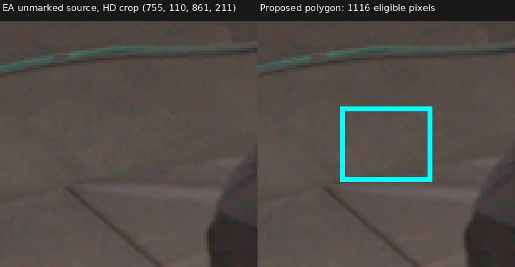
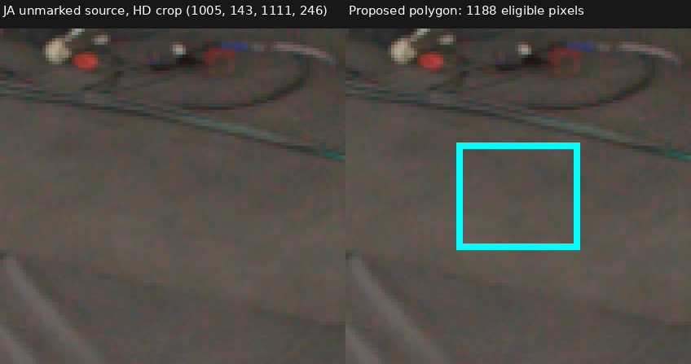
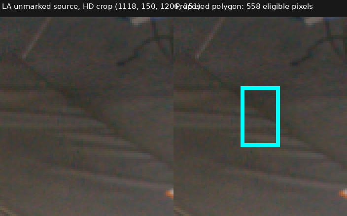
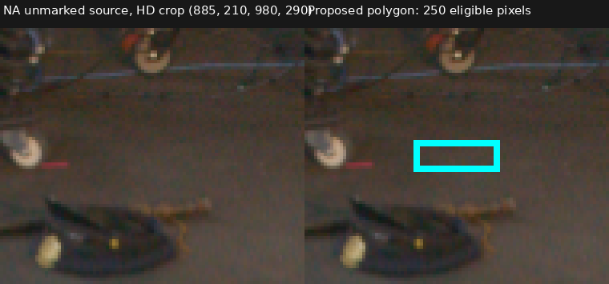

# Additional TRAIN clear-floor views

**What was tested.** Extend source-angle coverage beyond the separately approved AA/BA/HA polygons, without changing the original targets or eligibility rules. This CPU/source-image proposal adds no training or model changes. KA is EVAL and was explicitly excluded.

The retained integer pixels use normalized pixel-center rays and must satisfy source/train validity, no RAW64 actor support, no UNKNOWN occluder, W64 zero, a positive accepted-AABB interval with minimum floor-coordinate Z above0.10, and approximate floor intersection after AABB far. These are conditional experimental clearance criteria, not independent depth truth.

| TRAIN camera | Azimuth around accepted-box center | Proposed pixels | Minimum interval Z | Floor-after-far margin |
|---|---:|---:|---:|---:|
| EA | -93.53° | 1,116 | 0.14239 | 0.34327 |
| JA | -32.17° | 1,188 | 0.15784 | 0.39952 |
| LA | -11.95° | 558 | 0.16897 | 0.44221 |
| NA | 8.00° | 250 | 0.17079 | 0.50469 |

All3,112 retained pixels pass every unchanged check; none was rejected within these tightened polygons. Original AA/BA/HA azimuths are−168.75°/−147.96°/−55.14°. The added views extend coverage toward+8.00° and fill the gap near−93.53°; this still does not cover the full circumference uniformly.

**Source inspection.** All six initial camera contexts, four final full-source overlays, and four marked/unmarked zoom pairs were viewed. The preserved v1 draft included narrow cable/edge or near-equipment overlaps and is not an acceptable target set. V2 narrows EA above the diagonal line, shifts LA rightward below the stand foot, and restricts NA to a small bare-floor strip away from gear. JA remains on visible floor below the cable. Thin floor coverings, texture and folds remain possible; no claim assigns a precise measured depth to these pixels.

**Review status.** Root manual review and independent ray/source validation are pending. The proposal is `training_eligible=false`; no new targets or training are authorized by this artifact. The original7,369-pixel approved generation remains unchanged.

Artifacts: `/fsx/tmp/marshawn_001660_hd/tuning_20261106/native_resolution_pair_100000/documentation/clear_background_additional_views_v2`, including full source overlays, exact polygons, masks/rays, source hashes and helper. [Proposal receipt](assets/marshawn_additional_clear_polygons_20261107/proposal.json) SHA256 `bdf4a23310b85af8cddf22028b247fb2675788db8bfa56665c5fe50c3f6c4b7b`; [agent source review](assets/marshawn_additional_clear_polygons_20261107/source_review.json); [CPU helper](../scripts/propose_marshawn_additional_clear_polygons.py).
