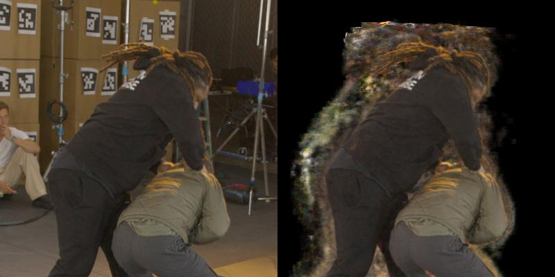
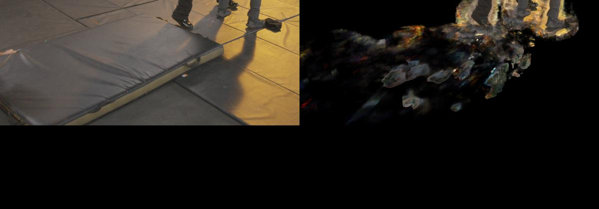
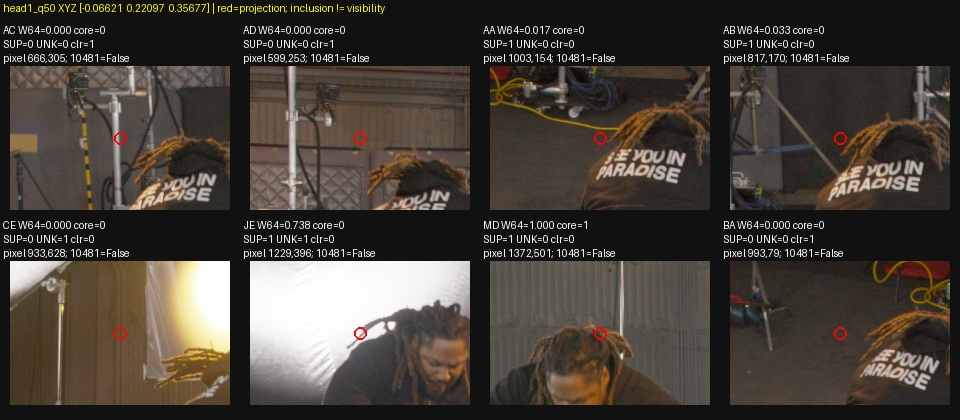
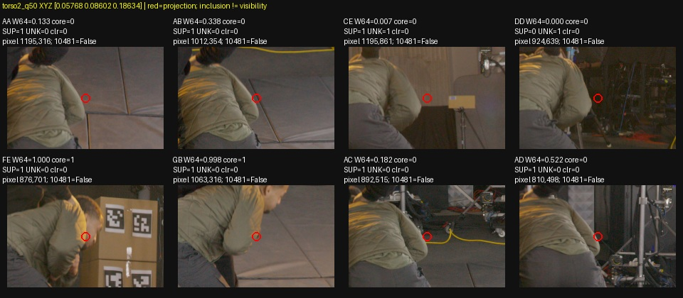
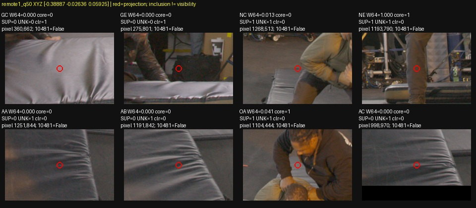

# Marshawn artifact termination versus TRAIN source evidence

**What was tested.** Twelve declared DC artifact rays from quarter111316 (`542e97f59ec1fd41452b0a04fde6bd832e0b430773d1989eef2ec062ef3f1a34`) were captured with the actual native renderer. This is a causal diagnostic of that frozen checkpoint, not a comparison against newer candidates. Actual FR=.3, coarse step=.0015625, legacy cap1024, R0 and the fixed W64 semantic density gate were verified. No uniform reference, training, new labels, mask/AABB change or colour conversion was performed. EVAL only located diagnostic rays. Peak-weight and conditional-median native samples were projected into all63 TRAIN cameras, with separate hash-bound mainW64/core/band, original confidenceW64 and corrected support/UNKNOWN/valid lookups.

The root-reviewed12-ray plan passed in21.57s with1754MiB peak process memory on exclusive GPU0. Actual imports, UUID, archived-PNG parity and21 registered/private/cache tensor states passed. The initially empty analytical16×32 feature-weight LUT was transparently primed at FR=.3 before state comparison, without another ray or density query. Native RGB differs from archived PNG by at most0.456 byte; all native weight/RGB/alpha checks passed. Frozen weights and primed tensor states remained exact. GPU0 was idle on completion.

**Results.** The table uses conditional-median XYZ; alpha and outside-pad1 mass use the entire actual native ray. “Positive” means an in-frame TRAIN pixel with valid mainW64>0, not a positive density/depth label at this XYZ. Actor pixels in other cameras can occlude the XYZ. “Clear” is the existing corrected-mask flag; source inspection below shows why it is insufficient for a whole-ray empty-space claim.

| DC ray (x,y) | Median Z | Native alpha | Actual weight outside sourcePad1 | TRAIN positive / soft / mask-clear / UNKNOWN | Nearest10481 segment distance |
|---|---:|---:|---:|---:|---:|
| head1(850,85) | .35677 | 1.0000 | 1.0000 | 12 /11 /46 /3 | .0448 |
| head2(1060,100) | .35024 | .1674 | .0532 | 24 /16 /32 /6 | .0108 |
| head3(850,190) | .27952 | .6354 | .3055 | 41 /16 /17 /5 | .0015 |
| torso1(790,290) | .20745 | .7049 | .2026 | 42 /17 /20 /4 | .0131 |
| torso2(1090,345) | .18634 | .4046 | 0 | 62 /37 /0 /12 | .1419 |
| torso3(800,380) | .14562 | .5551 | .2162 | 42 /15 /20 /7 | .0817 |
| feet1(755,545) | .02943 | .6838 | .0375 | 46 /25 /5 /31 | .2018 |
| feet2(865,555) | .03334 | .2342 | .0627 | 36 /22 /12 /37 | .2183 |
| feet3(1100,595) | .00635 | .8467 | .1693 | 34 /30 /21 /15 | .3210 |
| remote1(550,720) | .05925 | .5461 | .4763 | 3 /3 /4 /56 | .2134 |
| remote2(320,730) | −.05644 | .3069 | .3069 | 10 /3 /5 /39 | .3929 |
| remote3(600,845) | −.01127 | .9854 | .9649 | 3 /2 /2 /49 | .2480 |

Soft means0<W64<1; binary core and soft weights overlap, so these are not disjoint classes. All24 peak/median samples miss the10481 selected TRAIN pixels in all seven target cameras. The continuous nearest-segment distances above quantify this coverage gap; parameter sharing can still transfer training effects nearby.

Three mechanisms are present:

- **Conservative cell cover admits a substantial shell.** Head1 and all three remote median points are outside the exact sourcePad1 point selector but inside the mapped LC cell. The closed-boundary CPU mapping reproduces the sealed105049→131911 admitted-cell expansion exactly. All head1 termination mass and almost all remote2/remote3 mass sit outside sourcePad1. This identifies actual density in the cover shell, independently of the sampler cap. Original-weight accounting is not a rerender: excluding these samples would also change refinement/transmittance and could expose later density. It is not a physical-empty certificate or permission to tighten the production gate.
- **Positive background RGB survives in the actor envelope.** Torso2 is admitted even by sourceGate0. Its projections land outside the grey arm on visible TRAIN floor/background in AA/AB/AC/AD/EA, while the main objective assigns positive W64 in62 views, including37 soft weights. Existing-mask-clear constraints cannot reach this point because no corrected source pixel calls it clear. MainW64 also assigns strong positives to the separate black bag beside the grey shoe: MA/MB/MC/NA/NB/ND weights are1/1/~1/.945/1/1, versus original confidence.000024/.09497/0/0/.05844/0. MC/NA/ND corrected support is false and UNKNOWN true. Auxiliary UNKNOWN therefore does not repair the main RGB supervision. These are potential contributing source rays; this CPU audit does not measure their actual source-ray gradients.
- **Physical nonactors and occlusion dominate the floor region.** Feet3 projects onto a separate black bag/cloth, rather than empty floor. Remote1 projects to a thick grey mat in GC/GE even though those pixels carry the corrected clear flag. Remote3's two “clear” views land on crew trousers in IE and the mat side in KC. Remote2 is behind floor/crew/actor projections at deep negative fitted Z. Thus neither negative masks nor negative Z justify carving these whole rays. Nearfeet1/2 lie on floor/sheet/shadow context with unresolved local contact height.

**Insights and proposed constraints.** The next useful constraints should address those mechanisms separately:

1. Review a few **TRAIN visible-floor prefixes that actually cross halo XYZ**. Data-only7×7 proposals are BA[990,76,997,83] for head1, JA[974,102,981,109] for head2, BA[962,157,969,164] for head3, AA[946,348,953,355] for torso1 and BA[949,350,956,357] for torso3 (exclusive maximum coordinates). Every pixel is currentW64zero, valid, support-negative and UNKNOWN-negative. Their central rays reach the selected XYZ and can stop0.234–0.322 world units later using an empirical Z=.025 floor guard; head1's margin is.263. These differ from the10481 rule: a safe observed prefix need not require the *entire* AABB segment to stay above.10. They still require independent TRAIN first-surface review. Z=.025 uses the existing global maximum leave-one-out.0127875 plus a margin; it is not a calibrated local floor bound. A mat, rig or crew surface before the endpoint invalidates the prefix.
2. Independently qualify **TRAIN actor-negative background within positive soft bands**, then reconcile the RGB weights with that qualification and add a visibility-bounded actor-opacity/free-prefix constraint. Torso2 AA[1192,313,1199,320] is an inspectable proposal: its49 background pixels currently have W64=.01484–.47923 and support=true. Merely zeroing RGB weights removes one incentive but leaves density unconstrained; merely adding negatives while retaining positive background RGB creates a conflicting objective. Existing masks cannot provide this new qualification themselves. EVAL RGB or labels must not supply it.
3. Treat **bag/mat removal as actor-semantic exclusion at qualified nonactor surfaces**, not physical empty space. First obtain local TRAIN surface/visibility evidence and uncertainty. A narrow nonactor surface band could suppress floor/mat/bag density without declaring the occluded region behind it empty. The current plane and sparse nearfoot witnesses do not supply that depth everywhere. Do not promote below-plane gating, whole-ray mask carving or the proposed floor prefixes for these unresolved nearfloor/remote cases.

The source shell suggests a bounded point-selector diagnostic could remove some sampled artifacts, but it cannot address torso2 or certify every actor boundary. This report does not promote that change. Sparse clothing prefixes address a different local surface-depth problem; these actual global halo/nonactor rays explain why success on31points/84 observations does not imply actor isolation.

Evidence: [all63 projections and source hashes](assets/marshawn_artifact_sources_20261107/coverage.json), [material review](assets/marshawn_artifact_sources_20261107/manual_material_review.json), [actual-weight shell accounting](assets/marshawn_artifact_sources_20261107/actual_weight_source_shell.json), [TRAIN proposals, explicitly not labels](assets/marshawn_artifact_sources_20261107/TRAIN_prefix_proposals_NOT_LABELS.json), [bag sources](assets/marshawn_artifact_sources_20261107/feet3_q50.jpg), [deep remote sources](assets/marshawn_artifact_sources_20261107/remote2_q50.jpg), [crew/mat occlusion](assets/marshawn_artifact_sources_20261107/remote3_q50.jpg). Here `C=/fsx/tmp/marshawn_001660_hd/tuning_20261106` and silver `SC=/cache/ubuntu/lookcloser/campaigns/marshawn_tuning_20261106`. All24 source pages, native arrays and exact plan/release/completion are under `C/independent_occupancy/quarter111316_artifact_source_audit_v1`; before/after tensor arrays remain in the matching silver `SC` directory. Exact plan SHA `b78197b35fd6402bed7e24450dd02577360cdb788f3c1fcc17f4975cf0d6b7fe`; native audit SHA `d64cc0edc1a3763e8325ec49a4435d0cb2748fdf4a6dc1442b30802eed48536a`.

Reusable code: [native worker](../scripts/audit_marshawn_artifact_native_rays.py), [exclusive controller](../scripts/run_marshawn_artifact_native_rays.py), [CPU projection audit](../scripts/audit_marshawn_artifact_sources_cpu.py). The local paper's frequency grid and ray-marching design motivate retaining separate source support, learned occupancy and field density; frequency or finer marching cannot independently certify visibility or erase wrong RGB supervision.
