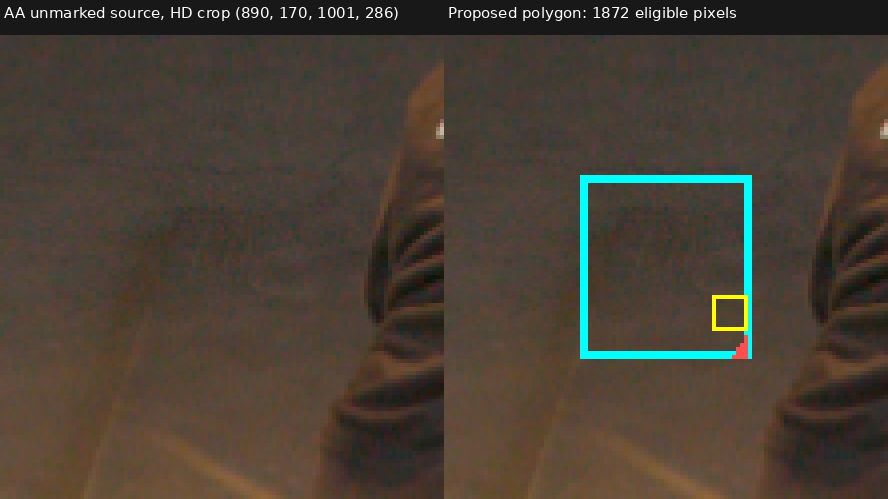
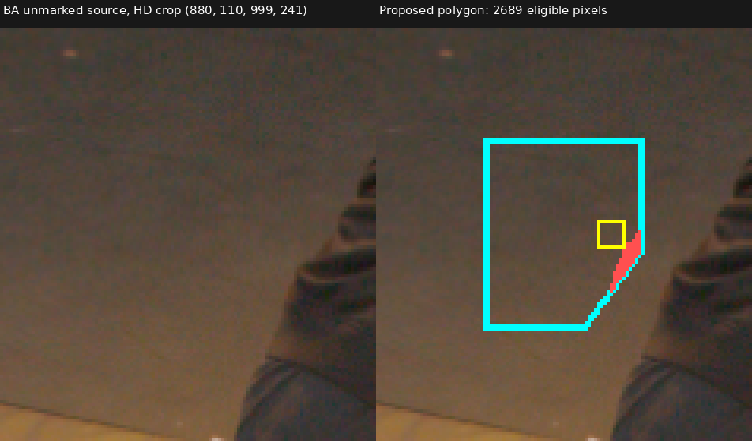
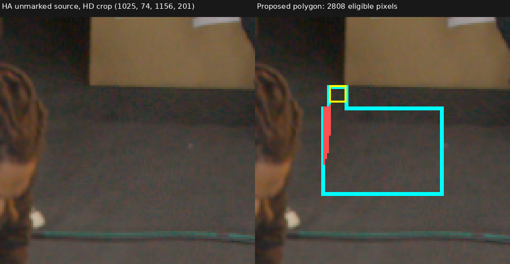

# Conservative TRAIN clear-background polygon proposal

**What was tested.** Expand only the three source-reviewed AA(961,239), BA(954,175), and HA(1067,113) 9×9 floor-backed patches. This is a CPU/source-image review proposal, not accepted training data. Original masks, targets, calibration, AABB and models remain unchanged.

Polygons were drawn from the actual TRAIN RGB sources. Their retained pixels must pass the same `source_valid & train_valid & ~RAW64_support & ~UNKNOWN & W64==0` checks as the existing 243 targets. Every normalized pixel-center ray must intersect the accepted AABB, stay above floor-coordinate Z=0.10 throughout that interval, and intersect the approximate Z=0 plane after AABB far. No relaxation extends these candidates toward shoes or floor contacts.

| Camera | Drawn pixels | Retained proposal | Rejected by actor margin | Minimum interval Z | Minimum floor-after-far margin |
|---|---:|---:|---:|---:|---:|
| AA | 1,886 | 1,872 | 14 | 0.17450 | 0.43063 |
| BA | 2,761 | 2,689 | 72 | 0.12371 | 0.29297 |
| HA | 2,905 | 2,808 | 97 | 0.20122 | 0.56316 |

All other eligibility checks pass throughout the drawn polygons. Retained masks contain 7,369 proposed pixels, including all original 243. Recomputed original origins, directions, near/far and floor intersection distances agree within `4.44e−16`. The unchanged body80 sampler would encounter approximately 0.526 proposed pixels per 4,096-ray batch, including protective-band sampling; this is an expectation, not measured optimization coverage or a claim about unseen space.

**Source review.** The agent inspected all three full source images and marked/unmarked zoom pairs. AA and BA show unobstructed floor beside the upper-body contours. HA's narrow connector preserves the original reviewed patch, while its wider lower region avoids the cardboard above and cable below. Cyan is the hand-drawn proposal boundary, yellow the existing accepted 9×9, and red pixels fail the unchanged actor-margin checks. Red pixels are excluded from the proposed mask.

**Root review and limits.** Root inspected all six source/overlay images and independently recomputed source and geometry eligibility for all 7,369 retained rays. The separate [root review](assets/marshawn_clear_background_polygons_20261107/root_review.json), SHA256 `fe417ec5d971234ae368362370d02882476a731bf05df649ae2b5ae9537b871b`, approves only the filtered 1,872/2,689/2,808 pixels as experimental negative targets under the original conditional floor constraints. The original proposal's `training_eligible=false` status is preserved; the later approval is explicit and separate. Clearance remains conditional on the approximate floor frame and visible source interpretation; this work adds no independent depth measurement and does not certify every nominally clear cache pixel. A fresh target-set comparison will be prepared separately; this review does not mutate the existing three-patch experiment or launch training.

The full source overlays, explicit integer polygon coordinates, retained masks/rays, input hashes and helper copy are under `/fsx/tmp/marshawn_001660_hd/tuning_20261106/native_resolution_pair_100000/documentation/clear_background_polygon_proposal_v1`. The [proposal receipt](assets/marshawn_clear_background_polygons_20261107/proposal.json) SHA256 is `b2dc3905295399307b6143960e453b91044d3a6339c91b0aadfbe78cace0a2cb`. [Cross-check receipt](assets/marshawn_clear_background_polygons_20261107/source_review_and_geometry_crosscheck.json); [reusable CPU helper](../scripts/propose_marshawn_clear_background_polygons.py).
