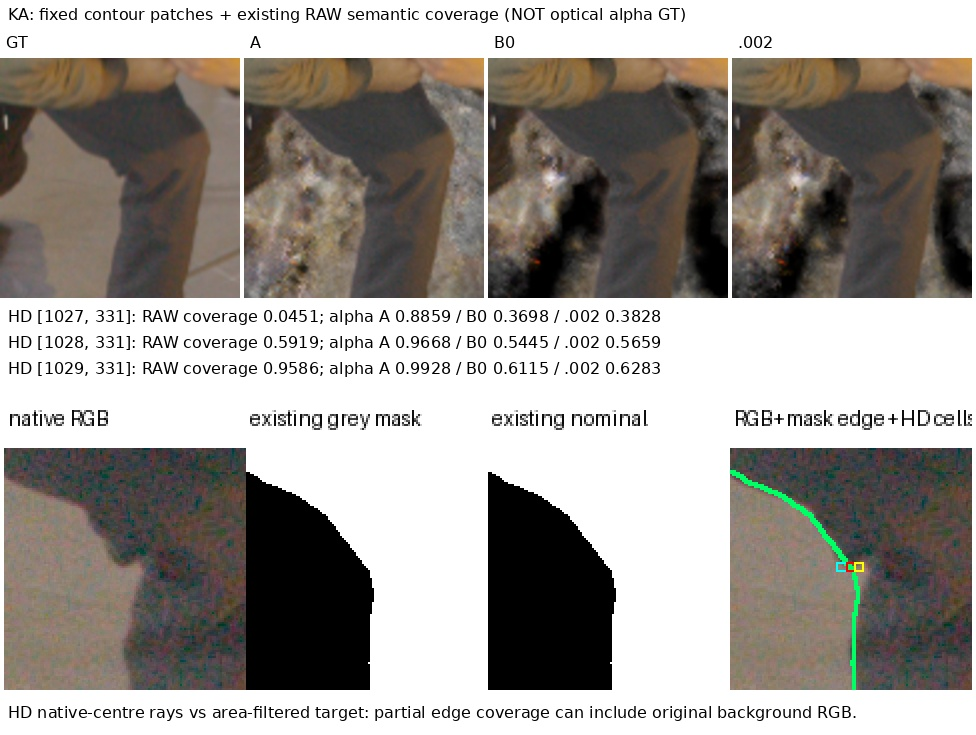
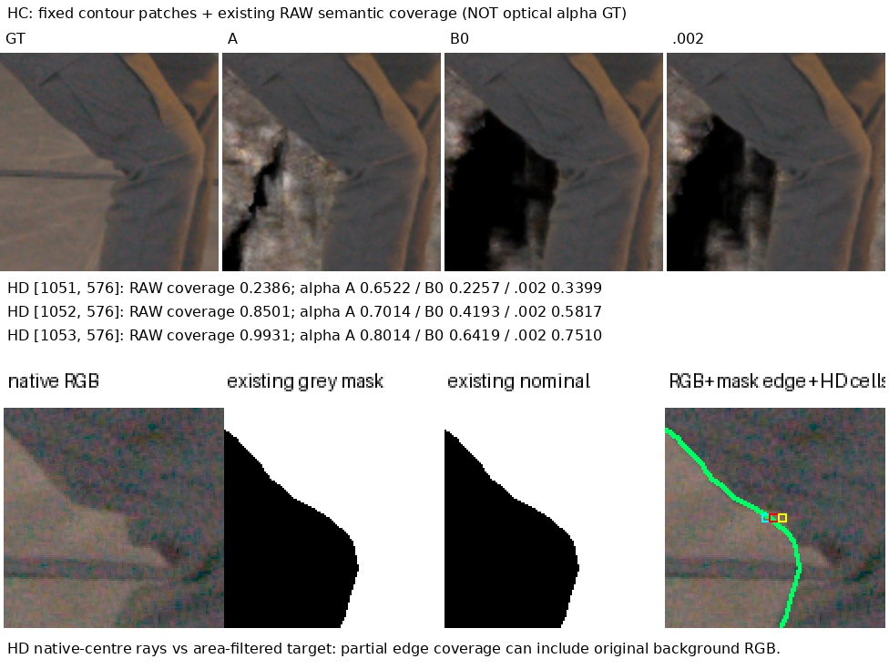

# Fixed interior and boundary diagnostics for SourcePad1 gating

## What was tested

CPU-only supplementary PSNR/SSIM/LPIPS on the existing126316 quarter-step/distortion .1 RGB8 renders: A, zero-margin SourcePad1 B0, geometric margin .001 and .002. All12RGB and12alpha images were present at1920×1012 and hashed. No new rendering, GT/mask edits, alpha labels, optimization or GPU context.

For each fixed V1 actor mask, the interior is Euclidean distance>8HD pixels from its complement; image exterior is explicitly background. The boundary is the remaining actor-mask pixels at distance≤8. Their disjoint union exactly equals the original mask. Each region uses the **same original sealed actor crop** for all variants, AlexNet LPIPS without resize, identical RGB.5 outside the region, and the existing SSIM-centre convention. The original whole mask is also remeasured from the same PNG8 inputs to expose quantization effects.

The region masks are diagnostics, not new training labels. Interior metrics exclude thin hair/contours and cannot certify their preservation. Boundary LPIPS averages a large fixed crop with identical neutral exterior; **only compare variants within a region**, not absolute values between interior/boundary. The three diagnostics are not additive LPIPS partitions.

## Results

| Region | Variant | PSNR | SSIM | LPIPS |
|---|---|---:|---:|---:|
|whole_PNG_control|A|31.630695|0.830714|0.01874998|
|whole_PNG_control|B0|31.444892|0.830383|0.01961002|
|whole_PNG_control|.001|31.506511|0.830572|0.01939662|
|whole_PNG_control|.002|31.554145|0.830690|0.01919520|
|core_gt8px|A|32.713550|0.842186|0.00987499|
|core_gt8px|B0|32.711568|0.842232|0.00987017|
|core_gt8px|.001|32.724769|0.842255|0.00982923|
|core_gt8px|.002|32.730635|0.842266|0.00980384|
|boundary_le8px|A|29.831890|0.938196|0.00648192|
|boundary_le8px|B0|29.418581|0.937239|0.00690063|
|boundary_le8px|.001|29.534563|0.937752|0.00681575|
|boundary_le8px|.002|29.626390|0.938084|0.00672454|

Interior aggregate A→.002 changes PSNR+0.01709dB, SSIM+0.000080, LPIPS−0.72%. Boundary LPIPS worsens3.74%, PSNR−0.20550dB. The whole-PNG control worsens2.37% LPIPS, consistent with the original float-render V1 direction; its absolute values differ because of PNG quantization and CPU evaluation. V1 rankings remain unchanged.

The following complete per-view/actor comparison shows the .002 candidate against A; all four variants are available in the linked CSV/JSON.

| Region | View/actor | PSNR A→.002 | SSIM A→.002 | LPIPS A→.002 |
|---|---|---:|---:|---:|
|core_gt8px|DC/black|32.52435→32.56041|0.802063→0.802115|0.01179122→0.01138237|
|core_gt8px|DC/grey|34.30133→34.30130|0.873171→0.873171|0.01153606→0.01153559|
|core_gt8px|HC/black|31.79305→31.79615|0.814949→0.815067|0.00866239→0.00868254|
|core_gt8px|HC/grey|33.46337→33.46312|0.869085→0.869087|0.00656953→0.00656987|
|core_gt8px|KA/black|31.62545→31.70844|0.813539→0.813872|0.01001281→0.00981724|
|core_gt8px|KA/grey|32.57376→32.55439|0.880310→0.880286|0.01067793→0.01083544|
|boundary_le8px|DC/black|28.13202→28.34815|0.937362→0.938594|0.00566321→0.00547204|
|boundary_le8px|DC/grey|30.83514→30.87779|0.946138→0.946303|0.00955845→0.00950097|
|boundary_le8px|HC/black|27.54044→27.75503|0.923135→0.926335|0.00723797→0.00682647|
|boundary_le8px|HC/grey|32.54771→32.37531|0.949073→0.948838|0.00442363→0.00452091|
|boundary_le8px|KA/black|28.66380→29.05681|0.934654→0.938475|0.00420510→0.00403785|
|boundary_le8px|KA/grey|31.27224→29.34525|0.938813→0.929961|0.00780319→0.00998901|

KA-grey remains a small interior exception: .002 core LPIPS+1.48%, PSNR−0.0194dB; its boundary LPIPS+28.01%, PSNR−1.927dB. HC-grey interior is effectively stable (LPIPS+0.005%, PSNR−0.00025dB), while boundary LPIPS+2.20%, PSNR−0.1724dB. This supports predominantly boundary-local changes, not universally identical interior texture.

Both contact pages were inspected. The RAW coverage figures are existing segmentation-derived estimates, not optical alpha GT. At the worst KA pixel, coverage .59186 and gated alpha .56595 remain compatible with a partial-coverage interpretation. The HC and neighboring high-coverage discrepancies remain unresolved; no alpha1 prior follows.

## Insights

The main loss in the original metric occurs around boundaries, where fixed hard-mask V1 includes area-filtered original background RGB. The source gate largely preserves the measured interior texture while removing a background-like farther layer, but the present diagnostics do not prove a clean or contour-safe asset. Geometry cleanup and boundary photometry must remain separate review dimensions.

Two CPU tests cover the fixed disjoint partition and Euclidean/image-edge semantics. All72 measurements completed in4.29s with CUDA uninitialized. [All per-view/actor/variant measurements](assets/marshawn_core_boundary_20261107/metrics.csv), [per-view and per-actor aggregates](assets/marshawn_core_boundary_20261107/by_view_actor.json), and [source/metric/model hashes](assets/marshawn_core_boundary_20261107/metrics.json). Full artifacts: `/fsx/tmp/marshawn_001660_hd/tuning_20261106/independent_occupancy/core_boundary_CPU_v1`.
