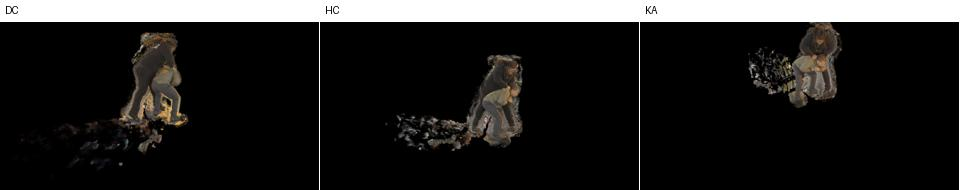

# Corrected ARM continuation preparation

## What was tested

CPU-only audit of an untested native sampler factor on quarter-step+.1 source126316: `corrected_arm_allocator=False→True`, keeping `max_steps_per_ray=1024`, actual distortion.1, FR.3, originalR0/W64/body80, frozen TRAIN63 maps, camera transforms and color unchanged. The local paper's Adaptive Ray Marching section motivates frequency-dependent integration; it does not specify this implementation's rounding/capping algorithm.

The flag has two effects. For a coarse interval needing multiple subdivisions, it replaces fixed `dt` plus a short residual interval with equal subdivisions across the same complete extent. This changes integration positions even without saturation; intervals needing one sample or dividing exactly can remain identical. When requested counts exceed1024, largest-remainder allocation replaces rounded counts plus far-tail clipping; coarse intervals exceeding the cap are merged before allocation. Both effects belong to the existing single flag. No claim is made that it fixes the field's source geometry or occupancy omissions.

Existing half/quarter-step, quarter+.1 and warm distortion experiments explicitly retain legacy1024. The completed read-only `frozen_LC_semantic_physical_plan_v3/uncapped_qualification` only sets cap0; its actual `marshawn_LC_semantic_physical_path.py:50` rejects a corrected allocator. Therefore legacyuncap0 and corrected1024 are separate factors. Prior115-ray zero-saturation evidence concerns earlier selected fields and does not establish the source126316 training distribution.

## Results

|CPU actual frozen `sampler.forward` probe|Samples|Starts|Final end|
|---|---:|---|---:|
|Legacy1024, unsaturated|4|0,.6,1,1.6|2|
|Corrected1024, unsaturated|4|0,.5,1,1.5|2|
|Legacyuncap0, unsaturated|4|0,.6,1,1.6|2|
|Legacy, illustrative cap3|3|0,.8,1|1.8|
|Corrected, illustrative cap3|3|0,.5,1|2|

These are synthetic arithmetic probes through the actual immutable forward implementation, with mocked traversal/frequency inputs and a CPU-only CSR metadata adapter. They do not measure CUDA traversal, actual source saturation, training quality or memory. The native `nerfacc.pack_info` API is restored after the probes. CUDA remained uninitialized.

All1495 original source files remain exact. All six requested configurations pass validation: the control has no scientific changes; the treatment differs only in the allocator flag. The source seven-state hashes, checkpointSHA`340e794ed8ea1cc656f246998941ddc9dee9d3a4244ee64952f2652ce35cd641`, and pipelineSHA`c83bc7dbb1504063c35f0a2b14ae3fb329ff27ed2eb6b3661eb89b4918d46636` remain bound to the qualified warm framework. Actual checkpoint loading/restoration has not been rerun by this CPU audit.

Source review uses existing immutable DC/HC/KA renders. The thumbnail shows the known exterior clouds and floor residue; no treatment render exists. Source metrics remain PSNR31.639727, SSIM.831264, LPIPS.01877312.

- [CPU evidence](assets/marshawn_corrected_arm_warm_20261107/CPU_readiness.json)
- [Preparation and resource proposal](assets/marshawn_corrected_arm_warm_20261107/preparation.json)
- [Exact worker derivation diff](assets/marshawn_corrected_arm_warm_20261107/worker.diff)
- [Local review-only package](/fsx/tmp/marshawn_001660_hd/tuning_20261106/corrected_arm_warm_candidate_v1)

The first local CPU invocation could not resolve the silver `/cache/...` semantic manifest. The identical package passed on silver with `CUDA_VISIBLE_DEVICES=''`; this was a host-path issue, not a scientific failure. It did not run or inspect a GPU worker.

## Insights and next steps

The corrected flag is a meaningful isolated training hypothesis, especially in high-frequency intervals whose lengths do not divide their requested step. The source may have learned compensation for legacy integration, so an inference-only change cannot establish improvement. Keep cap1024 for attribution and memory control; cap0 remains a separate diagnostic.

The generated worker reuses the qualified warm loop and source/cache/confidence APIs. Both ZERO jobs intentionally use OLD legacy1024 and require three-view source render parity plus seven-state/cache/RNG/LUT preservation. Only after that branch returns do technical/production jobs apply their requested allocator flag. Technical jobs run actual32+32, restore child seven states and nonpersistent caches, bind sampler settings in child lineage, check finite successful Adam updates and record actual packed counts. Each normal invocation return rehashes the immutable source checkpoint. Source payloads are never written.

No root release, guardian, physical UUID binding, GPU launch, technical result or production approval exists. `READY=false`. Proposed resources retain the proven10GiB Torch allocator limit, with a separate process ceiling no greater than32GiB, bounded zero/technical invocations and hourly campaign health checks. Plans list silverGPU3/4 only; root must verify current physical UUIDs and the global lease before any run. The executable external guardian still needs root preparation/review.

Production would retain early500/1000/2000/4000 visual gates and the unchanged minimum4000-plus-plateau schedule, evaluating all DC/HC/KA PSNR/SSIM/LPIPS. All evaluated checkpoints remain preserved. The inherited warm framework's internal selector uses its campaign LPIPS tolerance; final export must additionally honor the user's highest `eval_all_psnr` with LPIPS tie-breaker within.07dB. No quality promotion is justified by these CPU results.
