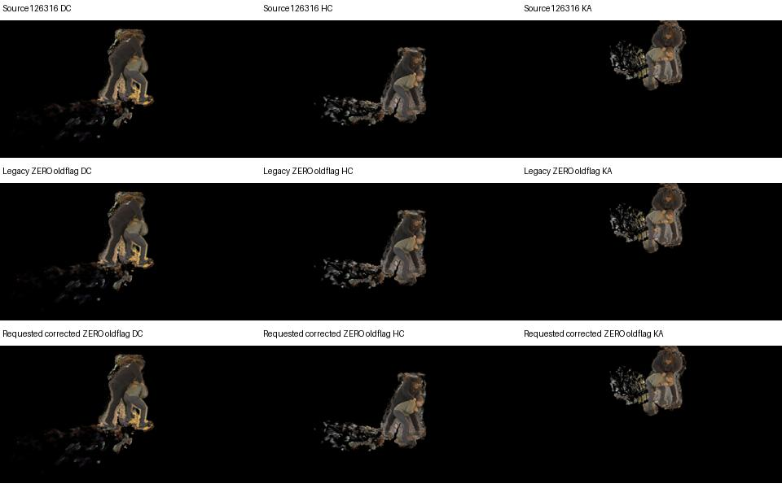
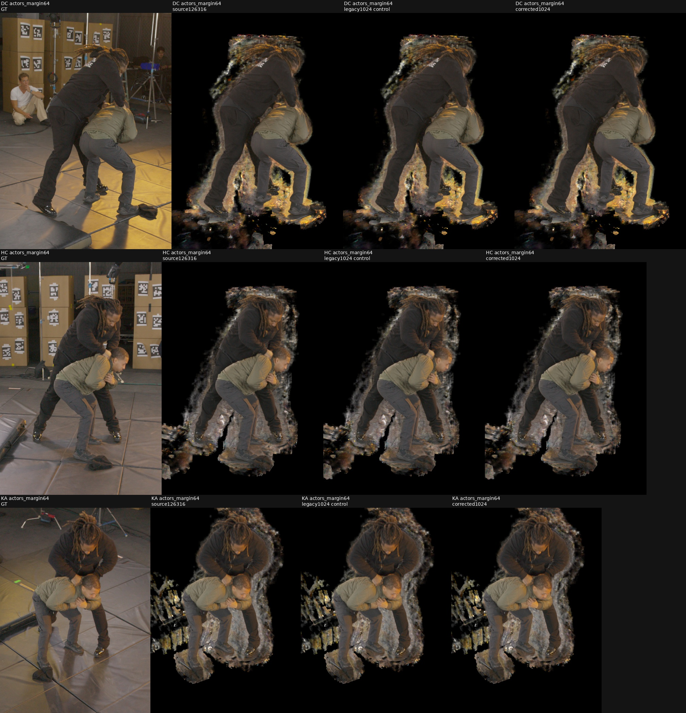
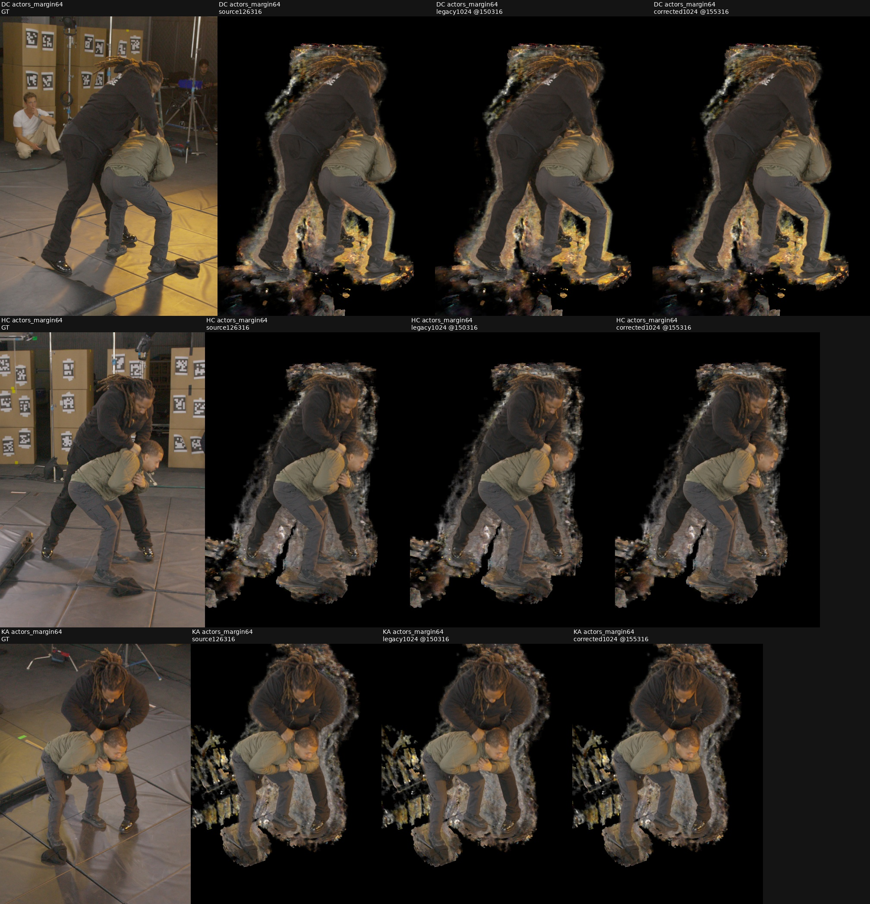

# Corrected ARM continuation preparation

**Final result:** Corrected1024 warm training produced no quality or visible geometry improvement over unchanged source126316. Both branches reached natural plateau; every reported checkpoint selector retains the source at PSNR31.639727, SSIM.831264, LPIPS.01877312. Source, code and common training-stream closure pass; no checkpoint is promoted. [Final CPU verification](assets/marshawn_corrected_arm_warm_20261107/production_verification_v1.json), [compact final summary](assets/marshawn_corrected_arm_warm_20261107/production_final_summary.json).

## What was tested

CPU-only audit of an untested native sampler factor on quarter-step+.1 source126316: `corrected_arm_allocator=False→True`, keeping `max_steps_per_ray=1024`, actual distortion.1, FR.3, originalR0/W64/body80, frozen TRAIN63 maps, camera transforms and color unchanged. The local paper's Adaptive Ray Marching section motivates frequency-dependent integration; it does not specify this implementation's rounding/capping algorithm.

The flag has two effects. For a coarse interval needing multiple subdivisions, it replaces fixed `dt` plus a short residual interval with equal subdivisions across the same complete extent. This changes integration positions even without saturation; intervals needing one sample or dividing exactly can remain identical. When requested counts exceed1024, largest-remainder allocation replaces rounded counts plus far-tail clipping; coarse intervals exceeding the cap are merged before allocation. Both effects belong to the existing single flag. No claim is made that it fixes the field's source geometry or occupancy omissions.

Existing half/quarter-step, quarter+.1 and warm distortion experiments explicitly retain legacy1024. The completed read-only `frozen_LC_semantic_physical_plan_v3/uncapped_qualification` only sets cap0; its actual `marshawn_LC_semantic_physical_path.py:50` rejects a corrected allocator. Therefore legacyuncap0 and corrected1024 are separate factors. Prior115-ray zero-saturation evidence concerns earlier selected fields and does not establish the source126316 training distribution.

## Results

|CPU actual frozen `sampler.forward` probe|Samples|Starts|Final end|
|---|---:|---|---:|
|Legacy1024, unsaturated|4|0,.6,1,1.6|2|
|Corrected1024, unsaturated|4|0,.5,1,1.5|2|
|Legacyuncap0, unsaturated|4|0,.6,1,1.6|2|
|Legacy, illustrative cap3|3|0,.8,1|1.8|
|Corrected, illustrative cap3|3|0,.5,1|2|

These are synthetic arithmetic probes through the actual immutable forward implementation, with mocked traversal/frequency inputs and a CPU-only CSR metadata adapter. They do not measure CUDA traversal, actual source saturation, training quality or memory. The native `nerfacc.pack_info` API is restored after the probes. CUDA remained uninitialized.

All1495 original source files remain exact. All six requested configurations pass validation: the control has no scientific changes; the treatment differs only in the allocator flag. The source seven-state hashes, checkpointSHA`340e794ed8ea1cc656f246998941ddc9dee9d3a4244ee64952f2652ce35cd641`, and pipelineSHA`c83bc7dbb1504063c35f0a2b14ae3fb329ff27ed2eb6b3661eb89b4918d46636` remain bound to the qualified warm framework. Actual checkpoint loading/restoration has not been rerun by this CPU audit.

Source review uses existing immutable DC/HC/KA renders. The thumbnail shows the known exterior clouds and floor residue; no treatment render exists. Source metrics remain PSNR31.639727, SSIM.831264, LPIPS.01877312.

- [CPU evidence](assets/marshawn_corrected_arm_warm_20261107/CPU_readiness.json)
- [Preparation and resource proposal](assets/marshawn_corrected_arm_warm_20261107/preparation.json)
- [Exact worker derivation diff](assets/marshawn_corrected_arm_warm_20261107/worker.diff)
- [Local review-only package](/fsx/tmp/marshawn_001660_hd/tuning_20261106/corrected_arm_warm_candidate_v1)

The first local CPU invocation could not resolve the silver `/cache/...` semantic manifest. The identical package passed on silver with `CUDA_VISIBLE_DEVICES=''`; this was a host-path issue, not a scientific failure. It did not run or inspect a GPU worker.

## Insights and next steps

The corrected flag is a meaningful isolated training hypothesis, especially in high-frequency intervals whose lengths do not divide their requested step. The source may have learned compensation for legacy integration, so an inference-only change cannot establish improvement. Keep cap1024 for attribution and memory control; cap0 remains a separate diagnostic.

The generated worker reuses the qualified warm loop and source/cache/confidence APIs. Both ZERO jobs intentionally use OLD legacy1024 and require three-view source render parity plus seven-state/cache/RNG/LUT preservation. Only after that branch returns do technical/production jobs apply their requested allocator flag. Technical jobs run actual32+32, restore child seven states and nonpersistent caches, bind sampler settings in child lineage, check finite successful Adam updates and record actual packed counts. Each normal invocation return rehashes the immutable source checkpoint. Source payloads are never written.

The completed remote CPU staging hardlinks the exact2,096,119,926-byte source checkpoint and verifies all seven actual serialized trees, all original1495 files plus helpers, every anchor-evidence hash, and the unchanged source checkpoint after the audit. CUDA remains uninitialized. No root release, GPU launch, technical result or production approval exists. `READY=false`.

The proven external v3 guardian is now adapted and staged with16 prepared bindings, three explicit CPU/source receipts and unchanged11 core identity/cleanup functions. Only the local olive controller dispatches; silver independently watches physical UUIDs, process GPU memory and heartbeat expiry. Limits are10GiB Torch allocator,32GiB measured process GPU memory,900seconds per zero/technical invocation, no production deadline and mandatory hourly campaign checks. PolicySHA`754f5273e0c1d94fd783e7154e9f34725e2fc3e07873cf4947f4fd6e43d9a460`; guardianSHA`0e5c98d6e650d37c4d16f96624d33dd1770d02eb0e83e93007bf7976dd30762a`.

SilverGPU3 binds `GPU-c024b6e2-0def-f4fd-c18a-64b95975effd`; GPU4 binds `GPU-cb1a0b07-abd6-8e55-9669-ccbb2c45a560`. Both showed0MiB in the preparation snapshot. No lease was acquired or reserved: the actual controller must acquire the shared exclusive lease and the worker verifies its parent receipt/UUID before Torch model setup. Independently rehashed remote guardian bindings and physical UUIDs pass. The zero-only external release template is false; root owns release publication, followed by separate zero/technical/production reviews.

- [Actual remote source and seven-state staging](assets/marshawn_corrected_arm_warm_20261107/checkpoint_staging_receipt.json)
- [Guardian CPU checks](assets/marshawn_corrected_arm_warm_20261107/CPU_orchestration.json)
- [Independent remote guardian binding check](assets/marshawn_corrected_arm_warm_20261107/remote_guardian_staging.json)
- [Review-only launch details](assets/marshawn_corrected_arm_warm_20261107/launch_readiness.json)
- [False zero-only external release template](assets/marshawn_corrected_arm_warm_20261107/zero_guard_release.template.json)

Production would retain early500/1000/2000/4000 visual gates and the unchanged minimum4000-plus-plateau schedule, evaluating all DC/HC/KA PSNR/SSIM/LPIPS. All evaluated checkpoints remain preserved. The inherited warm framework's internal selector uses its campaign LPIPS tolerance; final export must additionally honor the user's highest `eval_all_psnr` with LPIPS tie-breaker within.07dB. No quality promotion is justified by these CPU results.

## Actual ZERO result

Root subsequently released only the two ZERO jobs. The exact local external guardian launch ran once: local guardian2202908/controller2202912, remote guardian61374, workers62240 onGPU3 and62464 onGPU4. Both returned0 after60.42seconds; sampled exclusive GPU memory peaked2743MiB each. Local and remote guardians finished with `passed=true`, no violations or terminations. Both expected workers exited and the GPUs were released; compact supervision records include actual process, memory and OOM checks. No OOM or traceback occurred.

The CPU zero verifier passes with SHA`52e1d583a7c922ccadcfc25cfb7178ae88dd6d01963abaee90c7cf49aeb28262`. Both source seven-state hashes, cache/RNG/LUT/confidence, FR.3 and actual distortion.1 are preserved; source checkpoint rehash guards pass. Both run OLD legacy1024 as declared, with zero optimizer updates. The requested corrected flag has not been exercised on the source model yet.

|OLD-flag ZERO replay|Delta PSNR|Delta SSIM|Delta LPIPS|Max RGB8/alpha16 code delta|
|---|---:|---:|---:|---:|
|Legacy arm|−8.42e−8|−2.98e−8|+1.07e−7|1|
|Requested corrected arm|+9.81e−8|+9.93e−9|+4.27e−8|1|

All three FHD RGB/alpha comparisons pass the existing source parity policy; renders are numerically equivalent within that policy, not bitwise identical. At thumbnail scale both replays visually match the source, including its known exterior artifacts. This establishes source replay validity only. Technical32+32 and production remain unreleased pending separate root review.

[Actual ZERO verification](assets/marshawn_corrected_arm_warm_20261107/zero_verification.json), [compact process/resource/source summary](assets/marshawn_corrected_arm_warm_20261107/zero_review_summary.json), [supervision log](assets/marshawn_corrected_arm_warm_20261107/manual_zero_supervision.jsonl).

## Actual technical32+32 result

After accepting ZERO, root separately released technical only. Local guardian2203309/controller2203313 ran both first32 segments and their separate resume32 children. Both arms reached126380 with64 successful Adam updates, preserving the original schedule: Adam126262→126294→126326. The actual corrected flag is now exercised; child lineage binds its flag and cap1024. Initial source seven trees and child-start seven trees, global RNG, sampler/cache associations, confidence normalizer and nonpersistent LUT restore exactly. Both32-step packet-stream digests match across the two arms for both segments.

|Actual technical arm|Successful updates|First packet packed samples|Largest recorded per-ray count|Sampled process memory peak|
|---|---:|---:|---:|---:|
|Legacy1024|64|985035|1024|8464MiB|
|Corrected1024|64|985050|1024|8440MiB|

All64 successful combined gradients are finite in both arms. At both first/resumed reference steps, original W64 RGB gradient error is0, packed distortion value error is0, and packed distortion gradient error is at most9.10e−13. FR.3 and distortion.1 remain unchanged; no extra field queries or optimizer updates are used for these reference checks. Both source and corrected training packets reach the cap; the earlier zero-saturation115-ray diagnosis cannot describe this different source training distribution.

All four worker invocations return0. Local and remote guardians finish `passed=true`, without events, terminations, OOM or tracebacks. Memory maxima combine preserved5-second guardian observations and queue device snapshots; these are sampled maxima, not instrumented allocator peaks. The source checkpoint rehash still matches340e794…cd641. Byte hashes for all four technical checkpoints and final seven-state hashes are recorded remotely. No2GB checkpoint was transferred to olive.

The actual technical verifierSHA is`3769af075338bfb41677535139639d7db871d26e9e3a8e5dbca9a78beea27998`; compact closureSHA is`20a114db59a88f4859332c683af08c4936492bc54a302a105349f4f01a33bbfe`. This proves actual update/resume integration, not quality. No production job is launched by this gate; separate root acceptance/release is required before the original500/1000/2000/4000 visual gates and unchanged plateau continuation.

[Actual technical verification](assets/marshawn_corrected_arm_warm_20261107/technical_verification.json), [checkpoint/state/gradient/resource closure](assets/marshawn_corrected_arm_warm_20261107/technical_review_summary.json), [technical supervision](assets/marshawn_corrected_arm_warm_20261107/manual_technical_supervision.jsonl).

## Production early visual gates

Root accepted technical and separately released production. Both arms start fresh from the same126316 checkpoint, preserving all settings except their declared allocator flag. Local guardian2203762/controller2203782 supervise workers103047 and103269 on the boundGPU3/4 UUIDs. The read-only CPU retention watcher2203856 hashes checkpoint/grid metadata remotely and copies images, small grid archives and receipts with compressed rsync. Checkpoints stay on silver and are never pruned.

|Warm attempts|Legacy PSNR|Legacy SSIM|Legacy LPIPS|Corrected PSNR|Corrected SSIM|Corrected LPIPS|
|---|---:|---:|---:|---:|---:|---:|
|Source0|31.639727|.831264|.01877312|31.639727|.831264|.01877312|
|500|31.619498|.831217|.01888467|31.616714|.831244|.01887406|
|1000|31.627347|.831128|.01891657|31.637712|.831184|.01889892|
|2000|31.627780|.831191|.01895582|31.614452|.831042|.01895685|
|4000|31.607869|.830914|.01889948|31.600055|.830978|.01893746|

All three full FHD RGB/alpha renders and the fixed original nine hair/hands-contact/feet comparisons are retained at each gate. Root personally inspected the500 gate: bodies, hair, hands and shoes remain stable, while head/floor clouds persist; no promotion. The4000 actor comparison also shows no obvious broad geometry improvement. Source LPIPS remains lower than every early continuation. At4000 corrected exterior-opacity counts are118333/79795/54995 versus source118260/79892/54994; these small mask-exterior changes are diagnostic, not empty-space truth.

[Fixed nine detail comparisons at4000](assets/marshawn_corrected_arm_warm_20261107/production4000_all_details.jpg). All committed early manifests, full renders and individual guard PNGs remain in [the retained visual gates](/fsx/tmp/marshawn_001660_hd/tuning_20261106/corrected_arm_warm_candidate_v1/external_guard_corrected_ARM_v1/visual_gates_v1).

The early gates continued under the unchanged validation plateau rule, with its new130316 anchor and5000-step interval. At10:12:36 both expected workers and guardians remained alive at133365/133259, sampled GPU memory8086/7964MiB and no OOM/tracebacks. No quality promotion or stopping-rule change was made.

## Natural terminal result

Root independently inspected all three terminal actor comparisons and all nine fixed detail regions on November7. Both warm arms retain the hair halo, density between the legs and attachments around the shoes; neither provides a convincing geometry improvement. The inspection receipt is retained beside the terminal gallery as `root_terminal_manual_review.json`. This review does not certify empty space or a clean actor asset.

|Actual evaluated field|Warm attempts|PSNR|SSIM|LPIPS|
|---|---:|---:|---:|---:|
|Unchanged source126316|0|31.639727|.831264|.01877312|
|Legacy1024 at150316|24000|31.575576|.830046|.01889728|
|Corrected1024 at150316, matched step|24000|31.577410|.830112|.01887845|
|Corrected1024 at155316, own terminal|29000|31.577419|.829857|.01881533|

Corrected continued an additional5000 steps because the unchanged criterion had an earlier qualifying improvement. Neither trial was capped. Actual Adam updates are23989/28987 with11/13 AMP skips. At common150316, global RNG, sampler state, entire main-ray index chain and attempted-update count are all exactly equal across arms; streams were observed, never forced equal. All63 original confidence hashes/normalizers, explicit cache associations, FR.3, distortion.1 and fixed admission/cascade/resolution pass the remote CPU audit. Original checkpointSHA340e794…cd641 and all1495 scientific files plus helpers remain exact.

The final CPU proofSHA is`457c5800172242943e616f921dbe31bafb7b2f2638779bb2f3da56bbf1be0696`. Highest PSNR, the LPIPS tie-break within.07dB, raw LPIPS and the inherited selector all retain source126316. Its already proven three FHD RGB/alpha renders are saved with exact hashes under [selected_reference](/fsx/tmp/marshawn_001660_hd/tuning_20261106/corrected_arm_warm_candidate_v1/selected_reference); this reuses the unchanged winning reference and creates no new quality promotion.

Both actual workers return0. Local and remote guardians, controller and retention watcher finish successfully and exit. Sampled GPU memory peaks8131/8137MiB; no OOM or tracebacks occur. All16legacy and19corrected checkpoints remain remotely preserved, totaling73,365,516,663 bytes; none is transferred to olive. [Checkpoint inventory](assets/marshawn_corrected_arm_warm_20261107/production_checkpoint_inventory.json) and [supervision log](assets/marshawn_corrected_arm_warm_20261107/manual_production_supervision.jsonl) retain the evidence.

[Nine fixed terminal guards](assets/marshawn_corrected_arm_warm_20261107/terminal_all_details.jpg), [source/step/ROI provenance](assets/marshawn_corrected_arm_warm_20261107/terminal_provenance.json). Final three-body and nine-detail inspection retains hair, hands and shoes; exterior head/floor clouds persist without an obvious geometry gain. The common24000 comparison is retained separately, so unequal natural terminal lengths are explicit. This warm continuation is negative; a cold corrected-allocator trial remains untested.
