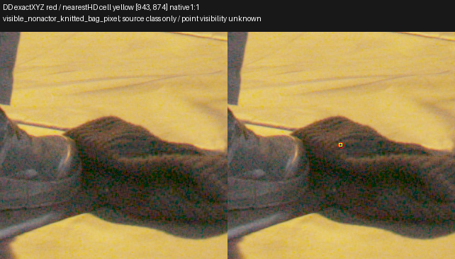
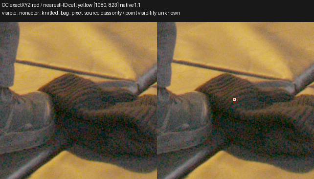
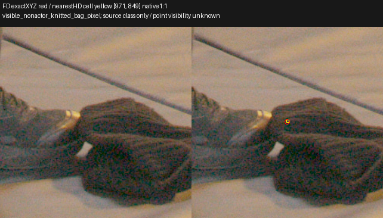
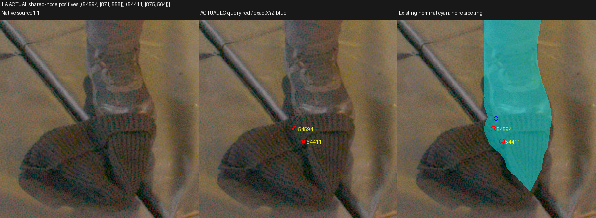
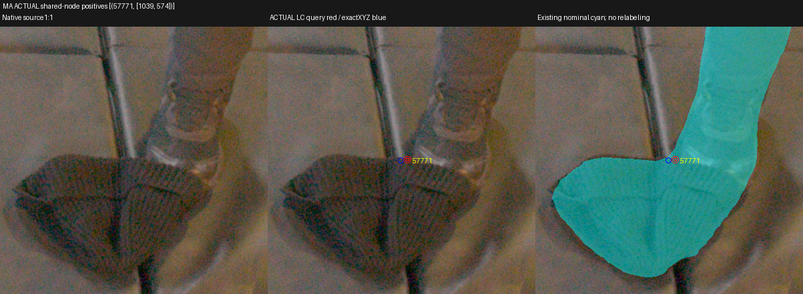
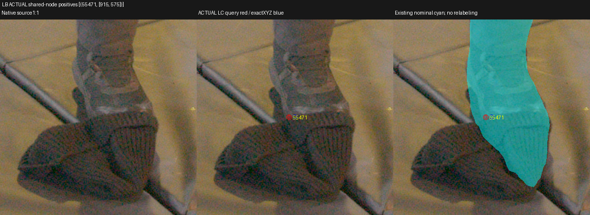

# Exact retained LC bag-contact sample: TRAIN source review

## What was tested

Posthoc CPU diagnostic of the dominant retained sample in `P3/prior001/renders/DC_trace_1097_572.npz`: exact `argmax(hard_theta05_selected_weight)` index22, floor XYZ **[0.057945191860198975,0.05855029821395874,0.01855337619781494]**. Its actor probability is .956770301 and retained weight .069712386. XYZ was not rounded or transformed a second time.

The point was projected into all63 TRAIN floor cameras; three clear projected source pixels and four shoe/bag contacts were inspected at native1:1. A DC pose-only backprojection returns (1097.50000595,572.50003483), confirming the coordinate basis within .000035HD pixel. No EVAL RGB/mask, GPU or model query was used. This review creates no labels or query proposals.

## Results

| Ranked clear TRAIN source view | Nearest HD pixel | Photographed projected pixel |
|---|---|---|
| DD | (943,874) | Knitted bag interior |
| CC | (1080,823) | Knitted bag interior |
| FD | (971,849) | Knitted bag interior |

The nearest source pixels are nominal actor=false, corrected UNKNOWN=false, and absent from the fixed queries. Their visible nonactor class does **not** establish that this exact XYZ lies on the visible surface or is unoccluded.

Independent actual-LC support auditing found31 positive and198 negative fixed queries whose *actual native-weight samples* share the point's eight interpolation nodes. This is point support, not a whole-ray intersection. The strongest positive current-objective pressure comes from two LA queries. Exact photographed query footprints were inspected separately from the continuous XYZ projection:

| Existing positive query | HD pixel | Nearest actual shared-node sample distance | Native source observation |
|---|---|---|---|
| LA54594/local450 | (871,558) | .004173 | Knit below grey toe; root qualified UNKNOWN in new derived fit |
| LA54411/local267 | (875,564) | .009562 | Farther onto knit; root qualified UNKNOWN in new derived fit |
| MA57771/local171 | (1039,574) | .001956 | Shoe/bag contact remains UNKNOWN |
| LB55471/local175 | (915,575) | .002114 | Shoe/bag contact remains UNKNOWN |

All four original targets/weights remain1. None belongs to the protected capacity136 cohort. The continuous point projections in IA(995,559), LA(872,553), LB(918,575), MA(1037,574) remain contact-ambiguous. They are not interchangeable with these sampled query coordinates.

The independent fixed conditional-CE calculation gives projected positive pressure −2.50569e−6, negative pressure +1.05871e−6, net −1.44698e−6 at the point's logit basis. A plain current gradient direction therefore favors higher actor probability here. This does not establish Adam/momentum behavior or historical causality.

Root subsequently viewed the actual LA/MA/LB pages and qualified **only LA54411/54594 as two additional UNKNOWN confidence0 entries in a new derived experimental fit**, preserving their target1 and every original cache/target/head. MA/LB contacts remain unchanged. [Exact root qualification copy](assets/marshawn_exact_bag_contact_source_projection_20261107/root_LA_two_UNKNOWN_qualification.json), [separate viewed-page receipt](assets/marshawn_exact_bag_contact_source_projection_20261107/root_source_manual_receipt.json). The immutable source-review JSON below remains SHA`cacc83d68f076495cab7cc4b94569dd553a1edc2a7465f8f7779ce9393fb06e3`; the new root qualification is SHA`e3dc58f2bb6293c1551dc3da76286224e34a92bba97bbe70b00d1c0f241cc687`.

An independent [fixed-camera temporal identity review](marshawn_knit_object_temporal_identity.md) confirms that the knit item remains at the same floor seam after the grey boot moves away. It is separate from the actor; individual contact-boundary ambiguity remains protected.

## Insights

The residual has genuine local positive-class support alongside bag negatives; source review should resolve the strongest LA footprints before interpreting grid resolution alone. MA/LB contact evidence remains ambiguous and should retain protection. No ray-line exposure or source projection proves which photographed surface produced a particular 3D sample.

[Exact sample bits,63 projections, native centers/corners, actual query IDs, support-audit hash and source provenance](assets/marshawn_exact_bag_contact_source_projection_20261107/qualified_review.json). All inspected native source crops were rehashed and canonical TIFF→gain4 Rec709 display replayed exactly; coordinate inverses passed. Full replay helpers and original source pages: `C/native_actor_bag_projection_review_CPU_v1`. Actual-LC support audit: `C/frozen_LC_semantic_actual_DCpoint_support_CPU_v1`, where `C=/fsx/tmp/marshawn_001660_hd/tuning_20261106`.

No mask, target, query, two-IA override, AABB, color, head or renderer changed. Visible bag pixels do not supply alpha0, depth, free-space, whole-ray-empty or behind-occluder labels. This EVAL-selected diagnostic does not authorize fitting from EVAL labels or automatic TRAIN source annotation.
