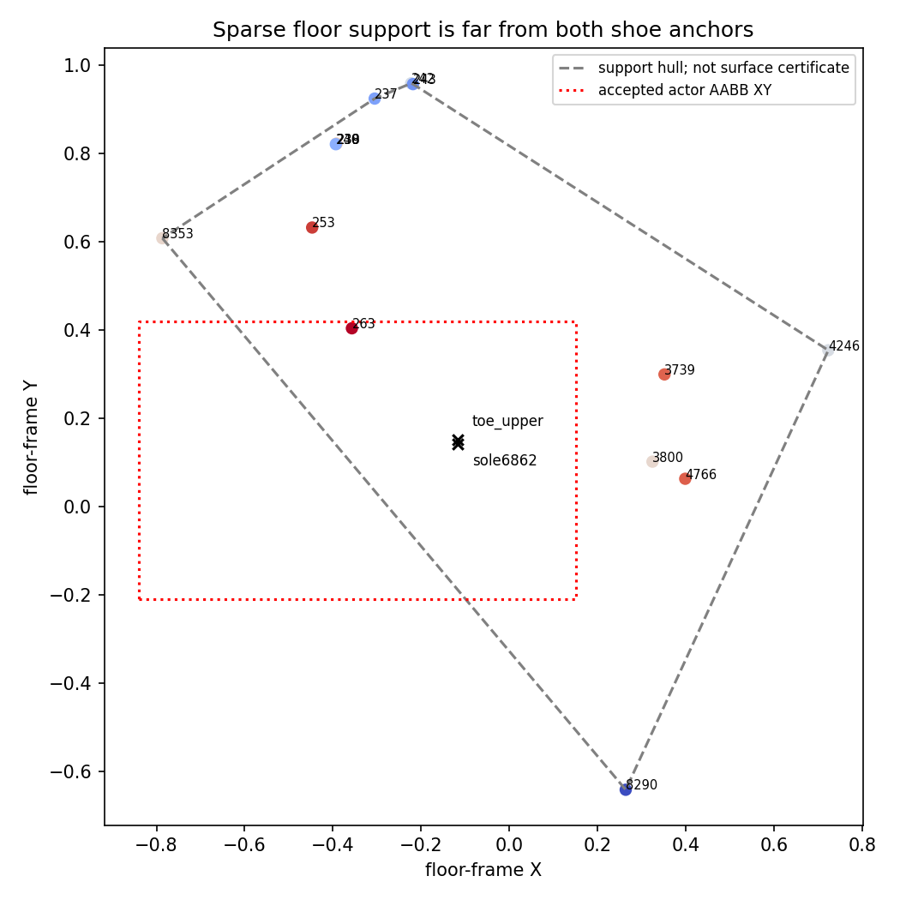

# Signed-floor-coordinate contribution diagnostic proposal

This CPU investigation proposes a read-only rendering diagnostic. It does not authorize carving, a floor prior, new masks, or a grid change. Signed height means distance from the **fitted coordinate plane**, not independently established height above the actual floor.

**What was checked.** The accepted floor frame comes from 14 previously photo-qualified TRAIN witnesses: 237, 238, 239, 240, 242, 243, 253, 263, 3739, 3800, 4246, 4766, 8353 and 8290. IDs3738 and8246 are explicitly excluded. The source archive contains 63 TRAIN camera names and no DC/HC/KA. A fresh CPU replay of the existing fitting helper reproduces the saved rigid frame and residuals within `1e-12`. Coordinates are prepared-world units; physical scale is unspecified.

| Floor reference property | Result |
|---|---:|
| Maximum fitted normal residual | 0.00463667 |
| Maximum leave-one-witness-out heldout residual | 0.01278754 |
| Upper-toe anchor: nearest measured floor XY distance | 0.348236 |
| Sole6862 anchor: nearest measured floor XY distance | 0.355666 |

Both shoe anchors fall inside the broad floor-witness XY convex hull. Neither has a nearby measured floor point. Several support tracks are near-duplicates, and ordinary leave-one-witness-out is therefore optimistic about independence. Neither the fitted residual nor the leave-one-out value is a calibrated confidence interval for the floor beneath a foot. Floor coverings can bend or sit above the structural floor.

The dashed polygon is the sparse support footprint, not a continuous opaque-floor certificate. Point colors show signed fitted residual. The red dotted rectangle is only the accepted actor AABB's XY footprint. The frame's exact normal is `[0.0279277793,-0.1362845961,0.9902759959]`, with offset `0.1716909231` in original native world. Thus native sample height is `n·x_original + offset`; LookCloser samples already in the accepted floor frame use their Z coordinate directly.

**Qualified source depth and its domain.** Existing TRAIN MA/NA/NB source review identifies point8290 as a floor-covering fleck, and independent native8K feature track80 corroborates the same feature within0.000501 world units. Raw80 has three actual detected observations and maximum reprojection error0.486 native pixels. It adds correspondence evidence at the same location, not a new nearby floor anchor. The source review explicitly found no floor witness enclosing the nine historical near-foot plane intersections; other nearby candidate tracks belonged to actors or uncertain contact boundaries.

The old `floor_band_prior_PROPOSAL` has an exact finite domain of2720 triangles, with full triangle corners supported by at least three of five reviewed TRAIN clear-floor polygons and an assumed ±0.02 band. However, it uses a different16-point plane and contains **zero measured SfM floor points** in that domain. Its own root review calls the plane a scene assumption and forbids interpreting it as ground truth or an occupancy certificate. It must not be inherited as a current physical validity domain. No existing source establishes a continuously valid depth surface under the actors. At most, the current14 measured points, their actual observed rays, and the separately qualified shoe anchors provide localized references.

The raised mat is separate: the existing TRAIN material review documents deformed upper cover/rims and broad proxy uncertainty. It cannot be merged into a flat floor, nor can a pixel over the mat be treated as an unobstructed floor observation. Six temporally qualified bag interiors and their contact uncertainty likewise remain separate from floor depth.

**Why active-cell counts are insufficient.** Root's selected semantic R0@111316 audit found7031/48509 active cell centers below Z0 and4490 below−0.01, with no cells outside fixed semantic admission. These are center counts, not contribution weights or an empty-space certificate. At resolution128, cell12 spans `[-0.004375,+0.00109375]` and has center−0.001640625: its center is below0 while the cell crosses the plane. Cell10 spans `[-0.0153125,-0.00984375]`; it is entirely below0, yet crosses−0.01. Even cells wholly below the fitted plane remain subject to the floor-reference uncertainty above.

**Proposed bounded diagnostic.** Freeze exact checkpoint, renderer, camera and existing near-foot ROI hashes for the selected semantic R0 and the matched λ0.01/λ1 pair. Use the existing fixed DC/HC/KA foot crops for a posthoc visual diagnostic, clearly separated from any fitting evidence. Preserve the two TRAIN shoe-anchor rays and the TRAIN floor-covering observations as geometric controls. The sealed103 clothing rays and DC12 garment queries do not supply floor depth truth; no current provenance-qualified near-foot LC profiles were found in those archives.

For each selected ray, save the model's actual native sampler intervals, density, RGB, original transmittance and weights, sample floor-frame position, and existing occupancy/admission status. Use exactly the weights of the image being diagnosed: for an accepted-AABB inside-only native render, use its existing inside-only transmittance; for LookCloser, use its actual rendered weights. Do not recompute transmittance separately for each height bin. Accumulate original weighted RGB and termination mass into signed-Z bins with edges `−0.02, −0.015, −0.01, −0.00463667, 0, +0.00463667, +0.01, +0.015, +0.02`, plus both tails. The ±0.015 cuts are sensitivity checks wider than the observed leave-one-out residual, not safety thresholds.

If a sampling interval crosses a bin edge, split its constant-density interval analytically while retaining the original incoming transmittance. For a subinterval `[a,b]` of original `[t0,t1]`, its weight is `T0·exp(−sigma·(a−t0))·(1−exp(−sigma·(b−a)))`; use the original sample RGB. This partitions the renderer's existing piecewise-constant integration without additional field queries or modified density. Also record how much mass lies in intervals crossing each cut, since midpoint-only bucketing can misclassify a thin sole or floor layer. Preserve any native alpha/early-stop approximations and verify the sum of bins plus original background reproduces the diagnosed image within the renderer's established numerical tolerance.

Report per-ray and per-ROI RGB contribution, termination mass, weighted signed-height quantiles, and the fraction below−0.015, inside±0.015 and above+0.015. Overlay the signed contribution maps on the unchanged source/render crops. Keep actor-contour/contact ambiguity visible; ROI membership is not a material label. Keep broad XY-hull membership separate from actual floor-qualified source-ray membership. A dominant below-plane contribution would locate the model artifact in fitted coordinates, not prove physical emptiness. Dominance near/above the plane would argue against a simple below-plane explanation.

This initial proposal was subsequently executed as the bounded [33-ray, three-model read-only probe](marshawn_signed_floor_probe.md); the original CPU investigation itself ran no field queries. Existing aggregate RGB/alpha images alone cannot recover the height distribution. The paired HD/4K producer keeps its exclusive GPU lock, so this diagnostic must not compete with it.

**Possible future source work.** The old MA/NA/NB/AB/BB clear-floor polygons expose finite floor-covering patches and seams that could support manual multiview intersection matching. Their current records do not establish matched tile-corner depths close to the feet. Any new triangulation must use the same physical visible feature in at least three original TRAIN views, preserve actual pixel-center/calibration contracts, report residual and uncertainty, and reject mat/bag/actor-occluded projections. No automatic plane clamp or invented floor correspondence is justified.

Evidence: [CPU reference/domain receipt](assets/marshawn_floor_reference_domain_20261106/reference_domain.json), [reusable CPU audit](../scripts/audit_marshawn_floor_reference_domain.py). The receipt binds the original floor frame/archive, TRAIN shoe sources, raw80 review and historical finite-domain proposal. Durable campaign copy: `C/native_resolution_pair_100000/documentation/floor_reference_domain_CPU/`. `C=/fsx/tmp/marshawn_001660_hd/tuning_20261106`.
