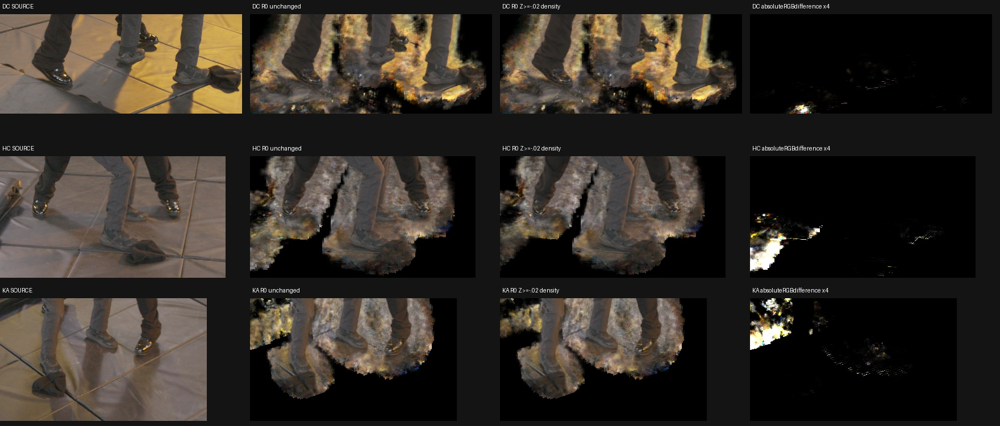
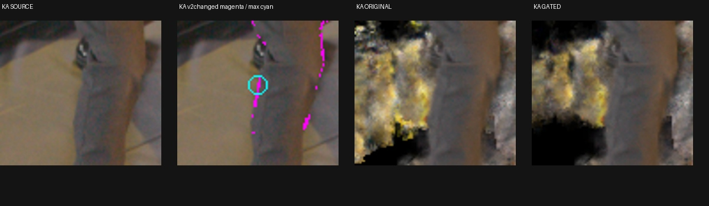

# Read-only Z<−0.02 density-gate diagnostic

**What was tested.** Selected semantic R0@111316 was replayed with one additional inference density selector: retain queried positions whose accepted floor-frame Z is at least−0.02. This is an empirical conservative prior motivated by the existing floor-coordinate uncertainty and local TRAIN source review, **not an empty-space certificate**. It does not change field weights, coordinates/hash normalization, native occupancy core, semantic admission, accepted AABB, source images or training. The selector applies to adaptive refinement and final density queries; transmittance is recomputed normally. It is a sample-position gate, not exact interval/plane clipping.

The authorized scope was the existing DC/HC/KA foot crops, six measured TRAIN shoe observations, and103 declared clothing observations. The clothing inventory is not103 independent3Dpoints, and point5568 remains a mixed-opacity hair feature. All original crop renders passed archived-PNG parity before any gated rendering. No full-frame score, new training prior, or final actor export was produced.

**Results.** All phases passed in28.9s on idle exclusive silver GPU5, with peak1796MiB; the resource limits were8GiB allocator,10GiB process and900s. The native HD/4K continuation remained active separately on dev3. Maximum unchanged-crop difference from the archived PNG was0.50006 of an8-bit value. Field state and occupancy tensors matched before/after, and removing the temporary wrapper restored the first original control ray within2e-6.

Rows are DC,HC,KA. The final column shows absolute RGB difference multiplied by four. Root independently reviewed all three rows: the gate removes a remote lower-left fragment in HC and an upper-left fragment in KA, changes little in DC, and leaves most near-shoe floor/halo intact. No gross shoe-contour cut is apparent at this overview resolution; that is not a complete-foot guarantee.

| Fixed crop | Pixels | Pixels changing by >1RGB byte | Original summed alpha | Gated summed alpha |
|---|---:|---:|---:|---:|
| DC | 74,550 | 2,930 | 52,093.97 | 51,723.76 |
| HC | 84,958 | 6,872 | 49,582.54 | 47,919.08 |
| KA | 78,624 | 8,046 | 35,990.03 | 34,676.40 |

All109 measured actor XYZ locations remain admitted. Across103 clothing rays, the largest RGB change is6.49e-5 and largest alpha change6.55e-5. The six shoe rays are less invariant: sole6862 in JB changes RGB by up to0.01250, with alpha0.92426→0.91115; JA and KB sole alpha falls by0.00603 and0.00640. Upper-toe controls are essentially unchanged. Admission of the measured points and small control changes do not establish preservation of every part of either foot.

**Boundary audit.** Existing EVALv2 labels were used only after rendering to locate changes; they never entered the gate or its threshold. More-than-one-byte changes touch8/15,831 actor-labeled foot-crop pixels in HC,14/14,887 in DC, and198/11,059 in KA. The maximum KA change is at(940,374), on a grey lower-leg silhouette: RGB change0.14590 and alpha0.96784→0.80681. The zoom shows the bright halo behind this boundary receding, but does not prove all boundary appearance is preserved. HC/DC maxima occur on real black toe/sole boundary pixels, with maximum actor-labeled alpha drops0.01188/0.02394. These effects are why the result cannot be called an actor-invariant cleanup.

The magenta marks are existing actor-label pixels changing by more than one byte, with the largest change circled in cyan. [HC toe zoom](assets/marshawn_floor_point_gate_20261107/floor_gate_HC_changed_actor_labels.jpg) and [DC sole zoom](assets/marshawn_floor_point_gate_20261107/floor_gate_DC_changed_actor_labels.jpg) preserve the same source/original/gated comparison. Label and contact uncertainty remains; no mask correction was made from these renders.

**Insight.** Deep-negative density explains some remote fragments, but removing it is insufficient for actor isolation. Most near-foot residue lies closer to or above the fitted plane. This single inference test is not promoted as a final fix or as evidence for globally empty space below the threshold. A separately controlled TRAIN visibility/clear-ray experiment addresses another cause and must retain its own evidence and authorization.

[Full diagnostic with109 control rays](assets/marshawn_floor_point_gate_20261107/diagnostic.json), [control summary](assets/marshawn_floor_point_gate_20261107/control_summary.json), [posthoc label audit](assets/marshawn_floor_point_gate_20261107/mask_diagnostic.json), [completion receipt](assets/marshawn_floor_point_gate_20261107/complete.json), [root visual review](assets/marshawn_floor_point_gate_20261107/root_visual_review.json). Code: [bounded controller](../scripts/run_marshawn_floor_point_gate.py), [streaming inference diagnostic](../scripts/marshawn_floor_point_gate_worker.py), [CPU boundary and coordinate-preservation tests](../tests/test_floor_point_gate.py).

Exact plan SHA256 `db89608e9f0d53240664f7cce77afd91eb2109ae5d187f7b5f91b11bbd32a62b`; diagnostic SHA256 `79b35af563824bbb45632b945ede43b932586c95698cd542c7ff311b6680143b`. Complete inputs, actual imported-helper proofs, resource logs and floating RGBA crop archives remain on silver at `SC/independent_occupancy/floor_point_gate_minus002_v1`. A review copy is at `O/documentation/floor_point_gate_minus002_v1`, where `O=/fsx/tmp/marshawn_001660_hd/tuning_20261106/native_resolution_pair_100000`. Neither this test nor the related signed-height probe modified the running production recipe.
