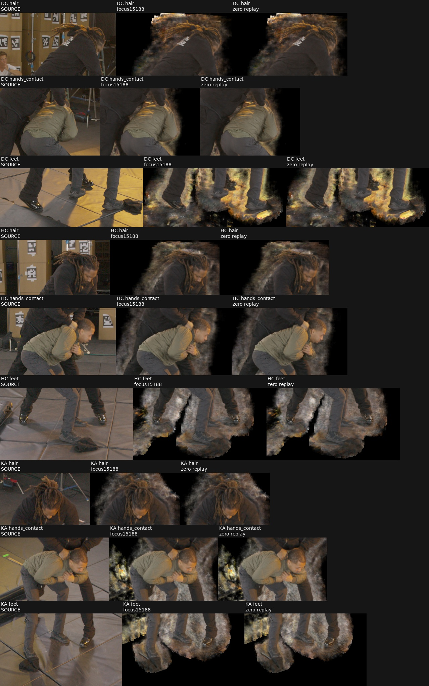
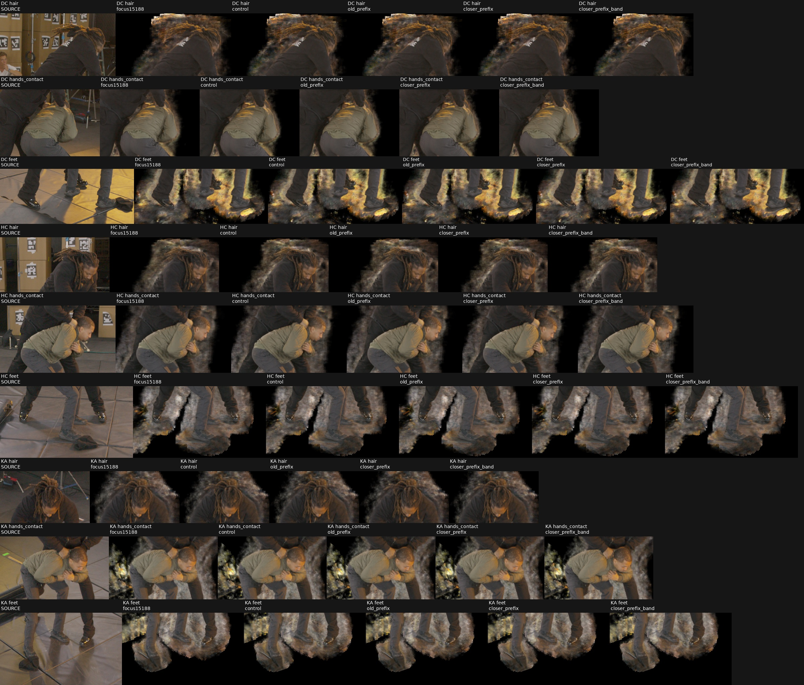

# Focused15188 geometry comparison

**What is proposed.** Four fresh4,000-attempt continuations from the same immutable focused15188 checkpoint test whether the closer free-prefix interval improves semantic actor geometry, and whether an added positive band helps or conflicts with detail. All four zero-update and176+16 restart gates passed independent root review. Root released the fresh4,000-attempt comparison; the four arms started from the original15188 checkpoint at2026-11-07 02:19:25 UTC and completed4000 attempts. All three views and the final native-ray geometry audit are complete. Closer-prefix supervision improves local reserved-point geometry; global halo/floor artifacts remain, and no variant is promoted.

| Arm | Prefix end before witness depth d | Prefix coefficient | Positive band coefficient |
|---|---|---:|---:|
| Control | No geometry term |0|0|
| Old prefix |max(0.01,0.05d)|0.003|0|
| Closer prefix |max(0.01,0.02d)|0.003|0|
| Closer prefix + band |max(0.01,0.02d)|0.003|0.001|

All arms preserve the existing focused frequency sampler, original4096-ray body80 objective, distortion0.01, LR/scheduler/scaler, native coarse step0.00625, R0 learned-core rule, fixed W64 semantic admission, cameras, field coordinates and future FR schedule. At15188 FR is1; it remains1 throughout this4k comparison. The exact source SHA256 is `a29f83e34be9406729d1a05c3dc40d52adceb934028b68fd147be29cfe4eb837`. Technical checkpoints are excluded from every production ancestry.

**Geometry contract.** The sealed31points/84TRAIN projected observations remain unchanged; all reserved IDs63/64/71/72/2219/5556/5568 are explicitly excluded. No new annotations or EVAL geometry enter supervision. The previous source review supplies clipped positive bands with half-widthmax(0.005,0.01d). Prefixes use512 midpoint samples; positive bands use256 after the [read-only convergence check](marshawn_semantic_clothing_transfer.md). The closer prefix still ends at least0.00927 before the band. It is a soft empirical prior, not a proof of empty space or a hard carve.

A separate private stream, seed4202084, samples128 observations per attempted iteration: uniform camera, then uniform observation within that camera. Its expectation is the same camera-balanced aggregation used in the all84 read-only gradient probe. All four arms consume identical private packets, including the zero-coefficient control. Prefix and band share the packet. The existing focused private seed/state4201024 and main sampler are never reset or borrowed. Prefix queries call the actual frozen field density with its shared semantic selector and exponential activation; they do not skip queries using the learned occupancy grid or terminate rays early. The positive-band term is−log(1−exp(−τ)), evaluated using stableexpm1. Nonpositive bandτ fails explicitly rather than hiding unsupported geometry behind an epsilon.

These rays pass through fitted3D points and differ from the actual detected feature rays and integer image-pixel rays. Source feature residual and localization uncertainty remain relevant. The earlier full-background P/PB experiments are historical mechanism evidence, not outcomes for this new semantic foreground comparison. The positive-band gradient remains negatively aligned with the measured main gradient at both frozen models; a quality benefit is not assumed.

**Preparation results.** Seven CPU tests pass: private RNG isolation and exact176+16 stream restart; identical arm streams; membership rejection; camera balancing; analytic constant-density prefix/band values and gradients; and control packet consumption without density queries. CPU reconstruction verifies all seven source state hashes, source core/active state and exact flattened EMA. The saved EMA diagnostic archive is3D while its checkpoint array is flat; values match exactly. The source configuration comparison has only two changes: `load_checkpoint` and `output_dir`. All four fork configurations are otherwise identical. No CUDA context was initialized during preparation.

The worker explicitly installs and restores `FocusRuntime` after the main sampler, before restoring global RNG. Its state capture hashes the live sampler and live focused runtime, not a stale metadata copy. It saves the separate geometry stream in child lineage. Original scientific model/pipeline code remains byte-identical; only the separate fork entrypoint, factory and auxiliary module are added, with the already reviewed physical-GPU lease helper.

**Proposed technical gates.** Root review and explicit per-spec release are required before execution. First run all four zero-update restorations: exact seven-state/runtime/core equality, no geometry draws, unchanged private focused state, and all three FHD RGB8/alpha16 renders. The existing numerical replay gate permits maximum one code difference, RGB changed fraction≤1e−5, alpha changed fraction≤0.001, and absolute PSNR/SSIM/LPIPS difference≤1e−5 in aggregate, each camera, each actor and all six actor-camera records. Source bytes remain exact; this is not a bitwise-render claim.

Then run176 technical attempts, save at15364, exit, and strictly resume16 more to15380. This crosses the actual focused-frequency refresh at15360;32+32 from15188 would miss it. Require actual Adam and pipeline changes, finite gradients on successful updates, exact seven-state plus geometry/focused private-state restoration, and a real focus refresh. AMP skips are recorded separately from attempts. All arms must share initial main indices and the geometry-packet chain. Later main/global-RNG equality is measured and reported; any model-dependent divergence must be explained, not repaired by silently reseeding.

The prepared controller uses the existing shared physical-GPU lease/UUID mechanism and only idle silver GPUs. Each phase has a durable guard that can signal only its own PID/start-time/boot-identity-matched worker. The allocator cap is12GiB and process limit16GiB. Zero and technical workers are bounded by900s each; a later production release would permit3,600s per4k worker. Existing healthy producers are never interrupted. No production release is implied by passing technical gates.

**Proposed evaluation.** Fresh production starts again from15188 and ends19188, with unchanged common V1 FHD gates at15688/16188/17188/19188. The parent checkpoint remains an eligible comparison. Use the campaign's actor-LPIPS goal and0.001 tie rule followed by PSNR/earlier step. Review all three views' hair, face, hands and feet, plus newly focused detail and residual halo/floor fragments. Separate geometry diagnostics retain fit and reserved groups from the predeclared103-ray inventory; the reserved5568 hair observations are excluded from opaque-cloth interpretation, and duplicate rays are identified. Improvement on fitted84 rays alone cannot establish generalization or physical correctness.

The concrete package is `SC/focused_clothing_geometry_candidate_v4`. Its [review manifest](assets/marshawn_focused_clothing_forks_20261107/review_manifest.json) binds1,543 files, SHA256 `210530689eb51556755be92086260aa3590e26cee3a1d3922ba178ce9b9b6854`. It contains12 phase/arm specs, source-bound checkpoint/geometry proofs, controller plans, guard/launcher, technical verifier and frozen code. V1/V2 CPU preparation failures and the V3 draft remain preserved; V4 adds live-runtime state hashing and stronger actual-update checks. [CPU proof](assets/marshawn_focused_clothing_forks_20261107/CPU_validation.json); [exact source config differences](assets/marshawn_focused_clothing_forks_20261107/source_config_diff.json); [phase policy](assets/marshawn_focused_clothing_forks_20261107/phase_policy.json).

Reusable helpers: [geometry runtime](../scripts/marshawn_focused_clothing_geometry.py), [strict factory](../scripts/marshawn_focused_clothing_factory.py), [full-state worker](../scripts/train_marshawn_focused_clothing_geometry.py), [phase launcher/guard](../scripts/run_marshawn_focused_geometry_phase.py), [CPU technical verifier](../scripts/verify_marshawn_focused_geometry_phase.py), [stream tests](../tests/test_focused_clothing_stream.py), [analytic integral tests](../tests/test_focused_clothing_integral.py).

**Zero restoration results.** Root approved the exact four zero-only specs in [root review](assets/marshawn_focused_clothing_forks_20261107/root_zero_review.json), SHA256 `6040c448cf6b537a64b607b4e96159fe09f5535f3e43358d32b7dcc73446214f`. All four preserve the seven source states, live main/focused sampler state, source core/active/EMA and zero geometry draws. All three RGB8/alpha16 replays satisfy the declared one-code and changed-fraction limits; the maximum absolute metric difference over every aggregate, actor, view and actor-view record is1.2573e−6. No Adam update occurs in this phase. [Independent CPU verifier](assets/marshawn_focused_clothing_forks_20261107/zero_verification.json) SHA256 `3de729bec5f4c126b8c3f1f7a7f69bdc80052a152c2d6c48bce128e1e8bf89fa`.

The three-view hair/hand/foot sheet shows visually equivalent source-parent and zero replay. It also makes the unchanged fuzzy halo and near-foot floor/bag remnants explicit; restoration success is not a quality or isolation result.

The initial remote controller could not authenticate SSH to itself; no worker had dispatched. The already confirmed host fingerprint was installed with a backup, but no credential was created or copied. The identical hash-verified controller instead ran through the established local SSH path. Its output state was mirrored every5s to the unchanged remote resource guard, with an independent60s stale-mirror watchdog restricted to the phase's PID/start-time/boot/command-verified workers. All four jobs and both guards passed. The failed pending-controller evidence remains preserved. The technical extension also watches controller-state age, and uses the same worker commands, physical-GPU leases and limits.

Full zero renders/proofs, source/zoom review, transport shim source and receipts are archived under `O/documentation/focused_geometry_zero_v4`:112files, tar SHA256 `0c405e22dd2cc2f9ca2019dee4aec1a15726d8c289d42aea9e45375edaca4690`. Root's separate technical-only release is SHA256 `941d99d45c13827c2e6ca0fcd9717b2232fe7a21887581f92aed2fc3ef150fd9`. The subsequent [diagnostic release](assets/marshawn_focused_clothing_forks_20261107/root_diagnostic_review.json), SHA256 `6f254555de35c3a318a59326b5d871c37339d5d33a5d05fcb396933402a61e60`, authorizes only the declared fresh4000-attempt comparison and final audits. Final trained checkpoints must receive fresh dense prefix/band quadrature checks because the starting512/256 convergence does not certify future thinner density layers.

**Technical restart results.** All four arms passed176+16 attempts across focus refresh15360. The serialized source Adam counter is15180, intermediate15356, final15372:192 actual updates, no AMP skips, all successful combined gradients finite. An earlier progress message mistakenly inferred source15182/190 updates; direct source/proof verification corrected the message, with no checkpoint mismatch. Seven-state and auxiliary/focus restoration match exactly; all four main-index chains, final global RNG and main sampler agree. Pipeline and optimizer hashes differ across arms as expected. [Canonical proof](assets/marshawn_focused_clothing_forks_20261107/technical_canonical_summary.json), SHA256 `ebb506a21307b6f1149785a5e7093f731bf9d922244366e201902ba82d7a6fdd`; [technical verifier](assets/marshawn_focused_clothing_forks_20261107/technical_verification.json), SHA256 `746670d363e5e5b961bd5e4b8516af9fd431420bb89957bf8465824d93318e8a`.

The diagnostic transport extends the reviewed external bridge/watchdog by only two phase-choice additions. The worker commands, physical leases,16GiB process limit and60s stale-state stop remain unchanged. Local controller2124714 is at `/tmp/focused_geometry_diagnostic_transport_v3`; durable remote guard/watchdog receipts are under `SC/focused_clothing_geometry_candidate_v4/transport_local_ssh_diagnostic_v3`. Technical15380 checkpoints are excluded from ancestry.

**Fresh4000 results.** All four arms finish at19188 with3998 actual Adam updates and2 AMP skips. Main sampling chains, geometry packets, final main sampler and focused private state agree across all arms; source15188 is unchanged. [Final CPU verification](assets/marshawn_focused_clothing_forks_20261107/diagnostic_verification.json), SHA256 `0c1e77920928b8295723db5db856156c2cd6c2e94a79b05c25442170f24407ea`, binds172 files including all16 gate checkpoints/core/EMA/admission archives and96 RGB/alpha images. Full checkpoints remain retained under the hash-bound completed arm outputs on silver; the inventory supplies exact hashes.

| Final19188 arm | PSNR | SSIM | Actor LPIPS |
|---|---:|---:|---:|
| Control |31.73550|0.844809|0.022924|
| Old prefix |31.81159|0.844790|0.022844|
| Closer prefix |31.77831|0.844353|0.022868|
| Closer prefix + band |31.69040|0.844060|0.022885|

These are small primary-metric differences, not evidence of a physical solution. Both this agent and root reviewed all nine fixed hair/hand/foot rows across DC/HC/KA. No gross actor contour loss is apparent at the contact scale, but heavy head/outer-actor halo and floor/mat/bag remnants persist in every arm. [Root review](assets/marshawn_focused_clothing_forks_20261107/root_final_visual_review.json).

**Final projected84 convergence.** The independent read-only replay preserves seven full states, main/focused sampler and cache associations; no gradients or Adam updates occur. All84 projected rays are evaluated at prefix512/1024/2048 and band256/512/1024. Prefix comparisons pass the predeclared absolute≤0.05 OR relative≤5% criterion in all four arms. Very small tau values can have larger relative differences despite passing the absolute criterion; this does not certify a zero-density interval. Stable camera-balanced old-prefix/closer-prefix tau is0.043924/0.109541 for control,0.000378/0.060063 for old prefix,0.000308/0.000875 for closer prefix, and0.000289/0.000815 for closer+band. Thus the closer interval suppresses density in the previously unpenalized fitted gap.

The band arm is **quadrature-limited**:3/84 final rays fail256→512, with maximum tau difference0.7305 and relative difference8.42%. All84 pass512→1024. Stable band tau is3.8984/3.8027/3.7626/10.4741 for control/old/closer/closer+band. The dense final measurement is valid under that convergence check; it does not retrospectively certify256-sample training. No rerun or increased-sample training is implied. [Dense audit receipt](assets/marshawn_focused_clothing_forks_20261107/final_dense_complete.json), SHA256 `f87489f1080d55b7c7785d0d8594dad419fc195495a823530e587c50241ac888`;139.8s, sampled peak3070MiB, source hashes reverified. Native103 fit/reserved andDC12 diagnostics remain separate from these fitted projected rays.

**Final actual pixel-ray geometry.** The [matched summary](assets/marshawn_focused_clothing_forks_20261107/final_geometry_summary.json), SHA256 `d4ca6b380d92ee701be8ddf46571c989f596645791a73752121c67af550a2f96`, recomputes the parent and four final models with the same method. Original packed renderer weights are authoritative; interval contributions split them by normalized constant-density fractions, preserving each weight. The table uses the actual integer-pixel rays, separate from the projected84 prior rays. “Early” is before witness depth−0.02; “band” is within±0.02, in accepted scene-coordinate units, not a verified centimetre scale.

| Model | Old18 fitted early / band | Old8 local reserved early / band | New66 fitted early / band |
|---|---:|---:|---:|
| Parent15188 |0.1988 /0.6682|0.2421 /0.7087|0.0656 /0.8678|
| Control19188 |0.1637 /0.7107|0.1761 /0.7629|0.0567 /0.8796|
| Old prefix19188 |0.1259 /0.7283|0.1488 /0.7758|0.0282 /0.9005|
| Closer prefix19188 |0.0102 /0.8165|0.0293 /0.8641|0.0006 /0.9243|
| Closer + band19188 |0.0115 /0.9086|0.0415 /0.8471|0.0005 /0.9872|

The closer prefix improves eight reserved observations near the original fitted shirt patch; these are local reserved observations, not eight independent unseen surfaces. Six other whole-patch reserved opaque-clothing rays already have about0.995 native band mass and remain there. The three reserved5568 hair-boundary rays are reported separately and excluded from opaque-cloth interpretation; two duplicated audit observations are also separate. The band objective improves fitted geometry but worsens the old eight reserved observations relative to closer-prefix alone. The old18 behind-band mass rises from0.1096 in control to0.1505 with closer prefix, then falls to0.0697 with band: removing early density alone does not establish a single correct surface.

A dense uniform same-field reference also supports improvement on the old eight reserved rays: early mass0.2248→0.0693 for control→closer prefix, with band mass0.7218→0.8367. Native and dense integration still differ, so the native sampler is not treated as ground truth. No final native sample-cap hit occurs in any of the four×103 clothing or four×12 DC rays. DC12 remains a posthoc EVAL RGB diagnostic without depth truth or training use; its RGB changes are small and mixed. All source-point localization/reprojection uncertainty remains applicable.

**Numerical replay qualification.** The original strict2e−6 FP64-sum check failed on three band-arm TRAIN rays and remains recorded as a failure. The saved native model/core state was unchanged. Replaying the same saved FP32 weights and RGB through the actual native compositor20 times gives maximum native-to-replay difference1.6093e−6; identical-input repetitions vary by up to2.5630e−6. The separate [numeric addendum](assets/marshawn_focused_clothing_forks_20261107/band_numeric_addendum.json), SHA256 `86d4039985989288fbe6297d450180c6d8a6bff65cee8877693ee0d697a9b7d8`, applies the measured native-compositor2e−6 check, the positive-sum FP32 boundγ(n−1)×Σ|terms|, and a maximum0.5alpha16-code FP64/native discrepancy. Product rounding is measured separately; theoretical bounds and observed errors are distinct. The maximum observed alpha discrepancy is0.162604 code. These TRAIN rays have no archived rendered PNG; this is a saved-float comparison, not an invented image check.

Only the remaining bandDC12 phase was run under the versioned numeric policy; the six earlier passing phases were reused. Its actual-compositor error is8.34e−7, FP64/native alpha discrepancy0.06315alpha16 code, and comparison against the existing finalDC RGB8/alpha16 PNGs gives maximum float-to-code errors0.48684/0.49220. [DC12 completion](assets/marshawn_focused_clothing_forks_20261107/band_DC12_complete.json); [explicit reconciliation of all eight phases](assets/marshawn_focused_clothing_forks_20261107/final_native_reconciliation.json). No model, source, optimizer or grid changed during these audits.

**Selection and next step.** The lowest final LPIPS is old-prefix19188. Applying the campaign's0.001-LPIPS tie window across all archived gates instead chooses closer+band17188 by PSNR; [numeric selection receipt](assets/marshawn_focused_clothing_forks_20261107/numeric_selection.json) preserves both facts. This is not a quality/geometry promotion. The detailed geometry comparison above is at19188, and the band arm is quadrature-limited. The useful causal result is local reserved-point improvement from closing the prefix gap. Broad halo/floor removal requires separate source-visibility/coverage evidence; these sparse clothing constraints do not solve it.

The complete3175-file evidence archive is `O/documentation/focused_geometry_final_v4.tar.gz`,469,245,962bytes, SHA256 `854feb22bfa69a0e762ae9a3fbad8058cf22ce4f6fec1f9014e754de3d876e86`. Its3174 manifest-bound files were independently rehashed after extraction to `O/documentation/focused_geometry_final_v4`; [archive receipt](assets/marshawn_focused_clothing_forks_20261107/FSX_archive_receipt.json). It includes all rendered gates, grid/core/EMA/admission files, final raw ray profiles, numerical-failure evidence, source/transport code and receipts. The33.6GB of full checkpoint payloads remain retained at their bound SC paths rather than duplicated in this compact evidence archive.
