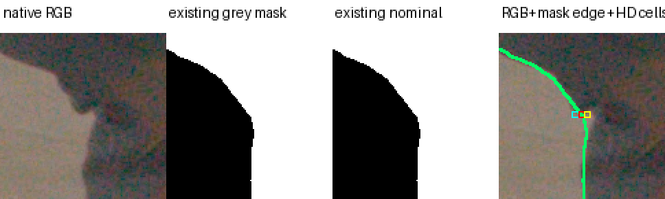
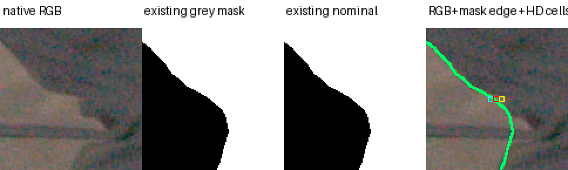

# Existing RAW foreground coverage at the grey contour

## What was tested

Diagnostic-only inspection of the highest-resolution existing8192×4320 RAW segmentation for KA/HC at the two worst grey-contour pixels and their x±1 neighbors. No segmentation, optical alpha labels, training, GPU query or leaderboard change. Source masks are the sealed `confidence_native_hair_v2/raw/{KA,HC}.npz`; native RGB crops come from the original source-bound RAW semantic display.

The calibrated mapping uses the existing RAW AREA prefilter followed by one OpenCV linear undistortion remap, exactly matching the established confidence pipeline. Intrinsics and distortion match the sealed source request; original rig files, masks, display images, HD confidence and coordinate helper are hashed. The recomputed **entire HD nominal-coverage arrays match the saved arrays with maximum error0** for both cameras. Grey and nominal coverage agree at all six pixels; black and source-ineligible coverage are zero.

## Results

| EVAL pixel | Existing RAW grey area coverage after calibrated filter | Nearest RAW centre label | V1 hard grey mask | Actual alpha A | Actual alpha margin .002 |
|---|---:|---|---|---:|---:|
| KA[1027,331] |.045130|background|false|.88589|.38281|
| **KA[1028,331]** |**.591855**|**background**|**true**|**.96684**|**.56595**|
| KA[1029,331] |.958630|grey|true|.99285|.62830|
| HC[1051,576] |.238636|background|false|.65215|.33991|
| **HC[1052,576]** |**.850081**|**grey**|**true**|**.70138**|**.58168**|
| HC[1053,576] |.993122|grey|true|.80137|.75102|

These are existing segmentation-derived semantic coverage estimates, **not measured optical alpha**. Their uncertainty includes mask-boundary error and the sampling/filtering mismatch between a single model ray and the target pixel footprint.

KA's worst centre maps to RAW array coordinate [4387.282502,1415.826654]; HC maps to [4489.945427,2460.238713]. The red footprint in each native crop denotes the worst HD pixel, cyan/yellow its x−1/x+1 neighbors. Green is the existing grey segmentation edge. Both worst pixels lie at the cloth/floor boundary, rather than inside a uniformly covered garment patch.

## Insights

At KA[1028,331], the .002-gated alpha .56595 is close to the existing semantic coverage .59186. The original .96684 alpha includes the farther background-like contribution identified in the source-layer audit. Calling this single gated pixel “underopaque cloth” or forcing it to alpha1 would be unsupported.

Current V1 uses a hard actor mask and compares the original target RGB at accepted boundary pixels. That target RGB contains an area-filtered mixture of foreground and actual floor/background, while the bounded foreground render uses black background. Removing a physically unwanted farther layer can therefore worsen V1 even when foreground alpha is closer to fractional pixel coverage. The fixed V1 leaderboard remains unchanged; this is a qualification of its contour interpretation.

HC's centre and the +1 neighbors have higher existing coverage than their gated alpha, so this explanation does not establish that all discrepancies are harmless antialiasing. Mask uncertainty, calibration/single-ray filtering and genuine insufficient foreground contribution remain possible there. No global opacity prior follows from these six pixels.

This follow-up narrows the earlier [source-layer conclusion](marshawn_grey_contour_source_layers.md): the farther layer is source-inconsistent/background-like in the inspected TRAIN views, but **far-layer color compensation does not itself prove that the true foreground should be opaque at a boundary pixel**. Source geometry and pixel-coverage correctness must be assessed separately.

[Source hashes, calibrated footprints and values](assets/marshawn_grey_contour_RAW_20261107/coverage.json). Full provenance: `/fsx/tmp/marshawn_001660_hd/tuning_20261106/independent_occupancy/grey_contour_RAW_coverage_v2`; coverage receipt SHA `3f20572fd60afc92b20e07f83e318faa7814a3018bfae24d45b005c0eae7e91a`. V1 preliminary artifact is preserved; v2 additionally checks the rig K/distortion against the sealed request and records calibration-file hashes. No values or masks changed between them.
