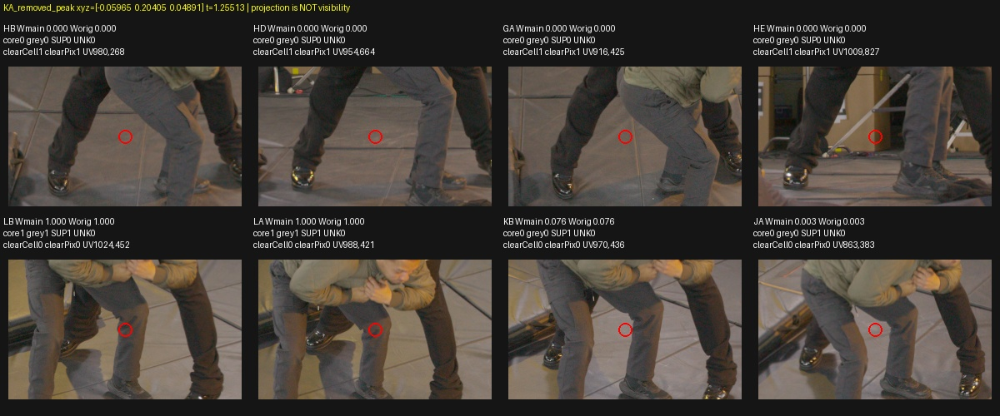
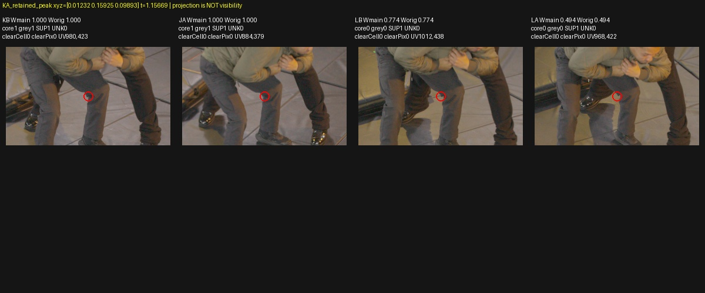
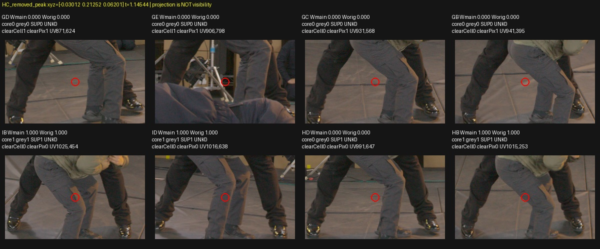
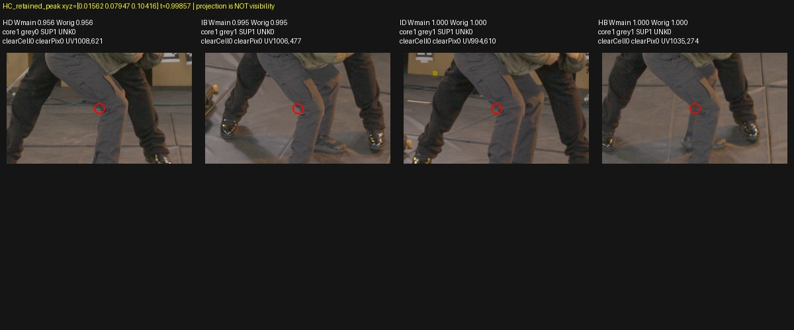

# Why removing the grey-contour layer worsens RGB

## What was tested

CPU-only causal source audit of two actual native rays from the mature quarter-step/distortion .1 checkpoint126316 (`340e794e…cd641`): KA[1028,331] and HC[1052,576]. Select maximum-weight sample and conditional weighted median separately from positions excluded/retained by the .002 geometric buffer around original SourcePad1. All weights are the saved renderer's actual weights. “Peak” means the largest discrete sample contribution, not a fitted continuous mode.

Project these eight sample selections into all63 original TRAIN cameras, preserving the floor-coordinate convention. Keep current W64/core/band/actor labels, original confidence W64, and corrected source support/UNKNOWN/valid as distinct columns. Re-run the exact original whole-cell eight-corner/outward-rectangle voter for each containing source cell and its27-cell neighborhood. No GPU, model queries, new masks, training labels or producer changes.

## Results

| Observation | KA grey contour | HC grey contour |
|---|---:|---:|
| Retained peak depth |1.15669|.99857|
| Removed peak depth |1.25513|1.14544|
| Removed peak behind retained peak |.09844|.14687|
| Original native weight at excluded samples |.41337|.11969|
| Original native weight at retained samples |.55346|.58168|
| Excluded weight behind retained conditional median |100%|100%|
| Whole-cell clear TRAIN votes at removed peak |14|12|
| Minimum votes among its27 neighbor cells |9|6|
| Whole-cell clear votes at retained peak |0|0|
| Corrected support at retained peak |63/63|63/63|

All141 unique tested source cells exactly reproduce the sealed gate0 decisions; their neighborhoods reproduce SourcePad1. Removed peaks are outside gate0, pad1 and the .002 buffer. Retained peaks/medians remain admitted. No center-only shortcut or CPU reconstruction of learned occupancy was used.

The removed KA peak projects to visible floor in HB/HD/GA and the HC peak to floor in GD/GC/GB; GE shows background equipment. These TRAIN crops were inspected manually. The retained peaks/medians project to the grey trouser knee region in nearby TRAIN views. Frustum inclusion and geometric camera proximity alone were not treated as visibility.

The farther layer is also covered by positive RGB confidence from other viewpoints:43/63 current-positive views for KA removed peak,39/63 for HC. Those include projections onto nearer actor surfaces, so positive mask overlap does not prove that the farther 3D sample belongs to the actor. At removed peaks, original whole-cell votes come from clear source rectangles, not from these occluded/actor-overlap views.

Partitioning the actual A contribution without recompositing shows why the image becomes darker: the removed KA layer contributes RGB [.19978,.16444,.14528], compared with retained [.19690,.19716,.19030]; HC removed contributes [.10022,.06081,.03463], retained [.23508,.20928,.20293]. The two pieces sum back to the saved model RGB within floating-point accumulation error. This decomposition is not the separately rendered gate-B color: B recomputes transmittance.

## Insights

The evidence supports a misplaced farther background-like layer compensating for insufficient contribution from the nearer trouser layer in these two pixels. It does **not** support interpreting the boundary LPIPS regression alone as proof that SourcePad1 clipped the principal grey-cloth surface. Conversely, this sparse source audit does not certify every excluded cell as physically empty or all contours as safe.

The existing support is not showing a clear mask error at these inspected veto views: the source images show floor/equipment at the removed projections, while the nearer layer has all63-view support. Root review of these source pages should decide the next controlled adaptation. No additional margin variant or point-gated training has been launched. The global RGB-confidence and known bag-positive issues remain separate causes.

Three CPU tests cover weight-partition peak/median selection, invalid/empty partitions and calibrated pixel-center projection. [Full all63-camera evidence and hashes](assets/marshawn_grey_contour_sources_20261107/manifest.json); runtime evidence also at `/fsx/tmp/marshawn_001660_hd/tuning_20261106/independent_occupancy/grey_contour_source_layers_v1`. Source cameras are ranked by geometric proximity to the diagnostic camera, explicitly not by certified visibility. Distances use scene units, not an asserted metric scale.

### Pixel-coverage qualification

The subsequent [highest-resolution RAW coverage audit](marshawn_grey_contour_RAW_coverage.md) finds KA worst-pixel semantic coverage .591855, close to gated alpha .56595. Therefore the farther-layer compensation observed here does not by itself prove genuine cloth underopacity: fixed hard-mask V1 also rewards reproducing the mixed floor/background color within accepted boundary pixels. HC and adjacent pixels retain additional uncertainty; no global alpha1 target is justified. The farther-layer source evidence and all original trace measurements remain unchanged.
