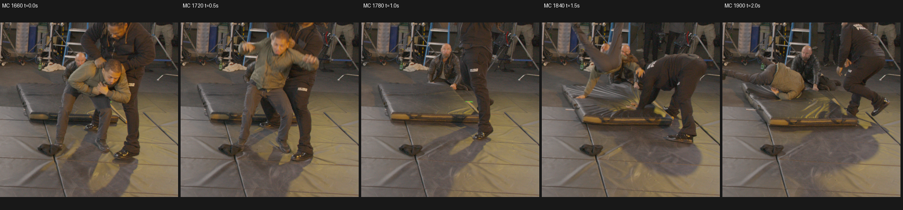
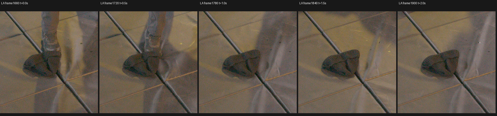
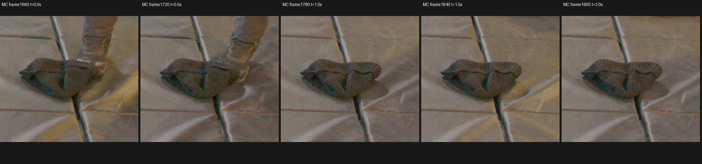

# Knitted object temporal identity

## What was tested

Whether the knit object next to the grey boot is a separate floor item or footwear/cloth moving with the actor. Frames1660/1720/1780/1840/1900 were independently inspected in the **same** TRAIN cameras, at0/.5/1/1.5/2seconds of120fps source footage. Existing wide MC context was reused; only small fixed RAW TIFF crops were decoded for native LA/MC inspection.

## Results

**The knit object stays beside the same floor seam and rig rod after the grey boot moves away.** At1780,1840,1900 the boot is absent from the object's location, while the entire knit item remains. LA and MC independently show this separation. The object is a separate floor item, not footwear or cloth moving with the actor. Its precise prop purpose is unnecessary for that identity conclusion.

The strips use fixed crop coordinates, not crops recentered on the object: LA RAW[3400,2070,4100,2800], MC RAW[4720,2850,5300,3380], both from8192×4320 sensors. [Native LA1660](assets/marshawn_knit_object_temporal_identity_20261107/LA_1660_native_fixed_RAW.png) and [native LA1780](assets/marshawn_knit_object_temporal_identity_20261107/LA_1780_native_fixed_RAW.png) preserve pixels at1:1; all10 native crops remain under the artifact root.

A small descriptive registration check supports the visual observation: the visible left knit-pouch template shifts at most2RAW pixels in either axis across the five LA frames; a fixed rod/floor-seam template shifts at most1pixel. The actor foot moves completely away. Local normalized correlations range .702–.755 for the pouch and .906–.960 for the landmark after1660. This is image registration evidence, not a rigid geometry or segmentation target. [Exact template regions/results](assets/marshawn_knit_object_temporal_identity_20261107/local_template_landmarks.json).

Each native patch uses the same fixed gain4 Rec709 display from original uint16 TIFFs, with fixed RAW raster/calibration. Existing MC HD context has unchanged per-camera photometry and calibration across time. [Identity receipt, raw hashes and calibrated crop metadata](assets/marshawn_knit_object_temporal_identity_20261107/identity_receipt.json) also binds the exact earlier HC/MC temporal pages independently viewed by root. Native LA/MC strips and standalone source pixels were independently viewed for this audit.

## Insights

Temporal evidence resolves the object identity concern; repeated simultaneous views alone were insufficient. Root confirmed the same stationary-item separation in the earlier five-frame pages. The existing experimental LA confidence0 qualification remains narrow: original targets stay1, original assets stay unchanged, and MA/LB contact queries remain protected.

Object identity does not certify a contact boundary, surface depth, optical alpha, density, free space, or hidden material. No further annotation, point negatives, EVAL scoring exclusion, training or GPU work was performed or authorized by this review.

Artifacts: `C/native_knit_object_temporal_identity_CPU_v1`, where `C=/fsx/tmp/marshawn_001660_hd/tuning_20261106`. Acquisition helper: `C/native_actor_bag_projection_review_CPU_v1/inspect_temporal_identity.py`. Existing hash-bound source qualification and root experimental qualification files were preserved unchanged.
