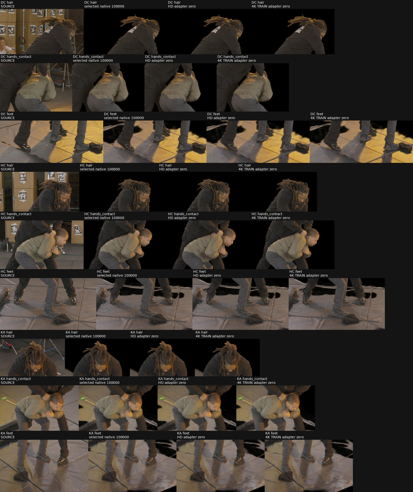

# Native 4K adapter: zero-update parity and restart probe

## What was tested

The isolated adapter changes native TRAIN RGB/validity/intrinsics from HD to real4K while preserving the original native world frame, field/hash normalization, nativeR1 grid, geometry priors, optimizer, scheduler, AMP scaler and RNG. All three EVAL cameras and the primary common V1 FHD metric remain unchanged. This is a geometry-supervised auxiliary reference, not a LookCloser architecture control.

The source is the selected100k HD checkpoint, SHA256 `51e0e6b0b28e1dc4d7b2c940bef942efa95163349ebe939a16ffd7115f2fe39c`. Its source metrics are PSNR30.41022620, SSIM.83477229 and LPIPS.05035869. The technical root release is `3945b6b025b55d653fc6fb473fdbc3b6d6f122c99d867cf297b0ebe72e455760`; it authorizes no production training.

The executor waited for the completed HD controller and worker to exit, an empty GPU, the shared GPU lock and at least20GiB available host RAM. It then bound the actual selected checkpoint/runtime/core and verified all17 retained HD gate checkpoints. The first launch failed before model construction because of a directory-creation ACL; the unchanged executable was relaunched after a temporary nonrecursive ACL repair, which was immediately removed. Both launch records remain preserved.

## Results

All six phases completed. The original-HD, adapter-HD and adapter4K zero-update phases restore model, Adam, scheduler, scaler, RNG, cache order, dynamic rays and authoritative native occupancy. Their persistent pipeline hash is identical. The4K cache is the actual63×2024×3840 float32 TRAIN tensor; EVAL stays1920×1012.

| Technical phase | Attempts | Actual Adam updates | Adam counter after phase |
|---|---:|---:|---:|
| Original-HD reference | 0 | 0 | 99,957 |
| Adapter-HD zero | 0 | 0 | 99,957 |
| Adapter4K zero | 0 | 0 | 99,957 |
| Adapter4K first segment | 16 | 16 | 99,973 |
| Reload and second segment | 16 | 16 | 99,989 |
| Final reload/roundtrip | 0 | 0 | 99,989 |

The32 actual updates cover global steps100001–100032, with no AMP skips in this probe. LR remains1e-4 and the scaler remains1,048,576. Both intermediate and final checkpoints pass exact persistent-state serialization/restoration checks. This does not imply zero AMP skips in longer production runs. The technical checkpoints are explicitly excluded from production ancestry.

| Zero-update branch versus selected100k | PSNR difference | SSIM difference | LPIPS difference | Maximum PNG code change |
|---|---:|---:|---:|---:|
| Adapter-HD | 0 | 0 | −9.31e-8 | 1 |
| Adapter4K | 0 | −2.98e-8 | +2.55e-8 | 1 |

Camera matrices, sample counts, accepted-box hash and model hashes match exactly for DC/HC/KA. Only7/1/8 RGB channel values change in the HD identity PNGs and8/2/2 in the4K zero-update PNGs. Aggregate and per-view differences pass the predeclared limits of.001dB PSNR,1e-5 LPIPS and one PNG code. The source/selected100k/HD-zero/4K-zero hair, hand/contact and foot panels were visually inspected in all three views and agree. Existing fine-detail softness and floor/mat/bag artifacts remain.

Fixed-step SfM free-space, surface-band and MVS prior outputs/gradients pass the declared numerical tolerances. Maximum absolute gradient differences are2.33e-10 for HD identity and1.16e-10 for4K. Relative L2 differences reach.00101 and.000822, respectively, for small MVS gradients: this is numerical parity, not bitwise gradient equality. The original geometry arrays and private sampling contracts were separately proven exact by the CPU adapter tests.

Observed4K process high-water RSS reaches13.879GiB. Across the observed4K phases, available system RAM stays above12.176GiB, process swap remains zero, and no OOM or RAM-abort occurs. Sampled GPU use reaches5,566MiB during updates. Process sampling is1second and GPU sampling10seconds; GPU peaks between samples may be missed. These measurements cover the bounded probe, not an arbitrarily long production run.

[Phase/state proof](assets/marshawn_native_4k_technical_20261106/technical_summary.json) · [Numerical parity](assets/marshawn_native_4k_technical_20261106/parity.json) · [Resource observations](assets/marshawn_native_4k_technical_20261106/resource_summary.json) · [Visual review](assets/marshawn_native_4k_technical_20261106/visual_review.json).

Full evidence: `/fsx/tmp/marshawn_001660_hd/tuning_20261106/native_reference_4k_technical_v2/`. Completion receipt SHA256: `0eb5bcc9a6fcf6b2710fb8689eac9a96675b7bb4f3800de77fadcb767275c221`. The executor reverified all release-bound files, selected-source hashes and retained HD checkpoints before committing completion. Both executor and resource observer exited; no production job was launched.

## Insights and next steps

The adapter is technically viable on dev3 with the historical runtime. No4K-trained quality gain is established by zero-update parity or32 update attempts. A controlled comparison must start both HD and4K branches from the original selected100k checkpoint, preserving its complete state and geometry supervision, and compare equal additional steps. Since100k is the final HD gate, no later HD suffix exists yet.

Production must avoid keeping the4K training cache alive while another full4K evaluator cache is constructed. The proposed paired controller saves complete state at each5k boundary, exits the worker, evaluates, and then restores the next chunk. The HD control should use the same lifecycle. This production controller and its exact configs require a separate root review/release. Supplementary4K EVAL renders may support later visual review, but must remain separate from TRAIN inputs and the primary V1 FHD stopping/selection protocol.
