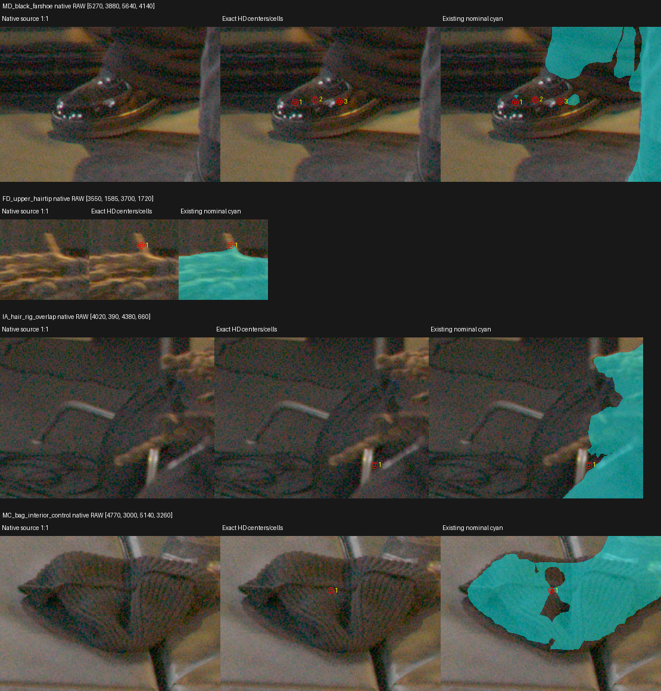

# Native TRAIN actor source review

## What was tested

Read-only frame1660 source audit for the two fighters, prioritizing missing hair and shoes. Eight TRAIN camera contexts were inspected: AA, GE, IA, ED, FD, MC, LB, MD. Prior capacity136 and W32 missed91 reviews were read first; genuine capacity-limited actor positives remain protected. The local `Paper LookCloser.md` remains the design reference; these classifications come from measured source pixels.

Source assets are native8192×4320 RAW TIFFs and existing native mask crops, never enlarged HD. For MD/FD/IA/MC, original TIFF/crop/archive hashes were rechecked and direct TIFF→Log3G10/RWG→Rec709 gain4 display replay matched every reviewed crop channel exactly. Explicit OPENCV mapping agreed with calibrated maps within .0005 native pixel and inverted within .0001 HD pixel. Mask coverage separately uses AREA prefilter plus calibrated remap; red outlines show geometric HD pixel footprints.

## Results

| TRAIN issue | Qualified source observation | Exact HD pixel(s) | Existing nominal coverage | Proposal |
|---|---|---|---|---|
| MD distant black shoe | Visible glossy leather connects to black actor trouser leg; most shoe omitted | (1268,944), (1276,943), (1286,944) | 0 / 0 / 0 | Three actor-membership candidates, confidence .99 |
| FD upward dreadlock tip | Visible tuft continues from actor hair; native center omitted | (852,381) | .230247 | Actor-membership candidate, confidence .95; mixed HD footprint |
| IA hair/rig boundary | Thin possible hair overlaps rig/floor lines | (1005,139) | 0 | UNKNOWN; no new label |
| MC knitted floor bag | Visible bag, including original grey false positive | (1162,725) | .272756 | Confirm existing nonactor query1152; no new label |

All four proposed actor points are absent from the fixed query manifest and outside current corrected UNKNOWN; none modifies an existing query. FD nearby positives273/294 remain. MC is already a qualified-bag negative, including its explicit exception to broad UNKNOWN. Root independently inspected MD shoe and FD tip and qualified visible actor membership; [root review receipt](assets/marshawn_native_actor_label_review_20261107/root_manual_review.json) binds the viewed source pages.

[Exact centers, geometric corners, classes, coverage, query status and source hashes](assets/marshawn_native_actor_label_review_20261107/qualified_review.json). MD RAW centers are (5395.398624,4006.521439), (5428.885946,4002.005320), (5470.611439,4005.668269); FD is (3637.361144,1628.544840). Each page preserves native pixels at1:1.

## Insights

The native source confirms a substantive shoe omission and a fine hair-tip omission. Native class certainty does not establish optical alpha1 across the HD footprint, especially FD's mixed pixel. A separately declared native/subpixel capture could test these memberships after root review; the existing69,888-query capture remains unchanged. AA/IA thin ambiguous boundaries stay UNKNOWN.

No masks, targets, IA overrides, query manifests, AABB, model, grid or training were changed. No GPU/model query or EVAL image/mask was read. Bag classification provides no free-space, whole-ray-empty or behind-occluder labels. This limited review does not certify complete hair/shoe silhouettes or justify discarding capacity-limited positives.

Full artifacts and replay helper: `C/native_actor_label_review_CPU_v1`, where `C=/fsx/tmp/marshawn_001660_hd/tuning_20261106`. Qualified JSON SHA256: `01e9169cb991e76eecb6dcc971e54b095eca29622fb2e895b1742c3a4e49e3ab`.
