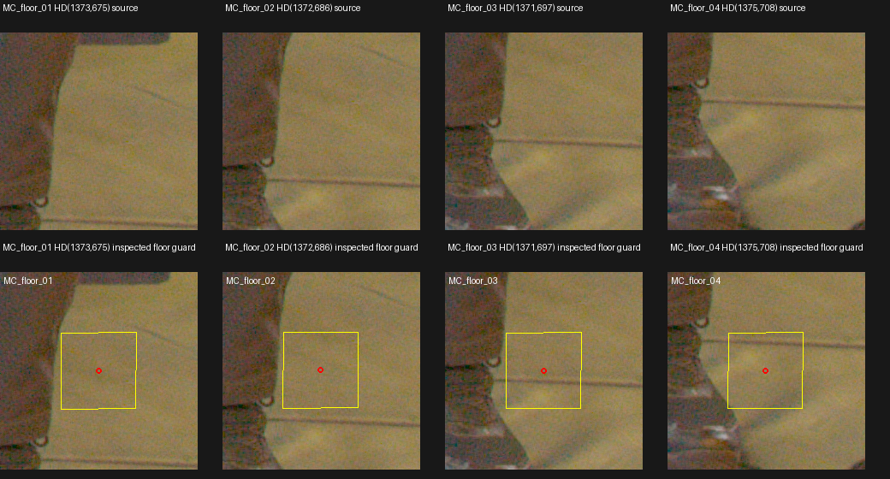
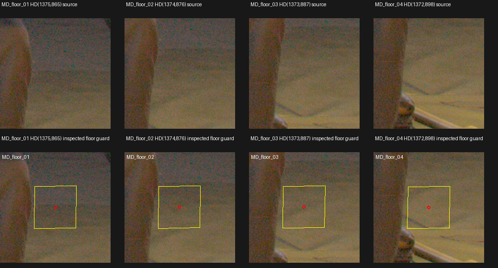
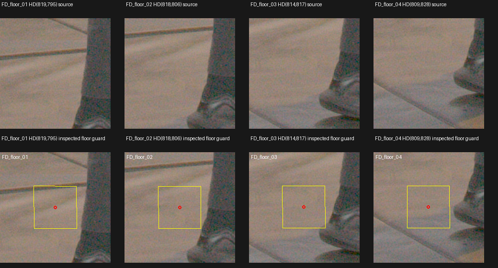

# Native TRAIN floor proposals near actor boundaries

## What was tested

Source-only audit of visible floor within the existing W64 support, where the original frozen classifier omits clear negatives to protect actor boundaries. The trigger was root's direct-LookCloser diagnostic: substantial floor cleanup with remaining fragments between legs and near shoes. No EVAL image selected these source coordinates. Native TRAIN photographs in MC/MD/FD were inspected, using the frozen gain4 Rec709 display and exact current OPENCV calibration.

## Results

| TRAIN camera | Four proposed HD pixels | Existing W64 RGB-weight range | Source observation |
|---|---|---|---|
| MC | (1373,675), (1372,686), (1371,697), (1375,708) | .000368–.003498 | Floor fabric beside grey trouser/shoe boundary |
| MD | (1375,865), (1374,876), (1373,887), (1372,898) | .000567–.001637 | Floor visible through gap beside grey trouser leg |
| FD | (819,795), (818,806), (814,817), (809,828) | .000406–.001236 | Floor fabric/seam beside grey leg/shoe |

All12 centers are inside current W64 source support, nominal actor=false, corrected UNKNOWN=false, and absent from the fixed69,888-query manifest. They are **visible-nonactor class proposals only**, confidence .98; no negative target or training label was written.

Each yellow quadrilateral maps a21×21HD inspection square into native RAW. Its photographed interior was manually inspected at1:1 for actor material, including shoes. The actor-free footprint supports a conservative9HD-pixel margin; this qualification comes from native appearance, not distance from the imperfect nominal mask. Candidate screening used the old mask only to find locations, then MC/MD points were moved farther from the photographed contour. No recognizable actor reflection or opaque foreground object occupies a selected guard. Closer shoe corners, MD rod contacts and ambiguous IA foot/bag contacts were excluded.

[Exact native centers, mapped pixel/guard corners, query status and input hashes](assets/marshawn_native_actor_near_floor_review_20261107/qualified_review.json). All12 native TIFF→Log3G10/RWG→Rec709 gain4 patch replays matched source display pixels exactly; source TIFF/crop/mask hashes were checked. Explicit mapping and inverse checks passed. Source rasters are8192×4320; pages preserve native pixels without upscaling HD.

Root independently viewed all three native pages and qualified the12 centers/guards as visible nonactor floor; adjacent clothing/feet remain outside the inspected squares. [Viewed-page hash receipt](assets/marshawn_native_actor_near_floor_review_20261107/root_manual_review.json).

## Insights

These small floor patches address a source-supervision gap close to real actor contours while preserving a visible margin. They do not identify the depth or density sample responsible for a rendered fragment. Future use requires separately declared source-native weights/depth/color qualification and root review.

Visible floor class is not optical alpha0, zero density, free space, a whole-ray-empty target, or a statement about hidden material. The [three MD shoe and one FD hair positive proposals](marshawn_native_actor_label_review.md) remain separate and unchanged. The fixed69,888 queries, two IA zero-weight overrides, masks, AABB, colors and model remain untouched. No GPU, inference or fitting was launched; no EVAL image or mask was read.

Full native patches, source bindings and replay helper: `C/native_actor_near_floor_review_CPU_v1`, where `C=/fsx/tmp/marshawn_001660_hd/tuning_20261106`.
