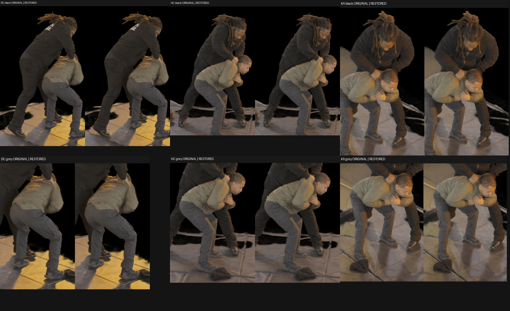

# Native20k continuation: restoration and gate controller

## What was tested

Whether the immutable native20k geometry-supervised reference can continue with its original field, priors, optimizer trajectory, and coordinate normalization, while evaluating the campaign's frozen common actor metric every 5k steps. This remains an auxiliary geometry-supervised reference, not a pure architecture control or a replacement for the LookCloser matrix.

Source: `/fsx/tmp/marshawn_001660_hd/native_png_radialK4_COLD_R1_DEV3_STAGED/immutable_selected_20000/step-000020000.ckpt`, SHA256 `fd56e541d91abde26b776ffe03b91caf997b3c0ada0044cebf6407728c988fa2`.

The checkpoint contains full model/native occupancy tensors, Adam moments, scheduler, AMP scaler, and Python/NumPy/CPU/CUDA RNG. It has 19,996 Adam updates after 20,001 attempts, including five historical AMP skips. The next dynamic batch size was not serialized, but the original TRAIN and EVAL TensorBoard scalars independently record **6,852 next rays at step20,000**.

The cached TRAIN image order was also not serialized. It was recovered from the original interrupted step20,204 diagnostic's saved RNG and actual ray indices. All 63 cache slots and all 6,793 pixel indices replay exactly. A naive first `random.sample` after seed42 gives a different order; the restored constructor's actual cache was verified and explicitly reordered to the recovered order. The interrupted diagnostic is used only as sampling evidence and is **never resumed**. The historical cached EVAL permutation is not independently recovered; the new constructor's order is recorded and becomes explicit restart state. Full-image common metrics are independent of this order.

## Results

Restored20k matches the source model, Adam state, scheduler state, scaler, and RNG exactly. All three runtime cameras and original sample counts also match. CUDA-rendered floats are numerically equivalent rather than bitwise identical: DC/HC/KA maximum RGBA differences are `5.96e-7`, `3.52e-5`, `5.96e-7`. The initial strict `1e-6` test failed HC and is preserved in the receipt. Root accepted at most one PNG code, `.001 dB` PSNR, and `1e-5` LPIPS differences. Observed RGB changes are at most one code at only 9/12/5 pixels, respectively.

| Common V1 metric | Immutable20k | Restored20k | Difference |
|---|---:|---:|---:|
| PSNR | 30.14773882 | 30.14773882 | 0 |
| SSIM | .82752702 | .82752703 | +9.93e-9 |
| LPIPS | .05446649 | .05446663 | +1.35e-7 |

All six original/restored actor crop pairs were visually inspected and agree.

An isolated technical probe then performed **32 actual Adam updates**, steps20,001–20,032, with no AMP skips. Adam count increased to20,028. LR continued from `.0001521184` to `.0001511029`; the scaler remained1,048,576. The resulting checkpoint was reloaded and saved again with exact model, Adam, scheduler, scaler, RNG, native-core sidecar, dynamic batch, and TRAIN-cache restoration. This probe is excluded from production ancestry; production starts from immutable20k.

The final production evaluator smoke test rerendered all three views and matched the original common V1 result within PSNR `-2.85e-8 dB`, SSIM `+9.93e-9`, LPIPS `+1.96e-7`. It also produced separate EVAL-v2 scores and mask-exterior opacity diagnostics. EVAL-v2 never enters training or the primary selector.

[Sampling replay](assets/marshawn_native_resume_20261106/cache_order_replay.json) · [Render parity](assets/marshawn_native_resume_20261106/restored20k_parity.json) · [32-update probe](assets/marshawn_native_resume_20261106/update32_receipt.json) · [Checkpoint roundtrip](assets/marshawn_native_resume_20261106/roundtrip_receipt.json) · [Configuration comparison](assets/marshawn_native_resume_20261106/config_comparison.json).

## Continuation protocol and next steps

The original optimizer and geometry recipe remains fixed. In particular, the original scheduler horizon stays22k and naturally clamps to LR `1e-4` afterward; it is not stretched or restarted. The old training cap is removed in favor of the reviewed plateau controller. Native stochastic internal evaluations retain their original 2k cadence. Accepted-AABB clipping is applied only by the external renderer, without changing the field/hash AABB. No semantic gate enters continuation ranking.

Common actor gates occur at25k,30k,35k,40k, and every5k afterward. The tracker is anchored at20k, with four consecutive misses of both independent significant-record thresholds: `.1%` relative improvement in the internal validation signal and `.001` absolute masked-LPIPS improvement. Subthreshold gains accumulate against the last significant record. The earliest plateau stop is40k; the campaign's overall20-hour commitment is separate from this job.

**Selection follows the user's LPIPS objective:** minimum common actor LPIPS, a `.001` tie window, then highest actor PSNR and earlier step. Root explicitly confirmed this overrides the historical AGENTS PSNR-primary default for this campaign. The original20k checkpoint stays on the eligible frontier and remains selected if continuation is worse under that rule.

The controller writes an atomic checkpoint, native-grid sidecar, and full runtime sidecar before publishing a resume pointer. It blocks further updates while external readers render/score all three views, then atomically commits gate history, plateau state, and selection. An interrupted read-only gate is replayed before any resumed update. A file lock prevents duplicate workers; bound hashes protect the release inputs. Four direct tests cover baseline retention/ties, patience4, accumulation of small improvements, and invalid/conflicting/idempotent gate replay. The production controller's separate restoration-only check passed before launch.

Reusable implementation: `scripts/run_marshawn_native_continuation.py` and `scripts/evaluate_marshawn_native_checkpoint.py`. Preparation and receipts: `/fsx/tmp/marshawn_001660_hd/tuning_20261106/native_semantic_grid_20000/native_continuation_plan/`. Planned separate production output: `/fsx/tmp/marshawn_001660_hd/tuning_20261106/native_reference_continuation_20000/`.

Root approved release SHA256 `ac0622978ea5d7fa7eb1c88cfd46a7c65266df0b27bebbb4e7bda92d7348c136`. Production launched on dev3 at2026-11-06 19:33:19 UTC under `/tmp/lookcloser_tuning_gpu_1000_0.lock`, controllerPID200934 and workerPID200939. Minute-level process/GPU checks are recorded in `supervision.jsonl`; active agent supervision continues through each gate.

The first25k gate completed and resumed training. It improves common V1 PSNR to30.23476627, SSIM to.82883585, and LPIPS to.05343542, an absolute LPIPS gain.00103107 over20k. Both plateau counters reset and25k becomes selected. Secondary V2 scores are30.23694367/.82895168/.05325661. All three source/render pairs were inspected, including visible hair, hands and shoes; actor details remain, but substantial floor/mat and stationary bag geometry remain. This is an improved geometry-supervised auxiliary reference, not an artifact-free isolation result. Production AMP skips are tracked separately from attempted steps and actual Adam updates; the technical32-step probe's zero skips do not imply zero production skips.

| Completed native gate | Common V1 PSNR | SSIM | LPIPS |
|---|---:|---:|---:|
| 20k original | 30.14773882 | .82752702 | .05446649 |
| 25k | 30.23476627 | .82883585 | .05343542 |
| 30k | 30.25604764 | .82944691 | .05295354 |
| 35k | 30.26555670 | .83009688 | .05258375 |
| 40k | 30.23191134 | .83006018 | .05276731 |
| 45k | 30.26456299 | .83072821 | .05218519 |
| 50k | 30.28583841 | .83127596 | .05209290 |
| 55k | 30.29889149 | .83168862 | .05193819 |
| 60k | 30.29843570 | .83185537 | .05182371 |
| 65k | 30.31342179 | .83226023 | .05168275 |
| 70k | 30.35370592 | .83276997 | .05133222 |
| 75k | 30.37438903 | .83316123 | .05115981 |
| 80k | 30.37398372 | .83349795 | .05100433 |
| 85k | 30.34834896 | .83344886 | .05116817 |
| 90k | 30.36297882 | .83398399 | .05079246 |
| 95k | 30.39817773 | .83449064 | .05055326 |
| 100k selected | 30.41022620 | .83477229 | .05035869 |

The continuation completed at100k under the predeclared cumulative plateau rule, with miss counters4 and5. The80000 new attempted steps produced79961 actual Adam updates and39 AMP skips; final Adam count is99957. The selected checkpoint SHA256 is `51e0e6b0b28e1dc4d7b2c940bef942efa95163349ebe939a16ffd7115f2fe39c`. The selected100k checkpoint improves over immutable20k by PSNR+0.26248738dB, SSIM+.00724527 and LPIPS−.00410780 (about7.54% relative). This stopping decision reflects the significant-record thresholds; it does not claim that every later optimization step would be ineffective.

Every completed5k gate received a three-view source/original20k/previous/current hair, hands/contact and feet review. At100k visible contours remain intact at the inspected scale, while source fine detail remains sharper and substantial floor, mat, stationary bag and nonactor fragments persist. This is an improved auxiliary geometry-supervised reference, not an artifact-free actor asset. Per-gate `detail_review/` and `visual_review.json` preserve the inspected evidence.

All17 baseline/completed gate checkpoints and their native-grid/runtime sidecars remain available. The selected100k checkpoint is eligible for the separately approved technical-only4K adapter probe. That executor waits for the HD controller/cache/GPU lock to release and refreshes the actual selected source; technical checkpoints are excluded from production ancestry. Since the selected source is the final HD gate, no later HD suffix exists yet for matched additional-step resolution controls.

An immutable65k download snapshot is available under `native_reference_continuation_20000/downloads/`: `native_reference_000065000_snapshot_review.zip` (5,586,423bytes; SHA256 `a9ff0757e6efe3abfd3513b5dd6bf95d0300f220eaee63ed9749cc74d52fea14`) contains the original three full-HD inside renders, existing actor/detail comparisons, metrics, accepted box and provenance. The companion `_with_original_alpha.zip` (273,922,328bytes; SHA256 `62f65f3311ca2e188355c21221de2c16b8f3ba1eed414b8995bff007af74a0fc`) also includes unchanged float RGB/alpha partitions. Every copied file and each ZIP entry checksum was verified. Read-only archives and snapshot files preserve their bytes; the README explicitly identifies residual floor/mat/bag and geometry supervision. No checkpoint weights are included.
