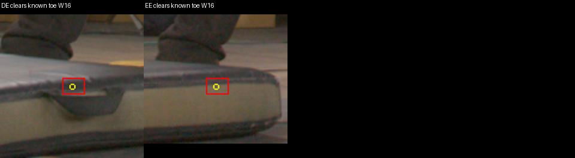

# Independent native actor-grid audit

What was tested: Read-only CPU reconstruction of the corrected W64 128³ semantic grid, native/floor camera transforms, independent ray intersections, every grid slice, and source crops. No training, model load, GPU use, AABB edit, or existing-grid mutation. The historical native checkpoint is an auxiliary reference with additional SfM/MVS supervision, not a matched architecture control.

Results: **The implementation reproduces its stated rule, but the rule treats some opaque foreground occluders as clear background.** This is a concrete geometry-policy failure, not an indexing or DDA error.

| Check | Result |
|---|---|
| Independently recomputed 2,097,152 W64 cells | Zero gate0, capped-background-count, or pad1 mismatches |
| XYZ C-order indexing and cell-center roundtrip | All cells pass |
| Fresh SciPy 26-neighbor dilation | Exactly 50,790 admitted cells from 37,647 gate0 cells |
| Prepared floor cameras vs native runtime, DC/HC/KA | Pose difference ≤1.12e-16; focal differences ≤3.81e-5 pixels |
| All 31 qualified W64 missed rays, independent ray/slab intersections against every admitted cell | All 31 misses confirmed; no traversal-code reuse |
| Random TRAIN positive-ray spot-check | 315/315 intersect support; not surface-depth certification |
| Accepted floor AABB SHA256 | `292609eebe9939e7ce5f840a1b317d963d39ec738cafaad8500abf3a2cd0620f`, unchanged |

High severity: the independently triangulated black toe-upper point at floor `[-0.1176921, 0.1512792, 0.01456784]`, cell `[93,73,15]`, receives clear-background votes from **DE and EE** at W32/W16. These two votes remove its entire cell from gate0. I inspected the projected source crops: both projections land on the foreground padded mat rim, which occludes the shoe. The mat is not marked UNKNOWN. DE point `(744.314,942.846)`, footprint `[736,936,754,949]`; EE point `(563.722,963.797)`, footprint `[556,957,574,970]`. W64's larger image padding prevents these votes. All three pad1 variants retain this particular point: the example proves false background classification, not loss of that point after padding. The feature was matched in HE/IC/ID and does not use native density; one toe-upper feature does not certify the sole or other shoe cells.



Related policy risk: six corrected TRAIN bag interiors contain **3,505 valid clear pixels** with zero actor support and UNKNOWN=false: MA 785, MB 518, MC 680, NA 880, NB 383, ND 259. Their uncertain contact shells are UNKNOWN, but interiors can carve rays behind the opaque bag. Removing these interiors from actor-positive labels is appropriate; treating them as depth-unqualified clear background is not. This audit has no independently triangulated shoe point demonstrating a bag-caused removal, so that causal claim remains unverified.

Visual review: all X/Y/Z slice atlases show coherent support and one-cell halo without wraparound. Source/render hair, hand-contact, and feet crops retain recognizable hair and clothing; substantial floor islands remain around the grey shoes. The gate contains 123 whole cells below floor Z=0 before padding and 617 afterward; these are admission counts, not evidence of occupied material or ground-truth floor geometry.

Low severity: the legacy `final_train_ray_receipt.json` key `semantic_gate_pad1_misses_given_floor_hit=0` actually reports the rejected 136-cell contributor union, as its explicit candidate field and script show. Preferred W64 has 31 qualified misses. Bind downstream comparisons to explicit array name and grid hash; do not compare that legacy total as preferred pad1. The native-reference owner was notified and is adding provenance clarification.

Insights: Keep W64 provisional. Global narrower margins expose unmodelled occlusion and are unsuitable as a general cleanup. The next bounded check is TRAIN-only foreground-mat occluder annotation in DE/EE, then recomputation of votes around this independently known toe point. Any physical free-space decision needs visibility/depth qualification; absent reliable occluder depth, keep its projected footprint UNKNOWN. Apply the same separation of actor-positive labels and occluder UNKNOWN to confirmed bags, without reintroducing them as actors. Recheck all TRAIN rays and fixed EVAL renders after any proposed revision; no such revision was applied here. Native contributor density, mask absence, and the 28 fitted TRAIN shirt depths cannot supply independent hidden-geometry truth.

Evidence and reproducibility: [all-cell receipt](assets/marshawn_native_grid_independent_20261106/receipt.json), [independent ray receipt](assets/marshawn_native_grid_independent_20261106/ray_receipt.json), [witness votes](assets/marshawn_native_grid_independent_20261106/witness_votes.json), [bag policy](assets/marshawn_native_grid_independent_20261106/bag_policy.json), [X atlas](assets/marshawn_native_grid_independent_20261106/all_slices_axis0.png), [Y atlas](assets/marshawn_native_grid_independent_20261106/all_slices_axis1.png), [Z atlas](assets/marshawn_native_grid_independent_20261106/all_slices_axis2.png). Helpers `audit.py`, `rays.py`, and `witness.py` in that committed source archive use CPU NumPy/SciPy/Pillow; each accepts `--campaign` and `--output`. The requested Ubuntu Conda path is unavailable on this host; a temporary isolated environment was used. FSX originals were read only.

Authorized follow-up: Prepared a separate [63-view TRAIN mat-occluder manifest](assets/marshawn_native_occluder_masks_20261106/manifest.json), SHA256 `f096be639cb46e669452e26d005eeedebe67f61ef967e2446568ce91e1162ffc`. Sixty views have conservative envelopes; CE/JE/NE have unqualified mat visibility and explicitly empty annotation masks; their lack of annotation must never authorize clear votes. The conservative occlusion_v2 variant disables all clear votes from these three views. The 9,063,157 marked pixels are UNKNOWN only, before union with existing uncertainty. All 63 HD source/overlay views and DE/EE native RAW source/overlays were visually inspected; [review receipt](assets/marshawn_native_occluder_masks_20261106/source_review_receipt.json). HD-authored contours are densely mapped into the original RAW raster, padded once by 16 native pixels for annotation uncertainty, then transported with the existing calibrated AREA/remap convention. This image uncertainty is separate from semantic grid pad1. The entire measured toe-cell footprint is UNKNOWN in DE/EE. Native-reference owns subsequent isolated gate construction, whole-grid monotonicity and witness regressions, TRAIN-ray audits and render review. Extra floor admission is an expected risk of conservative envelopes; these masks do not establish precise occluder depth or complete hidden geometry.

Independent follow-up verification of **partial occlusion_v2**: W64 all-cell reconstruction again gives zero classifier/count/padding mismatches. Across all 126 W64/W32 archives, actor support is byte-identical to its source; UNKNOWN is exactly the expected union of old uncertainty, mat envelopes, six qualified bag regions, and whole-raster uncertainty in CE/JE/NE. Each width adds 14,405,452 UNKNOWN pixels. The new W32 gate0 retains the measured toe cell, with DE/EE background votes changing from two to zero. Both grids are monotone supersets with one fresh semantic padding. W64 pad1 grows **50,790→105,049** cells; W32 **41,332→91,703**. The new Z-slice atlas visibly contains substantial admitted low-floor volume, so these are conservative correctness diagnostics requiring render review, not automatic cleanup winners. Other cameras' bag identity/extent and other opaque clutter remain unqualified; this correction is not visibility-complete. [Archive/padding verification](assets/marshawn_native_grid_independent_20261106/occlusion_v2_archive_verification.json), [toe regression](assets/marshawn_native_grid_independent_20261106/occlusion_v2_toe_regression.json), [all-cell receipt](assets/marshawn_native_grid_independent_20261106/occlusion_v2_W64/receipt.json), [new Z atlas](assets/marshawn_native_grid_independent_20261106/occlusion_v2_W64/all_slices_axis2.png), [three-view visibility policy](assets/marshawn_native_occluder_masks_20261106/visibility_policy_addendum.json).

Durability: every original `/tmp/native-grid-audit` evidence/code file was copied to [the campaign audit directory](/fsx/tmp/marshawn_001660_hd/tuning_20261106/independent_native_grid_audit); its initial 29-file manifest was independently hash-verified after transport. `initial_tmp_evidence` preserves the original scratch copies. `revision2/helpers` contains the finalized reusable CPU helpers, with owned source and result copies in this repository. No GPU is needed to rerun:

```bash
conda activate /home/ubuntu/anaconda3/envs/nerfstudio
AUDIT=/fsx/tmp/marshawn_001660_hd/tuning_20261106/independent_native_grid_audit/revision2
CAMPAIGN=/fsx/tmp/marshawn_001660_hd/tuning_20261106
python "$AUDIT/helpers/audit.py" --campaign "$CAMPAIGN" --output /tmp/native-grid-recheck
python "$AUDIT/helpers/rays.py" --campaign "$CAMPAIGN" --output /tmp/native-ray-recheck
python "$AUDIT/helpers/audit.py" --campaign "$CAMPAIGN" --grid-dir "$CAMPAIGN/native_semantic_grid_20000/occlusion_v2/W64" --output /tmp/native-occlusion-recheck
python "$AUDIT/helpers/verify_occlusion_archives.py" --variant "$CAMPAIGN/native_semantic_grid_20000/occlusion_v2" --output /tmp/native-occlusion-archives.json
python "$AUDIT/helpers/occluder_regression.py" --campaign "$CAMPAIGN" --mat-manifest "$CAMPAIGN/native_semantic_grid_20000/occluder_source_v1/transport_manifest.json" --new-grid "$CAMPAIGN/native_semantic_grid_20000/occlusion_v2/W32/semantic_grid.npz" --output /tmp/native-occluder-regression.json
```

The last two commands are meaningful regressions: they fail on actor-support mutation, unintended UNKNOWN changes, removed support cells, cumulative padding, missing source-mask hashes, or recurrence of the independently measured mat/toe contradiction. They do not certify all actor surfaces.
