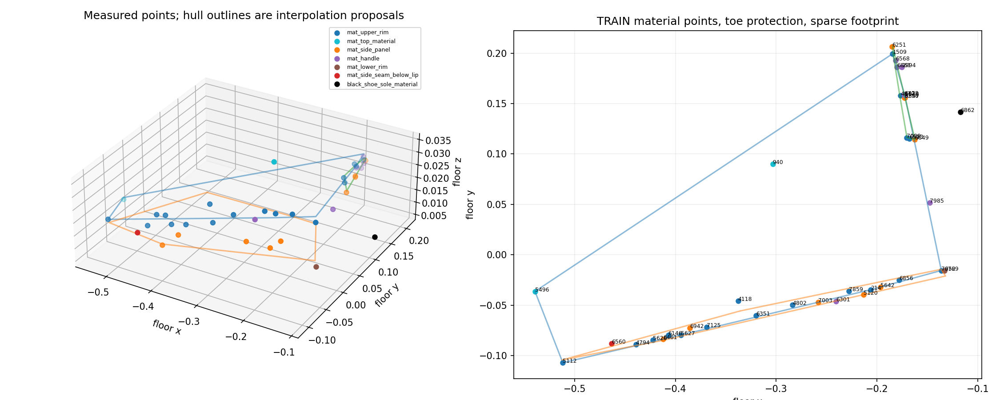
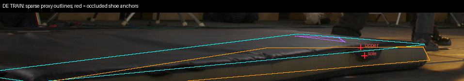
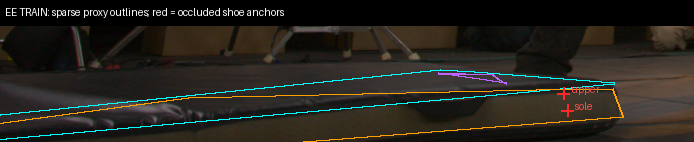

# TRAIN-only mat geometry proposal

## What was tested

Can independently observed mat geometry explain the semantic-grid occlusion error and replace unbounded mat-UNKNOWN cones with bounded depth intervals? This is a geometry diagnostic, **not a volume-deletion rule or a new rendering candidate**. The frozen native20k checkpoint, native R1 occupancy, accepted floor AABB, masks, and previous grids remain unchanged.

Source evidence is the original 9,022 TRAIN SfM points, original cached SIFT detections and directed 0.65 descriptor-ratio edges, and original prepared camera calibration. Conservative mat envelopes select 150 candidates only; they do not supply material labels. Exact graph replay reproduces all 150 original points to at most `1.11e-15` world-coordinate error. No EVAL images, EVAL annotations, or native-field depth enter these calculations. This is recovered TRAIN evidence, potentially already used in native supervision, not independent ground truth or a generalization test.

All 90 reviewed points were inspected in three original native-resolution TRAIN source crops. The versioned qualification identifies 37 mat-material points: 18 upper-rim, 2 top-cover, 9 side-panel, 6 handle, 1 lower-rim, and 1 seam below the upper lip. Another point, 6862, lies on the black shoe's lower toe/sole in JA/KB/JB. Workers, floor, and uncertain hand/material contacts are excluded. The first 64 triplets also received the root agent's independent review. Point 6560 is explicitly excluded from the upper fit because it sits below the lip; visible top deformation at points 940 and 5496 is retained rather than discarded as an outlier.

Full evidence and native crops: `/fsx/tmp/marshawn_001660_hd/tuning_20261106/native_semantic_grid_20000/mat_geometry_TRAIN/`. The original qualification is preserved; `qualified_material_points_v2.json` adds the second review and the seam correction.

## Results

[Material qualifications and actual feature observations](assets/marshawn_native_mat_geometry_20261106/qualified_material_points_v2.json) · [Complete numerical proposal](assets/marshawn_native_mat_geometry_20261106/bounded_geometry_proposal.json)

All distances below are **prepared-world units**, not asserted meters. Plane fits are unweighted total least squares, bounded by the convex hull of their projected source points. Near-identical points within `.001` world units receive one representative. This removes one side-panel duplicate; it does not prove statistical independence of all remaining tracks.

| Local proxy | Unique points | RMS normal residual | Maximum normal residual | Maximum leave-one-point-out residual | Diagnostic half-band |
|---|---:|---:|---:|---:|---:|
| Upper cover and upper rim | 20 | .00214 | .00571 | .00661 | .01092 |
| Front long rim and side | 20 | .00394 | .01172 | .01728 | .02340 |
| Near-shoe short rim and side | 8 | .00141 | .00323 | .00378 | .01014 |

The band adds the larger of the maximum fit residual and leave-one-point-out residual to the largest 3-sigma normal localization estimate. Localization assumes independent `.5` HD-pixel noise and fixed cameras; doubling pixel sigma doubles those localization axes. It excludes calibration bias, correspondence bias, deformation between unmeasured points, and uncertainty in material identity. The largest 3-sigma principal localization axis among the 38 material/shoe points is `.00922`. The maximum original fitted reprojection residual is `.9811` HD pixels; source-view leave-one-out reaches `1.6808` HD pixels. Neither small residuals nor a convex hull certify continuous opaque cover.

The two independently sourced shoe anchors are:

- Existing upper-toe feature: `[-.11769209, .15127924, .01456784]`, from three TRAIN views HE/IC/ID.
- Newly qualified original SIFT point 6862: `[-.11713805, .14165074, .00508542]`, lower toe/sole in JA/KB/JB.

Both DE/EE camera rays cross the bounded top and front proxy bands before reaching either shoe point. The near-shoe short-side proxy does not intersect these rays. The table shows the earliest front-proxy interval; the JSON contains every interval, camera origin, ray direction, projection, and point-localization matrix.

| TRAIN camera / anchor | Front proxy ray interval | Shoe ray distance | Proxy entirely before shoe |
|---|---:|---:|---|
| DE / upper toe | .66094–.69549 | .91100 | yes |
| DE / sole | .65964–.72309 | .90387 | yes |
| EE / upper toe | .73596–.76917 | .94403 | yes |
| EE / sole | .74650–.79040 | .93570 | yes |

These are **conditional geometric explanations**, not certified opaque intervals. Actual source overlays confirm the shoe projections land on the visible foreground mat. Cyan/orange/purple lines show sparse fitted proxy hulls, not measured physical boundaries; red crosses mark the occluded shoe anchors.

## Insights and next steps

The source geometry supports retaining the shoe behind the mat. It does **not** support deleting a filled planar mat volume. Upper-cover curvature is measurable, the side fits mix rolled rims and flexible panels, and the far/back boundary and underside remain insufficiently observed. The front side's leave-one-point-out error is particularly large. Sparse hulls must not fill holes, extrapolate outside observed support, or establish clear space before an occluder without an independent visibility check.

The next bounded experiment should qualify local top/rim patches or corners in additional TRAIN views, obtain depth intervals with explicit material-boundary uncertainty, and verify projected patch coverage against the native sources. Only then can a per-ray rule conservatively allow previously established background evidence strictly before the earliest possible opaque surface while keeping everything behind it UNKNOWN. Removing known mat material requires a separate, localized surface/volume argument and protection of shoe-overlap uncertainty. The bag remains a separate unresolved occluder. No gate update is authorized by this report's proxy fits alone.

Reproduce with `scripts/audit_marshawn_mat_geometry.py --qualification <G>/qualified_material_points_v2.json --transforms <R>/data/transforms.json --box <B>/code/marshawn_1660_1900_floor.json --output <new-output-directory>`. It reads qualified observations and writes diagnostics only. Two direct CPU checks pass for bounded slab intervals and rejection of plane extrapolation outside the observed footprint. Code compilation and scoped whitespace checks pass. Full acquisition/qualification helpers and source hashes are frozen under `<G>/code` and `geometry_provenance.json`.
