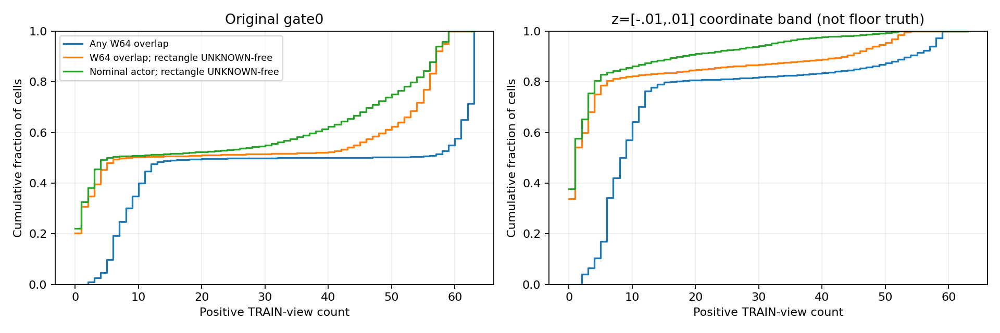
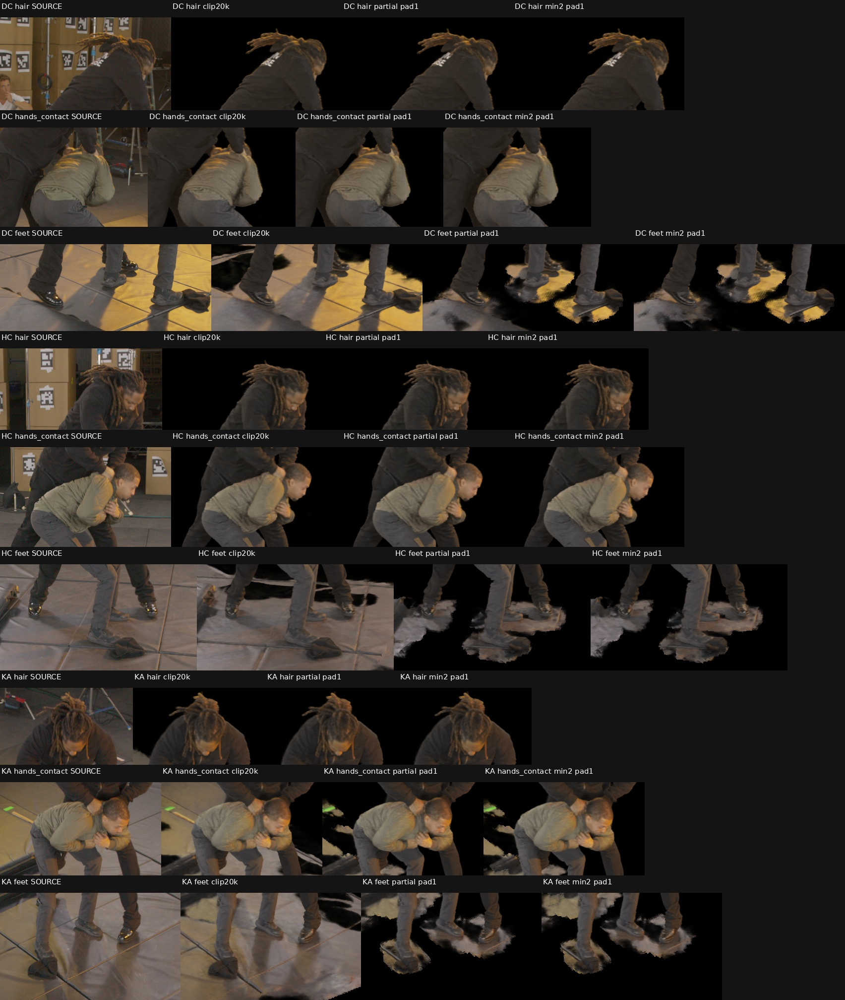

# Marshawn native: positive TRAIN support and UNKNOWN separation

## What was tested

Audit whether the partial-occlusion W64 semantic grid admits cells with little positive actor support. Count all63 TRAIN views for every admitted128-grid cell, keeping actor support, invalid raster and UNKNOWN occluder evidence distinct. No held-out annotation, field density or native occupancy state enters construction. This is separate from the running native continuation: the render candidate uses the immutable native20k checkpoint and unchanged nativeR1 grid/hash normalization.

For each cell, use the same outward rectangle enclosing all eight projected corners as the existing conservative carving helper. A positive vote means at least one valid actor-support pixel intersects that rectangle. The stricter diagnostic additionally requires the entire rectangle to be in-raster, valid and free of UNKNOWN pixels. This stricter test is conservative about annotated occluders but cannot establish true surface visibility: the annotations are partial, and broad mat envelopes can overlap real actor projections.

Artifact roots are `native_semantic_grid_20000/positive_support_audit128/` and the separate `positive_support_min2/` under `/fsx/tmp/marshawn_001660_hd/tuning_20261106/`.

## Results

The initial hypothesis is partly refuted: all78,056 original gate0 cells already have at least two W64-positive views. Plain minimum-two support would change nothing; minimum-three would remove only760 cells. Corrected nominal actor masks also give every gate0 cell at least one positive vote. Positive padding alone cannot identify physical actor geometry.

| Count criterion | Original gate0 cells below2 | Below3 |
|---|---:|---:|
| Any W64-positive rectangle | 0 | 760 |
| W64-positive with entire rectangle UNKNOWN-free | 23,976 | 27,137 |
| Nominal actor-positive rectangle | 586 | 3,101 |
| Nominal actor-positive with entire rectangle UNKNOWN-free | 25,416 | 29,704 |

The one controlled candidate retains original gate0 cells having at least two W64-positive, UNKNOWN-free rectangles, then applies one fresh26-neighbor semantic padding step. Gate0 decreases78,056→54,080 and pad1 decreases105,049→77,664. This is a **semantic-target restriction**, not a declaration that removed cells are physically empty. The native model's originalR1 occupancy is unchanged.

Both independently triangulated shoe anchors pass comfortably: the upper toe has15 stricter W64 votes and the low sole point6862 has11. By comparison, qualified mat-top point940 has eight ordinary W64-positive votes but none whose full footprint avoids UNKNOWN. Some mat and floor can still receive qualified actor-mask overlap from other views or padding.

The103 declared clothing records represent39 unique source witness IDs, including repeated camera observations and two duplicate audit-only records. All103 exact witness cells and all103 corresponding pixel-ray locations at the measured witness depth remain admitted under minimum2 or3. For the min2 candidate, fresh pad1 preserves the complete diagnostic ±.02 band on every clothing ray, matching the original padded gate. This is geometric admission length, not field termination mass or a calibrated confidence interval.

An independent CPU plane-partition crosscheck covers306 random, boundary and parallel rays before the accelerated DDA examines all4,657,323 corrected TRAIN actor-mask rays. Both stricter thresholds preserve the baseline intersection result: gate0 misses528 grey-label rays and no black-label rays; fresh pad1 misses zero. The existing gate0 misses occur in IA193, LA144, LB145, MB20, MC11 and NB15, around previously reviewed stationary-bag/contact-label boundaries. There are no new hair or foot ray-miss regions to classify. Zero misses means each ray intersects some admitted cell; it does not guarantee that its actual visible surface survives.

The frozen20k candidate is rendered in DC/HC/KA alongside exact same-sample native clip and original partial-occlusion gates. It runs as one authorized read-only child beside native production, with an8GiB allocator cap, a10GiB monitored process limit, and producer/GPU health receipts every10 seconds. An initial launcher import-path failure occurred before model loading; the preserved failure logs and corrected wrapper are separate from all training code.

All three fullHD renders and hair, hands/contact and foot crops were inspected. The candidate leaves visible actor detail effectively unchanged from partial-occlusion pad1, while removing some distant admitted volume. Substantial floor pads, bag/contact material and disconnected foreground floor fragments remain in every view. **Not promoted.**

| Frozen20k render | V1 PSNR | V1 SSIM | V1 LPIPS | V2 LPIPS |
|---|---:|---:|---:|---:|
| Accepted-box native clip | 30.147739 | .82752701 | .05446679 | .05428263 |
| Partial-occlusion W64 pad1 | 29.128258 | .82033878 | .06405209 | .06378391 |
| Qualified-min2 W64 pad1 | 29.128273 | .82033886 | .06405214 | .06378394 |

These comparisons use original fixed crops and same-file float render buffers, with equal actor/view aggregation. The approximately4e-8 LPIPS difference between padded gates is negligible. No EVAL-v2 actor pixel loses more than.1 opacity relative to partial-occlusion pad1. Exterior pixels with alpha>.1 outside the EVAL-v2 actor union dilated3HD pixels decrease DC177,032→87,330, HC85,622→46,934 and KA57,048→33,288. This image-domain diagnostic is not certified nonactor volume. The original native checkpoint and model hashes remain unchanged in all three render receipts.

[Full DC result](assets/marshawn_native_positive_support_20261106/DC_semantic_gate_pad1.png) · [Full HC result](assets/marshawn_native_positive_support_20261106/HC_semantic_gate_pad1.png) · [Full KA result](assets/marshawn_native_positive_support_20261106/KA_semantic_gate_pad1.png).

## Insights and next steps

Positive views and UNKNOWN handling answer different questions. Simply retaining all unknown volume is broad, but replacing uncertainty with a positive-view threshold is still a silhouette heuristic. Padded actor projections and whole-cell footprint overlap can support floor behind or beside actors; one-cell dilation also reintroduces adjacent space. Sparse measured clothing/toe protection is useful evidence without certifying hair, hidden limbs, or intervening nonactor surfaces. A cleaner mask score or smaller admitted volume is insufficient to establish correctness. Further blind support-threshold sweeps are deferred; better isolation requires additional source-qualified geometry/visibility or a learned actor objective rather than treating low support as physical emptiness.

Reusable helpers are `scripts/audit_marshawn_positive_support.py`, `scripts/audit_marshawn_support_rays_cpu.py` with its CPU C++ kernel, `scripts/audit_marshawn_support_witnesses.py`, and `scripts/build_marshawn_positive_support_candidate.py`. The complete count/source hashes, per-camera votes, exact query hash, ray diagnostics and isolated grid receipt remain in the artifact roots. Original masks, previous exports and the running producer are preserved.
