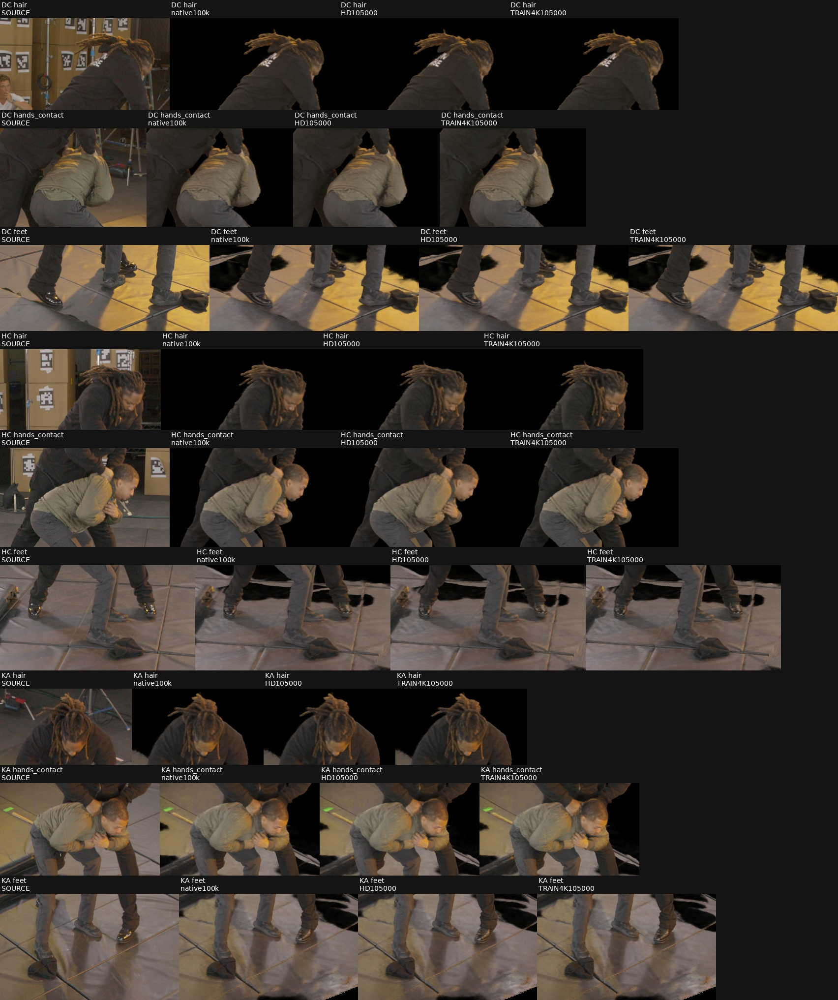

# Native HD / actual 4K paired continuation

Production launched on dev3 after root verified all 387 bound files. Release SHA256 is `67488793da3f5150ee21cd3a51e67467e80fe805c697bbf02d46273f0e45e5e9`; controller PID is 221219. Both packaged zero-update restoration gates passed before the first HD chunk started. The six-phase technical gate also passed, including 32 actual Adam updates and a fresh-process restart. Technical and zero-update checkpoints are excluded from production ancestry.

**What is tested.** Both arms start from the same selected native checkpoint at attempted step 100,000, with Adam count 99,957. HD uses the existing 63 TRAIN images at 1920×1012; TRAIN4K uses their actual 3840×2024 RAW-derived counterparts. The three EVAL images remain FHD. This is a geometry-supervised native reference, not an architecture-only control or a cleaned actor asset.

| Shared starting point | PSNR | SSIM | Actor LPIPS V1 |
|---|---:|---:|---:|
| Native selected 100k | 30.410226 | 0.834772 | 0.050359 |
| HD continuation 105k | 30.414155 | 0.835101 | 0.050160 |
| Actual TRAIN4K continuation 105k | 30.360915 | 0.834820 | 0.048082 |
| HD continuation 110k | 30.434841 | 0.835706 | 0.049878 |
| Actual TRAIN4K continuation 110k | 30.352440 | 0.835044 | 0.047881 |
| HD continuation 115k | 30.432073 | 0.835542 | 0.049990 |
| Actual TRAIN4K continuation 115k | 30.389065 | 0.835473 | 0.047557 |
| HD continuation 120k | 30.424657 | 0.835849 | 0.049896 |
| Actual TRAIN4K continuation 120k | 30.372261 | 0.835351 | 0.047568 |
| HD continuation 125k | 30.440828 | 0.836028 | 0.049793 |
| Actual TRAIN4K selected / terminal 125k | 30.393743 | 0.835658 | 0.047452 |
| HD unmatched continuation 130k | 30.456276 | 0.836584 | 0.049357 |
| HD unmatched continuation 135k | 30.429219 | 0.836376 | 0.049588 |
| HD unmatched continuation 140k | 30.457763 | 0.836619 | 0.049384 |
| HD unmatched continuation 145k | 30.440371 | 0.836886 | 0.049260 |
| HD unmatched continuation 150k | 30.486077 | 0.837237 | 0.049059 |

At the first matched gate, both arms completed5,000 attempts and4,998 actual Adam updates, with two AMP skips each. TRAIN4K reduces FHD actor LPIPS by4.14% relative to matched HD; PSNR is0.05324dB lower. The all-three-view hair/hand/foot review shows modestly crisper fine texture and stable visible contours, but source detail remains sharper and floor/mat/bag fragments persist. This is an early resolution result, not a plateau or actor-isolation result. The next HD chunk restored its actual105k checkpoint, RNG and runtime exactly, confirming real production restart beyond the zero-update preflight.

At110k, TRAIN4K retains a4.00% LPIPS advantage over matched HD, with PSNR0.08240dB lower. The repeated three-view hair/hand/foot review finds stable actor contours and continuing floor/mat/bag fragments. At 115k, the matched LPIPS advantage grows to 4.87%, with PSNR 0.04301dB lower. Both arms continued under their unchanged plateau rules at that gate.

The LPIPS advantage is consistent across all three views and both actors at every matched gate through 115k. At 115k, the reduction is 5.12% in DC, 5.07% in HC, and 4.26% in KA; black and grey actor reductions are 4.14% and 5.63%. The aggregate PSNR decrease is mainly HC (−0.16135dB), while DC and KA increase slightly (+0.01269 and +0.01963dB). These are descriptive comparisons from one paired trajectory, without replicate-based uncertainty estimates. At matched 120k, the aggregate LPIPS advantage is 4.67%, with PSNR 0.05240dB lower. Both arms pass the three-view detail review; the unchanged visible floor/mat/bag residual remains substantial. Neither arm had met both plateau conditions at120k. At125k, TRAIN4K meets both conditions and stops; its selected checkpoint is125k. The final matched comparison gives TRAIN4K a4.70% LPIPS advantage with PSNR0.04709dB lower. The all-three-view detail review still finds substantial floor/mat/bag residuals. HD continues:130k crosses the cumulative0.001 LPIPS improvement threshold relative to its previous significant anchor and resets that counter. Its later suffix is explicitly unmatched; use125k for the controlled resolution comparison.

The source checkpoint SHA256 is `51e0e6b0b28e1dc4d7b2c940bef942efa95163349ebe939a16ffd7115f2fe39c`. All 17 existing HD checkpoint controls remain preserved. The new experiment writes only to `/fsx/tmp/marshawn_001660_hd/tuning_20261106/native_resolution_pair_100000`.

The scientific treatment is TRAIN spatial resolution. Both arms retain the same original-world cameras, native hash normalization, native R1 occupancy rule, field architecture, geometry witnesses and their original HD coordinates, geometry-prior weights, optimizer, scheduler, AMP state and initial RNG. LR stays at the inherited `1e-4`; the original scheduler is not reset. The initial dynamic ray count is 6,825 with the same dynamic sample target of 1,048,576. Actual 4K changes the sampled spatial frequencies, pixel-center positions, and per-pixel noise/antialiasing distribution; it does not isolate frequency from all those coupled effects. Dynamic ray counts and skipped AMP updates can subsequently differ, and are recorded.

**Execution and selection.** A single controller alternates HD and TRAIN4K in 5,000 attempted-step chunks, HD first at equal progress. Each worker restores and verifies model, Adam, scheduler, scaler, RNG, TRAIN/EVAL cache order, dynamic rays, and authoritative occupancy core/active state. It saves full state and verifies serialization, then exits. Only after its process and image cache exit does the separate FHD evaluator start. The next chunk reloads that arm's actual post-update checkpoint and runtime; external evaluation never changes its training RNG. Both arms use this same restart procedure.

Before production updates, the new chunk worker must pass a zero-update restoration/serialization gate for each arm. These extra zero-update checkpoints are also excluded from ancestry. Prior six-phase evidence already establishes numerical FHD render parity, prior-gradient parity, 16+16 actual updates, and final roundtrip in this historical runtime; the new preflight checks the packaged chunk worker itself.

The common V1 masks, fixed crops, aggregation and FHD camera renders are unchanged. EVAL v2 is a separately reported annotation diagnostic. Each arm receives a fresh plateau tracker anchored at 100k, evaluated every 5k: cumulative relative internal-signal improvement of 0.001 and cumulative actor-LPIPS improvement of 0.001, patience four. Both signals must plateau. The earliest plateau stop is 120k; there is no 22k or other artificial short cap. Independent stopping means only the intersection of completed additional-step gates isolates the resolution treatment. Any longer unmatched suffix is labeled as also differing in optimization time.

Selection follows the user's actor-LPIPS goal: minimum LPIPS, with scores within 0.001 tied by highest PSNR and then earlier step. The unchanged 100k source remains eligible if continuation is worse. Actual Adam updates and attempted iterations are reported separately. Human evaluation reports contain PSNR, SSIM and LPIPS, not the internal stopping scalar.

**Results of preparation.** Four CPU tests pass, including an end-to-end fake-worker integration test that deliberately fails evaluation after saving HD 105k. On resume, the controller evaluates that checkpoint without repeating updates, alternates both arms to independent plateau, preserves the source, and verifies that no image cache is alive during evaluation. The test also exercises baseline eligibility, conflicting gate rejection, source ancestry, and release authorization. No GPU or model is used in these tests.

The executable review package is `/fsx/tmp/marshawn_001660_hd/tuning_20261106/native_semantic_grid_20000/native_resolution_pair_plan_v1`. It retains the unapproved review candidate and concrete template configs, the exact config comparison, controller, chunk worker, CPU tests, and source bindings. The separate root release authorizes production and binds the runtime-approved config materialization. Only RGB descriptor/scale and output/provenance paths differ between arm configurations. The original reviewed adapter and technical-executor generations remain unchanged.

The controller holds `/tmp/lookcloser_tuning_gpu_1000_0.lock`, requires an empty GPU and at least 20 GiB available RAM before each child, and aborts if available RAM falls below 2 GiB. It records health every ten seconds. The technical 4K worker reached 13.88 GiB resident high-water memory with at least 12.18 GiB available system RAM; observed sampled GPU use during updates was about 5.6 GiB. These measurements support serial execution, not overlapping two 4K caches. Every completed gate is retained, including full optimizer/RNG and runtime/grid sidecars. Incomplete attempts are retained and replayed from the last committed checkpoint. A changed release cannot silently resume an existing state.

After launch, the supervising agent must inspect each useful 5k gate and remain active with checks no more than one hour apart. It must inspect controller/worker state, checkpoint progress, GPU/OOM evidence, and source-versus-render hair, hand and foot crops. Current native outputs still contain floor, mat and bag fragments; none of the parity or restart checks establishes actor isolation.

**Supplemental 4K visual feasibility.** The frozen diagnostic cameras are explicitly excluded from training and primary scoring. CPU conversion of their floor-frame poses back into original native world agrees with all three original EVAL poses to `1.11e-16`; all six intrinsic/size ratios are exactly two and distortion remains zero. A later diagnostic renderer can copy the original native EVAL camera and double its intrinsics and dimensions. It must not pass floor-frame poses directly to the native field or replace the adapter's required FHD EVAL descriptor.

The proposed visual comparison is actual 4K GT, native100k, matched additional-step HD, and matched additional-step TRAIN4K, using fixed FHD actor/hair/hand/foot regions doubled in coordinates. Predictions must be rendered at 4K, not upsampled from FHD. This adds approximately four times the pixels and render work; full-ray/output buffers also grow fourfold even if query chunks remain fixed. A resource probe and separate rendering authorization are needed. No 4K diagnostic metric enters stopping or checkpoint selection. No 4K EVAL rendering has been launched by this preparation.

Reusable code: [controller](../scripts/run_marshawn_native_resolution_pair.py), [chunk worker](../scripts/run_marshawn_native_resolution_chunk.py), [stager](../scripts/prepare_marshawn_native_resolution_pair.py), [CPU tests](../tests/test_native_resolution_pair.py), [diagnostic camera audit](../scripts/audit_marshawn_native_4k_diagnostic.py). Prior evidence: [technical gate](marshawn_native_4k_technical.md), [completed HD continuation](marshawn_native_continuation.md).

HD-only continuation gates155k and160k were reviewed in all three hair/hand/foot contacts. Metrics respectively: PSNR30.48459/30.49213, SSIM0.837449/0.837762, actor LPIPS0.048899/0.048910. Actor contours remain visually consistent at contact scale, with modest detail changes; source fine texture remains softer and floor/mat/bag persists. These later HD checkpoints are not step-matched to terminal TRAIN4K125k. HD continues because its cumulative stopping condition has not been met. Reviews: `O/reviews/HD_155000` and `O/reviews/HD_160000`; the single actual4K visual probe remains queued for controller/cache/GPU exit.

HD165k/170k primaryV1 metrics are PSNR30.52634/30.52937, SSIM0.838022/0.838192 and actor LPIPS0.048689/0.048637. All three fixed detail contacts were reviewed: modest fine-detail changes, stable visible contours, persistent floor/mat/bag. The healthy controller has started175k; the4K resource probe remains queued.

HD175k/180k primary V1 metrics are PSNR30.50687/30.50513, SSIM0.838084/0.838317 and actor LPIPS0.048527/0.048384. Both all-three-view detail sheets were inspected: stable visible hair/hand/shoe contours at contact scale, persistent soft fine detail and substantial floor/mat/bag. Reviews are hash-bound in `O/reviews/HD_175000/visual_review.json` and `O/reviews/HD_180000/visual_review.json`. HD185k is active; the actual4K resource probe remains queued for terminal state and full cache/process exit.

HD185k: PSNR30.53492, SSIM0.838712, actor LPIPS0.048309. All nine source/native100k/185k detail rows were reviewed; visible contours remain stable at contact scale, fine texture changes modestly, and floor/mat/bag remains prominent. `O/reviews/HD_185000/visual_review.json` binds the sheet. The healthy controller proceeds to190k under unchanged stopping rules.

HD190k: PSNR30.56882, SSIM0.839111, actor LPIPS0.047971. The three-view detail review finds stable visible contours and modestly sharper cloth relative100k; the source remains finer and floor/mat/bag remains. Review: `O/reviews/HD_190000/visual_review.json`. This is an unmatched HD suffix; the controlled HD/4K comparison remains125k.

HD195k: PSNR30.54089, SSIM0.839089, actor LPIPS0.047975. All three detail contacts remain visually consistent at this scale; source texture is still finer and substantial floor/mat/bag persists. Review receipt: `O/reviews/HD_195000/visual_review.json`. HD200k remains active.

HD200k: PSNR30.53113, SSIM0.839129, actor LPIPS0.047948. All three hair/hand/foot contacts remain stable at the inspected scale, with soft fine texture and persistent floor/mat/bag. Receipt: `O/reviews/HD_200000/visual_review.json`. The unchanged cumulative stopping counters are2 internal-signal misses and3 LPIPS misses; HD205k is active.

HD205k: PSNR30.56356, SSIM0.839382, actor LPIPS0.047803. All three detail contacts were reviewed; visible contours remain stable at contact scale, with soft fine texture and substantial floor/mat/bag. Receipt: `O/reviews/HD_205000/visual_review.json`. HD210k is active.

The pair is now terminal: HD stopped at210k under the unchanged cumulative rule; TRAIN4K had stopped at125k. HD210k has PSNR30.54833, SSIM.839540 and actor LPIPS.0478119. The prescribed LPIPS.001 tie followed by highest PSNR selects HD190k (30.56882/.839111/.0479713), while TRAIN4K selects125k. All three final detail contacts were reviewed, with stable gross contours, soft fine texture and persistent floor/mat/bag; `O/reviews/HD_210000/visual_review.json` binds this review. Later HD is not step-matched evidence for the resolution factor.

After verified controller, worker and cache exit, idle dev3 GPU0 and more than20GiB available RAM, the previously released single HC actual4K resource probe launched with controller251830. Remaining eight diagnostic renders still require separate resource/visual review; primary FHD scoring and all checkpoints are unchanged.
