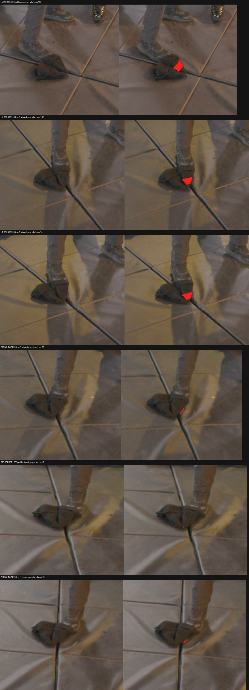
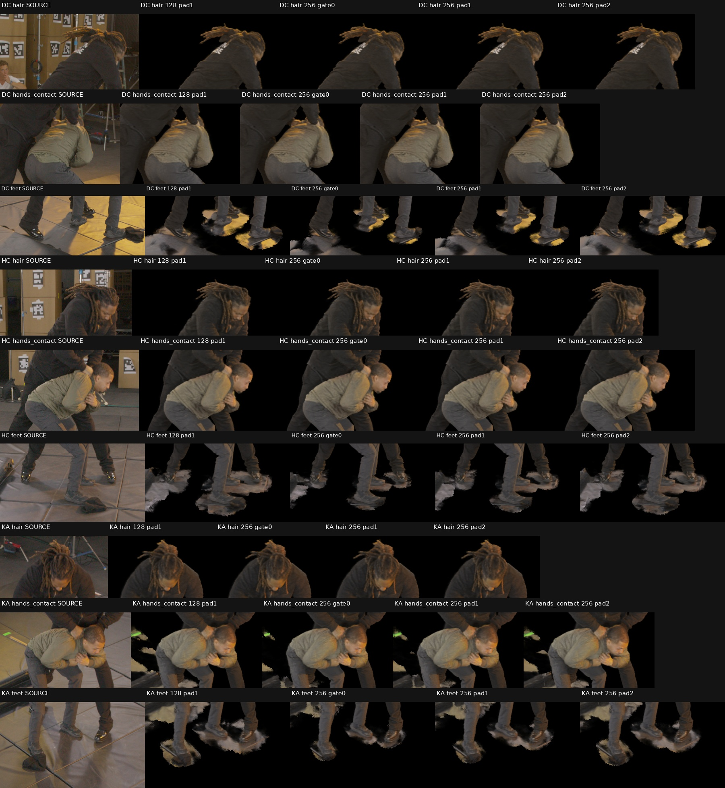

# Native semantic admission: 128³ versus 256³

## What was tested

A finer **separate semantic gate**, keeping the frozen native20k checkpoint, original native R1 occupancy, learned field normalization, accepted floor AABB, and all 63 corrected W64 partial-occlusion source archives unchanged. No field optimization, erosion, witness repair, or new mask annotation enters this factor.

The chunked builder first reproduced every original 128³ clear-vote count, gate0 cell, and pad1 cell with zero differences. It then classified 16,777,216 cells at 256³ using the same whole-cell projected-rectangle rule and two TRAIN clear-view votes. UNKNOWN regions, including the three fully unqualified views, retain their veto. Full 256³ construction took 163 seconds on dev3 CPU; no field was loaded.

At 256³ the cell extent is `[.00386719, .00246094, .00273438]` in floor-frame world units. Fresh pad1 therefore has half the physical extent of 128³ pad1. Optional fresh pad2, computed directly from gate0, matches the old pad1 axis extent. Neither operation changes native occupancy padding.

## Results

| Semantic variant | Admitted cells | Physical admission volume relative to 128³ counterpart | Qualified TRAIN ray misses | V1 PSNR | V1 SSIM | V1 LPIPS |
|---|---:|---:|---:|---:|---:|---:|
| 128³ gate0 | 78,056 | 100% | 528 | 28.90769 | .818727 | .064683 |
| 128³ pad1 | 105,049 | 100% | 0 | 29.12826 | .820339 | .064052 |
| 256³ gate0 | 563,071 | 90.17% of 128³ gate0 | 932 | 28.81931 | .818068 | .065001 |
| 256³ pad1 | 671,141 | 79.86% of 128³ pad1 | 507 | 28.92692 | .818939 | .064693 |
| 256³ pad2 | 777,364 | 92.50% of 128³ pad1 | 191 | 29.02982 | .819694 | .064480 |

The volume ratios compare world-space cell volumes, not raw counts. Admitted volume is a mask-derived hypothesis, not certified occupied or nonactor volume.

All 4,657,323 qualified TRAIN actor rays were audited with exact float64 voxel-plane intervals. All 256³ misses are grey-label rays; there are **zero black-label ray misses**, including at gate0. Both independently measured toe anchors remain admitted before any padding. This only proves point/cell membership and existence of a retained interval along a ray, not preservation of all actor surface or volume.

The 507 pad1 misses occur in IA187, LA142, LB141, MB20, MC2, NB15. The inspected TRAIN source overlays place them on the previously identified stationary bag fabric or rim, rather than visible black shoe tips. Tiny rim/contact pixels remain boundary-uncertain; these observations do not silently correct the frozen labels or certify all grey shoe volume.

Under the separately reviewed EVAL-v2 annotations, the metrics are:

| Variant | PSNR | SSIM | LPIPS |
|---|---:|---:|---:|
| 128³ pad1 | 29.17838 | .820786 | .063784 |
| 256³ gate0 | 28.90595 | .819047 | .064812 |
| 256³ pad1 | 28.99656 | .819666 | .064429 |
| 256³ pad2 | 29.08715 | .820254 | .064111 |

EVAL-v2 is used only for scoring. Original fixed crops, neutral exterior, full-HD float predictions, and equal actor/view weighting remain identical. [Complete V1/V2 scores](assets/marshawn_native_semantic256_20261106/metrics_v1_v2.json).

Mask-exterior opacity decreases, but considerable floor/mat remains. Pixel counts below measure alpha > .1 outside the EVAL-v2 actor union dilated by three HD pixels; they are not a certified nonactor segmentation.

| View | 128³ pad1 | 256³ gate0 | 256³ pad1 | 256³ pad2 |
|---|---:|---:|---:|---:|
| DC | 177,032 | 124,272 | 144,361 | 164,164 |
| HC | 85,622 | 59,914 | 70,040 | 79,201 |
| KA | 57,048 | 37,324 | 44,635 | 51,589 |

All three hair, hand/contact, and foot comparisons were visually inspected. Floor pads shrink at 256³, most visibly with gate0; the major actor details remain similar at this review scale. Subtle boundary changes and remaining foreground mat prevent an artifact-free claim. The finer grid has slightly worse masked scores, including when matching physical padding with pad2.

## Insights and next steps

Finer semantic resolution reduces conservative cell-footprint admission and padding width, but does not resolve the unbounded UNKNOWN-cone problem. This controlled candidate is **not promoted**. Local occluder depth/visibility qualification remains necessary to remove mat geometry safely.

The nominal floor/sole quantization argument needs the actual box origin: sole point 6862 is in 128³ z-cell13 `[.001094,.006563]`; nominal floor z=0 is cell12. They do not share one cell, although pad1 reaches the adjacent floor cell. Actual floor folds and localization uncertainty must not be replaced by a z=0 assumption. [Exact shoe indices and cell bounds](assets/marshawn_native_semantic256_20261106/toe_anchor_regression.json).

Reusable helpers: `scripts/build_marshawn_semantic_resolution.py`, `scripts/audit_marshawn_semantic_resolution_rays.py`, and the dimension-driven `scripts/render_marshawn_native_semantic_gate.py`. Packed depth tests, resolution lookup tests, flat-index cell bounds, the full 128³ reconstruction, and 40 independent CPU-DDA ray checks pass. The native model tensor digest is unchanged in every render receipt.

Durable experiment: `/fsx/tmp/marshawn_001660_hd/tuning_20261106/native_semantic_grid_20000/semantic_resolution256/`, including grid/source hashes, all renders and raw float buffers, fixed-crop scores, exact ray misses, and source review images. [Grid receipt](assets/marshawn_native_semantic256_20261106/grid_receipt.json) · [TRAIN ray receipt](assets/marshawn_native_semantic256_20261106/train_ray_receipt.json) · [Exterior opacity](assets/marshawn_native_semantic256_20261106/mask_exterior_tradeoff.json).
