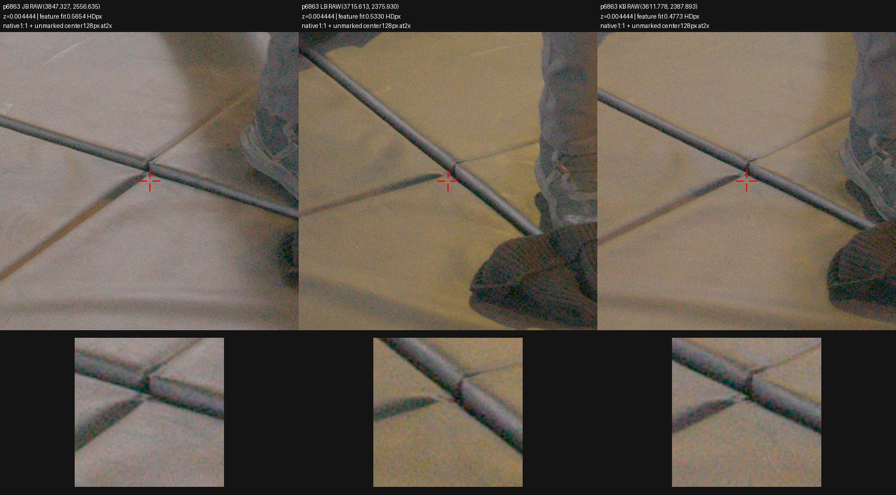
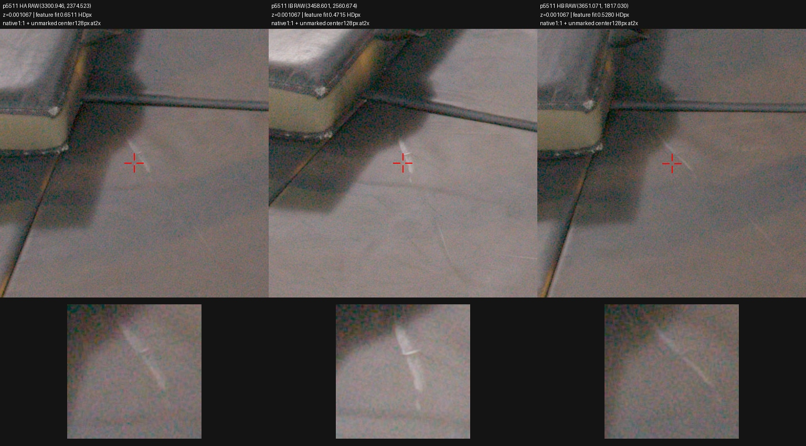

# TRAIN source review near measured shoe anchors

**What was tested.** The earlier accepted floor frame had no qualified floor point closer than0.348 world units to the two black-shoe anchors. This CPU-only investigation searched the existing9022 TRAIN SfM points for nearer floor-associated seams or texture. It recovered actual descriptor-connected feature tracks and examined original RAW crops. No EVAL image, model density, new correspondence, plane fit, training prior, or grid change was used.

The search recovered79/79 tracks within0.2XY of either shoe anchor and fitted Z between−0.05 and+0.025. The source archive has474 points within that XY radius at any height; its minimum Z there is−0.002418. Thus the lower search cut excluded no measured deep-negative witness. Absence of a feature track does not establish free space. Twenty point IDs were inspected in three RAW TRAIN views each, including duplicate-orientation points6307/6308 with byte-identical source patches. The rest of the79 candidates remain unclassified by this investigation.

**Results.** Two existing tracks provide clearer localized floor-associated material evidence. They improve the nearest qualified support distance to0.144888, but do not establish the surface beneath either foot.

| Existing point | Observed material | Nearest shoe XY distance | Fitted Z | Actual TRACK cameras | Maximum fitted residual, HD pixels |
|---|---|---:|---:|---|---:|
| 6863 | Floor-panel seam junction/edge | 0.144888 | +0.004444 | JA,JB,JC,KB,KC,LB | 0.796381 |
| 5511 | Pale scratch/crease or thin surface mark on a floor panel | 0.145002 | +0.001067 | HA,HB,IB | 0.651095 |

Point6863's RAW triplet was independently reviewed by root: it is a floor-panel seam/edge rather than actor, thick mat or bag. Its SIFT center lies near the seam-shadow boundary, so localization uncertainty remains. The six-source leave-one-view-out test moves XYZ by at most0.001007, with at most1.1385HDpx held-out reprojection error. Point5511 has only three actual observations; the original recovery helper does not report a leave-one-view-out test for three-view tracks.

Each top panel is a1:1 RAW-derived512px crop; the red marker labels the exact calibrated native array coordinate while leaving the central pixels untouched. Each lower panel magnifies the unmarked128px center2×. Actual detector coordinates, source feature IDs, RAW paths/hashes and original calibration bindings are retained in the review manifest. The fixed display transform is the same prior RAW source-review pipeline; it is not fitted to a prediction.

A fixed-camera linearization assuming independent0.5HDpx observation noise gives three-sigma Z localization0.001405 for6863 and0.003723 for5511. These are sensitivity diagnostics, not calibrated safety bounds: they exclude rig bias, scale-dependent SIFT centers, seam/shadow ambiguity, and floor-covering deformation. A thin surface mark need not lie exactly on the underlying panel surface.

**Closer candidates remain uncertain.** Points6307/6308 lie only0.02090XY from the upper-toe anchor, but encode floor/shadow/shoe-contact context rather than a sharply identified floor texture. Points1515 and941, at0.05280 and0.07477, similarly lie in cast-shadow structure. Points1015 and7866 appear near a seam in overview, but exact RAW markers land on shadow-edge/seam adjacency; they were not promoted to hard floor depth. Other closer candidates land on actual actor shoes:3729 is the black toe/rim, while2996 and348 are the grey shoe heel. They must not become floor labels. Point6873 has fitted Z−0.002418 on exposed floor appearance, but its center lacks a clearly localized physical feature in these crops and remains uncertain. No reviewed point certifies a real floor fold at Z≈−0.04 or−0.069, where some traced model fragments occur; this is a lack of local support, not proof of emptiness.

**Insight.** The original global plane had unnecessarily sparse local review, and existing TRAIN feature tracks improve that evidence. However, two localized panel features cannot define a plane, an opaque floor volume, or its visibility beneath shoes, bags and the mat. They support checking a few actual TRAIN rays against local measured depths before considering any intervention. A future manually triangulated candidate could use the visible panel-seam junction near point1015's context in BC/EB/CA, preserving the same physical crossing rather than its SIFT shadow center; no new pixel correspondence or triangulation was fitted here.

[Material review with actual observations and uncertainty labels](assets/marshawn_nearfoot_floor_20261107/material_review.json), [localization sensitivity](assets/marshawn_nearfoot_floor_20261107/localization_diagnostic.json). Durable complete evidence is `O/documentation/nearfoot_floor_search_v1/{recovered_candidates,new_raw_review,exact_markers}`, where `O=/fsx/tmp/marshawn_001660_hd/tuning_20261106/native_resolution_pair_100000`. All20 triplets and their RAW source bindings remain there. Reusable helpers: [track discovery](../scripts/discover_marshawn_nearfoot_floor.py), [RAW triplet review](../scripts/review_marshawn_nearfoot_floor.py), [localization diagnostic](../scripts/audit_marshawn_floor_candidate_localization.py). Native paired training continued without GPU contention.
