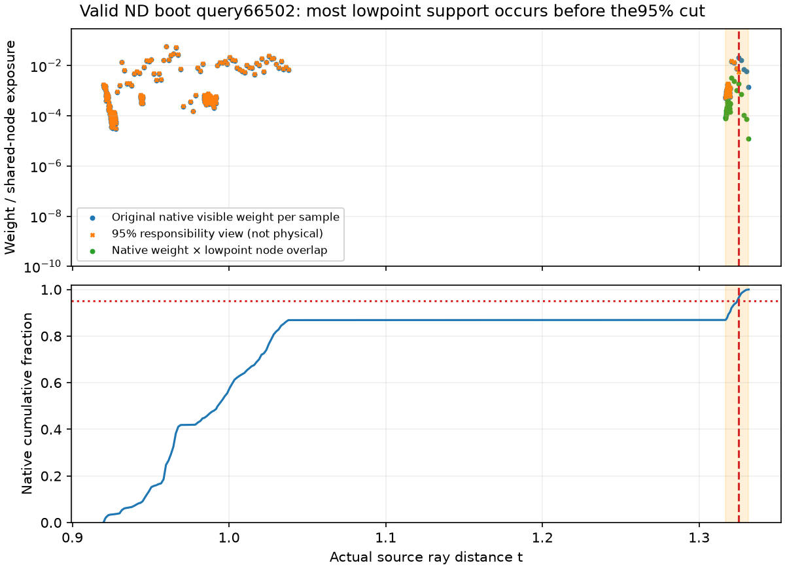
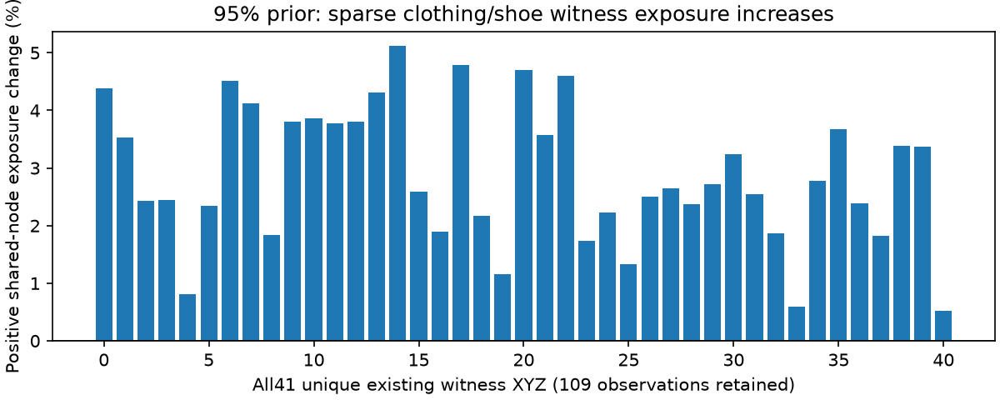

# Positive-only95% visible-prefix responsibility prior

## What was tested

CPU-only weight-view proposal: on class1 rays with nonzero confidence, retain the first95% of cumulative **native visible weight**, including a fractional boundary sample, then multiply retained weights by originalA/retainedA. Class0 and four UNKNOWN rays are unchanged. All69,888 query identities and fixed per-camera objective denominators remain present.

This is an explicit **front-depth responsibility prior** for possible semantic learning. It is not actor depth GT, optical opacity, a negative tail label, or a change to native sigma/weights/physical rendering. No head was trained, fitter prepared or GPU launched.

## Results

**Do not advance this95% prior.** It removes little dominant lowpoint support while increasing bag-point support. Root accepted that decision and requested no additional prefix scans or fitter preparation.

| Diagnostic point | Positive objective-normalized shared-node exposure, before→after | Change |
|---|---|---:|
| Isolated lowpoint | 2.157290e−7→1.955475e−7 | −9.355% |
| Exact DC bag sample22 | 8.228466e−6→8.516837e−6 | +3.505% |

Negative exposure is exactly unchanged. These quantities measure native-weighted interpolation-node overlap, normalized by original camera/ray counts; they are not class gradients, trained probabilities or evidence of optimizer causality. Analysis retains the existing four-UNKNOWN overlay; original caches remain byte-identical.

The isolated point is R0 cell[71,91,1]'s operational FP32 center XYZ[−.2869921625,.2403515577,−.0617968664], classifier p≈.952743. Direct native sigma at that center was unavailable; its support comes from actual captured TRAIN samples sharing its interpolation nodes. The DC point is the exact retained native sample22 from the earlier contact diagnostic.

ND66502, a root-qualified valid boot query, dominates lowpoint support: its raw exposure changes .01654833→.01501805. The tiny ND66496/66665 contributions become unsupervised, but most ND66502 support already occurs **before** the95% cut. Its lowpoint support begins near nativeCDF.8693; median lowpoint exposure occurs atCDF.9213 and distance1.320736, before the95% boundary at1.325423. The valid boot target/confidence remains1.

ND66502 nativeA=.921272, with279 samples and no cap hit. Query GT RGB≈[.8706,.6941,.2510], native RGB≈[.8764,.6947,.2507], removed-tail mean sample RGB≈[1,1,.9942]. These colors and source distances diagnose the captured representation; they do not locate physical footwear or certify hidden material. [All three ND depth/color profiles](assets/marshawn_positive_tail95_responsibility_20261107/ND_lowpoint_tail_depth_details.json), [complete diagnostics](assets/marshawn_positive_tail95_responsibility_20261107/report.json).

All30,716 active positive rays are affected. The view withholds1521.795702 weight units, exactly5% of their30435.914035 nativeA total, then restores that total by rescaling. There are30,716 fractional boundary samples. The6,374,156 positive tail samples assigned zero *learning responsibility* remain in the untouched physical cache; they are not negatives or empty space.

Conservation checks preserve each ray'sA within1.56e−15 in FP64, keep every negative/UNKNOWN weight unchanged, and preserve per-ray constant-probability class masses and the fixedN objective. A constant restricted to the accepted box can behave differently, so native geometric capacity and derived responsibility inside-mass were checked separately.

All136 original capacity-cohort identities/targets remain present, without filtering. Their actual LC native capacity ratios are all1; the derived inside ratios differ by at most1.56e−15. The cohort originated from an earlier NGP capacity diagnostic; these LC numbers do not replace that source evidence or certify entire silhouettes. [All136 cases](assets/marshawn_positive_tail95_responsibility_20261107/capacity136.csv).

All109 existing clothing/shoe observations, representing41 distinct XYZ, remain present. Positive shared-node exposure increases at every unique XYZ: ratios1.00515–1.05115. Sparse support therefore shows no measured loss here, but it does not certify fine hair, partial coverage or multilayer surfaces.

## Insights

The95% cutoff does not isolate the dominant lowpoint contribution; rescaling strengthens surviving front support, including the DC bag point. Stop this branch. [Root negative decision](assets/marshawn_positive_tail95_responsibility_20261107/root_negative_decision.json), [conservation and immutability validation](assets/marshawn_positive_tail95_responsibility_20261107/validation.json).

The isolated point is below the fitted floor plane in the accepted coordinate frame: z≈−.061797 and the fitted plane is exactly z=0; the floor fit's maximum residual is .004637 prepared units. That residual is not a local uncertainty bound or physical-empty-space certificate. A correct source boot label can still supervise incorrect geometry or contributions. No floor clipping, AABB edit or boot relabeling follows. [Exact floor-coordinate binding](assets/marshawn_positive_tail95_responsibility_20261107/floor_coordinate_note.json).

Replay: [CPU audit helper](../scripts/audit_marshawn_positive_tail_responsibility_cpu.py). Artifacts: `C/positive_native_tail95_responsibility_CPU_v2`, where `C=/fsx/tmp/marshawn_001660_hd/tuning_20261106`. Report SHA`8933173f1944dff516a0e9978d7ae393644173b247ed4b963faccb94261e8183`. Original source caches, labels, masks, heads, RGB, density and physical rendering remain unchanged.
