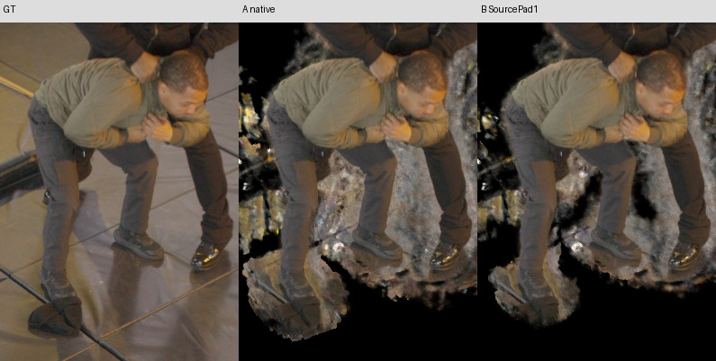
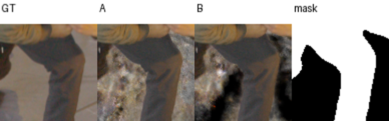
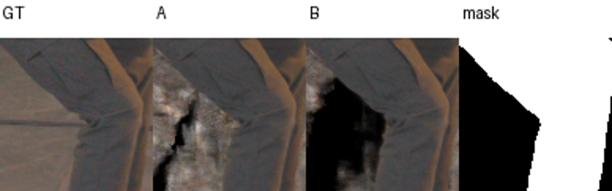

# Source-coordinate density admission on mature quarter-step + distortion .1

## What was tested

Read-only A / all-ones identity / B / restored A on the completed raw-LPIPS-min checkpoint126316, SHA `340e794ed8ea1cc656f246998941ddc9dee9d3a4244ee64952f2652ce35cd641`. The trained configuration remains semantic R0/W64, coarse step .0015625, native cap1024, final distortion .1, original global frequency updates, actual FR.3. B applies the previously qualified source-coordinate SourcePad1 selector to density. Native whole-cell traversal admission, learned core, EMA, active grid, weights and every other field parameter remain unchanged. No training occurred.

The bounded exclusive GPU1 replay completed in366s, peak2590MiB. Physical UUID matched the controller lease. All seven serialized states, global/private RNG and nonpersistent feature LUT were preserved/restored. Identity and restored native arrays were bitwise equal; full-resolution renders passed the established one-code/fraction tolerance. Dense16384 samples on all160 rays proved identical admitted density and exactly zero excluded density. These are implementation checks, not a physical free-space certificate.

## Results

| Fixed actor metric | A original | B SourcePad1 |
|---|---:|---:|
| PSNR |31.639727|31.453256|
| SSIM |.831264|.830931|
| LPIPS |.01877317|.01963302|

Mean LPIPS worsens4.58%. HC-grey worsens11.48%, KA-grey24.81% (KA-grey PSNR−1.458dB); DC-grey and HC/KA-black improve slightly. Six full body contacts were inspected manually. B visibly removes outer head/torso/floor components, while substantial floor/bag material remains.

| Exterior pixels with alpha>.1, >16HD pixels from fixed actor union | A | B |
|---|---:|---:|
| DC |118260|75535|
| HC |79892|47821|
| KA |54994|34706|

This exterior diagnostic does not declare every exterior pixel physically empty. The score regression is concentrated near actor contours:99.85% of positive RGB8 squared-error increment on HC-grey and97.24% on KA-grey lies within8pixels inside the sealed mask. Worst-pixel patches show the inner leg/knee boundary, not broad garment-interior holes. No contour or mask was changed to improve the score.

On the103 predeclared TRAIN clothing rays, mean original-renderer weight in ±.02 of measured depth remains93.4389% /91.3106% /99.9605% for old18/old8reserve/new9reserve; new66 changes97.1285→97.4809%. No native cap hits occur. These historical group names do not imply these cold models fitted the sparse priors. The inherited5568 hair/chest ambiguity remains; a wide depth band is not proof of an exact surface.

All six qualified TRAIN shoe rays retain native opacity within3.34e-5, with maximum RGB channel change.001761. This sparse check does not certify the entire foot/hair contour. Among twelve fixed EVAL artifact rays, head DC[850,85] opacity1→0, floor DC[865,555] .13216→0, remote DC[600,845] .18044→.02236; several other residual rays are unchanged. EVAL rays are diagnostic only.

## Insights

The extra density admitted by the mapped whole-cell cover causes part of the visible exterior clutter on this mature model. Removing it directly also changes actor contour appearance enough to worsen the fixed metric. This inference-only edit is not promoted as an asset fix or silently installed in any producer. A separately controlled training experiment could adapt contours, but the current result does not establish that it will preserve hair/feet or improve quality. Background RGB confidence and known bag positives are independent factors and remained unchanged here.

Full immutable receipts, four phases, all160 native/dense traces, source hashes and pixel diagnostics: `/fsx/tmp/marshawn_001660_hd/tuning_20261106/independent_occupancy/quarter_distortion_sourcepoint_counterfactual_v1`. Compact receipts and manually inspected patches are retained in [the evidence directory](assets/marshawn_quarter_distortion_sourcepoint_20261107/manifest.json). The CPU quarterτ continuation technical verifier is separate from this replay.
