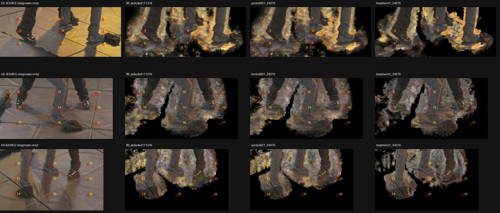

# Read-only signed-height probe of near-foot LC contributions

**What was tested.** The model's original packed-renderer weights were partitioned by signed Z in the accepted floor coordinate frame, without changing density, traversal, transmittance, masks, or checkpoints. The scope was 27 predeclared pixels on a fixed3×3 pattern in each DC/HC/KA foot crop, plus six actual TRAIN observations of two measured black-shoe points. These33 rays were evaluated on selected semantic R0@111316 and the matched λ0.01/λ1@34376 checkpoints. Only the two34376 checkpoints isolate the distortion factor. EVAL pixels are diagnostic observations, never geometry-fitting inputs.

**Results.** The small probe passed all six model/split phases in159.3s, using at most1758MiB on an idle exclusive silver GPU2. It performed zero optimizer updates. The native HD/4K producer continued separately on dev3. All frozen inputs were checked before and after execution.

| Verification across99 model/ray pairs | Maximum error |
|---|---:|
| Reconstructed alpha versus original renderer accumulation | 5.71e-7 |
| Original weighted RGB versus original renderer RGB | 6.93e-7 |
| EVAL float RGB versus archived RGB PNG, in byte units | 0.499874 |
| Per-sample partitioned weight versus original weight | 0 |
| Sum of binned RGB versus original weighted RGB | 4.44e-16 |
| Analytic FP64 reference weight versus original weight, diagnostic only | 8.43e-8 |

Archived PNGs contain RGB only. Alpha parity uses the original renderer's recorded accumulation, not an invented alpha channel. Original `actual_weights` remain authoritative. Stable constant-density interval fractions split each weight across cuts; the separate FP64 reference integration is never substituted for the renderer's weights.

Rows are DC, HC and KA. Columns are source, R0@111316, λ0.01@34376 and λ1@34376. Numbered pixels were selected before these traces. Their crop membership does not label them as actor, floor, mat or bag. The image shows persistent near-foot fragments even where stronger distortion has removed some surrounding haze.

The table reports **absolute termination mass**, not a percent of scene area. Z is the fitted coordinate, not established height above the actual local floor.

| Diagnostic pixel | Matched model | Total alpha | Mass Z<−0.015 | Mass within±0.015 | Mass Z>+0.015 |
|---|---|---:|---:|---:|---:|
| DC(930,557), #4 | λ0.01 | 0.862332 | 0.094200 | 0.757646 | 0.010486 |
| same | λ1 | 0.644923 | 0.001601 | 0.643322 | 0 |
| HC(1195,655), #14 | λ0.01 | 0.986832 | 0 | 0.958965 | 0.027867 |
| same | λ1 | 0.345054 | 0 | 0.345054 | 0 |
| HC(917,708), #15 | λ0.01 | 0.207562 | 0.207562 | 0 | 0 |
| same | λ1 | 0 | 0 | 0 | 0 |
| KA(918,392), #18 | λ0.01 | 0.925102 | 0.665785 | 0.259317 | 0 |
| same | λ1 | 0.022761 | 0 | 0.022761 | 0 |
| KA(1173,446), #23 | λ0.01 | 0.839834 | 0 | 0.839834 | 0 |
| same | λ1 | 0.043324 | 0 | 0.043324 | 0 |

R0@111316 also has deep-negative mass at HC#15 (alpha0.294293, median sample Z≈−0.06870) and KA#18 (alpha0.908829,82.28% below−0.015, median≈−0.03998). These locations explain some visible low fragments. The matchedλ1 run removes these tails, while DC#4 and HC#14 retain appreciable opacity near the fitted plane. Many other sampled fragments are above+0.015. The residual is therefore not solely below-plane density.

The six TRAIN controls cover the existing three-view upper-toe point and actual SIFT point6862 on the sole. Their λ1 alpha ranges0.9949–1.0000. Upper-toe weighted median sample Z is0.01409–0.01491 versus measured point Z0.014568; sole medians are0.00532–0.00559 versus measured point Z0.005085. These are localized controls, not proof of complete foot volume or every boundary's opacity. Signed-height agreement alone also does not certify full depth along a ray.

**Limits and next steps.** These27 EVAL pixels are a sparse diagnostic, not an area-weighted estimate of all floor artifacts. The fitted-floor audit has maximum leave-one-out residual0.012788 and sparse original local support. The±0.015 cuts are coordinate sensitivity bins, not empty-space thresholds. A global plane clamp is neither established as safe nor sufficient to remove the observed fragments. Newly identified TRAIN floor-panel texture/seam candidates are being reviewed separately; no new geometry or mask was fitted here. Bounded native-resolution crop maps require a separate streaming implementation and release; this probe did not dump every crop ray.

The first generation failed after its first trace because the frozen model's script path shadowed the instrumented probe helper. It preserved its failure and traces. Generation2 explicitly loads the helper by absolute path and records the actually imported helper paths/hashes before model tracing; the controller verifies those bindings. No parity tolerance was relaxed. Both generations remain intact.

Reproducibility: [summary and all99 ray rows](assets/marshawn_signed_floor_probe_20261106/summary.json), [compact CSV](assets/marshawn_signed_floor_probe_20261106/rays.csv), [completion receipt](assets/marshawn_signed_floor_probe_20261106/complete.json). Helpers: [weight partition](../scripts/marshawn_signed_height_bins.py), [trace executor](../scripts/run_marshawn_floor_trace_probe.py), [immutable staging](../scripts/prepare_marshawn_floor_trace_probe.py), [CPU review](../scripts/summarize_marshawn_floor_trace.py). Eight numerical edge-case tests passed, plus an independent103-clothing-profile numeric replay.

Durable source: `SC/independent_occupancy/signed_floor_contribution_v2`, where `SC=/home/ubuntu/lookcloser/campaigns/marshawn_tuning_20261106` on silver. Exact plan SHA256 `238201ad0586e5bdd14fcbfb80689d832d3d06b5d8684743b31ac2f0483478dc`; completion SHA256 `278fbaa6f270bf616a164e4ef174ae30d0d3ecc2e79dbc8b413ee5067590c161`. Each trace includes checkpoint/core/coordinate and actual-import receipts, exact original native profiles, accumulation parity, and height bins. No architecture or optimization change was made.
