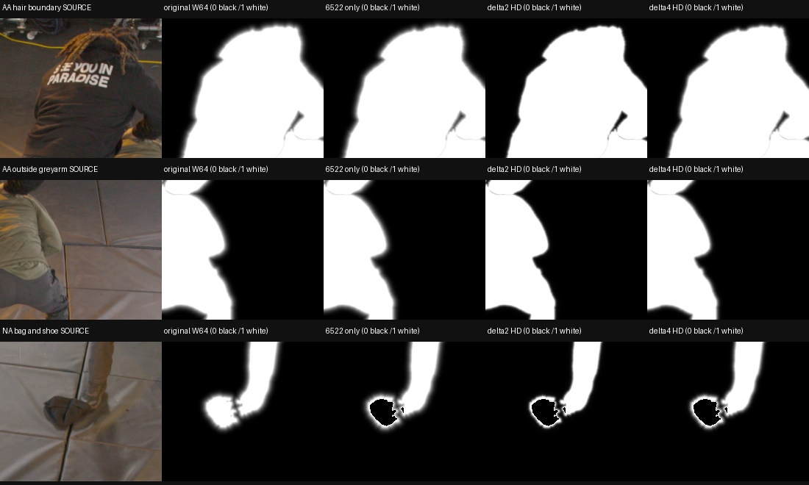
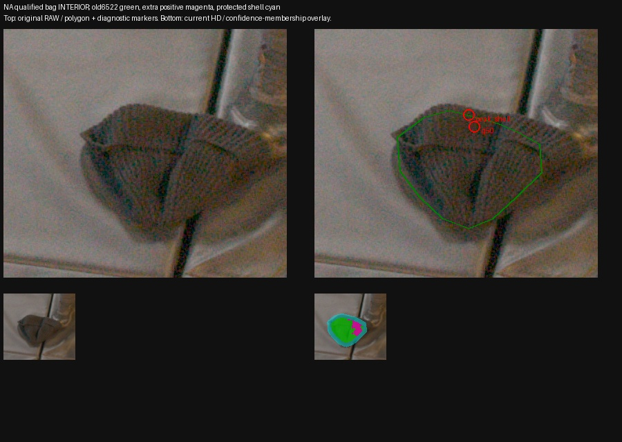
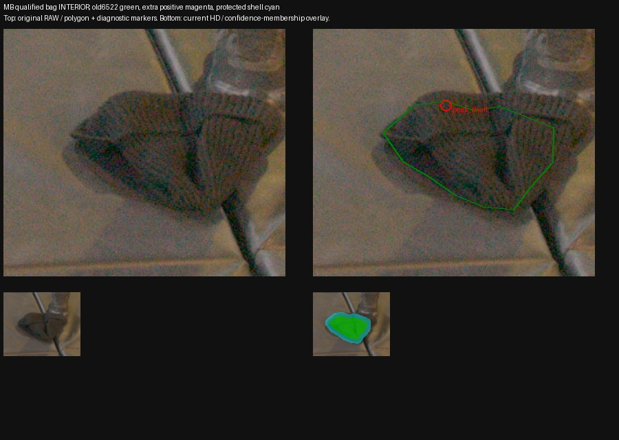

# Marshawn soft RGB weights and qualified bag interiors

**What was tested.** CPU-only feasibility of two continuous outside-mask RGB-confidence profiles on all63 TRAIN cameras at frame1660. Current mainW64 is the baseline; every tested repaired treatment includes the existing exact6522-pixel bag correction. Poses, images, raw masks, morphological sampling pools, FAS, RNG and density admission remain unchanged. No training, segmentation, rendering or production-source modification was performed. A separate source review checks whether the bag correction unnecessarily excludes already-qualified interior pixels whose current grey label is false.

**Results: outside profiles.** The original builder uses `(max(1−d_RAW/64,0))^3.321928`, giving.1 at32RAW pixels. Thus W64 describes64RAW pixels, approximately15HD pixels, rather than64HD pixels. The tuning sampler independently closes/fills the HD core with a17-pixel kernel and constructs33/65-pixel protective bands. These morphological pools can include background. They control sampling; confidence still weights the RGB objective once.

The proposed multiplier is

`mδ(d_out) = .1 + .9 exp(−d_out² / (2δ²))`, with δ=2 or4HD-equivalent pixels.

Distances use the original RAW nominal union, including reviewed add-only hair and source vetoes. RAW signed EDT uses anisotropic spacing `(1012/4320,1920/8192)`; the exact calibrated centre map samples this field into1920×1012, then `d_out=max(0,signed_distance)`. This gives a continuous level-set boundary with multiplier1 inside. δ2 corresponds to about8.53RAW pixels, δ4 to17.07RAW pixels. Distances are not computed from a blurred or morphologically closed HD mask. The effective weight is originalW64×multiplier, followed by the exact6522 RGB zeros.

| Outside distance, HD | δ2 multiplier | δ4 multiplier |
|---:|---:|---:|
| 0 | 1 | 1 |
| 1 | .8942 | .9723 |
| 2 | .6459 | .8942 |
| 4 | .2218 | .6459 |
| 8 | .1003 | .2218 |

| TRAIN measure | Original | 6522 only | 6522+δ2 | 6522+δ4 |
|---|---:|---:|---:|---:|
| Sum of confidence outside RAW union | 477866.67 | 477862.85 | 275876.42 | 375294.01 |
| Outside reduction versus6522 only | — | — | 42.27% | 21.46% |
| Outside share of normalized RGB objective, full FAS | 3.6170% | 3.6209% | 2.2071% | 2.9138% |
| Exact `E_q[w]`, step≥8192,4096 rays | .689319944 | .688576485 | .678621394 | .683561577 |
| Unchanged inside-pixel RGB-gradient scale versus original | 1 | 1.001080 | 1.015765 | 1.008424 |

The normalizer is the exact camera-uniform expectation under unchanged core-uniform/person-FAS/protective-band/valid-image quotas, including per-level/per-cell FAS means and original fallback rules. It is not a drawn-batch mean. An independent NumPy reconstruction reproduces the prior actual original/6522 adapter normalizers within4e−16. The actual frozen63-camera CPU adapter passes20 phases: four treatments at steps0,4096,6144,8192,111316. Indices and main RNG are identical, confidence installation consumes no RNG, pool/label/FAS/source-array hashes stay exact, normalizers agree within1e−12, and synthetic RGB gradients match single weighting divided by the analytic normalizer. No neural model, optimizer or GPU was created.

At the inspected background pixel AA(1195,316), outside the grey arm, W64.133118 becomes.013645/ .040818 forδ2/δ4. The AA hair-halo background pixel(1003,154) changes.016988→.001699/.002134. These reduce positive background supervision without labelling either ray physically empty.

Inside the RAW hard-union level set, all unqualified-bag weights remain bit-exact.12005 centre samples of reviewed add-only hair have summed weight11688.7885→11688.7264/11688.7730: reductions.000532%/.000133%. The three legacy5568 observations retain W=1; they are mixed hair-boundary evidence, not fine-alpha truth. Signed-level-set versus nearest-RAW-mask membership differs at2741 boundary pixels across all63 images; the tiny hair change arises at these resampling boundaries. Unsegmented hair outside the hard union is attenuated and requires visual validation. One frame establishes neither temporal flicker nor its improvement.

**Measured limitation.** NA(1037,641), on the bag, is only.27191HD outside the RAW level set. Its current weight.944994 survives6522-only and becomes.937170/.943031 withδ2/δ4. Both proposed fades therefore fail to noticeably suppress this particular near-boundary bag pixel. A continuous multiplier with `m(0)=1` naturally remains near1 immediately outside the boundary. Sharper fades are not a substitute for using the existing nonactor qualification correctly.

**Results: a narrower bag RGB fix.** The existing source qualification is explicitly class-independent visible *bag interior*: manually reviewed RAW polygons,2RAW-pixel erosion, calibrated area-remap coverage≥.99. A16RAW-pixel surrounding/contact shell remains UNKNOWN. Its independent six-view RAW review and MC/NA temporal evidence identify a stationary cloth bag while the shoe leaves. The current RGB repair unnecessarily intersects that interior with `original_grey`.

| Existing qualified view | Interior pixels | Old grey-only zeros | Additional positive pixels | Additional summed W64 |
|---|---:|---:|---:|---:|
| MA | 1388 | 1388 | 0 | 0 |
| MB | 1229 | 1229 | 0 | 0 |
| MC | 1185 | 1057 | 128 | 97.19981 |
| NA | 1154 | 930 | 224 | 136.71844 |
| NB | 1141 | 1141 | 0 | 0 |
| ND | 777 | 777 | 0 | 0 |
| Total | 6874 | 6522 | 352 | 233.91825 |

All352 additional pixels have positive W64(.23114–.96594), are inside the existing frozen qualified interior, overlap no protected shell, black actor, grey actor or nominal actor pixel, and all belong to the morphological core sampling pool. None of the109 existing TRAIN actor controls intersects these interiors or shells. Source inspection confirms the additional MC/NA regions remain on bag fabric, not the visible shoe/contact boundary.

Using **all already-qualified interior positive pixels**, rather than `interior & grey`, would set NAq50 W.944994→0 without expanding a polygon. MBpeak(1046,652) remains1 and NApeak(1035,637) remains.99983585 because both are in the protected UNKNOWN shell. The exact full-FAS normalizer would be.688559449, versus.688576485 for6522-only. This is a narrow RGB-ignore proposal, not a new segmentation, density carve or physical-empty label.

The frozen exclusion/shell arrays remain authoritative and unchanged. Replaying their RAW rasterization with current OpenCV4.13 differs at8 threshold-edge pixels across six views; none overlaps the extra352. No masks were regenerated. The report retains those replay differences instead of silently replacing the qualified arrays.

**Insights and next step.** First review the class-independent6874-interior RGB repair: it directly fixes the demonstrated NA residual while preserving every protected shell. Keep its policy and normalizer distinct from the approved6522 resume binding. Theδ2/δ4 profiles remain separate objective candidates;δ2 measurably suppresses distant positive background more strongly, but neither establishes rendered quality, every hair boundary, temporal stability or global halo removal. General W0 and known nonactor surfaces still provide no whole-ray empty-space supervision; floor/mat/crew occlusion uncertainty is unchanged. No recipe is approved or launched by this investigation.

Evidence: [all63 source/profile hashes and statistics](assets/marshawn_soft_rgb_profiles_20261107/summary.json), [normalizers, source pixels and hair controls](assets/marshawn_soft_rgb_profiles_20261107/analysis.json), [actual CPU adapter proof](assets/marshawn_soft_rgb_profiles_20261107/actual_adapter_CPU.json), [proposal-weighted outside contribution](assets/marshawn_soft_rgb_profiles_20261107/sampled_outside_weight.json), [six-view bag review and exact overlaps](assets/marshawn_soft_rgb_profiles_20261107/bag_interior_review.json), additional RAW pages [MA](assets/marshawn_soft_rgb_profiles_20261107/MA_interior_review.jpg), [MC](assets/marshawn_soft_rgb_profiles_20261107/MC_interior_review.jpg), [NB](assets/marshawn_soft_rgb_profiles_20261107/NB_interior_review.jpg), [ND](assets/marshawn_soft_rgb_profiles_20261107/ND_interior_review.jpg).

Complete profile arrays and frequency bindings remain at `/fsx/tmp/marshawn_001660_hd/tuning_20261106/soft_rgb_band_profiles_CPU_v1`; actual adapter proof also resides at silver `SC/independent_occupancy/soft_rgb_band_CPU_v1`, where `SC=/cache/ubuntu/lookcloser/campaigns/marshawn_tuning_20261106`. Reusable helpers: [RAW profile calculation](../scripts/audit_marshawn_soft_rgb_profiles.py), [independent expectation analysis](../scripts/analyze_marshawn_soft_rgb_profiles.py), [actual CPU adapter check](../scripts/audit_marshawn_soft_rgb_adapter_cpu.py), [bag source review](../scripts/audit_marshawn_bag_interior_rgb_cpu.py).
