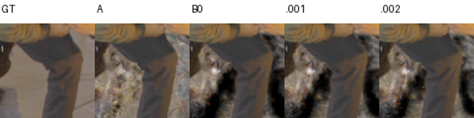
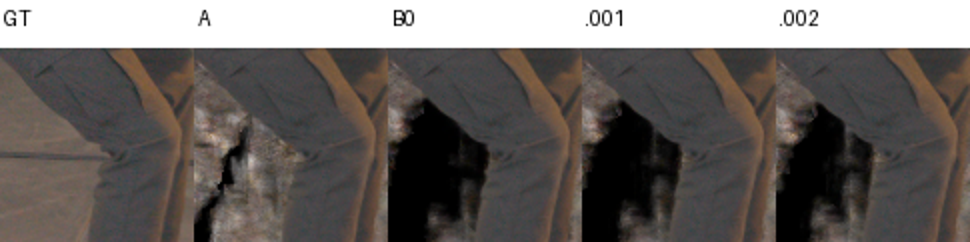
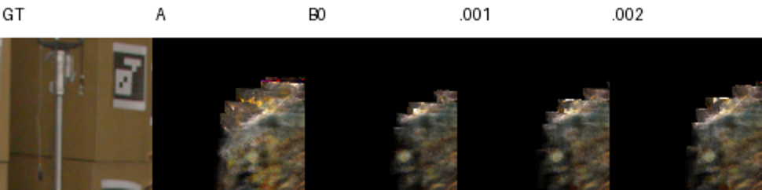

# Native SourcePad1 safety margins on the mature best checkpoint

## What was tested

Exact approved read-only replay of quarter-step/distortion .1 raw-min126316, SHA `340e794ed8ea1cc656f246998941ddc9dee9d3a4244ee64952f2652ce35cd641`. Native A/source-PNG identity, geometric L-infinity margins .001 and .002, then restored A. Each candidate renders all three FHD views. Nine predeclared EVAL diagnostic rays cover the problematic KA/HC grey contours and a DC head artifact. Zero-margin B0 is queried on these nine rays; its prior full-image results and all-ones identity proof are inherited by exact hash. No103/160-ray library was repeated.

Numerical epsilon remains2e-7 and is distinct from the geometric buffer. The wrapper uses the proven source-cell intersection, preserving outside-domain UNKNOWN semantics. Coarse traversal admission, native core/EMA/active grid, features, weights, frequency grid, actual FR.3 and legacycap1024 remain fixed. No optimizer, frequency or occupancy updates occurred. Source1495files and21artifacts were verified before launch.

The exclusive physical-UUID GPU1 replay passed in86.4s with2592MiB peak process memory. All seven states, global/private RNG, LUT and original field normalization were restored. Native arrays are bitwise equal before/after; full-resolution PNG/alpha/metric replay passes the existing tolerances. GPU lease released. Technical validity is not quality approval.

## Results

| Fixed actor metric | Original A | Zero margin B0 | .001 margin | .002 margin |
|---|---:|---:|---:|---:|
| PSNR |31.639727|31.453256|31.515261|31.563286|
| SSIM |.831264|.830931|.831121|.831244|
| LPIPS |.01877317|.01963302|.01941430|.01921371|
| LPIPS change vs A |—|+4.58%|+3.42%|+2.35%|

HC-grey LPIPS regression improves from11.48% at B0 to5.45% at .001 and1.50% at .002. KA-grey still regresses21.46% at .001 and16.93% at .002 (B0:24.81%). Thus .002 is the least damaging tested buffer, but it does not qualify as a safe cutoff. Black-actor HC/KA metrics improve slightly relative to A; the aggregate alone understates the KA-grey cost.

| Actual native ray opacity | A | B0 | .001 | .002 |
|---|---:|---:|---:|---:|
| KA[1028,331], grey inner knee |.96684|.54448|.55757|.56595|
| HC[1052,576], grey inner leg |.70138|.41927|.46538|.58168|
| DC[849,85], head artifact |1|0|0|0|
| DC[850,85], head artifact |1|0|0|0|
| DC[851,85], head artifact |1|0|0|0|

All six body contacts and three target patches were inspected manually. The larger buffer recovers some contour appearance, particularly HC, while the KA boundary remains darkened. Gross hair/shoe silhouettes remain visible, but this is not a complete fine-hair/foot retention certificate. Floor/bag components persist.

| >16HD-pixel exterior alpha>.1 count | A | .001 | .002 |
|---|---:|---:|---:|
| DC |118260|82549|90210|
| HC |79892|52522|57893|
| KA |54994|38278|42068|

These counts describe mask-exterior opacity, not certified empty space. The buffer returns some unwanted exterior density along with contour contributions.

Actual dense16384 queries confirm admitted density unchanged and excluded density exactlyzero for each margin. Native nine-ray sample counts stay below249; no cap saturation. Dense8192→16384 maximum RGB difference is .006903 for the original opaque head artifact and .000703 for the .002 candidate; the reference is therefore not declared exactly converged in head color. All tested margin head queries have exactlyzero density/opacity, and the primary reported ray changes above use actual native rendering.

## Insights

No tested inference-only selector achieves both full contour preservation and cleanup. .002 is a useful controlled adaptation candidate if a separate training experiment is authorized; the present result does not establish that adaptation will recover the missing KA contour. Increasing numerical epsilon silently or calling the original support physically empty would be incorrect. The independent RGB-confidence/bag-target repair should remain a separately attributable factor.

[Metrics and bound receipts](assets/marshawn_source_margin_native_20261107/manifest.json). Full source, arrays, resource checks and renders: `/fsx/tmp/marshawn_001660_hd/tuning_20261106/independent_occupancy/quarter_distortion_source_margin_v1`. Approved policy SHA `f2048f496461a3da34e950c488312b9a0583f441cf79ea2285afbeb55fa85f58`; root release SHA `4d881950b09b4b46b691e7bc2e206a60529399386359c505f7559e3e27244340`.
